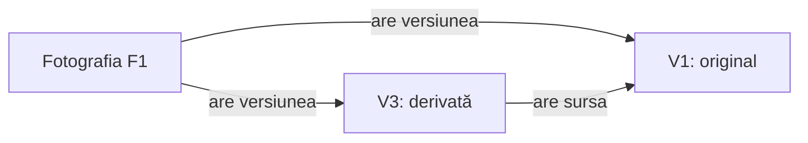

# Ce trebuie să distingem? {.transition}

Două descrieri identice înseamnă același lucru?

::: notes
Un model al domeniului ne ajută să explicăm stările cerute folosind concepte, identități și relații. Reluăm din cursul 3 legătura dintre o afirmație și regula care o susține.

**Organizare:** minutul 0 din 100; interval 0–10 (10 min), inclusiv coperta, citatul și discuția inițială. 30 de slide-uri cu tot cu copertă. []{.pace at=0 of=100}
:::

---

# Citatul zilei

> „**Model:** un sistem de abstractizări care descrie aspecte alese ale unui domeniu […]”
>
> Original: “**model:** A system of abstractions that describes selected aspects of a domain […]”

— **Eric Evans**

[Sursa: Domain-Driven Design Reference, Definitions, p. 6 (PDF)](https://www.domainlanguage.com/wp-content/uploads/2016/05/DDD_Reference_2015-03.pdf#page=6)

::: notes
„Selectate” contează: păstrăm distincțiile necesare întrebărilor noastre. Arhiva de azi urmărește fotografiile și proveniența editărilor, fără să modeleze algoritmul care schimbă pixelii.

**Sursă:** publicația autorului, Definitions, intrarea model, pagina PDF 6. Termenul definit este titlul intrării; îl redăm înaintea definiției, ca să se vadă pe slide ce se definește. Fragment păstrat din materialul anterior verificat în `docs/quotations.md`; finalul după domain este omis explicit.
:::

---

# Aceeași legendă, două fotografii

O arhivistă catalogează fotografii; fiecare intră în arhivă cu o **versiune originală**, iar editările produc alte versiuni. Versiunile sunt numerotate în toată arhiva, în ordinea creării:

| Fotografie | Legendă | Versiune originală |
|---|---|---|
| F1 | „Curte” | V1 |
| F2 | „Curte” | V2 |

**Regula convenită cu arhivista (beneficiarul):** legenda se poate schimba; fotografia își păstrează identificatorul.

**Scenariul S1:** schimbăm legenda lui F1 în „Dimineață”. **Ce se schimbă și ce rămâne?** Am putea folosi legenda pentru a identifica fotografia?

::: notes
Se schimbă numai legenda lui F1. F2 și identificatorii F1, F2, V1, V2 rămân aceiași. V2 este originalul lui F2, nu a doua versiune a lui F1: numărul este un identificator al arhivei, la fel ca F2, nu numără versiunile unei fotografii. Aceeași numerotare continuă cu V3 și V4 pentru F1, V5 propusă pentru F2. Legenda nu identifică fotografia: poate coincide și se poate schimba. Separăm ce spune enunțul de o presupunere despre identitatea imaginilor după conținut.

**Organizare:** 2 min: întrebare către clasă, așteptăm răspunsul. Datele sunt construite pentru curs. []{.pace dur=2}
:::

---

# Un model răspunde la întrebări

Un **model al domeniului** descrie conceptele relevante, relațiile dintre ele și regulile care le limitează.

Pentru arhiva noastră, modelul trebuie să răspundă la următoarele întrebări:

- Despre **care fotografie** vorbim, chiar dacă îi schimbăm legenda?
- **Ce versiuni** îi aparțin?
- **Din ce versiune** provine o versiune obținută prin editare?

Nu modelăm albume, drepturi de acces, ștergeri sau stocarea fișierelor.

::: notes
Aceste întrebări selectează conceptele utile. Modelul nu trebuie să reproducă toate proprietățile unei fotografii sau toate funcțiile unei arhive reale. Regulile și limitele sunt convenite în acest exemplu didactic, nu descoperite de un agent AI. În tipologia din cursul 3, R1–R5 sunt reguli ale domeniului: politica arhivei, valabilă cu sau fără sistem; R6 este o limită a exercițiului, nu o cerință.
:::

---

# Identitate și schimbare {.transition}

Ce rămâne același lucru atunci când îi schimbăm o proprietate?

::: notes
Identitatea se explică prin continuitatea pe care o cere domeniul. Un identificator o exprimă în exemplu, fără să alegem aici cum este generat sau stocat.

**Organizare:** minutul 10 din 100; interval 10–35 (25 min), inclusiv exercițiul despre editare. []{.pace at=10}
:::

---

# Identitatea nu este descrierea

**R1:** fiecare fotografie are un identificator stabil și o legendă modificabilă. Fotografii distincte pot avea aceeași legendă.

| Întrebare | Răspuns pentru F1 în S1 |
|---|---|
| „Care fotografie?” | F1, înainte și după schimbare. |
| „Ce legendă are?” | „Curte”, apoi „Dimineață”. |
| „A apărut o fotografie nouă?” | Nu, s-a schimbat doar legenda. |

**Identificatorul** și **atributul descriptiv** răspund la întrebări diferite. Nici textul egal, nici asemănarea vizuală nu stabilesc singure identitatea.

::: notes
Un atribut poate ajuta căutarea fără să fie identitatea. Evităm să transformăm exemplul într-o regulă universală conform căreia numele nu poate niciodată identifica ceva: aici imposibilitatea rezultă precis din R1.

Nici importul repetat al aceluiași fișier nu este convenit; nu deducem că ar crea o fotografie nouă sau că ar reutiliza una existentă. Revenim la el ca întrebare deschisă (S5).
:::

---

# Fotografia și versiunile ei

**R2:** fiecare versiune are identificator propriu și aparține exact unei fotografii.

**R3:** fiecare fotografie are exact o **versiune originală**, creată la catalogare (adăugarea fotografiei în arhivă). Originalul se păstrează și nu provine din altă versiune.

**Dedus din R3:** fiecare fotografie are cel puțin o versiune.

În arhiva noastră: F1 are originalul V1, iar F2 are originalul V2.

::: notes
Fotografia reprezintă continuitatea dintre editări; versiunea reprezintă un conținut păstrat. „Original” este rolul unei versiuni, nu neapărat un al treilea tip de obiect. „Cel puțin o versiune” nu este o regulă separată: rezultă din R3, pentru că originalul este o versiune.
:::

---

# Editarea creează o versiune nouă

**R4:** editarea oricărei versiuni existente creează o versiune nouă a aceleiași fotografii. Versiunea nouă este o **derivată**; versiunea editată este **sursa** ei. Fiecare derivată are exact o sursă, din aceeași fotografie.

**R5:** editarea păstrează legenda fotografiei și, pentru versiunile existente, conținutul, identitatea, apartenența și sursa. Schimbarea legendei nu modifică versiunile. Operațiile se execută pe rând.

::: notes
„Derivată” și „sursă” sunt roluri în relația de editare: aceeași versiune poate fi derivata uneia și sursa alteia. Sursa trebuie să existe înaintea noii versiuni. Executarea operațiilor pe rând ne scutește aici de întrebările despre editări simultane.
:::

---

# După prima editare

**Pornim din nou din starea inițială, independent de S1:** fotografia F1, legenda „Curte”, originalul V1.

**Scenariul S2:** din V1 se creează, prin editare, versiunea V3.

**Reguli (R2, R4–R5):** versiunea nouă are identitate proprie, aparține aceleiași fotografii și are ca sursă versiunea editată. Editarea păstrează conținutul versiunilor existente și legenda.

În pereche, schițați starea de după editare. Arătați **ce s-a adăugat**, **ce asociere a apărut** și **ce s-a păstrat**. Apoi comparați cu perechea vecină.

::: notes
Așteptăm aceeași fotografie F1, acum cu V1 și V3; sursa lui V3 este V1. Conținutul lui V1 și legenda „Curte” rămân. O simplă săgeată este suficientă; nu cerem clase, metode sau o notație UML.

**Organizare:** 8 min: 3 schiță în pereche, 3 comparație cu altă pereche, 2 discuție. []{.pace dur=8}
:::

---

# Editarea adaugă, nu suprascrie

| Element | Înainte | După |
|---|---|---|
| Fotografie | F1, „Curte” | F1, „Curte” |
| Original | V1 | V1, păstrat |
| Versiune derivată | — | V3, aparține lui F1 |
| Sursa lui V3 | — | V1 |

**Concluzie:** F1 are acum două versiuni. Identitatea sa, legenda și conținutul lui V1 se păstrează; V3 are sursa V1.

::: notes
Acesta este răspunsul de referință construit de profesor din R2–R5, nu o captură AI. Se adaugă două relații: V3 aparține lui F1 și are sursa V1. Nu spunem că „nimic din ce exista nu se schimbă”: F1 are acum încă o versiune, iar V1 este și sursă pentru V3. Se păstrează faptele existente despre identitate, legendă, conținut, apartenență și sursă.
:::

---

# Relațiile au reguli {.transition}

Ce stări permite schița noastră și ce stări exclude?

::: notes
Numele conceptelor nu sunt suficiente. Numărul permis de asocieri și restricțiile dintre ele decid ce stări poate exprima modelul.

**Organizare:** minutul 35 din 100; interval 35–60 (25 min), inclusiv construirea și compararea ramurilor de editare. []{.pace at=35}
:::

---

# Un vocabular comun

| Termen | Sensul în acest domeniu |
|---|---|
| Fotografie | Element al arhivei, cu identificator stabil, care își reunește versiunile. |
| Legendă | Text modificabil al fotografiei. |
| Versiune | Conținut păstrat, cu identitate proprie. |
| Original | Unica versiune creată la catalogare, fără sursă. |
| Derivată | Versiune creată prin editarea altei versiuni. |
| Sursă | Versiunea existentă din care a fost creată o derivată. |

**Verificare:** „am schimbat fotografia” este suficient de precis?

::: notes
Nu: poate însemna schimbarea legendei sau crearea unei versiuni. Cerem reformularea cu termenii din tabel. Vocabularul devine util când separă operații cu efecte diferite, nu doar când enumeră substantive.
:::

---

# Două relații diferite



**Apartenența** spune ale cui sunt versiunile. **Sursa** spune din ce versiune provine o derivată.

Săgețile arată relațiile numite pe ele; nu reprezintă ordinea execuției.

::: notes
Aceasta este o diagramă a unui exemplu concret, starea de după S2, nu modelul complet: toate nodurile sunt identificate. S3 pornește din această stare; apoi generalizăm câte asocieri sunt permise. O singură diagramă fără reguli nu ar exclude, de exemplu, două originale pentru F1.
:::

---

# Putem edita din nou originalul?

F1 are originalul **V1** și derivata **V3**, creată din V1 (S2).

**R4:** orice versiune existentă poate fi editată; versiunea nouă aparține aceleiași fotografii și are ca sursă versiunea editată. **R5:** versiunile existente se păstrează.

**Scenariul S3:** edităm din nou V1 și obținem V4.

Individual, apoi în pereche:

1. Desenați relațiile de sursă după S3. De ce V4 nu are sursa V3?
2. Cum ar trata S3 un model care permite numai editarea ultimei versiuni? Ce regulă îl contrazice?

::: notes
V3 și V4 au ambele sursa V1: două ramuri, nu lanțul V1–V3–V4. Sursa este versiunea editată, nu cea mai recentă versiune a fotografiei. Un model „numai ultima versiune” ar respinge S3, o acțiune permisă explicit de R4. Aici verificăm modelul printr-un caz care separă cele două interpretări.

**Organizare:** 8 min: 2 individual, 3 comparație în pereche, 3 discuție. []{.pace dur=8}
:::

---

# Cardinalități: câte asocieri sunt permise?

| Pentru fiecare… | Regula |
|---|---|
| fotografie | Cel puțin o versiune; exact un original. |
| versiune | Exact o fotografie. |
| original | Nicio sursă. |
| derivată | Exact o sursă, din aceeași fotografie. |
| versiune, ca sursă | Zero, una sau mai multe derivate directe. |

Aceste numere sunt **cardinalități**. Restricția „din aceeași fotografie” nu este un număr: cere ca sursa și derivata să aparțină aceleiași fotografii.

::: notes
Cardinalitatea nu spune totul: „exact o sursă” ar admite și o sursă din altă fotografie, dacă am omite restricția. R4 permite editarea oricărei versiuni existente, inclusiv a uneia deja folosite ca sursă; de aceea, ca în S3, o versiune poate avea mai multe derivate directe. Nu introducem limite care lipsesc din reguli.
:::

---

# Interzis sau încă neconvenit?

**Scenariul S4 — o asociere interzisă:** V1 aparține lui F1. Cineva propune V5 pentru F2, cu sursa V1. R4 o exclude: sursa și derivata trebuie să aparțină aceleiași fotografii.

**Scenariul S5 — o întrebare deschisă:** importăm din nou același fișier. Refolosim fotografia existentă sau creăm alta?

**R6 — limitele exercițiului:** nu modelăm ștergerea, albumele, accesul, formatul și stocarea fișierelor, detectarea fișierelor identice sau algoritmii de editare.

S4 încalcă o regulă. Pentru S5, **răspunsul rămâne deschis** până convenim cu arhivista extinderea modelului.

::: notes
„Interzis” și „neconvenit” cer reacții diferite. Pentru S4 avem un rezultat justificat; pentru S5 trebuie discutat cu beneficiarul dacă extindem domeniul. În termenii cursului 3, S4 încalcă o informație convenită, iar S5 este o întrebare deschisă; un răspuns provizoriu ar fi o ipoteză, nu o regulă. O excludere din exercițiu nu este o interdicție a unei funcții într-un produs real: aici nu stabilim, de exemplu, o politică de ștergere. Identificatorii sunt deja disponibili; nu proiectăm generarea lor.
:::

---

# Conceptul nu impune reprezentarea

Asocierea „V3 are sursa V1” poate fi exprimată prin:

- o referință între obiecte;
- înregistrări legate prin identificatori;
- o săgeată într-o schiță discutată cu beneficiarul.

Oricare variantă trebuie să păstreze **sursa unică**, **apartenența** și **originalul unic**.

::: notes
Nu evaluăm modelul după numărul de clase sau de tabele. Un atribut pentru rolul de original sau o asociere explicită spre original pot exprima aceeași regulă, dacă păstrăm coerența. Alegerea implementării cere alte întrebări decât cele abordate astăzi.
:::

---

# Ce cerem, aceea primim {.transition}

Aceleași fapte, cerute în două forme: primim același model?

::: notes
Forma cererii decide ce fel de răspuns primim. Cine cere „clasele” primește și decizii de implementare pe care faptele nu le conțin: tipuri pentru identificatori, dicționare, contoare, excepții, o clasă care coordonează operațiile. Cine cere concepte, relații și cardinalități primește un model al domeniului. Folosim răspunsuri reale pregătite înainte de curs; toate încercările sunt păstrate.

**Organizare:** minutul 60 din 100; interval 60–90 (30 min): tranziție și cele două cereri 4, răspunsul cu clase 6, răspunsul cu concepte 4, sortarea 7, sortarea noastră 3, reprezentări 3, sinteză 3. Fără rulări live. []{.pace at=60 dur=1}
:::

---

# Aceleași fapte, două cereri

**Context identic în ambele prompturi:** regulile R1–R5 și scenariile S1–S4 (legenda, două editări ale lui V1, sursa din altă fotografie).

**Cererea A, exactă:**

> Scrie clasele pentru arhiva fotografică descrisă mai jos. Răspunde în română, în maximum 300 de cuvinte.

**Cererea B, exactă:**

> Descrie conceptele arhivei fotografice de mai jos, relațiile dintre ele și cardinalitatea fiecărei relații. Răspunde în română, în maximum 300 de cuvinte.

**Predicție, individual:** ce va conține răspunsul A și nu va conține B?

::: notes
Singura diferență dintre prompturi este prima propoziție. Contextul nu conține R6 (limitele exercițiului): ultima ei propoziție spune „Nu cerem clase”, iar noi voiam să variem numai forma cererii. Așteptăm predicții ca „cod”, „metode”, „tipuri”, „identificatori generați”; le comparăm pe slide-urile următoare.

**Sursă:** `scenarios/04-fotografii/captures/2026-11-19/`: `clase-prompt.md`, `concepte-prompt.md`, contextul `context-fapte.md`. Claude Haiku 4.5, prin Claude Code 2.1.328, 19 noiembrie 2026, câte un context nou pentru fiecare rulare, fără unelte; trei rulări pentru fiecare cerere.

**Organizare:** 3 min, cu predicțiile notate pe hârtie. []{.pace dur=3}
:::

---

# Răspunsul la cererea A: versiunea

**Fragment din răspunsul AI — Claude Haiku 4.5, cererea A (clase), rularea 2, 19 noiembrie 2026:**

```python
# […]
class Versiune:
    def __init__(self, id_versiune: int, fotografie_id: str, continut: str, 
                 sursa_id: int = None):
        self.id_versiune = id_versiune
        self.fotografie_id = fotografie_id
        self.continut = continut
        self.sursa_id = sursa_id  # None pentru original
    # […]
```

**R2 (versiune):** fiecare versiune are un identificator propriu și aparține exact unei fotografii. **R4 (editare):** fiecare derivată are exact o sursă.

Individual: notați fiecare element care **nu apare** în faptele din context.

::: notes
Fotografia și versiunea, legenda, conținutul, apartenența și sursa vin din fapte. Nu vin din fapte: tipurile `str` și `int`, diferite pentru cele două feluri de identificatori; apartenența și sursa păstrate ca identificatori (`fotografie_id`, `sursa_id`); `None` ca semn al originalului. Unele dintre ele reprezintă reguli ale domeniului; reluăm distincția la sortare.

Clasa `Fotografie`, omisă de pe slide, are și un dicționar de versiuni indexat după identificator și un câmp `original_id` inițial `None`.

**Sursă:** `haiku45-clase-02-response.md`, clasa `Versiune` fără metoda `este_original`, literal; clasa `Fotografie` dinaintea ei este omisă.

**Organizare:** 3 min. []{.pace dur=3}
:::

---

# Răspunsul la cererea A: o clasă în plus

**Același răspuns AI — rularea 2, fragment:**

```python
class Arhiva:
    def __init__(self):
        self.fotografii = {}  # id_foto -> Fotografie
        self.versiuni = {}    # id_versiune -> Versiune
        self.contor_versiuni = 0
    
    def cataloga_fotografie(self, id_foto: str, legenda: str, continut: str):
        """R1, R2, R3: Creează o fotografie cu originalul său"""
        if id_foto in self.fotografii:
            raise ValueError("Fotografia există")
        # […]
```

**Faptele:** versiunile sunt numerotate în ordinea creării, în toată arhiva. Ce **decide** această clasă, deși faptele nu o cer?

::: notes
Clasa `Arhiva` este o componentă care coordonează operațiile, nu un concept nou al domeniului: întrebarea „cine execută catalogarea” aparține cursului 5. Contorul decide cum se generează identificatorii; faptele spun numai că versiunile sunt numerotate în ordinea creării (iar enunțul complet, prin R6, spune că identificatorii sunt deja disponibili). `raise ValueError` decide ce se întâmplă la un identificator repetat, o întrebare pe care regulile nu o pun. Nu sunt greșeli: sunt decizii luate în locul nostru, pentru că am cerut clase. Același efect a apărut în toate cele trei rulări ale cererii A: cod Python cu tipuri sau referințe, metode și validări; rulările 2 și 3 au și clasa `Arhiva` cu contor.

**Sursă:** `haiku45-clase-02-response.md`, începutul clasei `Arhiva`, literal; restul metodei și metodele `editeaza_versiune`, `schimba_legenda` sunt omise.

**Organizare:** 3 min. []{.pace dur=3}
:::

---

# Răspunsul la cererea B: concepte și cardinalități

**Fragment din răspunsul AI — Claude Haiku 4.5, cererea B (concepte), rularea 3, 19 noiembrie 2026:**

> […] **1. Fotografie ↔ Versiune: 1:N**
> - O fotografie are cel puțin o versiune
> - O versiune aparține exact unei fotografii
>
> […] **2. Versiune-sursă ↔ Versiune-derivată: 1:N**
> - O versiune poate fi sursă pentru mai multe versiuni derivate (vezi S3: V1 genereaza atît V3 cît și V4)
> - O versiune derivată are exact o sursă

**R2 (versiune):** fiecare versiune aparține exact unei fotografii. **R4 (editare):** fiecare derivată are exact o sursă, din aceeași fotografie.

Verificați cardinalitățile pe scenariul S3 (a doua editare a lui V1: V3 și V4, ambele cu sursa V1). Ce rămâne aici din lista de la cererea A?

::: notes
Cardinalitățile sunt cele din tabelul nostru: o fotografie, cel puțin o versiune; o versiune, exact o fotografie; o derivată, exact o sursă; o sursă, zero sau mai multe derivate (răspunsul scrie „1:N”, dar adaugă în text că originalul nu are sursă). Restricția „din aceeași fotografie” apare în răspunsul integral, la relația 2, ca în R4. În acest răspuns nu există tipuri, contoare, dicționare sau excepții: lista de la cererea A nu are corespondent aici. Răspunsul integral prezintă și „Original” ca al treilea concept („Prima versiune asociată unei fotografii, creată la catalogare”); pentru noi este rolul unei versiuni. Tot acolo, conceptele sunt numite „entități”; în vocabularul nostru spunem „concepte”.

**Sursă:** `haiku45-concepte-03-response.md`: relația 1 fără ultimul punct și relația 2 fără ultimul punct (omise), literal; diacriticele lipsă („genereaza”, „atît”, „cît”) sunt în original.

**Organizare:** 4 min. []{.pace dur=4}
:::

---

# Domeniu sau implementare?

::::: {.columns}
:::: {.column width="48%"}
**R1 (fotografie):** fotografia are un identificator stabil și o legendă modificabilă.

**R2 (versiune):** fiecare versiune aparține exact unei fotografii.

**R3 (original):** fiecare fotografie are exact un original, fără sursă.

**R4 (editare):** fiecare derivată are exact o sursă, din aceeași fotografie.
::::
:::: {.column width="52%"}
**Elemente din răspunsul A (clase):**

1. `id_foto: str`, `id_versiune: int`
2. `contor_versiuni`, care numerotează versiunile
3. `fotografie_id`, `sursa_id`, păstrate în versiune
4. `sursa_id = None` pentru original
5. `raise ValueError("Fotografia există")`
6. clasa `Arhiva`
::::
:::::

Individual: marcați fiecare element **D** (concept sau regulă a domeniului), **I** (decizie de implementare) sau **I pentru D** (implementează o regulă a domeniului).

::: notes
Sortarea este exercițiul central al etapei. Lăsați întâi câteva răspunsuri pentru elementele 3 și 4, unde de obicei apar dezacorduri: apartenența și sursa sunt relații ale domeniului, iar identificatorii păstrați în versiune sunt o reprezentare a lor.

Răspunsul B intră în discuție prin comparație: apartenența și sursa unică sunt **D** (R2, R4); „Original”, prezentat acolo ca al treilea concept, este **D** ca rol al unei versiuni.

**Organizare:** 7 min: 3 individual, 4 discuție cu toată clasa. []{.pace dur=7}
:::

---

# Sortarea noastră

| Element | Ce este |
|---|---|
| 1. tipurile identificatorilor | **I**: faptele cer identitate stabilă, nu un tip. |
| 2. contorul | **I**: alege cum se generează identificatorii. |
| 3. `fotografie_id`, `sursa_id` | **I pentru D**: reprezintă apartenența și sursa. |
| 4. `None` pentru original | **I pentru D**: „originalul nu are sursă”. |
| 5. excepția | **I**: răspunde la o întrebare pe care regulile nu o pun. |
| 6. clasa `Arhiva` | **I**: o componentă care execută operațiile. |

**Decizia noastră:** cerem întâi conceptele, relațiile și cardinalitățile; clasele vin după, cu fiecare decizie de implementare numită și justificată.

::: notes
Cererea A nu a produs un model greșit, ci un model în care deciziile de implementare stau amestecate cu regulile și par la fel de obligatorii. Cine citește doar clasele nu poate spune ce cere arhivista și ce a ales asistentul AI. În răspunsul B nu apare niciun element **I**: cererea B a păstrat distincțiile cursului: identitate, apartenență, sursă, cardinalități. Rezultatul ține de selecția a câte trei rulări pentru fiecare cerere, nu de o măsurare a modelului.

**Organizare:** 3 min. []{.pace dur=3}
:::

---

# Două reprezentări, aceleași verificări

**Referințe între obiecte:** versiunea V3 se referă la fotografia F1 și la versiunea-sursă V1.

**Înregistrări legate prin identificatori:**

| Versiune | Fotografie | Sursă |
|---|---|---|
| V1 | F1 | — |
| V3 | F1 | V1 |
| V4 | F1 | V1 |

**Reguli:** fiecare fotografie are un original fără sursă. Fiecare derivată are o singură sursă existentă, din aceeași fotografie.

Vrem să adăugăm V7 la F2, cu sursa V3. R4 respinge această adăugare. **Cum se vede încălcarea în fiecare reprezentare:** ce comparăm în tabel și ce comparăm între referințe?

::: notes
V3 aparține lui F1, deci nu poate fi sursa unei versiuni a lui F2 (R4). În tabel, comparăm coloana Fotografie a rândului V7 (F2) cu cea a rândului sursei V3 (F1). Între referințe, comparăm fotografia la care se referă V7 cu fotografia la care se referă sursa ei V3. Ambele reprezentări permit verificarea; niciuna nu o face singură. Pentru o verificare mai amplă: o versiune fără sursă se acceptă doar la catalogare, ca unic original al unei fotografii noi; o derivată are o singură sursă existentă, din aceeași fotografie. Noua versiune primește identitate distinctă și nu înlocuiește conținutul alteia. Tabelul este reprezentarea unui exemplu, nu o schemă de bază de date prescrisă. Variantele sunt construite de profesor din cardinalitățile discutate, nu sunt capturi AI. Răspunsul la cererea A a ales a doua variantă (`fotografie_id`, `sursa_id`) fără să i-o cerem.

**Organizare:** 3 min. []{.pace dur=3}
:::

---

# Ce transmitem mai departe

Un model pe care îl putem discuta cu altă persoană conține:

- **sensuri:** fotografie, versiune, original, derivată, sursă;
- **reguli:** identitate, apartenență și numărul permis de asocieri;
- **exemple și contraexemple:** schimbarea legendei, editarea, două ramuri; V5 din altă fotografie;
- **limite:** ce excludem explicit (R6);
- **decizii de implementare numite separat:** tipuri, identificatori generați, clase care execută operațiile;
- **întrebări deschise:** politica importului repetat (S5).

O diagramă ajută când putem explica fiecare relație printr-o regulă sau un exemplu.

::: notes
Acesta este rezumatul pentru o conversație de proiectare, nu un șablon de livrabil. Întrebările despre cine execută operațiile și unde se verifică regulile pregătesc cursul 5, fără să îi anticipăm teoria.

**Organizare:** 3 min; încheie etapa la minutul 90. []{.pace dur=3}
:::

---

# Transferăm ideea {.transition}

Ce distincție păstrăm într-un domeniu nou?

::: notes
Transferul arată dacă studenții pot recunoaște nevoia de identitate și relații fără vocabularul fotografiilor. Folosim doar datele afișate în exercițiu.

**Organizare:** minutul 90 din 100; interval 90–100 (10 min): exercițiu și discuție 7, încheiere 3. []{.pace at=90}
:::

---

# Aceeași piesă, două reprezentații

Un teatru ține evidența pieselor și a reprezentațiilor lor. Piesa **P7** are identificator stabil și titlul „Furtuna”; piesa **P8** are același titlu, dar nu are încă nicio reprezentație. P7 are reprezentațiile **Rp1**, vineri, și **Rp2**, sâmbătă; fiecare reprezentație are identificator propriu.

Pe hârtie, apoi cu un coleg:

1. Teatrul schimbă titlul lui P7. Ce se schimbă și ce identități se păstrează? Ar putea titlul identifica piesa?
2. Ce cardinalități propuneți pentru relația piesă–reprezentație? Ce exemplu de pe slide susține fiecare limită?
3. Ce informație despre reprezentații pierdem dacă pentru P7 păstrăm doar titlul și data ultimei reprezentații?

::: notes
Se schimbă doar titlul; P7, P8, Rp1 și Rp2 se păstrează. Titlul nu identifică piesa: P8 are același titlu. Cardinalități așteptate: o piesă are zero sau mai multe reprezentații (P8, respectiv P7); o reprezentație prezintă o piesă. Datele nu arată o reprezentație cu două piese; dacă teatrul vrea spectacole duble, limita trebuie convenită, nu presupusă. Data ultimei reprezentații nu păstrează ambele reprezentații și identitățile lor. Nu transferăm relația de sursă a editărilor: nu este cerută aici.

**Organizare:** 7 min: 2 individual, 2 în pereche, 3 discuție. []{.pace dur=7}
:::

---

# Trei întrebări pentru orice model

**Identitate:** ce rămâne același lucru când îi schimbăm descrierea?

**Relații:** ce este legat de ce și câte asocieri sunt permise?

**Verificare:** ce exemplu ar separa două interpretări ale modelului?

La laborator aplicăm aceste întrebări unui atelier comunitar de reparații, prin schițe, comparații și discuții.

::: notes
Modelul este util dacă distincțiile lui explică stările cerute. Capturile AI au arătat că forma cererii decide nivelul răspunsului: cerând clase, am primit și decizii de implementare amestecate cu regulile; sortarea a venit din reguli, nu din răspuns.

**Organizare:** ultimele 3 min; încheiere la minutul 100. []{.pace dur=3}
:::
