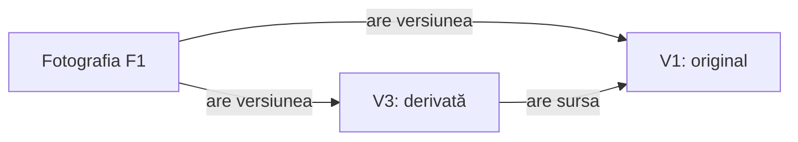

# Ce trebuie să distingem? {.transition}

Două descrieri identice înseamnă același lucru?

::: notes
Un model de domeniu ne ajută să explicăm situațiile cerute folosind concepte, identități și relații. Reluăm din cursul 3 legătura dintre o afirmație și regula care o susține.

**Organizare:** minutul 0 din 100; interval 0–15 (15 min), inclusiv coperta, citatul și discuția inițială. 30 de slide-uri cu tot cu copertă. []{.pace at=0 of=100}
:::

---

# Citatul zilei

> „Un sistem de abstractizări care descrie aspecte selectate ale unui domeniu […]”
>
> Original: “A system of abstractions that describes selected aspects of a domain […]”

— **Eric Evans**

[Sursa: Domain-Driven Design Reference — definiția modelului, p. 6 (PDF)](https://www.domainlanguage.com/wp-content/uploads/2016/05/DDD_Reference_2015-03.pdf#page=6)

::: notes
„Selectate” contează: păstrăm distincțiile necesare întrebărilor noastre. Arhiva de azi urmărește fotografiile și proveniența editărilor, fără să modeleze algoritmul care schimbă pixelii.

**Sursă:** publicația autorului, Definitions, intrarea model, pagina PDF 6. Fragment păstrat din materialul anterior verificat în `docs/quotations.md`; finalul după domain este omis explicit.
:::

---

# Aceeași legendă, două fotografii

O arhivistă catalogează fotografii și versiunile obținute prin editare. Arhiva conține două fotografii distincte:

| Fotografie | Legendă | Versiune originală |
|---|---|---|
| F1 | „Curte” | V1 |
| F2 | „Curte” | V2 |

**Regula convenită cu arhivista (beneficiarul):** legenda se poate schimba; fotografia își păstrează identificatorul.

**Cazul S1:** schimbăm legenda lui F1 în „Dimineață”. Pe hârtie, apoi în pereche: **ce se schimbă și ce rămâne?** Am putea folosi legenda pentru a identifica fotografia?

::: notes
Se schimbă numai legenda lui F1. F2 și identificatorii F1, F2, V1, V2 rămân aceiași. Legenda nu identifică fotografia: poate coincide și se poate schimba. Separăm ce spune enunțul de o presupunere despre identitatea imaginilor după conținut.

**Organizare:** 7 min: 2 individual, 2 în pereche, 3 discuție. Datele sunt construite pentru curs. []{.pace dur=7}
:::

---

# Un model răspunde la întrebări

Pentru arhiva noastră vrem să putem spune:

- despre **care fotografie** vorbim, chiar dacă îi schimbăm legenda;
- **ce versiuni** îi aparțin;
- **din ce versiune** provine o editare.

Nu modelăm albume, drepturi de acces, ștergeri sau stocarea fișierelor.

::: notes
Aceste întrebări selectează conceptele utile. Modelul nu trebuie să reproducă toate proprietățile unei fotografii sau toate funcțiile unei arhive reale. Regulile și limitele sunt convenite în scenariul didactic, nu descoperite de un agent AI.
:::

---

# Identitate și schimbare {.transition}

Ce rămâne același lucru atunci când îi schimbăm o proprietate?

::: notes
Identitatea se explică prin continuitatea pe care o cere domeniul. Un identificator o exprimă în exemplu, fără să alegem aici cum este generat sau stocat.

**Organizare:** minutul 15 din 100; interval 15–35 (20 min), inclusiv exercițiul despre editare. []{.pace at=15}
:::

---

# Identitatea nu este descrierea

**R1:** fiecare fotografie are un identificator stabil și o legendă modificabilă. Fotografii distincte pot avea aceeași legendă.

| Întrebare | Răspuns pentru F1 în S1 |
|---|---|
| „Care fotografie?” | F1, înainte și după schimbare. |
| „Ce legendă are?” | „Curte”, apoi „Dimineață”. |
| „A apărut o fotografie nouă?” | Nu, s-a schimbat doar legenda. |

**Identificatorul** și **atributul descriptiv** răspund la întrebări diferite. Nici textul egal, nici asemănarea vizuală nu stabilesc singure identitatea.

::: notes
Un atribut poate ajuta căutarea fără să fie identitatea. Evităm să transformăm exemplul într-o regulă universală conform căreia numele nu poate niciodată identifica ceva: aici imposibilitatea rezultă precis din R1.

Nici importul repetat al aceluiași fișier nu este convenit; nu deducem că ar crea o fotografie nouă sau că ar reutiliza una existentă. Revenim la el ca întrebare deschisă (S5).
:::

---

# Fotografia și versiunile ei

**R2:** fiecare versiune are identificator propriu și aparține exact unei fotografii. O fotografie are cel puțin o versiune.

**R3:** fiecare fotografie are exact un **original**, creat la catalogare (adăugarea fotografiei în arhivă). Originalul se păstrează și nu provine din altă versiune.

În arhiva noastră: F1 are originalul V1, iar F2 are originalul V2.

::: notes
Fotografia reprezintă continuitatea dintre editări; versiunea reprezintă un conținut păstrat. „Original” este rolul unei versiuni, nu neapărat un al treilea tip de obiect.
:::

---

# Editarea creează o versiune nouă

**R4:** editarea oricărei versiuni existente creează o versiune nouă a aceleiași fotografii. Versiunea nouă este o **derivată**; versiunea de la care pornește editarea este **sursa** ei. Fiecare derivată are exact o sursă, din aceeași fotografie.

**R5:** editarea nu mută versiuni între fotografii și nu modifică versiunile existente sau legenda. Schimbarea legendei nu modifică versiunile. Operațiile se execută pe rând.

::: notes
„Derivată” și „sursă” sunt roluri în relația de editare: aceeași versiune poate fi derivata uneia și sursa alteia. Sursa trebuie să existe înaintea noii versiuni. Executarea operațiilor pe rând ne scutește aici de întrebările despre editări simultane.
:::

---

# După prima editare

**Înainte:** fotografia F1, legenda „Curte”, originalul V1.

**Cazul S2:** din V1 se creează, prin editare, versiunea V3.

**Reguli (R4–R5):** versiunea nouă are identitate proprie, aparține aceleiași fotografii și are ca sursă versiunea de la care a pornit editarea. Editarea păstrează versiunile existente și legenda.

În pereche, schițați situația de după editare. Arătați **ce s-a adăugat**, **ce legătură a apărut** și **ce s-a păstrat**. Apoi comparați cu perechea vecină.

::: notes
Așteptăm aceeași fotografie F1, acum cu V1 și V3; sursa lui V3 este V1. Conținutul lui V1 și legenda „Curte” rămân. O simplă săgeată este suficientă; nu cerem clase, metode sau o notație UML.

**Organizare:** 8 min: 3 schiță în pereche, 3 comparație cu altă pereche, 2 discuție. []{.pace dur=8}
:::

---

# Editarea adaugă, nu suprascrie

| Element | Înainte | După |
|---|---|---|
| Fotografie | F1, „Curte” | F1, „Curte” |
| Original | V1 | V1, păstrat |
| Versiune derivată | — | V3, aparține lui F1 |
| Sursa lui V3 | — | V1 |

**Concluzie:** editarea adaugă o versiune și o legătură de sursă; nimic din ce exista nu se schimbă.

::: notes
Acesta este răspunsul de referință construit de profesor din R2–R5, nu o captură AI. Nu confundăm „fotografia are o versiune nouă” cu „originalul are acum alt conținut”.
:::

---

# Relațiile au reguli {.transition}

Ce situații permite schița noastră și ce situații exclude?

::: notes
Numele conceptelor nu sunt suficiente. Numărul permis de asocieri și restricțiile dintre ele decid ce situații poate exprima modelul.

**Organizare:** minutul 35 din 100; interval 35–60 (25 min), inclusiv construirea și compararea ramurilor de editare. []{.pace at=35}
:::

---

# Un vocabular comun

| Termen | Sensul în acest domeniu |
|---|---|
| Fotografie | Element al arhivei, cu identificator stabil, care își reunește versiunile. |
| Legendă | Text modificabil al fotografiei. |
| Versiune | Conținut păstrat, cu identitate proprie. |
| Original | Unica versiune creată la catalogare, fără sursă. |
| Derivată | Versiune creată prin editarea altei versiuni. |
| Sursă | Versiunea existentă din care a fost creată o derivată. |

**Verificare:** „am schimbat fotografia” este suficient de precis?

::: notes
Nu: poate însemna schimbarea legendei sau crearea unei versiuni. Cerem reformularea cu termenii din tabel. Vocabularul devine util când separă operații cu efecte diferite, nu doar când enumeră substantive.
:::

---

# Două relații diferite

**Apartenența** spune ale cui sunt versiunile. **Sursa** spune din ce versiune provine o derivată.

Săgețile arată relațiile numite pe ele; nu reprezintă ordinea execuției.

::: notes
Aceasta este o diagramă a unui exemplu concret, situația de după S2, nu modelul complet: toate nodurile sunt identificate. S3 pornește din această situație; apoi generalizăm câte asocieri sunt permise. O singură diagramă fără reguli nu ar exclude, de exemplu, două originale pentru F1.
:::

---

# Putem edita din nou originalul?

F1 are originalul **V1** și derivata **V3**, creată din V1 (S2).

**R4:** orice versiune existentă poate fi editată; noua versiune are exact o sursă, din aceeași fotografie. **R5:** versiunile existente se păstrează.

**Cazul S3:** edităm din nou V1 și obținem V4.

Individual, apoi în pereche:

1. Desenați relațiile de sursă pentru V3 și V4.
2. Ar fi corect un model care permite numai editarea ultimei versiuni?

::: notes
V3 și V4 au ambele sursa V1: două ramuri, nu lanțul V1–V3–V4. Condiția „numai ultima versiune” ar respinge o acțiune permisă explicit de R4. Aici verificăm modelul printr-un caz care separă cele două interpretări.

**Organizare:** 8 min: 2 individual, 3 comparație în pereche, 3 discuție. []{.pace dur=8}
:::

---

# Cardinalități: câte asocieri sunt permise?

| Pentru fiecare… | Regula |
|---|---|
| fotografie | Cel puțin o versiune; exact un original. |
| versiune | Exact o fotografie. |
| original | Nicio sursă. |
| derivată | Exact o sursă, din aceeași fotografie. |
| versiune, ca sursă | Zero, una sau mai multe derivate directe. |

Aceste numere sunt **cardinalități**. Restricția „din aceeași fotografie” nu este un număr: cere ca sursa și derivata să aparțină aceleiași fotografii.

::: notes
Cardinalitatea nu spune totul: „exact o sursă” ar admite și o sursă din altă fotografie, dacă am omite restricția. R4 permite editarea oricărei versiuni existente, inclusiv a uneia deja folosite ca sursă; de aceea, ca în S3, o versiune poate avea mai multe derivate directe. Nu introducem limite care lipsesc din reguli.
:::

---

# Interzis sau neconvenit?

**Cazul S4 — o asociere interzisă:** V1 aparține lui F1. Cineva propune V5 pentru F2, cu sursa V1. R4 o exclude: sursa și derivata trebuie să aparțină aceleiași fotografii.

**Cazul S5 — o întrebare deschisă:** importăm din nou același fișier. Refolosim fotografia existentă sau creăm alta?

**R6:** sunt excluse ștergerea, albumele, drepturile de acces, formatul și stocarea fișierelor, detectarea fișierelor identice și algoritmii de editare.

Nicio regulă nu dă răspunsul pentru S5: îl convenim cu arhivista.

::: notes
„Interzis” și „neconvenit” cer reacții diferite. Pentru S4 avem un rezultat justificat; pentru S5 trebuie discutat cu beneficiarul dacă extindem domeniul. Identificatorii sunt deja disponibili; nu proiectăm generarea lor.
:::

---

# Conceptul nu impune reprezentarea

Legătura „V3 are sursa V1” poate fi exprimată prin:

- o referință între obiecte;
- înregistrări legate prin identificatori;
- o săgeată într-o schiță discutată cu beneficiarul.

Oricare variantă trebuie să păstreze **sursa unică**, **apartenența** și **originalul unic**.

::: notes
Nu evaluăm modelul după numărul de clase sau de tabele. Un atribut pentru rolul de original sau o legătură explicită spre original pot exprima aceeași regulă, dacă păstrăm coerența. Alegerea implementării cere alte întrebări decât cele abordate astăzi.
:::

---

# Verificăm un model propus de AI {.transition}

Ce păstrăm, ce corectăm și pe ce regulă ne bazăm?

::: notes
Un răspuns poate fi util și totuși să conțină o generalizare nejustificată. Folosim răspunsuri reale pregătite înainte de curs, cu toate încercările păstrate; analiza umană precedă verdictul asupra revizuirii.

**Organizare:** minutul 60 din 100; interval 60–90 (30 min): tranziție și două prompturi 6, două comparații ale analizei 10, revizuire și corecție 8, reprezentare și sinteză 6. Fără rulări live. []{.pace at=60}
:::

---

# Promptul analistului AI

**Instrucțiunea exactă:**

> Propune un model de domeniu pentru regulile de mai jos: concepte, identități, relații și restricții. Explică prin S1–S4 cum susține modelul regulile. Separă alegerile de reprezentare de cerințe. Nu scrie cod și nu impune o notație. Răspunde în română, în maximum 450 de cuvinte.

**Context, în același prompt:** R1–R6 și cazurile S1–S5: S1 legenda, S2 prima editare, S3 a doua editare a lui V1, S4 sursa din altă fotografie, S5 importul repetat, neconvenit.

::: notes
Contextul conține regulile și cazurile discutate până acum, fără soluția profesorului. Nu cerem un anumit defect. Două rulări Claude Haiku 4.5 au primit același prompt; analizăm rularea 2.

**Sursă:** instrucțiunea integrală din `scenarios/04-fotografii/captures/2026-10-10/analist-instructiune.md`; contextul integral în `context.md`, promptul complet și ambele răspunsuri în același director.
:::

---

# Un răspuns susținut de reguli

**Fragment din răspunsul AI — Claude Haiku 4.5, analist AI, rularea 2, 10 octombrie 2026:**

> Un atribut modificabil, **Legenda**, aparține numai Fotografiei, nu versiunilor. Legenda se poate schimba fără să afecteze versiunile sau identitatea fotografiei.

**R1:** fotografia are identificator stabil și legendă modificabilă. **R5:** schimbarea legendei nu modifică versiunile.

În pereche: aplicați fragmentul la S1 (F1 devine „Dimineață”, F2 rămâne „Curte”). Ce rămâne neschimbat? Ce s-ar strica dacă legenda ar aparține fiecărei versiuni?

::: notes
Fragmentul este corect: confirmăm o parte bună, nu căutăm obligatoriu o eroare în fiecare fragment. Rămân F1, F2, V1, V2 și legenda lui F2. Dacă legenda ar ține de versiune, V1 și V3 ar putea avea legende diferite, iar schimbarea legendei lui F1 ar modifica versiunile, contrar lui R5; R1 atribuie legenda fotografiei.

**Sursă:** `haiku45-analist-02-response.md`, „Concepte și identități”, ultimul paragraf, integral; restul răspunsului este omis.

**Organizare:** 5 min, cu discuție. []{.pace dur=5}
:::

---

# Sunt compatibile cele două fragmente?

**Același răspuns AI — analist AI, rularea 2, fragmente:**

> Fiecare Versiune are zero sau o Sursă (relație recursivă).
>
> […]
>
> Doi copaci independenți (V3 și V4 din V1) nu sunt definiți; modelul permite orice orice configurație DAG cu original ca sursă indirectă.

Un graf orientat fără cicluri (**DAG**) interzice doar ciclurile; nu limitează câte săgeți intră într-un nod sau ies din el.

În pereche: desenați V6, cu sursele V3 și V4, toate în F1, folosind săgeți „are sursa”. Este un DAG? Îl admite R4? Care fragment trebuie corectat?

::: notes
„Zero sau o Sursă” respectă R4, dar „orice configurație DAG” admite și o versiune cu două surse. V6 nu are cicluri, deci este un DAG, dar încalcă R4: corectăm generalizarea. Răspunsul descrie corect cazul celor două ramuri în alt paragraf; defectul este generalizarea, nu întregul model. Nu cerem teorie a grafurilor: două săgeți „are sursa” care pleacă din aceeași derivată sunt suficiente ca exemplu.

Repetiția „orice orice” este în original; nu discutăm formularea lingvistică.

**Sursă:** `haiku45-analist-02-response.md`: prima propoziție din „Relația de derivare (sursă)” și ultima propoziție din „Rezultat structural” (prima, despre „pădure de versiuni”, este omisă), literale.

**Organizare:** 5 min: întâi verdict și regulă în pereche, apoi comparație. []{.pace dur=5}
:::

---

# Promptul evaluatorului AI

**Instrucțiunea exactă pentru evaluator (agent AI de revizuire):**

> Ești evaluator (agent AI de revizuire). Verifică propunerea de mai jos exclusiv față de contextul și sarcina furnizate. Identifică afirmațiile susținute, contradicțiile, omisiunile relevante și alegerile prezentate ca cerințe. Pentru fiecare observație, indică fragmentul și regula sau scenariul relevant. Nu presupune că trebuie să existe greșeli; dacă o afirmație este corectă, explică de ce. Nu scrie cod. Răspunde în română, în maximum 400 de cuvinte.

**Sesiune nouă, cu contextul:** aceleași reguli și cazuri, sarcina analistului AI și răspunsul său integral (rularea 2).

**Predicție, înainte de a vedea răspunsul AI:** va observa evaluatorul AI contradicția dintre „zero sau o Sursă” și „orice DAG”?

::: notes
Revizuirea nu primește comentariile profesorului sau conversația analistului AI. Un context nou nu garantează independența erorilor sau corectitudinea verdictului.

**Sursă:** instrucțiunea integrală din `evaluator-v2-instructiune.md`; intrarea completă în `evaluator-v2-prompt.md`. Pe slide-ul următor apare rularea 3. Primele două revizuiri, cu diacriticele instrucțiunii deteriorate la transmitere, sunt păstrate în arhivă și nu apar pe slide-uri.
:::

---

# Ce observă revizuirea?

**Fragment din răspunsul AI — Claude Haiku 4.5, evaluator AI, rularea 3, 10 octombrie 2026:**

> În S3, V3 și V4 nu sunt „doi copaci independenți" — sunt două noduri la același nivel în același arbore, ambii cu sursă V1.

**Cazul S3:** V3 provine din V1; edităm din nou V1 și obținem V4.

Explicați observația prin două săgeți. Dacă S3 este permis, rezultă că orice DAG este permis?

::: notes
Observația despre ramuri este corectă; verificarea unui exemplu nu justifică generalizarea la toate grafurile fără cicluri. Revizuirea integrală observă și că un DAG poate avea noduri cu mai mulți părinți; verificăm această observație prin limita de o sursă din R4. Cererile ei despre mecanismele de implementare și prevenirea ștergerii depășesc sarcina de modelare și limitele R6; nu le adoptăm automat.

Analistul AI nu afirmă explicit că V3 și V4 sunt copaci independenți; revizuirea reacționează la propoziția omisă despre „pădure de versiuni”. Observația este corectă despre domeniu; dacă studenții remarcă nepotrivirea, o confirmăm: verificăm și ce anume contrazice o observație.

Și revizuirea citează inexact: în citatul ei din analistul AI lipsesc repetiția „orice” și finalul propoziției. Citatele unei revizuiri se verifică și ele în sursă. Ghilimelele inegale și acordul „ambii” sunt în original.

**Sursă:** `haiku45-evaluator-03-response.md`, observația 1, paragraful „Problemă”, a treia propoziție, literală.

**Organizare:** 4 min, inclusiv răspunsuri. []{.pace dur=4}
:::

---

# Decizia noastră asupra modelului

**Analiza profesorului:**

- Păstrăm identitățile și separarea fotografiei de versiuni.
- Păstrăm mai multe derivate directe din aceeași sursă.
- Înlocuim „orice DAG” cu **un arbore cu rădăcina în original: fiecare derivată are exact o sursă**.

**R3–R4:** originalul nu are sursă; sursa unei derivate este o versiune care exista deja.

**În pereche:** de ce ajungem mereu la original, fără cicluri, dacă urmărim sursele din orice versiune?

::: notes
Aceasta este corecția umană, nu o a treia captură AI. Justificarea: fiecare versiune nouă se adaugă printr-o singură legătură spre o versiune care exista deja. Urmărind sursele, trecem mereu la o versiune mai veche și ne oprim la original, singura fără sursă. Nu introducem acum operația de combinare a două versiuni.

**Organizare:** 4 min, cu o justificare oferită de studenți. []{.pace dur=4}
:::

---

# Două reprezentări, aceleași verificări

**Referințe între obiecte:** versiunea V3 se referă la fotografia F1 și la versiunea-sursă V1.

**Înregistrare cu identificatori:**

| Versiune | Fotografie | Sursă |
|---|---|---|
| V1 | F1 | — |
| V3 | F1 | V1 |
| V4 | F1 | V1 |

În ambele variante, **ce ar trebui verificat înainte de a adăuga o versiune?**

::: notes
O versiune fără sursă se acceptă doar la catalogare, ca unic original al unei fotografii noi. Altfel, sursa trebuie să existe, să fie una singură și să aparțină aceleiași fotografii; noua versiune primește identitate distinctă și nu înlocuiește conținutul alteia. Tabelul este reprezentarea unui exemplu, nu o schemă de bază de date prescrisă. Variantele sunt construite de profesor din modelul corectat.
:::

---

# Ce transmitem mai departe

Un model pe care îl putem discuta cu altă persoană conține:

- **sensuri:** fotografie, versiune, original, derivată, sursă;
- **reguli:** identitate, apartenență și numărul permis de asocieri;
- **exemple și contraexemple:** schimbarea legendei, editarea, două ramuri; V5 din altă fotografie, V6 cu două surse;
- **limite:** ce excludem explicit (R6);
- **întrebări deschise:** politica importului repetat (S5).

O diagramă ajută când putem explica fiecare legătură printr-o regulă sau un exemplu.

::: notes
Acesta este rezumatul pentru o conversație de proiectare, nu un șablon de livrabil. Întrebările despre cine execută operațiile și unde se verifică regulile pregătesc cursul 5, fără să îi anticipăm teoria.
:::

---

# Transferăm ideea {.transition}

Ce distincție păstrăm într-un domeniu nou?

::: notes
Transferul arată dacă studenții pot recunoaște nevoia de identitate și relații fără vocabularul fotografiilor. Folosim doar regulile afișate în exercițiu.

**Organizare:** minutul 90 din 100; interval 90–100 (10 min): exercițiu și discuție 7, încheiere 3. []{.pace at=90}
:::

---

# Aceeași piesă, două reprezentații

Un teatru identifică piesa **P7**, cu titlu modificabil. Piese distincte pot avea același titlu.

P7 are reprezentațiile **Rp1**, vineri, și **Rp2**, sâmbătă. Fiecare reprezentație are identificator propriu și privește exact o piesă. O piesă poate exista fără reprezentații programate.

Pe hârtie, apoi cu un coleg:

1. Se schimbă titlul lui P7. Ce identități se păstrează?
2. Câte reprezentații poate avea o piesă? Câte piese are o reprezentație?
3. Ce informație pierdem dacă pentru P7 păstrăm doar titlul și data ultimei reprezentații?

::: notes
P7, Rp1 și Rp2 se păstrează. Piesa poate avea zero sau mai multe reprezentații; fiecare reprezentație exact o piesă. Data ultimei reprezentații nu păstrează ambele reprezentații și identitățile lor. Nu transferăm relația de sursă a editărilor: nu este cerută aici.

**Organizare:** 7 min: 2 individual, 2 în pereche, 3 discuție. []{.pace dur=7}
:::

---

# Trei întrebări pentru orice model

**Identitate:** ce rămâne același lucru când îi schimbăm descrierea?

**Relații:** ce este legat de ce și câte asocieri sunt permise?

**Verificare:** ce exemplu ar separa două interpretări ale modelului?

La laborator aplicăm aceste întrebări unui atelier comunitar de reparații, prin schițe, comparații și discuții.

::: notes
Modelul este util dacă distincțiile lui explică situațiile cerute. Capturile AI au oferit atât afirmații corecte, cât și o generalizare de corectat; verdictul a venit din reguli și exemple.

**Organizare:** ultimele 3 min; încheiere la minutul 100. []{.pace dur=3}
:::
