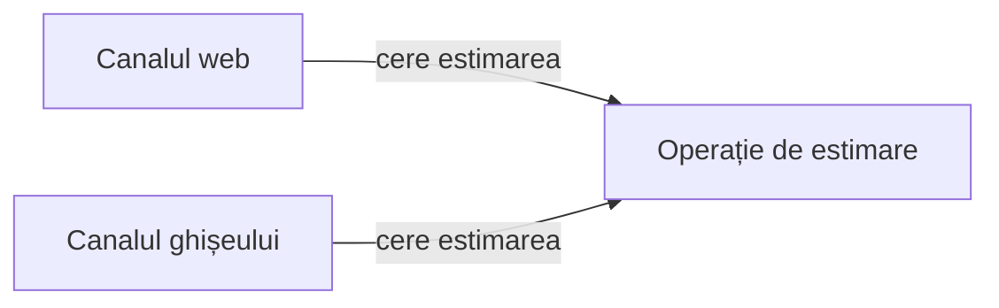

# Cine aplică regula? {.transition}

Am distins conceptele și regulile unui domeniu. Cine le aplică și ce trebuie să știe pentru asta?

::: notes
Legătura cu modelarea domeniului din cursul 4: după ce distingem conceptele și regulile, atribuim comportamentele unor componente ale soluției. O componentă poate fi o funcție, un modul sau o aplicație întreagă; nu presupunem clase. Astăzi alegem cine decide, de ce informații are nevoie și ce se schimbă când se schimbă o regulă.

**Organizare:** minutul 0 din 100; interval 0–15 (15 min), inclusiv coperta, citatul, problema, exercițiul inițial și slide-ul despre responsabilități. 32 de slide-uri cu copertă. []{.pace at=0 of=100}
:::

---

# Citatul zilei

> „Fiecare modul este apoi proiectat să ascundă o asemenea decizie față de celelalte.”
>
> Original: “Each module is then designed to hide such a decision from the others.”

— **David L. Parnas**

[Sursa: On the Criteria To Be Used in Decomposing Systems into Modules, p. 1058](https://akkartik.name/parnas.pdf#page=6)

::: notes
Decizia ascunsă este una dificilă sau susceptibilă de schimbare. Pentru noi: canalele trebuie să poată cere o estimare fără să cunoască pragurile folosite în calcul. Ce Parnas numește „modul” numim în curs componentă.

**Sursă:** articolul original, CACM 15(12), 1972, Conclusion, p. 1058, pagina PDF 6; formulare reverificată la 27 octombrie 2026. Nu deducem din citat că orice regulă cere un modul separat.
:::

---

# Cine calculează costul expedierii?

Un client cere o estimare pentru expedierea unui colet pe unul dintre cele două **canale**: site-ul sau aplicația operatorului de la ghișeu. Pentru aceleași date, ambele canale trebuie să accepte la același preț sau să refuze. Estimăm doar costul, fără să expediem coletul.

**Regula convenită cu firma (beneficiarul):** plicul poate avea cel mult **1000 g inclusiv**.

Pentru un plic de 1200 g, site-ul refuză, iar ghișeul acceptă. **Care canal a greșit și de unde știm?**

*Exemplu didactic; regulile și sumele sunt construite pentru acest curs. Lucrăm pe hârtie; toate datele necesare sunt pe slide-uri.*

::: notes
Site-ul respectă regula: plicul de 1200 g depășește limita. Nu aflăm asta comparând cele două canale între ele, ci comparând fiecare răspuns cu regula convenită. Dacă ambele ar accepta, ar fi de acord și totuși ambele greșite. De aici întrebarea cursului: unde stă regula, astfel încât ambele canale să o aplice la fel?

**Organizare:** 2 min: întrebare către clasă, așteptăm răspunsul. []{.pace dur=2}
:::

---

# Unde ați pune verificarea?

**Reguli:** plicul poate avea cel mult **1000 g inclusiv**; formularul web și ghișeul trebuie să aplice aceeași limită. Estimăm costul, fără să expediem coletul.

Un coleg propune: „Fiecare canal verifică limita înainte să calculeze prețul.”

1. Individual: ce trebuie să știe fiecare canal ca să aplice propunerea? Cine răspunde dacă cele două canale ajung să dea rezultate diferite?
2. În pereche: propuneți altă repartizare a deciziei de acceptare. Ce ar trebui să știe canalul despre componenta care decide și ce obligație aduce această repartizare?

::: notes
Fiecare canal ar trebui să cunoască limita și regula de preț; două copii trebuie ținute în acord, iar nicio componentă nu răspunde de acordul lor. Alternativa este o operație comună care primește masa și ambalajul și întoarce acceptare/preț sau refuz; obligația ei: intrările și rezultatele trebuie convenite și păstrate. În noua repartizare, canalul trebuie să știe doar ce trimite operației și ce primește: interfața ei, numită pe slide-ul operației. Nu numim încă alternativa „corectă”: cerem costul și informațiile necesare. Schimbarea unei reguli o urmărim în a doua parte a cursului.

**Organizare:** 7 min: 2 individual, 2 în pereche, 3 discuție. []{.pace dur=7}
:::

---

# O responsabilitate: rezultat și informație

O **responsabilitate** este o obligație a unei **componente** a soluției: **ce rezultat produce** și **de ce informații are nevoie**. O componentă poate fi o funcție, un modul sau o aplicație întreagă; nu presupunem clase.

Pentru estimarea costului, repartizarea responsabilităților trebuie să răspundă la trei întrebări:

- **Cine decide** dacă coletul este acceptat și cât costă?
- **Ce trebuie să știe** fiecare canal despre acea decizie?
- **Ce se schimbă** când se schimbă o regulă?

Nu proiectăm plata, expedierea sau transportatorul.

::: notes
Întrebările selectează ce comparăm în acest curs: nu numărul de cutii dintr-o diagramă, ci traseul unei cereri și al unei schimbări. Răspunsurile din exercițiul anterior au propus deja două locuri pentru decizie; le comparăm după regulile complete.
:::

---

# De la regulă la responsabilitate {.transition}

Ce trebuie să știe o componentă ca să poată decide?

::: notes
Trecem de la regulile enunțului la obligațiile componentelor: regulile complete, operația comună, dependențele, apoi coeziunea și cuplarea prin exemple.

**Organizare:** minutul 15 din 100; interval 15–30 (15 min): reguli 4, responsabilități și dependențe 5, coeziune și cuplare 6. []{.pace at=15}
:::

---

# Ce acceptăm și cât costă?

| Regulă | Conținut |
|--------|------------------------------------------|
| R1 (intrare) | Coletul este descris prin masa în grame întregi și tipul ambalajului. Canalul interpretează textul introdus; operația verifică valorile primite. |
| R2 (masa acceptată) | Acceptăm numai mase între 1 și 5000 g inclusiv. |
| R3 (ambalaj) | Un plic poate avea cel mult 1000 g; o cutie poate avea orice masă permisă de R2 (masa acceptată). Alt ambalaj este refuzat. |
| R4 (preț) | Un colet acceptat costă 10 lei până la 1000 g inclusiv și 18 lei peste. |

Un refuz nu include preț. Sumele sunt date didactice.

::: notes
Eligibilitatea și tariful sunt două decizii. O cutie de 1001 g este acceptată și costă 18 lei; un plic cu aceeași masă este refuzat. Nu adăugăm taxe sau rotunjiri.
:::

---

# Ce trebuie să fie comun?

**R5 (canale):** pentru aceeași masă și același ambalaj, ambele canale acceptă la același preț sau refuză. Textele și aspectul afișării pot diferi.

**R6 (limitele sarcinii):** producem doar o estimare, fără salvare, plată, expediere sau transportator extern.

| Obligație | Informația necesară |
|---|---|
| Interpretarea textului | Formatul intrării din acel canal. |
| Acceptarea și prețul | Masa, ambalajul, regulile de estimare. |
| Afișarea rezultatului | Rezultatul și convențiile canalului. |

::: notes
„Același rezultat” înseamnă acceptare cu aceeași sumă sau refuz. Nu cere mesaje identice. Pentru mai multe motive simultane nu fixăm prioritate. Responsabilitățile sunt conceptuale; tabelul nu impune trei clase.
:::

---

# O operație pe care o putem explica

`estimeaza(masa, ambalaj)` primește valori și întoarce:

- `acceptat(preț)`; sau
- `refuz(motiv)`.

**Reper:** masa 1–5000 g; plicul cel mult 1000 g; prețul 10 lei până la 1000 g, 18 lei peste. Refuzul nu are preț.

Semnătura și sensul rezultatelor formează **interfața** operației: tot ce trebuie să știe un canal ca s-o folosească.

Operația poate fi o **funcție locală**. Nu are nevoie să citească formularul sau să afișeze mesaje.

::: notes
Interfața operației este acordul despre intrări și rezultate. În curs folosim „interfață” numai în acest sens, nu pentru ecranul sau formularul unui canal. Când invocăm operația direct, regulile trebuie să se aplice în continuare. Acest lucru permite verificări fără browser.
:::

---

# Cine depinde de cine?

Săgeata înseamnă **„folosește operația”**, nu circulația tuturor datelor.

**Regula comună:** ambele canale trebuie să respecte aceleași limite de masă, ambalaj și preț. Operația întoarce rezultatul; canalul îl afișează.

::: notes
Webul și ghișeul depind de intrările și rezultatele operației. Operația nu depinde de un buton sau de ecranul ghișeului. Nu deducem din săgeți procese, servere sau apeluri prin rețea.
:::

---

# Coeziunea: de ce sunt împreună?

**Reguli:** plicul peste 1000 g este refuzat; fiecare canal poate alege textul prin care explică refuzul.

Propunere: `estimeaza` întoarce un mesaj gata de afișat. În pereche: ce simplifică aceasta? Ce se întâmplă dacă site-ul cere un text scurt, iar ghișeul o explicație detaliată?

Am comparat cât de bine servesc responsabilitățile unei componente același scop: aceasta este **coeziunea**. Acceptarea coletului și calculul sumei contribuie la același răspuns; formularea mesajului servește scopul fiecărui canal.

::: notes
Lăsați perechile să răspundă înainte de a numi conceptul. Mesajul comun simplifică inițial afișarea și evită texte duplicate. Totuși, pentru textele diferite permise de R5 (canale), operația ar trebui să cunoască fiecare canal. Un motiv de refuz separat de text lasă formularea canalului. Coeziunea se discută prin scopuri și motive de schimbare, nu prin lungimea fișierului.

**Organizare:** 3 min, inclusiv răspunsurile. []{.pace dur=3}
:::

---

# Cuplarea: ce trebuie să cunoască ceilalți?

**R5 (canale):** cele două canale trebuie să rămână de acord. Ce poate cunoaște un canal despre estimare?

| Canalul cunoaște… | Consecință |
|---|---|
| `estimeaza(masa, ambalaj)` și rezultatul | Poate cere estimarea fără să copieze pragurile. |
| Pragurile și ordinea verificărilor | Trebuie actualizată când se schimbă politica. |
| Variabilele interne ale calculului | O reorganizare internă îi poate afecta comportamentul. |

Ce dependență ne ajută și ce dependență ne încurcă? Dependențele dintre componente și detaliile pe care trebuie să le cunoască una despre cealaltă formează **cuplarea**.

::: notes
Cereți întâi răspunsul pentru fiecare rând, apoi numiți conceptul. Apelul operației este o dependență utilă. Eliminarea tuturor dependențelor nu este obiectivul. O interfață mai mică a operației poate proteja decizii interne, dar trebuie să exprime suficient pentru colaborare.

**Organizare:** 3 min, încheierea etapei la minutul 30. []{.pace dur=3}
:::

---

# Comparăm două repartizări {.transition}

Aceleași rezultate, obligații diferite pentru cei care schimbă sistemul.

::: notes
Nu alegem după desenul cu cele mai multe sau cele mai puține cutii. Verificăm traseul unei cereri și al unei schimbări.

**Organizare:** minutul 30 din 100; interval 30–55 (25 min): variante 7, exercițiu de prag 8, discuția alternativelor 6, verificare directă 4. []{.pace at=30}
:::

---

# Varianta cu reguli copiate

**R3 (ambalaj):** plicul de **1000 g inclusiv** este permis. **R4 (preț):** la 1000 g, prețul este 10 lei. **R5 (canale):** cele două canale trebuie să dea același rezultat.

Exemplu didactic construit pentru comparație:

| Canal | Condiție folosită pentru plic |
|---|---|
| Web | `masa < 1000` |
| Ghișeu | `masa <= 1000` |

Fiecare canal calculează apoi singur prețul. Copiile pot coincide inițial și pot ajunge să aplice reguli diferite după o modificare.

::: notes
Defectul este explicit la limita inclusă. Nu este o captură AI sau o eroare observată într-o aplicație reală. Chiar dacă reparăm semnul, obligația de sincronizare a copiilor rămâne.
:::

---

# Varianta cu o operație comună

Ambele canale cer `estimeaza(masa, ambalaj)` și afișează rezultatul.

**În operație:** masă 1–5000 g; plic până la 1000 g; preț 10 lei până la 1000 g, 18 lei peste; refuz fără preț.

**În fiecare canal:** interpretarea intrării și afișarea.

Cost: trebuie convenite și păstrate sensurile intrărilor, rezultatelor și motivelor de refuz.

::: notes
Centralizarea responsabilității nu garantează că regula este implementată corect. Dacă operația comună are limita greșită, ambele canale vor greși la fel. Compararea canalelor și compararea cu enunțul sunt verificări distincte.
:::

---

# Alegeți o verificare care separă variantele

**Reguli:** plic ≤1000 g; masă 1–5000 g; colet acceptat ≤1000 g → 10 lei, peste → 18 lei. Aceleași rezultate în ambele canale.

**Trei propuneri pentru condiția plicului:** A — web `masa < 1000`, ghișeu `masa <= 1000`; B — ambele `masa < 1000`; C — ambele `masa <= 1000`.

Pe hârtie, apoi în pereche:

1. Alegeți o intrare care deosebește cele trei propuneri. Ce întoarce fiecare canal și ce cere regula?
2. În B, canalele sunt de acord. Respectă regula firmei? Ce verificare o arată?
3. Ce nu putem afla din aceste rezultate despre locul în care sunt păstrate regulile?

::: notes
Plicul de 1000 g deosebește propunerile: A — webul refuză, ghișeul acceptă la 10 lei; B — ambele refuză, de acord și totuși greșit; C — ambele acceptă la 10 lei, corect. Plicul de 1001 g nu deosebește nimic: toate refuză corect. Acordul dintre canale și respectarea regulii sunt verificări distincte; a doua se face față de enunț. Rezultatele nu arată dacă regula este copiată sau comună: o operație comună cu limita greșită produce exact B. De aici următoarea întrebare: unde păstrăm decizia, ca o corecție să fie făcută o singură dată?

**Organizare:** 8 min: 2 individual, 3 în pereche, 3 comparație. []{.pace dur=8}
:::

---

# O funcție sau două funcții interne?

**Scop comun:** acceptare și preț conform limitelor de masă și ambalaj.

| A | B |
|---|---|
| `estimeaza` decide acceptarea și suma. | `estimeaza` coordonează `accepta` și `pret`. |
| Mai puține legături de explicat. | Eligibilitatea și tariful se pot schimba separat. |
| Regulile sunt grupate într-un loc. | `pret` se folosește numai după acceptare. |

În ambele variante, canalele apelează doar `estimeaza`.

Ce justificare ați cere înainte de a separa fiecare regulă într-o altă componentă?

::: notes
Ambele variante pot fi justificate. Separarea cere un motiv: evoluție independentă, reutilizare reală sau claritate. Dacă componentele trebuie permanent schimbate împreună, separarea poate adăuga coordonare fără beneficiu. Nu introducem catalogul de șabloane de proiectare.

**Organizare:** 6 min, cu argumente pro și contra. []{.pace dur=6}
:::

---

# Putem verifica fără formular și ghișeu?

Apelăm direct operația propusă, folosind **rezultatele așteptate din reguli**:

| Intrare | Rezultat așteptat |
|---|---|
| Plic, 1000 g | Acceptat, 10 lei. |
| Plic, 1001 g | Refuz, fără preț. |
| Cutie, 1001 g | Acceptată, 18 lei. |
| Cutie, 0 g / 5000 g / 5001 g | Refuz / acceptată, 18 lei / refuz. |

**Reper:** masa 1–5000 g; limita plicului 1000 g; pragul de preț 1000 g. Ce informație despre un buton ar fi necesară?

::: notes
Niciuna. Tabelul este o verificare propusă, nu rezultatul unei execuții. Dacă operația cere un obiect formular, discutăm dependența suplimentară și dificultatea verificării separate. Testabilitatea apare ca efect al separării responsabilităților, fără implementare obligatorie.

**Organizare:** 4 min. []{.pace dur=4}
:::

---

# Urmărim o schimbare {.transition}

Două limite au aceeași valoare. Au și același sens?

::: notes
Schimbarea separă sensuri pe care valoarea inițială comună le putea ascunde.

**Organizare:** minutul 55 din 100; interval 55–75 (20 min): C1 și predicție 8, comparația schimbărilor 7, sinteză 5. []{.pace at=55}
:::

---

# Limita plicului devine 1500 g

**C1 (limita plicului) modifică numai regula ambalajului:** plicul este acceptat până la **1500 g inclusiv**.

**Rămân:** masă 1–5000 g; preț 10 lei până la **1000 g inclusiv**, 18 lei peste; refuz fără preț; aceleași rezultate în cele două canale.

Individual, apoi în pereche:

1. Ce rezultat așteptăm pentru plicuri de 1200, 1500 și 1501 g?
2. Ce risc are o singură constantă `LIMITA = 1000` folosită la ambalaj și la preț?
3. Reguli copiate în web și la ghișeu sau o operație comună apelată de ambele canale: unde modificați limita plicului și ce reverificați în fiecare organizare?

::: notes
1200 și 1500 g: acceptate la 18 lei; 1501 g: refuz. Înlocuirea aceleiași constante peste tot ar reduce greșit prețul la 10 lei. În varianta copiată actualizăm ambele canale; în cea comună schimbăm politica de acceptare și reverificăm operația și folosirea ei de ambele canale.

**Organizare:** 8 min, cu discuție. []{.pace dur=8}
:::

---

# Harta schimbării

**C1 (limita plicului):** trece la 1500 g; pragul prețului rămâne 1000 g.

| Unde | Ce schimbăm? |
|---|---|
| Acceptarea coletului | Limita plicului și verificările la valorile-limită. |
| Calculul prețului | Regula rămâne; verificăm noile plicuri acceptate la 18 lei. |
| Canalele | Pot actualiza indicația afișată despre limita plicului. |
| Exemplele de acceptare | Scenariul S2 (plic de 1001 g) devine acceptare la 18 lei. |

Operația comună reduce copiile deciziei. Nu elimină toate efectele vizibile ale schimbării.

::: notes
Un text de ajutor „maximum 1000 g” trebuie actualizat chiar dacă operația comună este corectă. Nu promitem că o schimbare de regulă atinge un singur fișier. Separăm autoritatea deciziei de comunicarea ei către utilizator.

**Organizare:** 3 min. []{.pace dur=3}
:::

---

# Altă schimbare, altă componentă

**Situația curentă:** plic ≤1500 g; prag tarifar 1000 g; webul și ghișeul apelează `estimeaza`.

A. Site-ul adaugă o avertizare imediată când plicul depășește limita, înainte de a cere estimarea.

B. Apare un al treilea canal, care trebuie să respecte aceeași politică.

C. Se schimbă numai prețul treptei de peste 1000 g.

În pereche: pentru fiecare schimbare numiți componenta responsabilă și o verificare. La A: cine decide acceptarea? Ce se întâmplă dacă avertizarea folosește încă limita veche?

::: notes
A: afișarea web; avertizarea ajută utilizatorul, dar nu decide: operația comună verifică oricum înainte de a accepta. Cu limita veche în avertizare, site-ul ar avertiza greșit la 1200 g, iar estimarea ar accepta: verificăm concordanța textului cu politica, nu mutăm decizia în canal. O verificare repetată nu este greșită în sine; greșită ar fi o a doua autoritate. B: noul canal apelează operația; verificăm concordanța și interpretarea intrărilor. C: calculul comun și rezultatele așteptate, plus textele care ar afișa sume fixate. Nu schimbăm ipotetic și masa sau ambalajul.

**Organizare:** 4 min, continuând comparația cu harta schimbării. []{.pace dur=4}
:::

---

# Ce transmitem celui care dezvoltă soluția?

**Responsabilități:** canalele interpretează și afișează; operația decide acceptarea și prețul.

**Acord:** intrări, rezultate, reguli și exemple la valorile-limită.

**Decizia protejată:** politica poate evolua fără copii independente în canale.

**Cost și limite:** trebuie respectate semnificațiile convenite ale intrărilor și rezultatelor; textele explicative pot necesita actualizare. Nu am proiectat transportul sau plata.

::: notes
Transmiterea trebuie să păstreze legătura cu enunțul și cu versiunea lui: după C1, plicul de 1001 g nu mai este refuzat. Alegerea unei reprezentări nu înlocuiește regulile și exemplele.

**Organizare:** 5 min, întrebări și sinteză; ajungem la minutul 75. []{.pace dur=5}
:::

---

# Delegăm și verificăm decizia {.transition}

Cum judecăm o propunere înainte să acceptăm etichetele ei?

::: notes
Analizăm capturi reale, obținute înaintea cursului: Claude Haiku 4.5, prin Claude Code 2.1.311, la 27 octombrie 2026, fără unelte și fără contextul proiectului. Analistul AI a primit enunțul fără C1; evaluatorul (agent AI de revizuire) a primit, într-un context nou, enunțul, sarcina, răspunsul integral și C1 ca schimbare ulterioară. Am rulat câte două încercări și am ales câte una pentru discuție; selecția nu descrie performanța tipică a modelului. Toate încercările sunt în arhiva capturilor. La curs nu rulăm instrumente.

**Organizare:** minutul 75 din 100; interval 75–95 (20 min): predare 4, propunere 5, promptul evaluatorului AI 2, revizuire 5, decizie 4. []{.pace at=75}
:::

---

# O sarcină delimitată pentru un asistent AI

> Propune responsabilitățile și dependențele pentru estimarea costului expedierii. Compară o operație comună cu regulile copiate în cele două interfețe. Verifică scenariile S1–S5. Nu scrie cod, nu impune clase sau servicii. Răspunde în română, în maximum 350 de cuvinte.

**Enunțul trimis, înainte de C1 (limita plicului):** masă 1–5000 g; plic ≤1000 g; cutie pe tot intervalul; preț 10 lei până la 1000 g, 18 lei peste; refuz fără preț; aceleași rezultate în web și la ghișeu.

**Scenariile S1–S5:** plic 1000 g / 1001 g; cutie 1001 g / 0 g / 5000 g și 5001 g. Fără plată sau expediere.

::: notes
Instrucțiunea este cea trimisă efectiv, urmată de enunțul integral fără C1. Ea spune „interfețe” pentru canale, ca enunțul trimis atunci; răspunsul preia cuvântul. În vocabularul nostru, interfața este semnătura operației, cu sensul intrărilor și al rezultatelor. Predăm o versiune explicită, fără a amesteca C1 cu enunțul inițial: C1 apare numai la revizuire, ca schimbare ulterioară. Criteriile de verificare: responsabilitățile canalelor și ale operației, rezultatele S1–S5 și sensul fiecărei limite.

**Organizare:** 4 min, cu identificarea criteriilor de verificare. []{.pace dur=4}
:::

---

# O propunere de verificat

**Analistul AI — Claude Haiku 4.5, 27 octombrie 2026; fragmente:**

> **Interfață (web, ghișeu)** — interpretează textul intrării […] Nu validează reguli de domeniu.
>
> **Logica de estimare** — aplică R2–R4 […] acceptat+preț sau refuz.
>
> **Definirea regulilor** — stochează limitele, costurile, restricțiile per ambalaj. Accesibilă ambelor interfețe.
>
> **Risc de inconsistență:** dacă R3 se modifică (plic acceptat până la 1500 g), trebuie actualizat în două locuri; greșelile sunt posibile.

**Reguli:** plic ≤1000 g; preț 10 lei până la 1000 g, 18 lei peste. **C1 (limita plicului):** 1500 g.

Ce păstrăm? Canalele (la AI: „interfețe”) „nu validează reguli”: ce le este totuși „accesibil” și pentru ce? Ce precizăm despre „limitele” stocate pentru un plic de **1200 g după C1**?

::: notes
Răspunsul verifică S1–S5 corect. Păstrăm operația comună, independența față de afișare și verificarea S1–S5. Propunerea precizează că interfețele, adică în vocabularul nostru canalele, nu validează regulile domeniului, deci accesul lor la reguli nu poate însemna o decizie independentă de acceptare; rămâne neexplicat scopul lui, de exemplu afișarea limitei către utilizator. Nu prezentăm lipsa drept eroare: cerem precizarea scopului, care păstrează o singură autoritate a deciziei. Fragmentul nu stabilește cum sunt reprezentate limitele; nu putem deduce că folosește o singură constantă. Pentru C1 precizăm două decizii distincte: acceptarea plicului și calculul tarifului; plicul de 1200 g este acceptat și costă 18 lei. Modelul a ales singur 1500 g ca exemplu de schimbare; enunțul trimis nu conține această valoare. „DRY”, din restul răspunsului, este o etichetă; nu o adoptăm ca argument.

**Organizare:** 5 min: predicție individuală, comparație în pereche și răspunsuri. []{.pace dur=5}
:::

---

# Promptul evaluatorului AI

**Evaluator (agent AI de revizuire), context nou:** enunțul, sarcina analistului AI, răspunsul integral și C1 (limita plicului), prezentată ca schimbare ulterioară pe care analistul AI nu trebuia să o anticipeze.

**Instrucțiunea exactă, la începutul promptului:**

> Ești evaluator (agent AI de revizuire). Verifică propunerea de mai jos exclusiv față de contextul, sarcina analistului AI și schimbarea ulterioară C1. Identifică afirmațiile susținute, contradicțiile, omisiunile relevante și alegerile prezentate ca cerințe; verifică și ce trebuie să se schimbe în propunere după C1. Pentru fiecare observație, indică fragmentul, regula și un scenariu cu intrarea și rezultatul așteptat. Nu presupune că trebuie să existe greșeli; dacă o afirmație este corectă, explică de ce. Nu scrie cod. Răspunde în română, în maximum 400 de cuvinte.

**Predicție, înainte de a vedea răspunsul:** va deosebi evaluatorul AI consecințele lui C1 de o omisiune a analistului AI?

::: notes
Instrucțiunea cere două lucruri diferite: verificarea propunerii față de sarcina primită de analistul AI și consecințele schimbării ulterioare. Enunțul transmis spune explicit că C1 nu trebuia anticipată. Predicția pregătește lectura critică a revizuirii: o consecință corectă poate fi formulată ca reproș nejustificat.

**Sursă:** instrucțiunea integrală din `evaluator-instructiune.md`; intrarea completă în `evaluator-prompt.md`, arhiva din 27 octombrie 2026.

**Organizare:** 2 min; predicții prin ridicarea mâinii, fără discuție. []{.pace dur=2}
:::

---

# Revizuirea are nevoie de propria verificare

**Evaluatorul AI — Claude Haiku 4.5, captură din 27 octombrie 2026; fragmente:**

> Propunerea **nu menționa explicit ce se schimbă după C1**. Instrucțiunile de evaluare cer verificarea "ce trebuie să se schimbe în propunere după C1". […] Propunerea ar trebui să precizeze: „S2 devine acceptare la 18 lei după C1 […]”
>
> Observația DRY și „dificultate în testare" sunt bune, dar **depășesc sarcina analistului**, care nu cere o soluție de cod sau arhitectură. […]
>
> Merge dincolo cu sugestii de implementare (DRY, centralizare).

**Sarcina analistului AI:** compară o operație comună cu regulile copiate; enunțul primit nu conținea C1 (limita plicului). **Scenariul S2:** plic de 1001 g. **După C1:** plic ≤1500 g; 10 lei până la 1000 g inclusiv, 18 lei peste.

Ce observație este susținută? Ce etichetă nu este susținută de sarcina analistului AI?

::: notes
Consecința pentru S2 este corectă și răspunde instrucțiunii noastre: după C1, plicul de 1001 g costă 18 lei. Eticheta de „omisiune” a propunerii este însă nedreaptă: analistul AI nu a primit C1, iar enunțul trimis evaluatorului AI spunea că schimbarea C1 nu trebuia anticipată. Restul revizuirii notează corect că enunțul cere rezultate egale, nu aceeași implementare; afirmația că operația comună „depășește sarcina” ignoră însă sarcina, care cere chiar comparația dintre operația comună și regulile copiate. Revizuirea aplică distinct cele două praguri în S2 (plic ≤1500 g, 18 lei peste 1000 g), dar nu cere propunerii responsabilități separate pentru ele; noi le precizăm în decizie, fără să deducem reprezentarea internă a limitelor. Cealaltă revizuire păstrată are alte erori, de exemplu un posibil refuz pentru ambalaj la cutia de 0 g.

**Organizare:** 5 min, cu răspunsuri. []{.pace dur=5}
:::

---

# Decizia noastră

Păstrăm operația comună și verificarea scenariilor S1–S5. Separăm **limita ambalajului** de **pragul tarifului**.

**Acceptăm din revizuire:** după C1 (limita plicului), scenariul S2 (plic de 1001 g) → acceptat, 18 lei. **Respingem:** ideea că operația comună iese din sarcină; sarcina cere explicit comparația.

**După C1:** plic ≤1500 g; preț 10 lei până la 1000 g, 18 lei peste. Verificăm: plic de 1200 g → 18 lei; plic de 1501 g → refuz, în ambele canale.

::: notes
Verdictul aparține oamenilor și se sprijină pe regulă și scenariu. O revizuire poate conține o consecință corectă și o critică nejustificată; le judecăm separat. Nu cerem ca orice propunere sau revizuire să fie greșită; aceleași verificări pot confirma o propunere bună.

**Organizare:** 4 min; încheierea etapei la minutul 95. []{.pace dur=4}
:::

---

# Transferăm ideea {.transition}

Unde punem regula într-un domeniu nou?

::: notes
Transferul verifică dacă studenții pot explica responsabilitatea fără vocabularul coletelor.

**Organizare:** minutul 95 din 100; interval 95–100 (5 min): exercițiu și încheiere. []{.pace at=95}
:::

---

# Reducerea unui bilet

**Enunț nou:** biletul costă 40 lei; studenții eligibili plătesc 20 lei. Site-ul și casa de bilete trebuie să aplice aceeași regulă. Eligibilitatea este deja furnizată ca da/nu; nu proiectăm verificarea statutului.

Pe hârtie, apoi două răspunsuri în plen:

1. Cine decide suma și ce primește?
2. Cine decide cum o afișează?
3. Reducerea devine 25%. Ce modificați și ce exemplu verificați?

**De reținut:** numiți responsabilitatea, dependența și consecința unei schimbări.

::: notes
O operație comună primește eligibilitatea și întoarce suma; canalele afișează. După schimbare, studentul plătește 30 lei, ceilalți 40 lei. Verificăm ambele categorii și concordanța canalelor. Cursul 6 precizează mai atent promisiunile operațiilor, inclusiv refuzurile. Echipele pot cere feedback pentru proiect oricând.

**Organizare:** 5 min; încheiere la minutul 100. []{.pace dur=5}
:::
