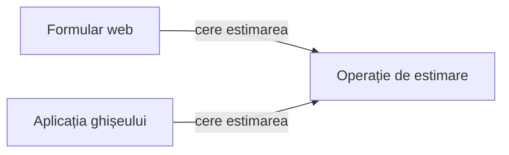

# Cine calculează costul expedierii?

Un client cere o estimare pentru expedierea unui colet: pe site sau de la operatorul ghișeului. Pentru aceleași date, cele două aplicații trebuie să accepte la același preț sau să refuze.

Astăzi alegem **cine decide**, **de ce informații are nevoie** și **ce se schimbă când se schimbă o regulă**.

Exemplu didactic. Lucrăm pe hârtie; toate datele necesare sunt pe slide-uri.

::: notes
Legătura cu modelarea domeniului: după ce distingem conceptele și regulile, atribuim comportamentele unor părți ale soluției. O parte poate fi o funcție sau un modul; nu presupunem clase.

**Organizare:** minutul 0 din 100; deschidere 0–10 (10 min): orientare și citat 3, exercițiu 7. 29 de slide-uri cu copertă. []{.pace at=0 of=100}
:::

---

# Citatul zilei

> „Fiecare modul este apoi proiectat să ascundă o asemenea decizie față de celelalte.”
>
> Original: “Each module is then designed to hide such a decision from the others.”

— **David L. Parnas**

[Sursa: On the Criteria To Be Used in Decomposing Systems into Modules, p. 1058](https://akkartik.name/parnas.pdf#page=6)

::: notes
Decizia ascunsă este una dificilă sau susceptibilă de schimbare. Pentru noi: interfețele trebuie să poată cere o estimare fără să cunoască pragurile folosite în calcul.

**Sursă:** articolul original, CACM 15(12), 1972, Conclusion, p. 1058, pagina PDF 6; formulare reverificată la 27 octombrie 2026. Nu deducem din citat că orice regulă cere un modul separat.
:::

---

# Unde ați pune verificarea?

**Reguli:** plicul poate avea cel mult **1000 g inclusiv**; formularul web și ghișeul trebuie să aplice aceeași limită. Estimăm costul, fără să expediem coletul.

Un coleg propune: „Fiecare interfață verifică limita înainte să calculeze prețul.”

1. Individual: ce trebuie modificat dacă limita devine 1500 g?
2. În pereche: propuneți alt loc pentru decizia de acceptare.
3. Ce ar trebui să știe interfața despre acel loc?

::: notes
Două copii cer două actualizări și verificarea concordanței. Alternativa este o operație comună care primește masa și ambalajul și întoarce acceptare/preț sau refuz. Nu numim încă alternativa „corectă”: cerem costul și informațiile necesare.

**Organizare:** 7 min: 2 individual, 2 în pereche, 3 discuție. []{.pace dur=7}
:::

---

# De la regulă la responsabilitate {.transition}

Ce trebuie să știe o parte ca să poată decide?

::: notes
O responsabilitate este o obligație explicabilă prin rezultat și informațiile necesare, nu doar un nume de clasă.

**Organizare:** minutul 10 din 100; interval 10–30 (20 min): reguli 5, responsabilități și dependențe 7, comparație și discuție 8. []{.pace at=10}
:::

---

# Ce acceptăm și cât costă?

| Regulă | Conținut |
|--------|------------------------------------------|
| R1 | Masa în grame întregi și tipul ambalajului. Interfața interpretează textul; operația verifică valorile. |
| R2 | Acceptăm numai mase între 1 și 5000 g inclusiv. |
| R3 | Plic: cel mult 1000 g; cutie: întregul interval R2. Alt ambalaj: refuz. |
| R4 | Colet acceptat: până la 1000 g inclusiv → 10 lei; peste → 18 lei. |

Un refuz nu include preț. Sumele sunt date didactice.

::: notes
Eligibilitatea și tariful sunt două decizii. O cutie de 1001 g este acceptată și costă 18 lei; un plic cu aceeași masă este refuzat. Nu adăugăm taxe sau rotunjiri.
:::

---

# Ce trebuie să fie comun?

**R5:** pentru aceeași masă și același ambalaj, ambele aplicații acceptă la același preț sau refuză. Textele și aspectul afișării pot diferi.

**R6:** doar estimare, fără salvare, plată, expediere sau transportator extern.

| Obligație | Informația necesară |
|---|---|
| Interpretarea textului | Formatul intrării din acel canal. |
| Acceptarea și prețul | Masa, ambalajul, regulile de estimare. |
| Afișarea rezultatului | Rezultatul și convențiile interfeței. |

::: notes
„Același rezultat” înseamnă acceptare cu aceeași sumă sau refuz. Nu cere mesaje identice. Pentru mai multe motive simultane nu fixăm prioritate. Responsabilitățile sunt conceptuale; tabelul nu impune trei clase.
:::

---

# O operație pe care o putem explica

`estimeaza(masa, ambalaj)` primește valori și întoarce:

- `acceptat(preț)`; sau
- `refuz(motiv)`.

**Reper:** masa 1–5000 g; plicul cel mult 1000 g; prețul 10 lei până la 1000 g, 18 lei peste. Refuzul nu are preț.

Operația poate fi o **funcție locală**. Nu are nevoie să citească formularul sau să afișeze mesaje.

::: notes
Interfața operației este acordul despre intrări și rezultate. Nu o confundăm cu interfața grafică. Când invocăm operația direct, regulile trebuie să se aplice în continuare. Acest lucru permite verificări fără browser.
:::

---

# Cine depinde de cine?

Săgeata înseamnă **„folosește operația”**, nu circulația tuturor datelor.

**Regula comună:** ambele canale trebuie să respecte aceleași limite de masă, ambalaj și preț. Operația întoarce rezultatul; canalul îl afișează.

::: notes
Webul și ghișeul depind de intrările și rezultatele operației. Operația nu depinde de un buton sau de ecranul ghișeului. Nu deducem din săgeți procese, servere sau apeluri prin rețea.
:::

---

# Coeziunea: de ce sunt împreună?

**Coeziune:** cât de bine contribuie responsabilitățile unei părți la un scop comun.

Pentru estimare: acceptarea coletului și calculul sumei contribuie la același răspuns.

**Reguli:** plicul peste 1000 g este refuzat; fiecare interfață poate alege textul prin care explică refuzul.

Propunere: `estimeaza` întoarce un mesaj gata de afișat. În pereche: ce simplifică aceasta? Ce se întâmplă dacă site-ul cere un text scurt, iar ghișeul o explicație detaliată?

::: notes
Mesajul comun simplifică inițial afișarea și evită texte duplicate. Totuși, pentru textele diferite permise de R5, operația ar trebui să cunoască fiecare canal. Un motiv de refuz separat de text lasă formularea interfeței. Coeziunea se discută prin scopuri și motive de schimbare, nu prin lungimea fișierului.

**Organizare:** 4 min, inclusiv răspunsurile. []{.pace dur=4}
:::

---

# Cuplarea: ce trebuie să cunoască ceilalți?

**Cuplare:** dependențele dintre părți și detaliile pe care trebuie să le cunoască una despre cealaltă.

| Interfața cunoaște… | Consecință |
|---|---|
| `estimeaza(masa, ambalaj)` și rezultatul | Poate cere estimarea fără să copieze pragurile. |
| Pragurile și ordinea verificărilor | Trebuie actualizată când se schimbă politica. |
| Variabilele interne ale calculului | O reorganizare internă îi poate afecta comportamentul. |

**R5:** cele două canale trebuie să rămână de acord. Ce dependență ne ajută și ce dependență ne încurcă?

::: notes
Apelul operației este o dependență utilă. Eliminarea tuturor dependențelor nu este obiectivul. O interfață mai mică poate proteja decizii interne, dar trebuie să exprime suficient pentru colaborare.

**Organizare:** 4 min, încheierea etapei la minutul 30. []{.pace dur=4}
:::

---

# Comparăm două repartizări {.transition}

Aceleași rezultate, obligații diferite pentru cei care schimbă sistemul.

::: notes
Nu alegem după desenul cu cele mai multe sau cele mai puține cutii. Verificăm traseul unei cereri și al unei schimbări.

**Organizare:** minutul 30 din 100; interval 30–55 (25 min): variante 7, exercițiu de prag 8, discuția alternativelor 6, verificare directă 4. []{.pace at=30}
:::

---

# Varianta cu reguli copiate

**R3:** plicul de **1000 g inclusiv** este permis. **R4:** la 1000 g, prețul este 10 lei. **R5:** cele două canale trebuie să dea același rezultat.

Exemplu didactic construit pentru comparație:

| Canal | Condiție folosită pentru plic |
|---|---|
| Web | `masa < 1000` |
| Ghișeu | `masa <= 1000` |

Fiecare canal calculează apoi singur prețul. Copiile pot coincide inițial și se pot despărți la o modificare.

::: notes
Defectul este explicit la limita inclusă. Nu este o captură AI sau o eroare observată într-o aplicație reală. Chiar dacă reparăm semnul, obligația de sincronizare a copiilor rămâne.
:::

---

# Varianta cu o operație comună

Ambele interfețe cer `estimeaza(masa, ambalaj)` și afișează rezultatul.

**În operație:** masă 1–5000 g; plic până la 1000 g; preț 10 lei până la 1000 g, 18 lei peste; refuz fără preț.

**În fiecare canal:** interpretarea intrării și afișarea.

Cost: trebuie convenite și păstrate sensurile intrărilor, rezultatelor și motivelor de refuz.

::: notes
Centralizarea responsabilității nu garantează că regula este implementată corect. Dacă operația comună are limita greșită, ambele interfețe vor greși la fel. Compararea canalelor și compararea cu enunțul sunt verificări distincte.
:::

---

# Alegeți o verificare care separă variantele

**Reguli:** plic ≤1000 g; masă 1–5000 g; colet acceptat ≤1000 g → 10 lei, peste → 18 lei. Aceleași rezultate în ambele canale.

**Propunerea copiată:** webul acceptă plicul dacă `masa < 1000`; ghișeul dacă `masa <= 1000`.

Pe hârtie, apoi în pereche:

1. S1: plic de 1000 g. Ce întoarce fiecare canal și ce ar trebui să întoarcă?
2. S2: plic de 1001 g. Dacă ambele refuză, este suficient pentru a valida propunerea?
3. Formulați corecția și responsabilitatea care trebuie păstrată comună.

::: notes
S1: web refuză incorect; ghișeu acceptă la 10 lei. S2: ambele refuză corect, dar un singur acord nu stabilește respectarea întregii reguli. Corectăm limita și discutăm eliminarea copiilor independente ale politicii.

**Organizare:** 8 min: 2 individual, 3 în pereche, 3 comparație. []{.pace dur=8}
:::

---

# O funcție sau două funcții interne?

**Scop comun:** acceptare și preț conform limitelor de masă și ambalaj.

| A | B |
|---|---|
| `estimeaza` decide acceptarea și suma. | `estimeaza` coordonează `accepta` și `pret`. |
| Mai puține legături de explicat. | Eligibilitatea și tariful se pot schimba separat. |
| Regulile sunt grupate într-un loc. | `pret` se folosește numai după acceptare. |

În ambele variante, canalele apelează doar `estimeaza`.

Ce justificare ați cere înainte de a separa fiecare regulă într-o altă componentă?

::: notes
Ambele variante sunt defensabile. Separarea cere un motiv: evoluție independentă, reutilizare reală sau claritate. Dacă părțile trebuie permanent schimbate împreună, separarea poate adăuga coordonare fără beneficiu. Nu introducem catalogul de șabloane de proiectare.

**Organizare:** 6 min, cu argumente pro și contra. []{.pace dur=6}
:::

---

# Putem verifica fără interfața grafică?

Apelăm direct operația propusă, folosind **rezultatele așteptate din reguli**:

| Intrare | Rezultat așteptat |
|---|---|
| Plic, 1000 g | Acceptat, 10 lei. |
| Plic, 1001 g | Refuz, fără preț. |
| Cutie, 1001 g | Acceptată, 18 lei. |
| Cutie, 0 g / 5000 g / 5001 g | Refuz / acceptată, 18 lei / refuz. |

**Reper:** masa 1–5000 g; limita plicului 1000 g; pragul de preț 1000 g. Ce informație despre un buton ar fi necesară?

::: notes
Niciuna. Tabelul este o verificare propusă, nu rezultatul unei execuții. Dacă operația cere un obiect formular, discutăm dependența suplimentară și dificultatea verificării separate. Testabilitatea apare ca efect al separării responsabilităților, fără implementare obligatorie.

**Organizare:** 4 min. []{.pace dur=4}
:::

---

# Urmărim o schimbare {.transition}

Două limite au aceeași valoare. Au și același sens?

::: notes
Schimbarea separă sensuri pe care valoarea inițială comună le putea ascunde.

**Organizare:** minutul 55 din 100; interval 55–75 (20 min): C1 și predicție 8, comparația schimbărilor 7, sinteză 5. []{.pace at=55}
:::

---

# Limita plicului devine 1500 g

**C1 modifică numai ambalajul:** plicul este acceptat până la **1500 g inclusiv**.

**Rămân:** masă 1–5000 g; preț 10 lei până la **1000 g inclusiv**, 18 lei peste; refuz fără preț; aceleași rezultate în cele două canale.

Individual, apoi în pereche:

1. Ce rezultat așteptăm pentru plicuri de 1200, 1500 și 1501 g?
2. Ce risc are o singură constantă `LIMITA = 1000` folosită la ambalaj și la preț?
3. Reguli copiate în web și la ghișeu sau o operație comună apelată de ambele canale: unde modificați limita plicului și ce reverificați în fiecare organizare?

::: notes
1200 și 1500 g: acceptate la 18 lei; 1501 g: refuz. Înlocuirea aceleiași constante peste tot ar reduce greșit prețul la 10 lei. În varianta copiată actualizăm ambele canale; în cea comună schimbăm politica de acceptare și reverificăm operația și folosirea ei de ambele canale.

**Organizare:** 8 min, cu discuție. []{.pace dur=8}
:::

---

# Harta schimbării

**C1:** numai limita plicului trece la 1500 g; pragul prețului rămâne 1000 g.

| Parte | Ce schimbăm? |
|---|---|
| Acceptarea coletului | Limita plicului și verificările la valorile-limită. |
| Calculul prețului | Regula rămâne; verificăm noile plicuri acceptate la 18 lei. |
| Canalele | Pot actualiza indicația afișată despre limita plicului. |
| Exemplele de acceptare | S2 (plic 1001 g) devine acceptare la 18 lei. |

Operația comună reduce copiile deciziei. Nu elimină toate efectele vizibile ale schimbării.

::: notes
Un text de ajutor „maximum 1000 g” trebuie actualizat chiar dacă operația comună este corectă. Nu promitem că o schimbare de regulă atinge un singur fișier. Separăm autoritatea deciziei de comunicarea ei către utilizator.

**Organizare:** 3 min. []{.pace dur=3}
:::

---

# Altă schimbare, altă parte

**Situația curentă:** plic ≤1500 g; prag tarifar 1000 g; webul și ghișeul apelează `estimeaza`.

A. Webul schimbă culoarea butonului.

B. Apare o a treia interfață, care trebuie să respecte aceeași politică.

C. Se schimbă numai prețul treptei de peste 1000 g.

În pereche: pentru fiecare schimbare numiți partea responsabilă și o verificare. Care dependență permite schimbarea fără copierea regulilor?

::: notes
A: afișare web, fără modificarea estimării. B: noul canal apelează operația; verificăm concordanța și interpretarea intrărilor. C: calculul comun și rezultatele așteptate, plus textele care ar afișa sume fixate. Nu schimbăm ipotetic și masa sau ambalajul.

**Organizare:** 4 min, continuând comparația cu harta schimbării. []{.pace dur=4}
:::

---

# Ce transmitem celui care dezvoltă soluția?

**Responsabilități:** canalele interpretează și afișează; operația decide acceptarea și prețul.

**Acord:** intrări, rezultate, reguli și exemple la valorile-limită.

**Decizia protejată:** politica poate evolua fără copii independente în canale.

**Cost și limite:** trebuie păstrat acordul operației; textele explicative pot necesita actualizare. Nu am proiectat transportul sau plata.

::: notes
Transmiterea trebuie să păstreze legătura cu enunțul și cu versiunea lui: după C1, plicul de 1001 g nu mai este refuzat. Alegerea unei reprezentări nu înlocuiește regulile și exemplele.

**Organizare:** 5 min, întrebări și sinteză; ajungem la minutul 75. []{.pace dur=5}
:::

---

# Delegăm și verificăm decizia {.transition}

Cum judecăm o propunere înainte să acceptăm etichetele ei?

::: notes
Analizăm capturi reale, obținute înaintea cursului: Claude Haiku 4.5, prin Claude Code 2.1.311, la 27 octombrie 2026, fără unelte și fără contextul proiectului. Analistul AI a primit enunțul fără C1; evaluatorul AI a primit, într-un context nou, enunțul, sarcina, răspunsul integral și C1 ca schimbare ulterioară. Am rulat câte două încercări și am ales câte una pentru discuție; selecția nu descrie performanța tipică a modelului. Toate încercările sunt în arhiva capturilor. La curs nu rulăm instrumente.

**Organizare:** minutul 75 din 100; interval 75–95 (20 min): predare 4, propunere 6, revizuire 6, decizie 4. []{.pace at=75}
:::

---

# O sarcină delimitată pentru un asistent AI

> Propune responsabilitățile și dependențele pentru estimarea costului expedierii. Compară o operație comună cu regulile copiate în cele două interfețe. Verifică scenariile S1–S5. Nu scrie cod, nu impune clase sau servicii. Răspunde în română, în maximum 350 de cuvinte.

**Enunțul trimis, înainte de C1:** masă 1–5000 g; plic ≤1000 g; cutie pe tot intervalul; preț 10 lei până la 1000 g, 18 lei peste; refuz fără preț; aceleași rezultate în web și la ghișeu.

**S1–S5:** plic 1000 g / 1001 g; cutie 1001 g / 0 g / 5000 g și 5001 g. Fără plată sau expediere.

::: notes
Instrucțiunea este cea trimisă efectiv, urmată de enunțul integral fără C1. Predăm o versiune explicită, fără a amesteca C1 cu enunțul inițial: C1 apare numai la revizuire, ca schimbare ulterioară. Criteriile de verificare: responsabilitățile canalelor și ale operației, rezultatele S1–S5 și sensul fiecărei limite.

**Organizare:** 4 min, cu identificarea criteriilor de verificare. []{.pace dur=4}
:::

---

# O propunere de verificat

**Analistul AI — Claude Haiku 4.5, captură din 27 octombrie 2026; fragmente:**

> **Logica de estimare** — aplică R2–R4 […] Produce un răspuns standardizat: acceptat+preț sau refuz.
>
> **Definirea regulilor** — stochează limitele, costurile, restricțiile per ambalaj. Accesibilă ambelor interfețe.
>
> **Risc de inconsistență:** dacă R3 se modifică (plic acceptat până la 1500 g), trebuie actualizat în două locuri; greșelile sunt posibile.

Răspunsul verifică S1–S5 corect. **Reguli:** plic ≤1000 g; preț 10 lei până la 1000 g, 18 lei peste. **C1:** numai limita plicului devine 1500 g.

Ce păstrăm? Ce trebuie precizat despre „limitele” stocate? Folosiți un plic de **1200 g după C1**.

::: notes
Păstrăm operația comună, independența față de afișare și verificarea S1–S5. Răspunsul nu spune dacă „limitele” conțin o singură valoare de 1000 g sau două valori cu sensuri diferite. După C1, plicul de 1200 g este acceptat și costă 18 lei: limita plicului și pragul tarifului trebuie numite separat. Modelul a ales singur 1500 g ca exemplu de schimbare; enunțul trimis nu conține această valoare. Riscul numit privește numai copiile din canale, nu pragul tarifului. „DRY”, din restul răspunsului, este o etichetă; nu o adoptăm ca argument.

**Organizare:** 6 min: predicție individuală, comparație în pereche și răspunsuri. []{.pace dur=6}
:::

---

# Revizuirea are nevoie de propria verificare

Un **evaluator (agent AI de revizuire)** a primit într-un context nou enunțul, sarcina analistului AI, răspunsul integral și C1.

**Evaluatorul AI — Claude Haiku 4.5, captură din 27 octombrie 2026; fragmente:**

> Propunerea **nu menționa explicit ce se schimbă după C1**. […] Propunerea ar trebui să precizeze: „S2 devine acceptare la 18 lei după C1 […]”
>
> Fraza „regulile și logica estimării trebuie centralizate" e recomandare, nu cerință din enunț.

**Sarcina analistului:** compară o operație comună cu regulile copiate; enunțul primit nu conținea C1. **După C1:** plic ≤1500 g; prag tarifar 1000 g.

Ce observație este susținută? Ce verificare lipsește din revizuire?

::: notes
Consecința pentru S2 este corectă: după C1, plicul de 1001 g costă 18 lei. Reproșul este însă nedrept: analistul AI nu a primit C1. A doua observație ignoră sarcina, care cere chiar comparația dintre operația comună și regulile copiate; recomandarea se discută, dar nu iese din sarcină. Revizuirea nu verifică întrebarea esențială pentru C1: limita plicului și pragul tarifului sunt valori distincte? Cealaltă revizuire păstrată are alte erori, de exemplu un posibil refuz pentru ambalaj la cutia de 0 g.

**Organizare:** 6 min, cu răspunsuri. []{.pace dur=6}
:::

---

# Decizia noastră

Păstrăm operația comună și verificările S1–S5. Separăm **limita ambalajului** de **pragul tarifului**.

**Acceptăm din revizuire:** după C1, S2 (plic de 1001 g) → acceptat, 18 lei. **Respingem:** ideea că operația comună iese din sarcină; sarcina cere explicit comparația.

**După C1:** plic ≤1500 g; preț 10 lei până la 1000 g, 18 lei peste. Verificăm: plic de 1200 g → 18 lei; plic de 1501 g → refuz, în ambele canale.

::: notes
Verdictul aparține oamenilor și se sprijină pe regulă și scenariu. O revizuire poate conține o consecință corectă și o critică nejustificată; le judecăm separat. Nu cerem ca orice propunere sau revizuire să fie greșită; aceleași verificări pot confirma o propunere bună.

**Organizare:** 4 min; încheierea etapei la minutul 95. []{.pace dur=4}
:::

---

# Transferăm ideea {.transition}

Unde punem regula într-un domeniu nou?

::: notes
Transferul verifică dacă studenții pot explica responsabilitatea fără vocabularul coletelor.

**Organizare:** minutul 95 din 100; interval 95–100 (5 min): exercițiu și încheiere. []{.pace at=95}
:::

---

# Reducerea unui bilet

**Enunț nou:** biletul costă 40 lei; studenții eligibili plătesc 20 lei. Site-ul și casa de bilete trebuie să aplice aceeași regulă. Eligibilitatea este deja furnizată ca da/nu; nu proiectăm verificarea statutului.

Pe hârtie, apoi două răspunsuri în plen:

1. Cine decide suma și ce primește?
2. Cine decide cum o afișează?
3. Reducerea devine 25%. Ce modificați și ce exemplu verificați?

**De reținut:** numiți responsabilitatea, dependența și consecința unei schimbări.

::: notes
O operație comună primește eligibilitatea și întoarce suma; canalele afișează. După schimbare, studentul plătește 30 lei, ceilalți 40 lei. Verificăm ambele categorii și concordanța canalelor. Cursul 6 precizează mai atent promisiunile operațiilor, inclusiv refuzurile. Echipele pot cere feedback pentru proiect oricând.

**Organizare:** 5 min; încheiere la minutul 100. []{.pace dur=5}
:::
