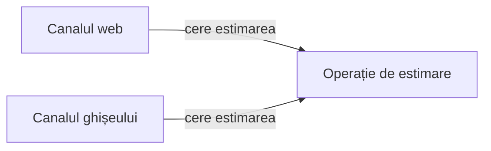

# Cine aplică regula? {.transition}

Am distins conceptele și regulile unui domeniu. Cine le aplică și ce trebuie să știe pentru asta?

::: notes
Legătura cu modelarea domeniului din cursul 4: după ce distingem conceptele și regulile, atribuim comportamentele unor componente ale soluției. O componentă poate fi o funcție, un modul sau o aplicație întreagă; nu presupunem clase. Astăzi alegem cine decide, de ce informații are nevoie și ce se schimbă când se schimbă o regulă.

**Organizare:** minutul 0 din 100; interval 0–15 (15 min), inclusiv coperta, citatul, problema, exercițiul inițial și slide-ul despre responsabilități. 33 de slide-uri cu copertă. []{.pace at=0 of=100}
:::

---

# Citatul zilei

> „Fiecare modul este apoi proiectat să ascundă o asemenea decizie față de celelalte.”
>
> Original: “Each module is then designed to hide such a decision from the others.”

— **David L. Parnas**

[Sursa: On the Criteria To Be Used in Decomposing Systems into Modules, p. 1058](https://akkartik.name/parnas.pdf#page=6)

::: notes
Decizia ascunsă este una dificilă sau susceptibilă de schimbare. Pentru noi: canalele trebuie să poată cere o estimare fără să cunoască limitele și pragul de preț folosite în calcul. Ce Parnas numește „modul” numim în curs componentă.

**Sursă:** articolul original, CACM 15(12), 1972, Conclusion, p. 1058, pagina PDF 6; formulare reverificată la 27 octombrie 2026. Nu deducem din citat că orice regulă cere un modul separat.
:::

---

# Cine calculează prețul expedierii?

Un client cere o estimare pentru expedierea unui colet pe unul dintre cele două **canale**: site-ul sau aplicația operatorului de la ghișeu. Pentru aceleași date, ambele canale trebuie să accepte la același preț sau să refuze. Estimăm doar prețul, fără să expediem coletul.

**Regula convenită cu firma (beneficiarul):** plicul poate avea cel mult **1000 g inclusiv**.

Pentru un plic de 1200 g, site-ul refuză, iar ghișeul acceptă. **Care canal a greșit și de unde știm?**

*Exemplu didactic; regulile și sumele sunt construite pentru acest curs. Lucrăm pe hârtie; toate datele necesare sunt pe slide-uri.*

::: notes
Site-ul respectă regula: plicul de 1200 g depășește limita. Nu aflăm asta comparând cele două canale între ele, ci comparând fiecare răspuns cu regula convenită. Dacă ambele ar accepta, ar fi concordante și totuși ambele greșite. De aici întrebarea cursului: unde stă regula, astfel încât ambele canale să o aplice la fel?

**Organizare:** 2 min: întrebare către clasă, așteptăm răspunsul. []{.pace dur=2}
:::

---

# Unde ați pune verificarea?

**Reguli:** plicul poate avea cel mult **1000 g inclusiv**; formularul web și ghișeul trebuie să aplice aceeași limită. Estimăm prețul, fără să expediem coletul.

Un coleg propune: „Fiecare canal verifică limita înainte să calculeze prețul.”

1. Individual: ce trebuie să știe fiecare canal ca să aplice propunerea? Cine răspunde dacă cele două canale ajung să dea rezultate diferite?
2. În pereche: propuneți altă repartizare a deciziei de acceptare. Ce ar trebui să știe canalul despre componenta care decide și ce cost aduce această repartizare?

::: notes
Fiecare canal ar trebui să cunoască limita și regula de preț; două copii trebuie sincronizate, iar nicio componentă nu răspunde de sincronizarea lor. Alternativa este o operație comună care primește masa și ambalajul și întoarce acceptare/preț sau refuz; costul ei: intrările și rezultatele trebuie convenite și păstrate. În noua repartizare, canalul trebuie să știe doar ce trimite operației și ce primește: interfața ei, numită pe slide-ul operației. Nu numim încă alternativa „corectă”: cerem costul și informațiile necesare. Schimbarea unei reguli o urmărim în a doua parte a cursului.

**Organizare:** 7 min: 2 individual, 2 în pereche, 3 discuție. []{.pace dur=7}
:::

---

# O responsabilitate: rezultat și informație

O **responsabilitate** este ceea ce trebuie să asigure o **componentă** a soluției: **ce rezultat produce** și **de ce informații are nevoie**. O componentă poate fi o funcție, un modul sau o aplicație întreagă; nu presupunem clase.

Pentru estimarea prețului, repartizarea responsabilităților trebuie să răspundă la trei întrebări:

- **Cine decide** dacă coletul este acceptat și cât costă?
- **Ce trebuie să știe** fiecare canal despre acea decizie?
- **Ce se schimbă** când se schimbă o regulă?

Nu proiectăm plata, expedierea sau transportatorul.

::: notes
Întrebările selectează ce comparăm în acest curs: nu numărul de cutii dintr-o diagramă, ci traseul unei cereri și al unei schimbări. Răspunsurile din exercițiul anterior au propus deja două locuri pentru decizie; le comparăm după regulile complete.
:::

---

# De la regulă la responsabilitate {.transition}

Ce trebuie să știe o componentă ca să poată decide?

::: notes
Trecem de la regulile enunțului la responsabilitățile componentelor: regulile complete, operația comună, dependențele, apoi coeziunea și cuplarea prin exemple.

**Organizare:** minutul 15 din 100; interval 15–30 (15 min): reguli 4, responsabilități și dependențe 5, coeziune și cuplare 6. []{.pace at=15}
:::

---

# Ce acceptăm și cât costă?

| Regulă | Conținut |
|--------|------------------------------------------|
| R1 (intrare) | Coletul este descris prin masa în grame întregi și tipul ambalajului. Canalul interpretează textul introdus; componenta care decide verifică valorile primite. |
| R2 (masa acceptată) | Acceptăm numai mase între 1 și 5000 g inclusiv. |
| R3 (ambalaj) | Un plic poate avea cel mult 1000 g; o cutie poate avea orice masă permisă de R2 (masa acceptată). Alt ambalaj este refuzat. |
| R4 (preț) | Un colet acceptat costă 10 lei până la 1000 g inclusiv și 18 lei peste. |

Un refuz nu include preț. Sumele sunt date didactice.

::: notes
Acceptarea și prețul sunt două decizii. O cutie de 1001 g este acceptată și costă 18 lei; un plic cu aceeași masă este refuzat. Nu adăugăm taxe sau rotunjiri.
:::

---

# Ce trebuie să fie comun?

**R5 (canale):** pentru aceeași masă și același ambalaj, ambele canale acceptă la același preț sau refuză: aceasta este **concordanța canalelor**. Textele și aspectul afișării pot diferi.

**R6 (limitele sarcinii):** producem doar o estimare, fără salvare, plată, expediere sau transportator extern.

| Responsabilitate | Informația necesară |
|---|---|
| Interpretarea textului | Formatul intrării din acel canal. |
| Acceptarea și prețul | Masa, ambalajul, regulile de estimare. |
| Afișarea rezultatului | Rezultatul și convențiile canalului. |

::: notes
Concordanța înseamnă acceptare cu aceeași sumă sau refuz în ambele canale. Nu cere mesaje identice. Pentru mai multe motive simultane nu fixăm prioritate. Responsabilitățile sunt conceptuale; tabelul nu impune trei clase.
:::

---

# O operație pe care o putem explica

`estimează(masă, ambalaj)` primește valori și întoarce:

- `acceptat(preț)`; sau
- `refuz(motiv)`.

**Reper:** masa 1–5000 g; plicul cel mult 1000 g; prețul 10 lei până la 1000 g, 18 lei peste. Refuzul nu are preț.

Semnătura și sensul rezultatelor formează **interfața** operației: tot ce trebuie să știe un canal ca s-o folosească.

Operația poate fi o simplă funcție, de exemplu într-o bibliotecă folosită de ambele canale; nu presupune un serviciu de rețea. Nu are nevoie să citească formularul sau să afișeze mesaje.

::: notes
Interfața operației este acordul despre intrări și rezultate. În curs folosim „interfață” numai în acest sens, nu pentru ecranul sau formularul unui canal. Când invocăm operația direct, regulile trebuie să se aplice în continuare. Acest lucru permite verificări fără browser.
:::

---

# Cine depinde de cine?



Săgeata înseamnă **„folosește operația”**, nu circulația tuturor datelor.

**Regula comună:** ambele canale trebuie să respecte aceleași limite de masă și ambalaj și același prag de preț. Operația întoarce rezultatul; canalul îl afișează.

::: notes
Webul și ghișeul depind de intrările și rezultatele operației. Operația nu depinde de un buton sau de ecranul ghișeului. Nu deducem din săgeți procese, servere sau apeluri prin rețea.
:::

---

# Coeziunea: de ce sunt împreună?

**Reguli:** plicul peste 1000 g este refuzat; fiecare canal poate alege textul prin care explică refuzul.

Propunere: `estimează` întoarce un mesaj gata de afișat. În pereche: ce simplifică aceasta? Ce se întâmplă dacă site-ul cere un text scurt, iar ghișeul o explicație detaliată?

**Coeziunea:** cât de bine servesc responsabilitățile unei componente același scop.

::: notes
Lăsați perechile să răspundă înainte de a numi conceptul. Acceptarea coletului și calculul sumei contribuie la același răspuns; formularea mesajului servește scopul fiecărui canal. Mesajul comun simplifică inițial afișarea și evită texte duplicate. Totuși, pentru textele diferite permise de R5 (canale), operația ar trebui să cunoască fiecare canal. Un motiv de refuz separat de text lasă formularea canalului. Coeziunea se discută prin scopuri și motive de schimbare, nu prin lungimea fișierului.

**Organizare:** 3 min, inclusiv răspunsurile. []{.pace dur=3}
:::

---

# Cuplarea: ce trebuie să cunoască ceilalți?

**R5 (canale):** canalele trebuie să rămână concordante. Trei variante:

| | Canalul cunoaște… | Consecință |
|---|---|---|
| A | numai interfața `estimează(masă, ambalaj)` | Nu copiază regulile. |
| B | regulile (limite, prag, ordinea verificărilor) | Se schimbă odată cu regulile. |
| C | un rezultat intermediar al operației, expus pe lângă `acceptat`/`refuz` | Se schimbă când operația este reorganizată, cu aceleași reguli. |

Ce dependență ne ajută și ce dependență ne încurcă? Dependențele dintre componente și detaliile pe care trebuie să le cunoască una despre cealaltă formează **cuplarea**.

::: notes
Cereți întâi consecința fiecărei variante, apoi numiți conceptul. B cuplează canalul de reguli, C de implementarea operației: de exemplu, site-ul alege o pictogramă după o categorie „greu” calculată în `estimează`; dacă operația este reorganizată și categoria dispare, site-ul trebuie schimbat, deși nicio regulă nu s-a schimbat. Apelul operației este o dependență utilă. Eliminarea tuturor dependențelor nu este obiectivul. O interfață mai mică a operației poate proteja decizii interne, dar trebuie să exprime suficient pentru colaborare.

**Organizare:** 3 min, încheierea etapei la minutul 30. []{.pace dur=3}
:::

---

# Comparăm două repartizări {.transition}

Aceleași rezultate, costuri diferite pentru cei care schimbă sistemul.

::: notes
Nu alegem după desenul cu cele mai multe sau cele mai puține cutii. Verificăm traseul unei cereri și al unei schimbări.

**Organizare:** minutul 30 din 100; interval 30–55 (25 min): variante 7, exercițiu de limită 8, discuția alternativelor 6, verificare directă 4. []{.pace at=30}
:::

---

# Varianta cu reguli copiate

**R3 (ambalaj):** plicul de **1000 g inclusiv** este permis. **R4 (preț):** la 1000 g, prețul este 10 lei. **R5 (canale):** canalele trebuie să fie concordante.

Exemplu didactic construit pentru comparație:

| Canal | Condiție folosită pentru plic |
|---|---|
| Web | `masa < 1000` |
| Ghișeu | `masa <= 1000` |

Fiecare canal calculează apoi singur prețul. Copiile pot coincide inițial și pot ajunge să aplice reguli diferite după o schimbare.

::: notes
Defectul este explicit la limita inclusă. Nu este o captură AI sau o eroare observată într-o aplicație reală. Chiar dacă reparăm semnul, costul sincronizării copiilor rămâne.
:::

---

# Varianta cu o operație comună

Ambele canale cer `estimează(masă, ambalaj)` și afișează rezultatul.

**În operație:** masă 1–5000 g; plic până la 1000 g; preț 10 lei până la 1000 g, 18 lei peste; refuz fără preț.

**În fiecare canal:** interpretarea intrării și afișarea.

Cost: trebuie convenite și păstrate sensurile intrărilor, rezultatelor și motivelor de refuz.

::: notes
Centralizarea responsabilității nu garantează că regula este implementată corect. Dacă operația comună are limita greșită, ambele canale vor greși la fel. Compararea canalelor și compararea cu enunțul sunt verificări distincte.
:::

---

# Alegeți o verificare care separă propunerile

**Reguli:** plicul este acceptat până la 1000 g inclusiv; masa acceptată este 1–5000 g; un colet acceptat costă 10 lei până la 1000 g inclusiv și 18 lei peste; canalele trebuie să fie concordante.

**Trei propuneri pentru condiția plicului:** P1 — web `masa < 1000`, ghișeu `masa <= 1000`; P2 — ambele `masa < 1000`; P3 — ambele `masa <= 1000`.

Pe hârtie, apoi în pereche:

1. Alegeți o intrare care deosebește cele trei propuneri. Ce întoarce fiecare canal și ce cere regula?
2. În P2, canalele sunt concordante. Respectă regula firmei? Ce verificare o arată?
3. Ce nu putem afla din aceste rezultate despre locul în care sunt păstrate regulile?

::: notes
Plicul de 1000 g deosebește propunerile: P1 — webul refuză, ghișeul acceptă la 10 lei; P2 — ambele refuză, concordante și totuși greșite; P3 — ambele acceptă la 10 lei, corect. Plicul de 1001 g nu deosebește nimic: toate refuză corect. Concordanța canalelor și respectarea regulii sunt verificări distincte; a doua se face față de enunț. Rezultatele nu arată dacă regula este copiată sau comună: o operație comună cu limita greșită produce exact P2. Operația comună de pe slide-ul anterior păstrează decizia într-un singur loc, așa că o corecție se face o singură dată; urmează organizarea ei internă.

**Organizare:** 8 min: 2 individual, 3 în pereche, 3 comparație. []{.pace dur=8}
:::

---

# O funcție sau două funcții interne?

**Scop comun:** acceptare și preț conform limitelor de masă și ambalaj.

| A | B |
|---|---|
| `estimează` decide acceptarea și suma. | `estimează` coordonează `acceptă` și `preț`. |
| Mai puține dependențe de explicat. | Acceptarea și prețul se pot schimba separat. |
| Regulile sunt grupate într-un loc. | `preț` se folosește numai după acceptare. |

În ambele variante, canalele apelează doar `estimează`.

Ce justificare ați cere înainte de a separa fiecare regulă într-o altă componentă?

::: notes
Ambele variante pot fi justificate. Separarea cere un motiv: evoluție independentă, reutilizare reală sau claritate. Dacă componentele trebuie permanent schimbate împreună, separarea poate adăuga coordonare fără beneficiu. Nu introducem catalogul de șabloane de proiectare.

**Organizare:** 6 min, cu argumente pro și contra. []{.pace dur=6}
:::

---

# Putem verifica fără formular și ghișeu?

Apelăm direct operația propusă, cu **scenariile S1–S5** și rezultatele așteptate din reguli:

| Scenariu | Intrare | Rezultat așteptat |
|---|---|---|
| S1 | Plic, 1000 g | Acceptat, 10 lei. |
| S2 | Plic, 1001 g | Refuz, fără preț. |
| S3 | Cutie, 1001 g | Acceptată, 18 lei. |
| S4 | Cutie, 0 g | Refuz, fără preț. |
| S5 | Cutie, 5000 g, apoi 5001 g | Acceptată, 18 lei; apoi refuz. |

**Reper:** masa 1–5000 g; limita plicului 1000 g; pragul de preț 1000 g. Dacă `estimează` ar primi formularul web în loc de masă și ambalaj, ce ar trebui construit ca să verificăm acest tabel și pentru ghișeu?

::: notes
Un formular web fals sau o conversie de la ghișeu la formularul web: operația ar depinde de un canal, iar verificarea ei separată ar deveni dificilă. Cu masă și ambalaj, tabelul se verifică direct. Tabelul este o verificare propusă, nu rezultatul unei execuții. Testabilitatea apare ca efect al separării responsabilităților, fără implementare obligatorie.

**Organizare:** 4 min. []{.pace dur=4}
:::

---

# Urmărim o schimbare {.transition}

Două limite au aceeași valoare. Au și același sens?

::: notes
Schimbarea separă sensuri pe care valoarea inițială comună le putea ascunde.

**Organizare:** minutul 55 din 100; interval 55–75 (20 min): C1 și predicție 8, comparația schimbărilor 7, sinteză 5. []{.pace at=55}
:::

---

# Limita plicului devine 1500 g

**C1 (limita plicului) schimbă numai regula ambalajului:** plicul este acceptat până la **1500 g inclusiv**.

**Rămân:** masă 1–5000 g; preț 10 lei până la **1000 g inclusiv**, 18 lei peste; refuz fără preț; canalele rămân concordante.

Individual, apoi în pereche:

1. Ce rezultat așteptăm pentru plicuri de 1200, 1500 și 1501 g?
2. Ce risc are o singură constantă `LIMITA = 1000` folosită la ambalaj și la preț?
3. Reguli copiate în web și la ghișeu sau o operație comună apelată de ambele canale: unde schimbați limita plicului și ce reverificați în fiecare organizare?

::: notes
1200 și 1500 g: acceptate la 18 lei; 1501 g: refuz. Înlocuirea aceleiași constante peste tot ar reduce greșit prețul la 10 lei. În varianta copiată actualizăm ambele canale; în cea comună schimbăm regula de acceptare și reverificăm operația și folosirea ei de ambele canale.

**Organizare:** 8 min, cu discuție. []{.pace dur=8}
:::

---

# Harta schimbării

**C1 (limita plicului):** trece la 1500 g; pragul de preț rămâne 1000 g.

| Unde | Ce schimbăm? |
|---|---|
| Acceptarea coletului | Limita plicului și verificările la valorile-limită. |
| Calculul prețului | Regula rămâne; verificăm noile plicuri acceptate la 18 lei. |
| Canalele | Pot actualiza indicația afișată despre limita plicului. |
| Exemplele de acceptare | Scenariul S2 (plic de 1001 g) devine acceptare la 18 lei. |

Operația comună reduce copiile deciziei. Nu elimină toate efectele vizibile ale schimbării.

::: notes
Un text de ajutor „maximum 1000 g” trebuie actualizat chiar dacă operația comună este corectă. Nu promitem că o schimbare de regulă atinge un singur fișier. Separăm componenta care decide de comunicarea deciziei către utilizator.

**Organizare:** 3 min. []{.pace dur=3}
:::

---

# Altă schimbare, altă componentă

**Regulile curente:** plicul este acceptat până la 1500 g inclusiv; pragul de preț rămâne 1000 g; webul și ghișeul apelează `estimează`.

Trei schimbări distincte; fiecare pornește independent de la regulile curente.

A. Site-ul adaugă o avertizare imediată când plicul depășește limita, înainte de a cere estimarea.

B. Apare un al treilea canal, care trebuie să respecte aceleași reguli.

C. Se schimbă numai prețul treptei de peste 1000 g.

În pereche: pentru fiecare schimbare numiți componenta responsabilă și o verificare.

**În plus, pentru A:** cine decide acceptarea? Ce se întâmplă dacă avertizarea folosește încă limita veche?

::: notes
A: afișarea web; avertizarea ajută utilizatorul, dar nu decide: operația comună verifică oricum înainte de a accepta. Cu limita veche în avertizare, site-ul ar avertiza greșit la 1200 g, iar estimarea ar accepta: verificăm că textul respectă regulile, nu mutăm decizia în canal. O verificare repetată nu este greșită în sine; greșită ar fi o a doua componentă care decide. B: noul canal apelează operația; verificăm concordanța canalelor și interpretarea intrărilor. C: calculul comun și rezultatele așteptate, plus textele care ar afișa sume fixate. Nu schimbăm ipotetic și masa sau ambalajul.

**Organizare:** 4 min, continuând comparația cu harta schimbării. []{.pace dur=4}
:::

---

# Ce transmitem celui care dezvoltă soluția?

**Responsabilități:** canalele interpretează și afișează; operația decide acceptarea și prețul.

**Acord:** intrări, rezultate, reguli și exemple la valorile-limită.

**Decizia protejată:** regulile pot evolua fără copii independente în canale.

**Cost și limite:** trebuie respectate semnificațiile convenite ale intrărilor și rezultatelor; textele explicative pot necesita actualizare. Nu am proiectat transportul sau plata.

::: notes
Transmiterea trebuie să păstreze legătura cu enunțul și cu versiunea lui: după C1, plicul de 1001 g nu mai este refuzat. Alegerea unei reprezentări nu înlocuiește regulile și exemplele.

**Organizare:** 5 min, întrebări și sinteză; ajungem la minutul 75. []{.pace dur=5}
:::

---

# Fiecare canal, delegat separat {.transition}

Două sesiuni AI scriu câte un canal. Cine răspunde de regulă?

::: notes
O echipă poate delega fiecare canal unei sesiuni separate a unui asistent AI. Fiecare sesiune primește regulile și scrie propria copie a deciziei de acceptare și a prețului: exact varianta cu reguli copiate din partea a doua a cursului, de data aceasta produsă real, nu construită de noi. Analizăm capturi obținute înainte de curs; la curs nu rulăm instrumente.

**Organizare:** minutul 75 din 100; interval 75–95 (20 min): tranziție 1, cele două sarcini 3, funcția site-ului 3, funcția ghișeului 3, rezultatele 3, C1 4, decizie 3. []{.pace at=75 dur=1}
:::

---

# Două sarcini, aceleași reguli

**Ambele sesiuni primesc, într-un context nou, aceleași reguli:** R1–R6 ale enunțului (intrare, masa acceptată, ambalaj, preț, canale, limitele sarcinii), fără C1 și fără operația comună.

**Sesiunea site-ului, instrucțiunea exactă:**

> Lucrezi la formularul web al firmei. Scrie în JavaScript funcția care primește textul introdus de client pentru masă și ambalajul ales […]

**Sesiunea ghișeului, instrucțiunea exactă:**

> Lucrezi la aplicația operatorului de la ghișeu. Scrie în Python funcția care primește masa și ambalajul introduse de operator […]

**Predicție:** vor răspunde la fel cele două funcții?

::: notes
Fiecare sesiune a primit un context nou și nu a văzut cealaltă funcție. Regulile trimise sunt R1–R6 ale enunțului (limita plicului 1000 g, prag de preț 1000 g), cu R1 formulată fără „operația”, ca să nu sugereze o componentă comună. Instrucțiunile continuă cu rezultatul cerut („și întoarce mesajul afișat: prețul estimat sau motivul refuzului”, respectiv „și întoarce textul afișat operatorului: prețul estimat sau motivul refuzului”) și identic: „Respectă regulile de mai jos. Răspunde cu codul și cel mult cinci rânduri de explicații, în română.” Predicția obișnuită este „da, au aceleași reguli”.

**Sursă:** `scenarios/05-colete/captures/2026-11-19/`: `site-prompt.md`, `ghiseu-prompt.md`, contextul `context-reguli.md`. Claude Haiku 4.5, prin Claude Code 2.1.328, 19 noiembrie 2026, fără unelte; șase rulări pentru fiecare canal.

**Organizare:** 3 min, cu predicțiile prin ridicarea mâinii. []{.pace dur=3}
:::

---

# Funcția scrisă pentru site

**Fragment din răspunsul AI — Claude Haiku 4.5, sesiunea site-ului, rularea 3, 19 noiembrie 2026:**

::::: {.columns}
:::: {.column width="62%"}
```javascript
const masa = parseInt(masaText, 10);
if (isNaN(masa)) {
  return "Masa trebuie să fie […]";
}
// […]
if (ambalaj === "plic" && masa > 1000) {
  return "Plicul este acceptat […]";
}
if (ambalaj !== "plic" && ambalaj !== "cutie") {
  return "Tip de ambalaj neacceptat.";
}
const pret = masa <= 1000 ? 10 : 18;
```
::::
:::: {.column width="38%"}
**Reper:** `parseInt("1000,5", 10)` întoarce 1000: citește cifrele până la primul caracter care nu este cifră.

Individual: ce afișează site-ul pentru plic „1000”, plic „1001”, plic „1000,5” și „Plic” de 500 g?
::::
:::::

::: notes
Plic „1000”: 10 lei. Plic „1001”: refuz pentru plic. Plic „1000,5”: masa devine 1000, deci 10 lei, fără cererea de corectare. „Plic” cu majusculă nu este egal cu `"plic"`: refuz pentru ambalaj neacceptat. Regulile R2–R4 sunt scrise aici încă o dată: limita plicului, intervalul și pragul de preț.

**Sursă:** `haiku45-site-03-response.md`, literal; omise: semnătura funcției, finalul textelor de refuz („un număr întreg. Vă rugăm corectați.”, „doar până la 1000 grame.”), verificarea intervalului 1–5000 g, linia finală care întoarce prețul și explicațiile.

**Organizare:** 3 min: individual, apoi răspunsuri. []{.pace dur=3}
:::

---

# Funcția scrisă pentru ghișeu

**Fragment din răspunsul AI — Claude Haiku 4.5, sesiunea ghișeului, rularea 1, 19 noiembrie 2026:**

::::: {.columns}
:::: {.column width="62%"}
```python
try:
    masa = int(masa_text)
except (ValueError, TypeError):
    return "Masa introdusă nu este validă."
# […]
ambalaj_lower = ambalaj.lower()
if ambalaj_lower == "plic":
    if masa > 1000:
        return "Plicul este acceptat […]"
# […]
if masa <= 1000:
    return "Preț estimat: 10 lei"
```
::::
:::: {.column width="38%"}
**Reper:** `int("1000,5")` ridică `ValueError`; `"Plic".lower()` este `"plic"`.

Individual: ce afișează ghișeul pentru plic „1000”, plic „1001”, plic „1000,5” și „Plic” de 500 g? Unde diferă de site?
::::
:::::

::: notes
Plic „1000”: 10 lei; „1001”: refuz; până aici, la fel ca site-ul. Plic „1000,5”: „Masa introdusă nu este validă.”, deci ghișeul cere corectarea, iar site-ul dă 10 lei. „Plic” de 500 g: devine „plic”, deci 10 lei, iar site-ul refuză. Cele două diferențe merg în sensuri opuse.

**Sursă:** `haiku45-ghiseu-01-response.md`, literal; omise: finalul textului de refuz („doar până la 1000 g.”), semnătura funcției și comentariile, verificarea intervalului 1–5000 g, ramura cutiei și a ambalajului nerecunoscut, ramura de 18 lei și explicațiile.

**Organizare:** 3 min. []{.pace dur=3}
:::

---

# Aceleași reguli, rezultate diferite

| Intrare (rulare înainte de curs, cod integral) | Site, rularea 3 | Ghișeu, rularea 1 |
|---|---|---|
| plic „1000” | Preț estimat: 10 lei | Preț estimat: 10 lei |
| plic „1001” | Plicul este acceptat doar până la 1000 grame. | Plicul este acceptat doar până la 1000 g. |
| plic „1000,5” | Preț estimat: 10 lei | Masa introdusă nu este validă. |
| „Plic”, „500” | Tip de ambalaj neacceptat. | Preț estimat: 10 lei |

**R1 (intrare):** dacă masa nu poate fi interpretată ca număr întreg, canalul cere corectarea. **R5 (canale):** aceeași masă și același ambalaj, același rezultat.

Care rând încalcă R1? Care încalcă R5? De ce nu le-au găsit scenariile S1–S5 (mase întregi, ambalaje scrise exact)?

::: notes
„1000,5” nu este un număr întreg: site-ul încalcă R1 și, cu ghișeul, R5. „Plic” încalcă R5; enunțul nu spune dacă majuscula contează, deci aceasta este o întrebare pentru firmă, nu o greșeală a unui singur canal. S1–S5 conțin numai mase întregi și ambalaje scrise exact; ambele funcții le trec, deci concordanța pe S1–S5 nu arată că regulile sunt aceleași. Rezultatele vin dintr-o rulare a codului făcută înainte de curs, nu din răspunsurile AI.

Selecție: dintre cele șase funcții ale site-ului, numai rularea 3 acceptă „1000,5”; rularea 6 acceptă „1000.0”, celelalte cer corectarea. Trei funcții din douăsprezece transformă „Plic” în „plic” (site 1, ghișeu 1 și 2). Ghișeul 2 și 3 primesc masa ca număr și nu interpretează deloc textul. Am ales perechea care arată divergența; nu descrie frecvența ei.

**Sursă:** `scenarii-executie.md`, generat de `ruleaza-scenarii.py` (Node.js 24.19.0, Python 3.10.11), cu codul din răspunsuri nemodificat; tabelul complet are toate cele 23 de funcții capturate, inclusiv cele de după C1, și intrările lui S1–S5.

**Organizare:** 3 min. []{.pace dur=3}
:::

---

# C1: încă două sesiuni

**C1 (limita plicului):** plicul este acceptat până la **1500 g inclusiv**; pragul de preț rămâne 1000 g. Fiecare funcție a primit C1 într-o sesiune nouă.

**Ghișeu, rularea 2, ramura plicului, înainte și după sesiunea C1:**

:::::: {.columns}
::: {.column width="50%"}
**Înainte:**

```python
if ambalaj_norm == "plic":
    if masa > 1000:
        return "Refuz: plicul […] 1000 g"
    pret = 10
```
:::
::: {.column width="50%"}
**După C1:**

```python
if ambalaj_norm == "plic":
    if masa > 1500:
        return "Refuz: plicul […] 1500 g"
    pret = 10 if masa <= 1000 else 18
```
:::
::::::

**Site, după C1:** s-a schimbat numai limita plicului; „1000,5” dădea înainte 10 lei.

De ce s-a schimbat la ghișeu și linia prețului? Câte sesiuni și verificări cere C1? Ce dă site-ul pentru „1000,5” acum?

::: notes
În ghișeul 2, `pret = 10` era corect numai pentru că limita plicului și pragul de preț aveau aceeași valoare; după C1, un plic de 1200 g ar fi costat 10 lei. Sesiunea C1 a văzut asta și a rescris prețul. Toate cele 11 sesiuni C1 (4 pentru site 3, 3 pentru ghișeul 1, 4 pentru ghișeul 2) au schimbat corect limita și au păstrat pragul: răspunsurile sunt bune. Totuși, schimbarea a trebuit cerută, făcută și verificată o dată pentru fiecare canal; dacă una dintre sesiuni lipsește, canalele nu mai sunt concordante. După C1, site-ul acceptă încă „1000,5” la 10 lei: C1 nu a cerut altceva.

**Sursă:** `haiku45-ghiseu-02-response.md` și `haiku45-c1-ghiseu-02-01-response.md`, ramura `if ambalaj_norm == "plic":`, literal, cu indentarea funcției eliminată și textul refuzului prescurtat („acceptat doar până la”, omis); prompturile `c1-*-prompt.md`.

**Organizare:** 4 min. []{.pace dur=4}
:::

---

# Cine răspunde de regulă?

**Comparația noastră:** fiecare sesiune a primit aceleași reguli și a scris o altă copie a lor. Copiile trec scenariile S1–S5 (valorile-limită ale enunțului), dar se despart la intrări pe care nu le-am scris ca scenarii. Nicio componentă nu răspunde de regulă: concordanța depinde de cine transmite fiecare schimbare fiecărei sesiuni.

**Decizia noastră:**

- `estimează(masă, ambalaj)` decide acceptarea și prețul (R2–R4: masa acceptată, ambalaj, preț); o delegăm o singură dată, iar C1 (limita plicului) se face tot o dată.
- Fiecare sesiune de canal primește **interfața** operației, nu regulile; canalul interpretează textul (R1, intrare) și afișează.
- Adăugăm „1000,5” la verificările fiecărui canal; despre „Plic” întrebăm firma.

::: notes
Operația comună nu rezolvă singură interpretarea textului: R1 o lasă canalelor, deci „1000,5” rămâne o verificare a fiecărui canal. Câștigul este că limita, pragul și prețul există într-un singur loc, iar C1 se face o dată. Lecția despre AI: când delegăm separat părți care trebuie să aplice aceeași regulă, delegăm întâi regula, ca o componentă cu responsabilitate proprie, apoi canalele care o folosesc.

**Organizare:** 3 min; încheierea etapei la minutul 95. []{.pace dur=3}
:::

---

# Transferăm ideea {.transition}

Unde punem regula într-un domeniu nou?

::: notes
Transferul verifică dacă studenții pot explica responsabilitatea fără vocabularul coletelor.

**Organizare:** minutul 95 din 100; interval 95–100 (5 min): exercițiu și încheiere. []{.pace at=95}
:::

---

# Reducerea unui bilet

**Enunț nou:** biletul costă 40 lei; studenții eligibili plătesc 20 lei. Site-ul și casa de bilete trebuie să aplice aceeași regulă. Eligibilitatea este deja furnizată ca da/nu; nu proiectăm verificarea statutului.

Pe hârtie, apoi două răspunsuri în plen:

1. Cine decide suma și ce primește?
2. Cine decide cum o afișează?
3. Reducerea devine 25%. Ce schimbați și ce exemplu verificați?

**De reținut:** numiți responsabilitatea, dependența și consecința unei schimbări.

::: notes
O operație comună primește eligibilitatea și întoarce suma; canalele afișează. După schimbare, studentul plătește 30 lei, ceilalți 40 lei. Verificăm ambele categorii și concordanța canalelor. Cursul 6 precizează mai atent promisiunile operațiilor, inclusiv refuzurile. Echipele pot cere feedback pentru proiect oricând.

**Organizare:** 5 min; încheiere la minutul 100. []{.pace dur=5}
:::
