# Ce are voie să se întâmple acum? {.transition}

Aceeași cerere, permisă ieri, este refuzată azi. Ce s-a schimbat?

::: notes
În cursul 6 am precizat ce promite o operație, inclusiv când refuză. Azi urmărim de ce aceeași operație reușește într-un moment și este refuzată în altul: istoricul manuscrisului, rezumat în stare și date, decide ce evenimente sunt permise acum. Nu adăugăm cerințe noi, ci organizăm promisiunile operațiilor de-a lungul vieții unui obiect.

**Organizare:** minutul 0 din 100; interval 0–15 (15 min), inclusiv coperta, citatul, întrebarea deschisă, problema, exercițiul cu cele șapte evenimente și slide-urile despre stări și tranziții. 36 de slide-uri cu copertă. []{.pace at=0 of=100}
:::

---

# Citatul zilei

> „O mare parte a informaticii se ocupă de mașini de stări.”
>
> Original: “Much of computer science is about state machines.”

— **Leslie Lamport**

[Sursa: Computation and State Machines (2008), p. 1](https://lamport.azurewebsites.net/pubs/state-machine.pdf#page=4)

::: notes
Lamport susține că stările și tranzițiile sunt conceptul comun de sub limbaje și notații diferite. Pentru noi: ciclul de viață al unui manuscris este o mașină de stări, pe care o descriem printr-un tabel de tranziții, fără un limbaj anume. Diagrama de mai târziu este doar o altă reprezentare a aceluiași tabel.

**Sursă:** manuscris pe site-ul autorului, prima propoziție din Introduction, pagina numerotată 1 (pagina PDF 4); formulare reverificată în textul PDF la 12 noiembrie 2026. Vezi `docs/quotations.md`.
:::

---

# O cerere pe care nu ați mai putut-o schimba

Gândiți-vă la o comandă, o cerere de concediu, un bilet, o lucrare trimisă: la un moment dat nu ați mai putut face ceva cu ea (anula, modifica, retrage).

**În ce „stare” era și ce v-ar fi ajutat să știți dinainte? Ați întâlnit o aplicație care vă lăsa să apăsați un buton, dar refuza acțiunea?**

::: notes
Nu căutăm un singur răspuns corect. Pot apărea o comandă care nu se mai anulează după expediere, o lucrare care nu se mai editează după trimitere, un bilet care se anulează cu penalizare, un buton activ care întoarce o eroare. Observăm că utilizatorii vor să știe dinainte ce este permis și că aplicația trebuie să decidă după istoricul cererii, nu după cine apasă. Azi facem explicită această decizie.

**Organizare:** 5 min: întrebare către clasă; notăm câteva exemple, fără să le rezolvăm. []{.pace dur=5}
:::

---

# Un manuscris retras poate fi acceptat?

Un sistem editorial ține evidența manuscriselor trimise unei reviste. **Registrul editorial**, componenta responsabilă, păstrează pentru fiecare manuscris **starea** lui și **datele** înregistrate pe parcurs: fișierul, editorul responsabil, rapoartele de evaluare.

**Regula convenită cu revista (beneficiarul):** autorul poate retrage manuscrisul trimis cât timp nu are decizie; după retragere, nicio decizie nu mai este posibilă.

Ieri autorul a retras manuscrisul M. Azi editorul apasă „Acceptă”. **Ce trebuie să facă registrul și ce trebuie să rămână înregistrat?**

*Exemplu didactic; registrul nu trimite e-mailuri și nu publică. Lucrăm pe hârtie; toate datele necesare sunt pe slide-uri.*

::: notes
Registrul refuză acceptarea: manuscrisul este retras, iar regula nu permite decizii după retragere. Rămân înregistrate fișierul, editorul, rapoartele deja scrise și momentul retragerii. Răspunsul depinde de istoricul manuscrisului, nu de butonul apăsat: de aici întrebarea cursului, cum rezumăm istoricul într-o stare care spune ce este permis acum.

**Organizare:** 2 min: întrebare către clasă, așteptăm răspunsul. []{.pace dur=2}
:::

---

# Care evenimente schimbă starea?

**Reguli** (fiecare eveniment este apelul unei operații):

- `atașează(f)`: autorul atașează fișierul f; numai cât timp manuscrisul este ciornă (netrimis);
- `trimite`: autorul îl trimite revistei; numai pentru o ciornă, dacă există fișier;
- `preia(e)`: editorul e îl preia; numai pentru un manuscris trimis;
- `înregistrează raport(r)`: se adaugă raportul r; numai în evaluare;
- `acceptă` și `respinge`: editorul decide; numai în evaluare, cu cel puțin un raport;
- `retrage`: autorul îl retrage; numai după trimitere, până la decizie.

Un manuscris nou este o ciornă fără date. Un eveniment nepermis este **refuzat**: nimic nu se schimbă.

**M este în evaluare,** cu editorul E1 și raportul Rp1. Individual, apoi discutăm: fiecare dintre cele șapte evenimente **schimbă starea**, **păstrează starea, dar înregistrează ceva** sau **este refuzat**?

::: notes
`acceptă` → Acceptat, `respinge` → Respins, `retrage` → Retras: schimbă starea. `înregistrează raport(Rp2)` păstrează În evaluare și adaugă raportul. `atașează`, `trimite`, `preia` sunt refuzate: nu sunt permise În evaluare. Observăm că răspunsul vine din starea curentă și din reguli, nu din cine cere. Crearea manuscrisului nu este un eveniment al modelului: un manuscris nou este pur și simplu o ciornă fără date. Regulile de pe slide sunt rezumatul celor complete, care urmează.

**Organizare:** 6 min: 3 individual, 3 discuție. []{.pace dur=6}
:::

---

# Stare și eveniment

În cursul 6, „starea” registrului însemna toate valorile lui la un moment dat. Aici le despărțim: **starea** manuscrisului este una dintre etapele cu nume ale ciclului de viață (Ciornă, Trimis, În evaluare etc.), iar **datele** sunt celelalte valori păstrate (fișier, editor, rapoarte). Starea rezumă istoricul; împreună cu datele, decide **ce evenimente sunt permise acum**.

Un **eveniment** este ceva ce se întâmplă și contează pentru model; aici, fiecare eveniment este apelul unei operații asupra manuscrisului.

::: notes
Legătura cu cursul 6: ce numeam acolo starea registrului corespunde aici perechii stare și date; precondițiile și postcondițiile le citesc pe amândouă. De aici înainte, „stare” înseamnă numai etapa cu nume: o listă fixată de beneficiar, care rezumă istoricul manuscrisului. Datele rămân alături și nu se reduc la stare.
:::

---

# Tranziție, condiție, efect

O **tranziție** spune: din starea curentă, la acest eveniment, dacă **condiția** este îndeplinită, trecem în starea următoare, cu un **efect** asupra datelor.

Un eveniment fără tranziție permisă, sau cu condiția neîndeplinită, este **refuzat**: starea și datele rămân neschimbate.

**Ciclul de viață al manuscrisului** descrie stările și tranzițiile, pornind de la starea inițială și precizând stările finale intenționate. Îl scriem ca tabel de tranziții, îl desenăm ca diagramă de stări și îl verificăm pe scenarii.

::: notes
Legătura cu cursul 6: tabelul descrie cazurile de succes ale contractelor operațiilor; regula refuzului le completează. Starea curentă și condiția formează condiția de succes; starea următoare și efectul sunt postcondiția cazului de succes; refuzul cu starea și datele neschimbate este postcondiția cazului de refuz. Noutatea: condiția de succes depinde de starea din ciclul de viață și de celelalte date, iar tranzițiile se înlănțuie. Nu presupunem clase, enumerări sau un instrument.
:::

---

# Precizăm ciclul de viață {.transition}

Ce evenimente sunt permise în fiecare stare și cu ce condiție?

::: notes
Citim regulile complete, apoi le scriem ca tabel de tranziții: reprezentarea pe care o verificăm pe scenarii în etapa următoare.

**Organizare:** minutul 15 din 100; interval 15–35 (20 min): reguli 4, tabel 5, condiția și datele 4, exercițiu 7. []{.pace at=15}
:::

---

# Regulile manuscrisului: context, stări, evenimente

| Regulă | Conținut |
|--------|------------------------------------------|
| R1 (context) | Identificatorii sunt cunoscuți; apelurile sunt secvențiale; un singur manuscris pe scenariu. Nu discutăm autentificarea, concurența, retrimiterea sau programarea publicării. |
| R2 (stări) | Starea este una dintre Ciornă, Trimis, În evaluare, Acceptat, Respins, Retras; un manuscris nou este în Ciornă, fără date. |
| R3 (pregătire și trimitere) | `atașează(f)` numai în Ciornă: f înlocuiește orice fișier anterior. `trimite` numai în Ciornă și numai cu fișier: trece în Trimis, cu momentul trimiterii. |
| R4 (evaluare) | `preia(e)` numai în Trimis: e devine editorul responsabil; manuscrisul trece În evaluare. `înregistrează raport(r)` numai În evaluare: adaugă raportul r; starea rămâne. |

::: notes
Regulile vin de la beneficiar: cine are voie să facă ce și când. Noi le organizăm; nu adăugăm tranziții pe care enunțul nu le cere. Momentele trimiterii, deciziei și retragerii fac parte din date: se înregistrează la tranziția respectivă și se păstrează.
:::

---

# Regulile manuscrisului: decizie, retragere, refuz, date

| Regulă | Conținut |
|--------|------------------------------------------|
| R5 (decizie) | `acceptă`, `respinge` numai În evaluare și numai cu cel puțin un raport: manuscrisul trece în Acceptat, respectiv Respins, cu momentul deciziei. |
| R6 (retragere) | `retrage` numai în Trimis sau În evaluare: manuscrisul trece în Retras, cu momentul retragerii. O ciornă sau un manuscris cu decizie nu se retrage. |
| R7 (evenimente refuzate) | Un eveniment fără tranziție permisă sau cu condiția neîndeplinită este refuzat: starea și datele rămân neschimbate. |
| R8 (date păstrate, stări finale) | Fișierul, editorul și rapoartele nu se șterg la nicio schimbare de stare. Acceptat, Respins și Retras sunt stări finale intenționate: nu au tranziții de ieșire. |

::: notes
R7 și R8 sunt regulile pe care le verificăm la fiecare eveniment refuzat și la fiecare tranziție: nimic nu se modifică la refuz, iar succesul modifică numai datele precizate. În Ciornă, `atașează(f)` poate înlocui fișierul; R8 nu impune păstrarea versiunilor anterioare. Stările finale sunt decizia beneficiarului, nu o lipsă a modelului.
:::

---

# Tabelul de tranziții

| Stare curentă | Eveniment | Condiție | Stare următoare | Efect |
|:-------------|:---------------------------|:---------------|:---------------|:-------------------------|
| Ciornă | `atașează(f)` | — | Ciornă | fișier: f |
| Ciornă | `trimite` | există fișier | Trimis | momentul trimiterii |
| Trimis | `preia(e)` | — | În evaluare | editor: e |
| În evaluare | `înregistrează raport(r)` | — | În evaluare | rapoarte: + r |
| În evaluare | `acceptă` / `respinge` | cel puțin un raport | Acceptat / Respins | momentul deciziei |
| Trimis, În evaluare | `retrage` | — | Retras | momentul retragerii |

**Altfel: refuzat**, fără modificări. Schimbarea stării păstrează datele existente.

::: notes
Tabelul este reprezentarea pe care o verificăm. „—” la condiție înseamnă că nu cerem altceva în afară de starea indicată. Un rând descrie un caz de succes: în starea curentă, dacă condiția este adevărată, evenimentul reușește cu starea următoare și efectul. Dacă niciun rând nu se aplică, evenimentul este refuzat. Rândul `înregistrează raport` nu schimbă starea, dar este o tranziție: are efect asupra datelor și trebuie să fie permis undeva, altfel nicio decizie nu ar deveni posibilă. Rândurile lipsă nu sunt uitări: ele spun „refuzat”.
:::

---

# Condiția nu este o stare

`trimite` cere un fișier; `acceptă` cere un raport. **De ce nu introducem stările „Ciornă cu fișier” și „În evaluare cu raport”?**

Am putea: ar fi alt model corect, cu mai multe stări. Alegem **starea pentru distincția convenită cu beneficiarul** și **condiția pentru verificarea datelor**:

- Ciornă cu sau fără fișier este, pentru revistă, aceeași stare: manuscrisul nu a fost trimis;
- rapoartele sunt date pe care le păstrăm oricum; condiția le numără.

**Legătura cu cursul 6:** starea curentă și condiția formează împreună condiția de succes a evenimentului; refuzul păstrează starea și datele, ca refuzul din contractul atribuirii.

::: notes
Ambele modele descriu aceleași comportamente; diferă prin ce arată. Un tabel cu stări „cu fișier”/„fără fișier” dublează rândurile și amestecă etapele cu detaliile datelor; condițiile păstrează ciclul de viață la șase stări și arată explicit ce date decid. Criteriul nostru: starea grupează valorile pe care beneficiarul le numește la fel; condiția spune ce verificăm în date. Nu există un număr „corect” de stări.
:::

---

# Ce se păstrează când se schimbă starea

**R8 (date păstrate, stări finale):** fișierul, editorul și rapoartele nu se șterg la nicio schimbare de stare.

**Înainte:** M În evaluare; fișier f1, momentul trimiterii, editor E1, rapoarte [Rp1].

**Eveniment:** `retrage`.

**După:** M Retras; fișier f1, momentul trimiterii, editor E1, rapoarte [Rp1], momentul retragerii.

Starea s-a schimbat; datele au rămas, iar momentul retragerii s-a adăugat. **De ce contează că Rp1 rămâne?**

::: notes
Raportul face parte din istoricul evaluării: revista poate explica ce s-a întâmplat înainte de retragere. Retrimiterea rămâne în afara enunțului; nu îi presupunem regulile. Starea nu înlocuiește celelalte date: un model care ar șterge rapoartele la retragere ar respecta tranziția din tabel și ar încălca R8. Verificăm, deci, și starea de după, și datele de după, ca la postcondițiile din cursul 6.

**Organizare:** 1 min: întrebare către clasă, din cele 4 ale condiției și datelor. []{.pace dur=1}
:::

---

# Este permis `acceptă` acum?

**Reguli:** `acceptă` este permis numai În evaluare și numai cu cel puțin un raport; Acceptat, Respins și Retras sunt stări finale intenționate; un eveniment nepermis este refuzat, fără modificări.

| | Stare | Date | `acceptă` este permis? |
|:-|:-----------|:------------------------------|:---------------------|
| 1 | În evaluare | fișier f1, editor E1, niciun raport | ? |
| 2 | Trimis | fișier f1, fără editor | ? |
| 3 | În evaluare | fișier f1, editor E1, rapoarte [Rp1, Rp2] | ? |
| 4 | Retras | fișier f1, editor E1, rapoarte [Rp1] | ? |

Individual, apoi discutăm: pentru fiecare refuz, **ce** îl decide: starea sau condiția? La rândul 4, ce rămâne înregistrat după refuz?

::: notes
1: refuzat de condiție (niciun raport). 2: refuzat de stare (Trimis nu permite decizii; nici nu există editor). 3: permis → Acceptat, cu momentul deciziei înregistrat; decizia însăși este starea. 4: refuzat de stare (Retras este o stare finală intenționată); rămân f1, E1, Rp1 și momentul retragerii. Refuzul este rezultatul corect, nu un defect de reparat. La rândul 1 se poate înregistra un raport, apoi cere acceptarea; la rândul 4 nu există niciun parcurs permis spre Acceptat.

**Organizare:** 7 min: 3 individual, 4 discuție; ajungem la minutul 35. []{.pace dur=7}
:::

---

# Urmărim ciclul de viață {.transition}

Aceleași evenimente, în altă ordine: același rezultat?

::: notes
Verificăm tabelul pe scenarii: un parcurs normal, o retragere, o decizie după retragere și două ordini ale acelorași evenimente.

**Organizare:** minutul 35 din 100; interval 35–60 (25 min): diagrama 3, S1 5, exercițiul S3–S4 8, două ordini 6, stări finale 3. []{.pace at=35}
:::

---

# Același tabel, desenat

:::::: {.columns align=center}
::: {.column width="58%"}

```mermaid
%%{init: {"theme":"base","themeVariables":{"primaryColor":"#F3F7F8","primaryTextColor":"#0A2145","primaryBorderColor":"#087373","lineColor":"#087373","fontFamily":"Arial","fontSize":"32px"}}}%%
stateDiagram-v2
    direction LR
    accTitle: Ciclul de viață al unui manuscris
    accDescr: Tranzițiile numerotate sunt explicate în tabel. Din Ciornă se trece în Trimis, din Trimis în starea În evaluare, de unde se ajunge în Acceptat sau Respins; retragerea duce din Trimis sau În evaluare în Retras. Atașarea fișierului și înregistrarea unui raport păstrează starea.
    state "Ciornă" as C
    state "Trimis" as T
    state "În evaluare" as E
    state "Acceptat" as A
    state "Respins" as R
    state "Retras" as W
    [*] --> C
    C --> C: 1
    C --> T: 2
    T --> E: 3
    E --> E: 4
    E --> A: 5
    E --> R: 6
    T --> W: 7
    E --> W: 7
```

:::
::: {.column width="40%"}
| Nr. | Eveniment și condiție |
|:---:|---|
| 1 | `atașează(f)` |
| 2 | `trimite`, dacă există fișier |
| 3 | `preia(e)` |
| 4 | `înregistrează raport(r)` |
| 5 | `acceptă`, cu cel puțin un raport |
| 6 | `respinge`, cu cel puțin un raport |
| 7 | `retrage` |
:::
::::::

Evenimentele refuzate nu sunt desenate. Diagrama arată dintr-o privire stările fără ieșiri: din Acceptat, Respins și Retras nu pleacă nicio săgeată.

::: notes
Diagrama este reprezentarea tabelului, nu un model suplimentar; efectele asupra datelor nu apar în ea, deci tabelul rămâne referința pentru verificare. Buclele 1 și 4 sunt tranziții care păstrează starea și modifică datele. Notația nu este obligatorie: o diagramă ajută când întrebarea este „de unde se ajunge unde”; tabelul, când întrebarea este „ce se înregistrează”.

**Organizare:** 3 min. []{.pace dur=3}
:::

---

# Scenariul S1 (parcurs normal)

**Din I0:** M în Ciornă, fără date.

| Pas | Eveniment permis | Stare după | Date adăugate |
|:-----|:----------------------------------|:---------------|:---------------------------|
| 1 | `atașează(f1)` | Ciornă | fișier f1 |
| 2 | `trimite` | Trimis | momentul trimiterii |
| 3 | `preia(E1)` | În evaluare | editor E1 |
| 4 | `înregistrează raport(Rp1)` | În evaluare | raport Rp1 |
| 5 | `acceptă` | Acceptat | momentul deciziei |

**Fișierul precede trimiterea; raportul precede acceptarea.** S1 arată că Acceptat este **accesibil** din I0: există o secvență de evenimente permise care ajunge acolo. Datele adăugate la fiecare pas se păstrează.

::: notes
La fiecare pas sunt îndeplinite cerințele de stare și condiția; datele din coloana finală se adaugă celor existente. O trasare verifică o singură secvență; pentru accesibilitate, una este suficientă: o stare este accesibilă dacă există cel puțin o secvență de evenimente permise care ajunge la ea.

**Organizare:** 5 min, cu întrebări. []{.pace dur=5}
:::

---

# Retragerea și decizia ulterioară

**Din I0:** M în Ciornă, fără date. În Ciornă putem atașa un fișier, apoi trimite manuscrisul; `trimite` înregistrează momentul trimiterii. Din Trimis, `preia(E1)` înregistrează editorul și trece În evaluare, unde putem adăuga rapoarte.

**Reguli:** `retrage` din Trimis sau În evaluare duce în Retras și înregistrează momentul retragerii; `acceptă` cere În evaluare și cel puțin un raport. Datele existente se păstrează. Din Retras, orice eveniment este refuzat, fără modificări.

**Scenariul S3 (retragere din evaluare):** din I0, `atașează(f1)`, `trimite`, `preia(E1)`, `înregistrează raport(Rp1)`, apoi `retrage`.

**Scenariul S4 (decizie după retragere):** continuarea lui S3: `acceptă`.

Pe hârtie, apoi discutăm: pentru fiecare pas din S3 și pentru S4, permis sau refuzat, starea și datele de după. **Ce vede editorul la S4 și ce rămâne din munca lui?**

::: notes
S3: primii patru pași ca în S1; `retrage` permis → Retras; date: f1, E1, [Rp1], momentul trimiterii, momentul retragerii; fără decizie. S4: `acceptă` refuzat (Retras nu permite decizii); starea și datele rămân exact cele de după S3, inclusiv Rp1. Editorul primește un refuz; enunțul nu precizează textul afișat; raportul lui rămâne înregistrat. Este răspunsul la întrebarea de la început.

**Organizare:** 8 min: 3 pe hârtie, 5 discuție. []{.pace dur=8}
:::

---

# Scenariul S6 (două ordini): două rezultate

**Reguli:** `acceptă` este permis numai În evaluare, cu cel puțin un raport, și duce în Acceptat; `retrage` este permis numai în Trimis sau În evaluare și duce în Retras; Acceptat și Retras sunt stări finale intenționate; evenimentul nepermis este refuzat.

**Punctul de pornire, comun:** M În evaluare, fișier f1, editor E1, rapoarte [Rp1].

| Ordinea | Pasul 1 | Pasul 2 | Stare finală |
|:------|:----------|:----------|:------------|
| (a) | `retrage` | `acceptă` | ? |
| (b) | `acceptă` | `retrage` | ? |

Aceleași două evenimente. Câte sunt refuzate în fiecare ordine? Care ordine este „corectă”?

::: notes
(a): `retrage` permis → Retras; `acceptă` refuzat; final Retras. (b): `acceptă` permis → Acceptat; `retrage` refuzat; final Acceptat. În fiecare ordine exact un eveniment este refuzat. Ambele sunt corecte față de reguli; ordinea vine din lume (cine a apăsat primul), iar modelul trebuie să dea un rezultat precis pentru fiecare. Starea finală depinde de ordine tocmai pentru că stările finale nu au ieșiri. Cu apeluri secvențiale, nu există „simultan”; concurența rămâne în afara exercițiului.

**Organizare:** 6 min: 2 individual, 4 discuție. []{.pace dur=6}
:::

---

# Stări finale intenționate

**R8 (date păstrate, stări finale):** Acceptat, Respins și Retras nu au tranziții de ieșire, **prin decizia beneficiarului**: retrimiterea și programarea publicării sunt în afara exercițiului.

| Stare | Are ieșire? | De ce |
|:-------------------|:-------------------------------|:-------------------------------|
| Acceptat | nu | finală intenționată |
| Ciornă, fără fișier | da: `atașează(f)` | nu este finală, deși `trimite` este refuzat |
| În evaluare, fără raport | da: `înregistrează raport`, `retrage` | nu este finală, deși deciziile sunt refuzate |

Lipsa unei ieșiri este o decizie de notat, nu o omisiune. **Ce ar însemna să permitem `retrage` din Acceptat?**

::: notes
Ar fi altă regulă, cu alte consecințe (un manuscris acceptat retras înainte de publicare), pe care numai beneficiarul o poate stabili; nu o adăugăm pentru simetrie. Distingem „nu mai este nimic de făcut, intenționat” de „nu se mai poate face ce vrem, din greșeală”: etapa următoare arată al doilea caz.

**Organizare:** 3 min; ajungem la minutul 60. []{.pace dur=3}
:::

---

# Căi excepționale {.transition}

Un tabel care arată bine poate ascunde un parcurs imposibil?

::: notes
Verificăm un tabel propus prin trasare: căutăm un parcurs pe care regulile îl interzic, dar tabelul îl permite, și o stare pe care regulile o cer, dar la care tabelul nu poate ajunge. Nu rulăm cod în timpul cursului.

**Organizare:** minutul 60 din 100; interval 60–80 (20 min): tabelul propus și S2 6, întrebările 5, trei cazuri 4, corecție 3, limite 2. []{.pace at=60}
:::

---

# Tabelul propus P

| Stare curentă | Eveniment | Condiție | Stare următoare |
|:-------------------|:-----------------------|:-----------------|:-----------------|
| Ciornă | `atașează(f)` | — | Ciornă |
| Ciornă | `trimite` | — | Trimis |
| Trimis | `preia(e)` | — | În evaluare |
| În evaluare | `acceptă` / `respinge` | cel puțin un raport | Acceptat / Respins |
| Trimis, În evaluare | `retrage` | — | Retras |

**Altfel: refuzat. Reguli:** trimiterea cere fișier; deciziile cer un raport, înregistrat În evaluare.

Pe hârtie, apoi discutăm: din I0 (Ciornă, fără date), **scenariul S2 (trimitere fără fișier)**, `trimite`, apoi `preia(E1)`. Unde ajunge M sub P după fiecare pas? Ce cer regulile?

::: notes
P este o propunere de tabel de tranziții; are cinci rânduri, pare complet și are două abateri față de enunț: `trimite` nu cere fișier, iar rândul `înregistrează raport` lipsește, deși deciziile cer un raport. Nu le numim încă; studenții le găsesc prin trasare. S2: sub P, `trimite` este permis fără fișier → Trimis, apoi `preia(E1)` → În evaluare: un manuscris fără fișier ajunge în evaluare, contrar lui R3. P este construit pentru verificare; nu este o captură AI.

**Organizare:** 6 min: citim tabelul 2, trasare 2, discuție 2. []{.pace dur=6}
:::

---

# Ce permite și ce nu permite P?

**P:** în Ciornă, `atașează(f)` păstrează starea și înregistrează f, iar `trimite` trece în Trimis fără condiție. `preia(e)` trece din Trimis În evaluare; de aici, `acceptă`/`respinge` cer un raport. `retrage` duce din Trimis sau În evaluare în Retras. Restul este refuzat.

**Regulile enunțului:** trimiterea cere fișier; În evaluare putem înregistra rapoarte, necesare deciziilor. **I0:** Ciornă, fără date.

Pe hârtie, apoi discutăm:

1. După `trimite` și `preia(E1)`, M este În evaluare, fără fișier și fără raport. Ce evenimente permite P de aici? Găsiți o secvență care duce M în Acceptat sub P sau explicați de ce nu există.
2. Care rând lipsește și care condiție lipsește?

::: notes
1: din În evaluare, P permite numai `retrage`; `acceptă` și `respinge` cer un raport, dar niciun eveniment din P nu înregistrează unul: Acceptat nu este accesibil dintr-o ciornă nouă. 2: lipsesc condiția „există fișier” la `trimite` și rândul `înregistrează raport(r)`. Prima abatere permite prea mult; a doua, prea puțin. Trasarea face consecințele concrete; abaterile se pot observa și comparând tabelul cu regulile.

**Organizare:** 5 min: 2 pe hârtie, 3 discuție. []{.pace dur=5}
:::

---

# Interzisă, finală sau inaccesibilă?

Aceeași observație, „nu se mai poate face X”, are trei cauze; numai ultima este o greșeală de model:

| Cauza | Exemplu | Ce înseamnă |
|:--------------------|:-------------------|:------------------------------------|
| **Tranziție interzisă** | `retrage` din Acceptat | regula o refuză; refuzul este corect |
| **Stare finală intenționată** | Acceptat | nicio ieșire, prin decizia beneficiarului |
| **Stare inaccesibilă** | Acceptat, sub P | nicio secvență permisă din I0 nu ajunge acolo, deși regulile o cer: P este greșit |

Un **blocaj** este forma extremă: o stare în care niciun eveniment nu mai este permis, fără să fie finală intenționată. Sub P, În evaluare nu este blocaj (`retrage` rămâne permis), dar starea Acceptat, cerută de reguli, este inaccesibilă.

::: notes
Aceeași observație, „nu se mai poate face X”, are trei cauze: o regulă (corectă, nu reparăm), o decizie (notată, nu reparăm) sau o greșeală de model (reparăm). Întrebarea de verificare este mereu aceeași: ce cer regulile beneficiarului? Explorarea sistematică a stărilor accesibile și a blocajelor urmează în cursul 9; azi le găsim prin trasare.

**Organizare:** 4 min. []{.pace dur=4}
:::

---

# Corecția noastră

**R3 (pregătire și trimitere):** `trimite` este permis numai în Ciornă și numai cu fișier. **R4 (evaluare):** `înregistrează raport(r)` este permis numai În evaluare și păstrează starea.

| Stare curentă | Eveniment | Condiție | Stare următoare | Efect |
|:-------------|:--------------------------------|:-----------|:--------------|:--------------|
| Ciornă | `trimite` | **există fișier** | Trimis | momentul trimiterii |
| În evaluare | **`înregistrează raport(r)`** | — | În evaluare | rapoarte: + r |

**Reverificăm:** scenariul S2 (trimitere fără fișier) → `trimite` refuzat, M rămâne în Ciornă; scenariul S1 (parcurs normal) → Acceptat accesibil, prin pasul 4.

::: notes
Corecția se justifică prin regulă și scenariu, nu prin simetrie. După corecție, tabelul coincide cu cel din etapa a doua. Reverificăm S2, care trebuie refuzat, și S1, care trebuie să ajungă în Acceptat. S1 nu funcționa sub P: lipsea înregistrarea raportului.

**Organizare:** 3 min. []{.pace dur=3}
:::

---

# Ce stabilește o trasare

**Scenariul S1 (parcurs normal)** arată că Acceptat este accesibil: o secvență ajunge acolo.

**„Orice manuscris în Trimis sau În evaluare are fișier”** privește **toate** secvențele. O trasare nu o poate stabili; o justificăm pornind din I0: intrarea în Trimis cere fișier, intrarea În evaluare se face numai din Trimis, iar fișierul nu se șterge. Afirmația este un **invariant** (ultimul rând).

| Afirmație | Ce o susține |
|:-----------------------------------|:------------------------------------|
| o stare este accesibilă | o secvență care ajunge acolo |
| o stare nu este accesibilă | un argument despre toate secvențele |
| un invariant (cursul 6): o proprietate adevărată la orice moment | adevărată în I0 și păstrată de fiecare tranziție |

::: notes
Este aceeași distincție ca în cursul 6 între un exemplu și argumentul pentru toate cazurile. Ultimul rând este invariantul din cursul 6, citit pe ciclul de viață: dacă starea și datele sunt valide inițial și fiecare tranziție păstrează validitatea, ele rămân valide după orice secvență. Aici: un manuscris în Trimis, În evaluare sau cu decizie are fișier, pentru că fiecare tranziție îl păstrează. În cursul 9 explorăm sistematic toate combinațiile accesibile de stare și date ale unui model de dimensiuni reduse și discutăm ce rămâne în afara explorării.

**Organizare:** 2 min; ajungem la minutul 80. []{.pace dur=2}
:::

---

# Verificăm un ciclu de viață delegat {.transition}

Un tabel propus de altcineva spune tot ce avem nevoie?

::: notes
Analizăm capturi reale, obținute înaintea cursului: Claude Haiku 4.5, prin Claude Code 2.1.322, la 12 noiembrie 2026, fără unelte și fără contextul proiectului. Evaluatorul (agent AI de revizuire) a primit într-un context nou enunțul, sarcina și răspunsul integral. Am rulat câte două încercări și am ales câte una pentru discuție; selecția nu descrie performanța tipică a modelului. Toate încercările sunt în arhiva capturilor. La curs nu rulăm instrumente.

**Organizare:** minutul 80 din 100; interval 80–95 (15 min): sarcină 3, analiză 4, promptul evaluatorului AI 2, revizuire 4, decizie 2. []{.pace at=80}
:::

---

# Ce cerem asistentului AI?

> Propune tabelul de tranziții al manuscrisului: stare curentă, eveniment, condiție, stare următoare și efect asupra datelor. Precizează ce se întâmplă cu un eveniment refuzat și ce date se păstrează la schimbarea stării. Verifică S1–S7 […]. Spune care stări sunt finale intenționate și dacă Acceptat este accesibil dintr-o ciornă nouă. Nu scrie cod. Răspunde în română, în maximum 450 de cuvinte.

**Context:** regulile R1–R8 de mai devreme, integral: evenimentele permise în fiecare stare, condițiile lui `trimite` (fișier) și ale deciziilor (un raport), retragerea din Trimis sau În evaluare, refuzul fără modificări, datele păstrate.

**Date:** I0 = Ciornă fără date; scenariile S1–S7: parcursul normal, trimiterea fără fișier, retragerea din evaluare, decizia după retragere, acceptarea fără raport, cele două ordini, retragerea unei ciorne.

::: notes
Instrucțiunea este cea trimisă efectiv, urmată de enunțul integral; omisiunea marcată din citat este enumerarea cerințelor pentru fiecare scenariu. Un evaluator (agent AI de revizuire) a primit apoi și sarcina exactă, pentru a judeca propunerea față de ce s-a cerut.

**Organizare:** 3 min. []{.pace dur=3}
:::

---

# Ce propune analistul AI?

**Analistul AI — Claude Haiku 4.5, captură din 12 noiembrie 2026; fragmente:**

> […]
>
> **S1** (normal): ataseaza(f1)✓→Ciornă, trimite✓→Trimis, preia(E1)✓→ÎnEval, inregistreaza_raport(Rp1)✓→ÎnEval, accepta✓→Acceptat. ✓ **Permis** complet.
>
> **Acceptat accesibil din Ciornă nouă?** **NU.** Singura cale către Acceptat este evenimentul `accepta` din ÎnEval, care necesită ≥1 raport. […] Lanțul este **unic: Ciornă → Trimis → ÎnEval → Acceptat**. Acceptat nu este direct accesibil din Ciornă.

**Enunțul trimis** cerea „dacă Acceptat este accesibil dintr-o ciornă nouă”, fără să definească „accesibil”. **Regulă:** `acceptă` numai În evaluare, cu cel puțin un raport.

**Ce sens dă analistul AI cuvântului „accesibil”? Cu ce sens sunt compatibile „NU” și propria lui trasare S1 (parcurs normal)?**

::: notes
Tabelul de tranziții (omis pe slide) și scenariile S1–S7 din răspunsul integral sunt corecte, inclusiv datele păstrate și stările finale intenționate. Încheierea răspunde „NU” citind „accesibil” ca „într-un singur pas”: ultima propoziție spune „nu este direct accesibil”. Este un sens consacrat (relația de accesibilitate dintr-un model Kripke leagă stări aflate la un pas), iar enunțul nostru nu l-a exclus. Cu acest sens, „NU” și S1 sunt compatibile; cu sensul nostru, „printr-o secvență de evenimente permise”, răspunsul este „da, prin S1”. Din răspuns lipsește precizarea sensului ales, nu o trasare. Cealaltă analiză păstrată are aceeași lectură („nu este accesibil direct”). Definiția a fost adăugată ulterior în enunț (vezi „Decizia noastră”). Fragmentele sunt fidele; „ÎnEval” este prescurtarea modelului pentru În evaluare.

**Organizare:** 4 min: răspuns individual, apoi discuție. []{.pace dur=4}
:::

---

# Promptul evaluatorului AI

**Evaluator (agent AI de revizuire), context nou:** enunțul, sarcina analistului AI și răspunsul integral; fără observațiile noastre.

**Instrucțiunea exactă, la începutul promptului:**

> Ești evaluator (agent AI de revizuire). Verifică propunerea exclusiv față de enunț și sarcină. Pentru fiecare observație indică fragmentul, regula și un scenariu concret, cu starea de pornire și rezultatul așteptat. Verifică fiecare rând al tabelului de tranziții, condițiile, efectele, evenimentele refuzate, datele păstrate, stările finale intenționate și accesibilitatea lui Acceptat. Confirmă și afirmațiile corecte; nu presupune că trebuie să existe greșeli. Nu scrie cod. Răspunde în română, în maximum 350 de cuvinte.

**Predicție, înainte de a vedea răspunsul:** propunerea ajunge în Acceptat prin scenariul S1 (parcurs normal), dar răspunde „NU”, fără să spună în ce sens. Va semnala evaluatorul AI sensul ales?

::: notes
Instrucțiunea cere verificarea fiecărui rând și confirmarea afirmațiilor corecte; nu îi semnalăm ce am observat noi și nu îi cerem un număr minim de defecte.

**Sursă:** instrucțiunea integrală din `evaluator-instructiune.md`; intrarea completă în `evaluator-prompt.md`, arhiva din 12 noiembrie 2026.

**Organizare:** 2 min; predicții prin ridicarea mâinii, fără discuție. []{.pace dur=2}
:::

---

# Revizuirea confirmă fiecare fragment

**Evaluatorul AI — Claude Haiku 4.5, captură din 12 noiembrie 2026; fragmente:**

> Propunerea este **corectă și completă**. […]
>
> **S1** (normal): Lanțul Ciornă → Trimis → ÎnEval → ÎnEval → Acceptat este valid; toate evenimentele permise. ✓
>
> **Accesibilitate Acceptat:** NU din Ciornă nouă — argumentul lanțului obligatoriu (Ciornă → Trimis → ÎnEval → Acceptat) este riguros. […] ✓

**Enunțul trimis** nu definea „accesibil”. Într-un pas, Acceptat nu se atinge din Ciornă; printr-o secvență de evenimente permise, scenariul S1 (parcurs normal) îl atinge.

Evaluatorul AI confirmă S1 și confirmă „NU”. **Cu ce sens al lui „accesibil” sunt compatibile cele două confirmări? Ce ar fi fost util să semnaleze?**

::: notes
Sunt compatibile numai cu sensul „într-un pas”, pe care evaluatorul AI îl preia de la analist fără să-l numească. Util ar fi fost să semnaleze că termenul nu este definit în enunț și că răspunsul depinde de sens: „NU” într-un pas, „da, prin S1” printr-o secvență. Nu reproșăm sensul ales, ci faptul că rămâne implicit. Cealaltă revizuire păstrată confirmă la fel propunerea („nu sunt observații de corectat”). O revizuire care confirmă totul nu este inutilă: rândurile tabelului chiar sunt corecte; dar verdictul despre accesibilitate rămâne al nostru.

**Organizare:** 4 min: răspunsuri individuale, apoi discuție. []{.pace dur=4}
:::

---

# Decizia noastră

**Păstrăm** din propunere tabelul de tranziții, scenariile S1–S7, datele păstrate și stările finale intenționate: sunt susținute de regulile enunțului trimis.

**Precizăm** un punct: analistul AI a citit „accesibil” ca „într-un pas”, un sens consacrat (de exemplu, în modelele Kripke), cu care „NU” este corect. Noi voiam sensul „printr-o secvență de evenimente permise”: cu el, **Acceptat este accesibil** dintr-o ciornă nouă, prin scenariul S1 (parcurs normal).

**Clarificăm enunțul:** ambiguitatea era a noastră. „Accesibil din I0” înseamnă acum explicit că există o secvență de evenimente permise din I0 până la starea căutată. Capturile păstrează formularea inițială.

::: notes
Verdictul aparține oamenilor și se sprijină pe regulă și scenariu. Precizarea nu schimbă tabelul, ci sensul unei afirmații despre el. Lecția privește întâi enunțul: un termen cu mai multe sensuri consacrate trebuie definit; apoi, un răspuns bun își numește sensul ales. Nu cerem ca orice propunere sau revizuire să fie greșită: aceleași verificări ar fi confirmat o concluzie corectă. Ultima observație este o lecție despre enunț, nu despre model.

**Organizare:** 2 min; încheierea etapei la minutul 95. []{.pace dur=2}
:::

---

# Transferăm ciclul de viață {.transition}

Aceleași întrebări, alte reguli.

::: notes
Transferăm metoda de citire a unui ciclu de viață, nu regulile revistei.

**Organizare:** minutul 95 din 100; interval 95–100 (5 min): exercițiu și încheiere. []{.pace at=95}
:::

---

# O comandă la cafenea

**Enunț nou:** o comandă este Plasată, apoi În pregătire, apoi Gata, apoi Ridicată. `anulează` este permis **numai** în Plasată și duce în Anulată. Ridicată și Anulată nu mai permit evenimente. Evenimentele nepermise sunt refuzate, fără modificări; produsele comandate și momentul comenzii se păstrează.

**Înainte:** comanda K este În pregătire, cu două produse.

1. `anulează(K)`: permis sau refuzat? Este o tranziție interzisă sau un rând uitat?
2. Este Ridicată o stare finală intenționată? Dar Gata?
3. Independent, din altă stare: o comandă J este Plasată, cu două cafele, la ora 10:15. După `anulează(J)`, ce rămâne înregistrat?

::: notes
1: refuzat; tranziție interzisă prin regulă, nu rând uitat, deoarece enunțul spune „numai în Plasată”. 2: Ridicată, da (nu există evenimente după); Gata, nu (urmează ridicarea). 3: Anulată, cu produsele și momentul comenzii păstrate. Regulile se citesc din noul enunț; nu importăm retragerea revistei. La laborator, după cursul 8, ciclul de viață se combină cu un expeditor extern și cu reîncercările. Feedbackul pentru proiect poate fi cerut oricând.

**Organizare:** 5 min, încheiere la minutul 100. []{.pace dur=5}
:::
