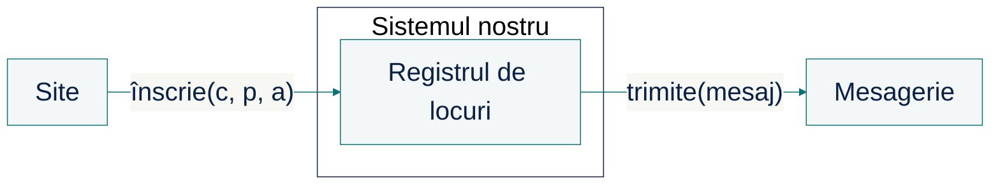

# Cine coordonează o operație care iese din sistem? {.transition}

Sistemul nostru a acceptat o cerere, dar un serviciu extern a raportat un eșec. Ce îi spunem utilizatorului?

::: notes
În cursul 7 am urmărit un singur obiect de-a lungul vieții lui. Azi o operație traversează o graniță: o parte a muncii este făcută de un serviciu pe care nu îl controlăm. Întrebarea cursului: cine coordonează, ce promitem când componenta din exterior eșuează și ce se întâmplă când cererea vine a doua oară.

**Organizare:** minutul 0 din 100; interval 0–15 (15 min), inclusiv coperta, citatul, întrebarea deschisă, problema, exercițiul de predicție și slide-ul despre graniță. 34 de slide-uri cu copertă. []{.pace at=0 of=100}
:::

---

# Citatul zilei

> „Orice organizație care proiectează un sistem (în sens larg) va produce o soluție a cărei structură este o copie a structurii de comunicare a organizației.”
>
> Original: “Any organization that designs a system (defined broadly) will produce a design whose structure is a copy of the organization's communication structure.”

— **Melvin E. Conway**

[Sursa: Conway’s Law — formularea autorului](https://www.melconway.com/Home/Conways_Law.html)

::: notes
Granițele dintre componente urmează adesea granițele dintre organizații: serviciul de mesagerie din exemplul de azi este operat de altă firmă, deci îl cunoaștem numai prin interfața lui și prin ce presupunem despre el. Conway descrie o tendință, nu o regulă de proiectare; pentru noi, concluzia este că o graniță organizațională trebuie făcută explicită în model, cu presupunerile ei.

**Sursă:** pagina autorului, formularea introdusă prin „Here is one form of the paper's thesis”; nu o confundați cu variantele din alte surse. Reverificată la 12 noiembrie 2026. Vezi `docs/quotations.md`.
:::

---

# O confirmare care nu a venit

Gândiți-vă la o plată, o înscriere, o comandă online: ați apăsat butonul, pagina s-a blocat sau a afișat o eroare, iar confirmarea nu a venit.

**Ați apăsat din nou? Ce s-a întâmplat: două comenzi, niciuna sau una cu două confirmări? De unde ați fi putut afla ce s-a înregistrat de fapt?**

::: notes
Nu căutăm un singur răspuns corect. Pot apărea plăți duble, comenzi înregistrate fără confirmare, confirmări pentru comenzi inexistente, pagini care spun „nu apăsați din nou”. Observăm că utilizatorul nu vede decât răspunsul canalului, iar sistemul trebuie să decidă ce înseamnă o cerere repetată. Azi facem explicite aceste decizii.

**Organizare:** 5 min: întrebare către clasă; notăm câteva exemple, fără să le rezolvăm. []{.pace dur=5}
:::

---

# Înscriere acceptată, confirmare eșuată

Un centru cultural organizează ateliere cu locuri limitate. **Registrul de locuri**, componenta pe care o proiectăm, primește cererile de înscriere de la site și înregistrează înscrierile acceptate. După fiecare înscriere acceptată, registrul cere unui serviciu extern de mesagerie, operat de altă firmă (pe scurt, **mesageria**), să trimită participantului o confirmare.

**Regula convenită cu centrul (beneficiarul):** eșecul confirmării nu anulează o înscriere acceptată; centrul preferă un participant înscris fără confirmare unui participant cu confirmare fără loc.

P1 cere un loc la atelierul A de fotografie nocturnă. Registrul acceptă, dar mesageria răspunde `eșec`. **Ce îi spunem site-ului? Ce rămâne înregistrat?**

*Exemplu didactic; registrul nu trimite el însuși mesaje. Lucrăm pe hârtie; toate datele necesare sunt pe slide-uri.*

::: notes
Îi spunem `acceptat`: înscrierea există, locul este consumat, iar lângă înscriere rămâne rezultatul `netrimisă`: mesageria a raportat `eșec`, fără să știm dacă mesajul a ajuns. Răspunsul nu depinde de mesagerie, ci de regula beneficiarului; dar trebuie să rămână consemnat undeva că trimiterea nu a fost confirmată de mesagerie. De aici întrebarea cursului: cine coordonează pașii și ce promitem pentru fiecare.

**Organizare:** 2 min: întrebare către clasă, așteptăm răspunsul. []{.pace dur=2}
:::

---

# Aceeași cerere, a doua oară

**Reguli:** atelierul A are un număr fix de locuri. O cerere de înscriere este acceptată dacă participantul nu este înscris și există loc; în celelalte cazuri este refuzată. După acceptare, registrul cere mesageriei să trimită confirmarea; mesageria răspunde `trimis` sau `eșec`, iar eșecul confirmării nu anulează înscrierea.

**Înainte:** 2 locuri libere, nicio înscriere. Site-ul trimite `înscrie(c1, P1, A)`, unde c1 este identificatorul cererii; registrul acceptă, iar mesageria răspunde `eșec`. Site-ul nu ajunge să afișeze răspunsul și trimite din nou `înscrie(c1, P1, A)`.

Individual, apoi discutăm: regulile de mai sus nu spun nimic despre o cerere primită a doua oară. **Ce ar răspunde un registru care îi aplică regula de acceptare? Ce ar trebui să răspundă și ce ar trebui să rămână înregistrat?**

::: notes
Aplicată a doua oară, regula de acceptare dă `refuz`: P1 este deja înscris. Site-ul ar afișa un refuz pentru o înscriere reușită. Răspunsul pe care îl vrem: `acceptat`, un loc liber, o singură înscriere; identificatorul c1 arată că este aceeași cerere, nu una nouă. Unii studenți vor propune refuzul, alții a doua înscriere: răspunsurile diferite arată de ce regula trebuie scrisă (R5, în etapa următoare). Cât despre confirmare, registrul poate încerca din nou trimiterea sau o poate lăsa pentru mai târziu; comparăm variantele în etapa a patra.

**Organizare:** 6 min: 3 individual, 3 discuție. []{.pace dur=6}
:::

---

# Interacțiune, graniță, coordonare

O **interacțiune** este schimbul de apeluri și răspunsuri prin care mai multe componente realizează o operație: cine apelează pe cine, ce trimite, ce primește. **Fluxul de lucru** al operației organizează toți pașii ei, atât apelurile, cât și pașii interni (decizii, înregistrări): ce pas trebuie să îl preceadă pe altul și ce pași sunt independenți.

**Granița** sistemului nostru separă componentele pe care le proiectăm de cele cu care doar comunicăm: unele ne apelează, pe altele le apelăm. O componentă din exterior pe care o apelăm o cunoaștem numai prin **interfața** ei și prin ce **presupunem** despre ea; nu îi cunoaștem pașii.

**Coordonarea** este responsabilitatea de a conduce pașii unei operații: de a decide ordinea, de a înregistra rezultatul fiecărui pas și de a răspunde apelantului, inclusiv când un pas eșuează sau când cererea vine a doua oară.

Pentru înscrieri le precizăm pe rând și le verificăm pe scenarii. Nu modelăm plata, lista de așteptare, concurența sau erorile tehnice din interiorul registrului.

::: notes
Interacțiunea și fluxul nu sunt același lucru: interacțiunea arată comunicarea dintre componente (mesajele), fluxul arată dependențele dintre toți pașii operației, inclusiv cei care nu trec granița. Un pas al fluxului este un mesaj al interacțiunii sau un pas intern. Aceleași mesaje pot fi organizate în fluxuri diferite: în scenariul S1, răspunsul către site nu depinde de răspunsul mesageriei, deci poate pleca înaintea lui. În UML, diagrama de secvență arată o interacțiune, iar diagrama de activitate (Laboratorul 1) un flux.

Legătura cu cursul 5: interfața rămâne semnătura și sensul rezultatelor; noutatea este că pentru o componentă din exterior interfața este tot ce avem, iar restul sunt presupuneri de scris explicit. Legătura cu cursul 6: ce promite registrul când mesageria eșuează este o postcondiție a operației `înscrie`, nu o speranță. Coordonarea este o responsabilitate ca oricare alta: cineva trebuie să o aibă.
:::

---

# Interfețe, coordonare și cereri repetate {.transition}

Ce știm despre mesagerie și ce promitem noi?

::: notes
Citim regulile complete, apoi desenăm granița, repartizăm responsabilitățile și precizăm ce înseamnă o cerere repetată.

**Organizare:** minutul 15 din 100; interval 15–35 (20 min): reguli 4, graniță 3, coordonare 3, reîncercare 3, exercițiu 7. []{.pace at=15}
:::

---

# Regulile înscrierii: context, cerere, acceptare, confirmare

| Regulă | Conținut |
|--------|------------------------------------------|
| R1 (context) | Locurile atelierului A sunt limitate; fiecare scenariu spune câte sunt libere. Participanții sunt cunoscuți, iar apelurile sunt secvențiale. Nu modelăm plata, lista de așteptare, anularea, concurența sau erorile tehnice din registru. |
| R2 (cerere) | `înscrie(c, p, a)`: identificatorul c al cererii este generat de site și este unic pentru fiecare cerere nouă; la reîncercare, site-ul trimite același c. |
| R3 (acceptare) | O cerere cu c neînregistrat este acceptată exact când p nu este înscris la a și există loc: registrul consumă locul și înregistrează (c, p, a). În celelalte cazuri întoarce `refuz`, fără modificări și fără să apeleze mesageria. |
| R4 (confirmare) | După acceptare, registrul cere mesageriei `trimite(mesaj)`; mesageria răspunde `trimis` sau `eșec`, iar registrul înregistrează confirmarea `trimisă` sau `netrimisă`, potrivit ultimului răspuns. Eșecul confirmării nu anulează înscrierea; site-ul primește `acceptat`. |

::: notes
R4 vine de la beneficiar; noi nu o putem schimba, doar o putem face explicită. R3 spune și ce nu se întâmplă la refuz: niciun apel către mesagerie.
:::

---

# Regulile înscrierii: reîncercare, graniță, efect limitat

| Regulă | Conținut |
|--------|------------------------------------------|
| R5 (reîncercare) | O cerere cu c deja înregistrat primește același `acceptat`, fără alt loc și fără o a doua înscriere. Dacă confirmarea este `trimisă`, registrul nu apelează mesageria. |
| R6 (graniță) | Despre mesagerie presupunem doar că răspunde la fiecare apel cu `trimis` sau `eșec`. `eșec` nu înseamnă că mesajul nu a ajuns; `trimis` nu înseamnă că mesajul a ajuns, nici că a fost citit. `netrimisă` consemnează `eșec`, nu nelivrarea. |
| R7 (efect limitat) | O cerere nu modifică alte înscrieri și nici locurile lor. |

În afara regulilor: la o reîncercare cu confirmarea `netrimisă`, o nouă trimitere nu este nici cerută, nici interzisă; decidem mai târziu.

::: notes
R5 tace intenționat despre `netrimisă`: ce nu interzice este permis, iar alegerea rămâne o decizie de proiectare, nu o regulă a beneficiarului. R6 vine de la furnizorul extern: este tot ce știm; `trimis` spune doar că mesageria a preluat mesajul. Exemplu didactic pentru `eșec` cu mesaj ajuns: mesageria a predat mesajul mai departe, dar nu a mai primit la timp încheierea trimiterii și ne răspunde `eșec`. Nu știm cum lucrează mesageria; exemplul arată doar că cele două nu se exclud. R5 spune ce înseamnă „aceeași cerere”: identificatorul, nu conținutul. Două cereri noi cu același conținut sunt cereri diferite, iar a doua este refuzată de R3. R7 (efect limitat) rămâne în fundal: în scenarii, înscrierea altui participant nu se modifică niciodată; nu îi dedicăm un exercițiu.
:::

---

# Granița și interfața mesageriei

Săgeata înseamnă „apelează”. **Diagrama arată numai cine pe cine apelează; ce știm despre mesagerie scriem lângă ea:**

- **Interfața:** `trimite(mesaj)` întoarce `trimis` sau `eșec`.
- **R6 (graniță), ce presupunem:** răspunde la fiecare apel.
- **Ce nu presupunem:** că `eșec` înseamnă „mesajul nu a ajuns” (mesajul poate pleca înainte ca mesageria să constate o eroare); că `trimis` înseamnă „mesajul a ajuns” sau „a fost citit”; nimic despre durata răspunsului.

::: notes
Lista de sub diagramă nu explică desenul, ci îl completează: o diagramă a graniței nu are unde să arate ce răspunde componenta din exterior și ce presupunem despre ea, deci le scriem separat, ca parte a modelului. Site-ul este în afara graniței în sensul că nu îl proiectăm azi, deși este al centrului; mesageria este în afara ei și organizațional. Despre mesagerie, pe care o apelăm, avem interfața ei și presupunerea R6; despre site, care ne apelează, avem numai presupunerile din R2: generează un identificator unic pentru fiecare cerere nouă și îl păstrează la reîncercare. Presupunerile despre mesagerie sunt partea cea mai fragilă a modelului: dacă una cade (de exemplu, nu răspunde niciodată), promisiunile noastre trebuie recitite. Nu desenăm procese, servere sau protocoale.

**Organizare:** 3 min. []{.pace dur=3}
:::

---

# Cine coordonează?

| Componentă | Responsabilitate |
|:----------|:--------------------------------------------------|
| Site | interpretează formularul, generează identificatorul cererii, reîncearcă cu același identificator, afișează rezultatul |
| **Registru** | decide acceptarea, consumă locul, înregistrează înscrierea și identificatorul, **apelează mesageria**, înregistrează confirmarea, răspunde site-ului |
| Mesagerie | încearcă trimiterea și răspunde `trimis` sau `eșec` |

Registrul **coordonează**: site-ul nu apelează mesageria; interfața mesageriei nu cere acces la locuri. **R4 (confirmare):** confirmarea se cere numai după o înscriere acceptată, iar eșecul ei nu anulează înscrierea. **Dacă site-ul ar trimite el confirmarea, ce ar trebui să știe și ce greșeli ar deveni posibile?**

::: notes
Site-ul ar trebui să cunoască rezultatul deciziei și regula R4 și ar trebui să fie el cel care înregistrează rezultatul confirmării, deși nu deține înscrierile; o confirmare ar putea pleca fără înscriere sau o înscriere ar rămâne fără urma confirmării. Coordonarea stă acolo unde stau datele pe care pașii le modifică și regulile pe care le aplică. Ca în cursul 5, dependența utilă este apelul operației; cuplarea cu regulile registrului ar fi costul variantei cu site-ul coordonator.

**Organizare:** 3 min: întrebare către clasă. []{.pace dur=3}
:::

---

# Aceeași cerere sau o cerere nouă?

**R5 (reîncercare):** o cerere cu c **deja înregistrat** primește același `acceptat`, fără alt loc și fără o a doua înscriere. **R3 (acceptare):** altfel, cererea se judecă după înscrieri și locuri.

**Pornire:** 2 locuri libere, nicio înscriere; `înscrie(c1, P1, A)` este acceptată. **După:** 1 loc liber; înscrierea (c1, P1, A). De aici, două continuări independente:

| | Cererea | Rezultat |
|:-|:----------------------------------------|:--------------------------------------------|
| 1 | reîncercarea `înscrie(c1, P1, A)` | același `acceptat`; 1 loc liber, o înscriere |
| 2 | cererea nouă `înscrie(c9, P1, A)` | `refuz`: P1 este deja înscris (scenariul S5) |

**Identificatorul cererii** le deosebește, nu conținutul. Repetarea cererii nu repetă efectul asupra înscrierilor: față de ele, operația este **idempotentă**. În cursul 6, eliberarea repetată nu modifica registrul, dar întorcea alt rezultat (`fără_dulap`); aici R5 cere **același** rezultat.

::: notes
Regulile se citesc din enunț, nu se importă de la muzeu. Fără identificator, registrul nu ar putea distinge „aceeași cerere, trimisă din nou” de „altă cerere cu același conținut”: ar trebui fie să răspundă `refuz` la reîncercare, deși P1 este înscris (site-ul ar afișa un refuz pentru o înscriere reușită), fie să răspundă `acceptat` oricărei cereri a unui participant deja înscris, adică altă regulă decât R3; revenim la ea la fluxul G. În cursul 6 am observat diferența fără să o numim; acum îi dăm numele consacrat. Idempotența privește efectul repetării, nu egalitatea răspunsurilor: eliberarea repetată din cursul 6 era idempotentă, deși întorcea alt rezultat. Aici efectul asupra înscrierilor nu se repetă, iar R5 cere suplimentar același răspuns. Confirmarea poate fi retrimisă, iar rezultatul ei înregistrat se poate modifica: de aceea spunem „față de înscrieri”. Vezi RFC 9110, §9.2.2: https://www.rfc-editor.org/rfc/rfc9110.html#section-9.2.2.

**Organizare:** 3 min. []{.pace dur=3}
:::

---

# Ce răspunde registrul?

**R3 (acceptare):** o cerere cu c neînregistrat este acceptată dacă participantul nu este înscris și există loc; altfel primește `refuz`, fără înregistrări și fără apelul mesageriei. **R5 (reîncercare):** o cerere cu c deja înregistrat primește același `acceptat`, fără alt loc; la `trimisă`, mesageria nu este apelată. **R4 (confirmare):** `eșec` nu anulează înscrierea.

**Pornire:** 1 loc liber; (c1, P1, A), confirmare `netrimisă`. Cererile sosesc în această ordine:

| | Cererea | Rezultat | Locuri | Mesageria apelată? |
|:-|:--------------------------------|:---------|:-------|:--------------------|
| 1 | `înscrie(c2, P2, A)`, cu `eșec` | ? | ? | ? |
| 2 | `înscrie(c2, P2, A)`, din nou | ? | ? | ? |
| 3 | `înscrie(c3, P3, A)`, de două ori | ? | ? | ? |

**Individual, apoi discutăm:** completați tabelul. La rândul 2, contează câte locuri au mai rămas libere? La rândul 3, se aplică R5 celei de-a doua cereri?

::: notes
Rândul 1: `acceptat`, 0 locuri, da; confirmarea lui P2 este `netrimisă`. Rândul 2: `acceptat`, 0 locuri: c2 este înregistrat, deci registrul nu mai verifică locurile. Regulile nu cer și nu interzic un nou apel al mesageriei (R5 îl exclude numai la `trimisă`); dacă registrul îl face și mesageria răspunde `trimis`, actualizează confirmarea. Răspuns greșit probabil: `refuz`, „fiindcă nu mai sunt locuri”. Rândul 3: `refuz`, 0 locuri, fără apel, de ambele dăți. A doua cerere nu intră sub R5: refuzul nu a înregistrat nimic, deci c3 a rămas neînregistrat, iar cererea este judecată din nou după R3. Rezultatul este același numai pentru că locurile nu se eliberează (R1 exclude anularea). Răspuns greșit probabil: „R5: același rezultat”. Pentru site este tot o reîncercare, cu același c; pentru registru, R5 se aplică numai identificatorilor înregistrați. Cererea nouă a unui participant înscris (c9, scenariul S5) este rezolvată pe slide-ul anterior. Mesageria poate fi apelată numai după o acceptare nouă sau la o reîncercare cu confirmare `netrimisă`.

**Organizare:** 7 min: 3 individual, 4 discuție; ajungem la minutul 35. []{.pace dur=7}
:::

---

# Urmărim fluxul {.transition}

Înregistrăm înainte de a apela mesageria sau după aceea?

::: notes
Scriem fluxul pas cu pas pentru cazul normal și pentru eșecul confirmării, apoi reîncercările; comparăm două ordini ale pașilor.

**Organizare:** minutul 35 din 100; interval 35–58 (23 min): S1 5, S2 2, exercițiul S3–S4 8, două ordini 5, garanții 3. []{.pace at=35}
:::

---

# Scenariul S1 (înscriere confirmată)

**Din I** (2 locuri libere, nicio înscriere): `înscrie(c1, P1, A)`; mesageria răspunde `trimis`.

| Pas | Apel, răspuns sau pas intern | Ce înregistrează registrul |
|:----|:--------------------------------------|:----------------------------|
| 1 | Site → Registru: `înscrie(c1, P1, A)` | — |
| 2 | Registru: c1 neînregistrat, P1 neînscris, loc liber → **acceptă** | 1 loc liber; (c1, P1, A); confirmare `în așteptare` |
| 3 | Registru → Mesagerie: `trimite(mesaj)` | — |
| 4 | Mesagerie → Registru: `trimis` | confirmare `trimisă` |
| 5 | Registru → Site: `acceptat` | — |

Decizia și înregistrarea (pasul 2) precedă apelul mesageriei (pasul 3). Pasul 5 nu depinde de răspunsul mesageriei (R4, confirmare: site-ul primește `acceptat` și la `eșec`), deci poate avea loc în paralel cu pașii 3–4. **Ce știe registrul între pașii 3 și 4?**

::: notes
Între 3 și 4, registrul știe că înscrierea există și că răspunsul confirmării nu a venit încă; de aceea confirmarea are o valoare proprie, `în așteptare`, nu lipsește. Pașii 3–4 și pasul 5 sunt independenți: interacțiunea are aceleași mesaje, fluxul le ordonează doar unde există o dependență. Răspunsul către site trimis înaintea răspunsului mesageriei scutește site-ul de așteptare; în schimb, o reîncercare poate sosi cu confirmarea încă `în așteptare`, caz pe care R5 nu îl tratează. În scenarii păstrăm ordinea din tabel, cu apeluri secvențiale și fără concurență (R1). În vocabularul cursului 7, înscrierea nu are un ciclu de viață cu etape; `în așteptare`, `trimisă` și `netrimisă` sunt valori ale unei date a înscrierii, rezultatul confirmării. Tabelul fluxului este reprezentarea pe care o verificăm: fiecare rând este un mesaj al interacțiunii sau un pas intern al registrului și spune ce rămâne înregistrat. Nu desenăm încă o diagramă de secvență; tabelul conține aceleași informații, plus coloana înregistrărilor.

**Organizare:** 5 min, cu întrebarea. []{.pace dur=5}
:::

---

# Scenariul S2 (confirmare eșuată)

**R4 (confirmare):** eșecul confirmării nu anulează înscrierea; site-ul primește `acceptat`.

**Din I** (2 locuri libere, nicio înscriere): `înscrie(c1, P1, A)`; mesageria răspunde `eșec`.

| Pas | Apel, răspuns sau pas intern | Ce înregistrează registrul |
|:----|:--------------------------------------|:----------------------------|
| 1 | Site → Registru: `înscrie(c1, P1, A)` | — |
| 2 | Registru: **acceptă** | 1 loc liber; (c1, P1, A); confirmare `în așteptare` |
| 3 | Registru → Mesagerie: `trimite(mesaj)` | — |
| 4 | Mesagerie → Registru: `eșec` | confirmare **`netrimisă`** |
| 5 | Registru → Site: `acceptat` | — |

**Poate site-ul deosebi scenariul S2 de scenariul S1 (înscriere confirmată)? Cine poate?**

::: notes
Nu: site-ul primește `acceptat` în ambele scenarii (R4). Față de S1 diferă numai confirmarea înregistrată; diferența există doar în registru și o vede cine citește rezultatul confirmării, de exemplu un operator al centrului. Este răspunsul la întrebarea de la început, de unde aflăm ce s-a înregistrat, și pregătește varianta B. Faptul că eșecul se vede numai în coloana înregistrărilor este intenționat: regula beneficiarului spune că înscrierea nu depinde de confirmare. Ceea ce rămâne de rezolvat este confirmarea `netrimisă`; o rezolvăm în etapa următoare; nu o ascundem. Nu presupunem că mesajul nu a ajuns (R6).

**Organizare:** 2 min. []{.pace dur=2}
:::

---

# Reîncercarea după eșec și după succes

**R5 (reîncercare):** o cerere cu identificator deja înregistrat primește același `acceptat`, fără alt loc și fără o a doua înscriere. La `trimisă`, mesageria nu este apelată. **R6 (graniță):** `eșec` nu înseamnă că mesajul nu a ajuns. **Alegerea noastră pentru acest exercițiu:** la `netrimisă`, apelăm mesageria o dată și înregistrăm rezultatul. Regulile nu cer și nu interzic această alegere.

**Scenariul S3 (reîncercare după eșec):** continuarea scenariului S2 (confirmare eșuată: 1 loc liber; (c1, P1, A) cu confirmare `netrimisă`): `înscrie(c1, P1, A)`; mesageria răspunde `trimis`, dacă este apelată.

**Scenariul S4 (reîncercare după succes):** continuarea scenariului S1 (înscriere confirmată: 1 loc liber; (c1, P1, A) cu confirmare `trimisă`): `înscrie(c1, P1, A)`.

Pe hârtie, apoi discutăm: scrieți pașii fiecărui scenariu, câte un rând pentru fiecare apel, răspuns sau pas intern, cu ce rămâne înregistrat. Ce verifică registrul întâi: identificatorul cererii sau înscrierea participantului? **Dacă în S3 mesageria ar răspunde din nou `eșec`, ce ar primi site-ul și câte mesaje ar fi putut primi P1?**

::: notes
S3: Site → Registru; registrul găsește c1 înregistrat, confirmare `netrimisă`; Registru → Mesagerie `trimite`; Mesagerie → Registru `trimis`; confirmarea devine `trimisă`; Registru → Site `acceptat`. Două rânduri cu mesageria, apelul și răspunsul; locurile rămân 1; nu apare altă înscriere. S4: Site → Registru; c1 înregistrat, confirmare `trimisă`; Registru → Site `acceptat`. Niciun rând cu mesageria; nimic nu se schimbă. Registrul verifică întâi identificatorul (R5). Întrebare orală, cu R3 reamintită: ce ar primi site-ul în S4 dacă ordinea ar fi inversă? Un registru care verifică întâi înscrierea îl găsește pe P1 înscris și răspunde `refuz` în S3 și în S4: este registrul din exercițiul de la început. Decizia de acceptare, consumul locului și înregistrarea înscrierii nu se repetă. În ambele, răspunsul este același ca prima dată, cum cere R5. Cu un al doilea `eșec` în S3: site-ul primește tot `acceptat`, confirmarea rămâne `netrimisă`, iar P1 ar fi putut să nu primească niciun mesaj ori să primească unul sau două, fiindcă `eșec` nu spune dacă mesajul a ajuns (R6). Registrul nu poate afla care dintre cazuri s-a produs.

**Organizare:** 8 min: 3 pe hârtie, 5 discuție. []{.pace dur=8}
:::

---

# Două ordini ale pașilor

**R4 (confirmare):** eșecul nu anulează înscrierea. **R6 (graniță):** `eșec` nu înseamnă nelivrare.

**Pornire:** c1 neînregistrat, P1 neînscris, un loc liber. **Fluxul nostru:** înregistrează, apoi apelează mesageria. **Fluxul F (exemplu didactic):** apelează întâi mesageria și înregistrează numai la `trimis`; la `eșec` întoarce `refuz`.

| Mesageria răspunde | Fluxul nostru: site-ul primește; rămâne înregistrat | Fluxul F: site-ul primește; rămâne înregistrat |
|:-------------|:----------------------------|:----------------------------|
| `trimis` | `acceptat`; înscriere, confirmare `trimisă` | `acceptat`; înscriere |
| `eșec` | `acceptat`; înscriere, confirmare `netrimisă` | `refuz`; nicio înscriere; mesaj posibil livrat |

Ce încalcă F? Ce crede P1 dacă a primit totuși mesajul? **Un flux care apelează întâi mesageria și înregistrează apoi, oricare ar fi răspunsul: prin ce diferă de al nostru?**

::: notes
F încalcă R4: un `eșec` anulează înscrierea, deși beneficiarul a cerut contrariul. R6 arată o consecință suplimentară: dacă mesajul a ajuns, P1 are o confirmare fără loc, exact cazul pe care centrul voia să îl evite. Împotriva lui F, argumentul nu are nevoie de căderea registrului între pași, pe care R1 o exclude. Fluxul din ultima întrebare este altceva: în limitele lui R1 întoarce aceleași rezultate și lasă aceleași înregistrări ca al nostru. Diferă numai dacă operația se întrerupe între cei doi pași: al nostru lasă o înscriere fără confirmare, celălalt un mesaj posibil livrat fără înscriere. Preferința beneficiarului din R4 alege ordinea noastră. Este justificarea ordinii, nu o garanție: reluarea după o cădere rămâne printre limitele de pe slide-ul următor. Ordinea pașilor nu este un detaliu de implementare: ea decide ce rămâne înregistrat dacă operația se întrerupe între pași, nu ce rămâne la `eșec`.

**Organizare:** 5 min: discuție cu toată clasa. []{.pace dur=5}
:::

---

# Ce garantează registrul și ce nu

**Context:** apeluri secvențiale, fără erori tehnice în registru; mesageria răspunde la fiecare apel.

| Garantăm | Nu garantăm |
|:-----------------------------------|:-----------------------------------|
| o cerere acceptată consumă exact un loc | că participantul a primit mesajul |
| o reîncercare primește același rezultat și nu consumă alt loc | că participantul l-a citit |
| rezultatul confirmării este înregistrat la fiecare înscriere | reluarea după o cădere a registrului |
| un refuz nu modifică nimic și nu produce mesaje | comportamentul la cereri concurente |

Garanțiile depind de graniță și de presupunerile enunțului.

::: notes
A spune ce nu garantăm este parte din proiectare, nu o scuză: cine citește contractul știe ce trebuie adăugat dacă una dintre limite devine cerință (de exemplu, o confirmare de citire). Căderea registrului între pași ar cere un mecanism de reluare, exclus de R1; îl numim ca limită, nu îl inventăm.

**Organizare:** 3 min; ajungem la minutul 58. []{.pace dur=3}
:::

---

# Comparăm variante de recuperare {.transition}

Mesageria a răspuns `eșec`. Cine cere din nou trimiterea și când: site-ul, registrul sau un operator?

::: notes
Prima cale este reîncercarea site-ului, ca în scenariul S3; ea este sigură numai dacă registrul recunoaște cererea repetată, deci urmărim întâi un flux care nu o recunoaște. Apoi comparăm trei variante de recuperare după `eșec`, cu presupunerile și costurile lor.

**Organizare:** minutul 58 din 100; interval 58–80 (22 min): fluxul G 10, variante 4, exercițiu 5, decizie 3. []{.pace at=58}
:::

---

# Fluxul propus G

**Fluxul G (exemplu didactic, construit pentru verificare):** registrul nu înregistrează identificatorul cererii și nu verifică dacă participantul este deja înscris: acceptă ori de câte ori există loc liber. Înregistrează, apoi apelează mesageria.

**R5 (reîncercare):** o cerere cu identificator deja înregistrat nu consumă alt loc și primește același `acceptat`. **R3 (acceptare):** o cerere nouă a unui participant înscris este refuzată.

**Din I** (2 locuri libere, nicio înscriere), cu fluxul G: `înscrie(c1, P1, A)`, cu `eșec`; apoi reîncercarea `înscrie(c1, P1, A)`, cu `trimis`; apoi `înscrie(c2, P2, A)`.

Pe hârtie, apoi discutăm: notați, după fiecare cerere, **locurile libere, înscrierile și răspunsul către site**. Ce regulă încalcă G și la care cerere? **G are două lipsuri: dacă reparăm numai una dintre ele, mai apare a doua înscriere?**

**Fluxul G′:** tot fără identificator, dar un participant deja înscris primește `acceptat`, fără alt loc. Prin ce diferă de regulile noastre la reîncercare? Dar la o cerere nouă a lui P1?

::: notes
Cu fluxul G: prima cerere → `acceptat`, 1 loc, înscrierea lui P1 (confirmare `netrimisă`); reîncercarea este tratată ca o cerere nouă → `acceptat`, 0 locuri, a doua înscriere a lui P1; P2 → `refuz`, deși un singur participant este înscris. G încalcă R5 la a doua cerere; refuzul lui P2 contrazice R3, fiindcă un loc ar fi trebuit să rămână liber.

În trasarea de pe slide, oricare reparație face să dispară a doua înscriere. Cu identificator, dar fără verificarea „participantul nu este înscris”, reîncercarea este recunoscută: `acceptat`, fără alt loc. Cu verificarea, dar fără identificator, reîncercarea primește `refuz`: răspuns greșit (R5), dar o singură înscriere; este registrul din exercițiul de la început. Cele două reparații se deosebesc abia la o cerere nouă a lui P1: registrul cu identificator, dar fără verificare, îl înscrie a doua oară; numai verificarea îl oprește. Locurile sunt apărate de verificarea din R3; identificatorul hotărăște numai ce răspuns primește o cerere repetată. De aici G′.

G′ nu diferă de regulile noastre la reîncercare: nici la noi răspunsul nu deosebește prima trimitere a cererii de o reîncercare, fiindcă R5 cere același `acceptat`. Diferă numai la o cerere nouă a unui participant înscris (scenariul S5): R3 întoarce `refuz`, G′ `acceptat`, fără alt loc. Ambele reguli sunt posibile, iar alegerea este a beneficiarului; G′ chiar scutește site-ul de un refuz pentru o înscriere reușită. G′ funcționează pentru că un participant are cel mult o înscriere la un atelier, deci participantul și atelierul identifică cererea. Identificatorul devine necesar când două cereri diferite pot avea același conținut, de exemplu dacă un participant ar putea cere mai multe locuri la același atelier.

**Organizare:** 10 min: 4 pe hârtie, 6 discuție. []{.pace dur=10}
:::

---

# Trei variante după `eșec`

**R4 (confirmare):** eșecul nu anulează înscrierea. **R6 (graniță):** `eșec` nu înseamnă că mesajul nu a ajuns.

| Var. | Ce face registrul | Presupune | Cost |
|:----|:-------------------------|:----------------------|:------------------------|
| **A** | retrimite imediat, de cel mult două ori | eșecul poate fi trecător | site-ul așteaptă; până la trei mesaje |
| **B** | păstrează `netrimisă`; oferă o operație de retrimitere | cineva o apelează | un apelant în plus; alt eșec sau un mesaj duplicat |
| **C** | anulează înscrierea | `eșec` înseamnă „mesajul nu a ajuns” | încalcă R4; confirmare posibilă fără loc |

Retrimiterea nu garantează livrarea; alegerea stabilește **cine** suportă costul eșecului.

::: notes
A și B respectă R4 și se pot combina: o retrimitere imediată, apoi B. În B, retrimiterea este o operație separată a registrului; cine o apelează (un program periodic, un operator) este de notat. C ajunge la același rezultat ca fluxul F de mai devreme, privit ca variantă de recuperare. Costurile nu sunt egale: A mută așteptarea la utilizator (mai puțin dacă răspunsul către site pleacă în paralel cu apelurile mesageriei, ca pe slide-ul scenariului S1; dublarea rămâne), B adaugă o responsabilitate nouă în sistem. Nu există variantă fără presupuneri; întrebarea este care presupuneri sunt scrise.

**Organizare:** 4 min. []{.pace dur=4}
:::

---

# Care variantă și cu ce justificare?

**R4 (confirmare):** eșecul nu anulează înscrierea. **R6 (graniță):** `eșec` nu stabilește dacă mesajul a ajuns. **R5 (reîncercare):** o cerere deja acceptată primește același `acceptat`.

**Variantele:** A, retrimitere imediată; B, confirmare `netrimisă` și retrimitere printr-o operație separată; C, anularea înscrierii.

Individual, apoi discutăm:

1. Mesageria răspunde `eșec` timp de o oră. Ce rămâne înregistrat în A și în B și cine mai poate cere trimiterea după aceea?
2. În B, cine răspunde de retrimitere? Ce se întâmplă dacă nimeni nu apelează operația?
3. Ce ați alege pentru centru și ce l-ați întreba pe beneficiar înainte de a alege?

::: notes
1: în A, trei apeluri și trei răspunsuri `eșec`; rămâne `netrimisă`, iar A nu spune cine mai încearcă. În B rămâne tot `netrimisă`, dar operația de retrimitere poate fi apelată după ce trece ora. A ajută numai la un eșec de câteva clipe; pentru celelalte tot este nevoie de cineva care să ceară retrimiterea. În ambele variante, un `eșec` pentru un mesaj ajuns, urmat de un `trimis`, lasă participantul cu două mesaje, iar registrul înregistrează `trimisă`, fără să poată observa dublarea (R6). C nu intră în comparație: încalcă R4 indiferent dacă mesajul a ajuns. 2: registrul oferă operația; cine o apelează (un program periodic, un operator) este o decizie de notat, altfel B înseamnă, în fapt, „niciodată”. 3: nu există un singur răspuns. Întrebări utile pentru beneficiar: cât poate aștepta utilizatorul pe site, cine ar apela retrimiterea și când, cât de supărător este un mesaj primit de două ori. A mizează pe un eșec trecător, fără să îl garanteze; pentru verificarea ei pe scenarii, trasarea trebuie să arate și câte apeluri s-au făcut.

**Organizare:** 5 min: 2 individual, 3 discuție. []{.pace dur=5}
:::

---

# Decizia noastră: varianta B

**R4 (confirmare):** înscrierea rămâne acceptată la `eșec`. **R5 (reîncercare):** interzice apelul mesageriei numai la `trimisă`. **R6 (graniță):** nu cunoaștem livrarea efectivă.

**Alegem B: retrimitere ulterioară**, cu responsabilități explicite:

- `înscrie` apelează mesageria o dată la acceptare și o dată la o reîncercare, dacă rezultatul confirmării este `netrimisă`;
- propunem operația `retrimite confirmările()`, care încearcă o dată trimiterea fiecărei confirmări `netrimisă` și îi actualizează rezultatul; o apelează un operator al centrului;
- păstrăm înscrierile și locurile; amânarea cere un operator și poate produce mesaje duplicate.

**De ce B și nu A:** varianta A ajută numai dacă eșecul trece în câteva clipe; altfel confirmarea rămâne `netrimisă` și tot trebuie cineva care să ceară retrimiterea mai târziu. **C contrazice R4.** Varianta A se poate adăuga peste B; ar cere precizarea numărului de încercări și trasări noi.

::: notes
Aceasta este o decizie de proiectare pentru exemplul nostru, nu o regulă deja cerută de beneficiar. Operația separată este o extensie propusă, apelată secvențial cu înscrierile. Site-ul nu știe că trimiterea a eșuat, fiindcă primește `acceptat`, deci reîncercarea lui este o ocazie de retrimitere, nu un mecanism de recuperare; de aceea B are operația separată. Nu adăugăm o valoare nouă a rezultatului confirmării: `netrimisă` exista deja. Scenariile S1–S6 rămân neschimbate; pentru extensie, după S2, un apel al operatorului cu răspuns `trimis` schimbă numai rezultatul confirmării. Un al doilea apel nu mai trimite acel mesaj. Dacă operatorul nu intervine, nu promitem retrimiterea; niciun număr finit de încercări nu garantează livrarea.

**Organizare:** 3 min; ajungem la minutul 80. []{.pace dur=3}
:::

---

# Cine oferă garanția? {.transition}

Un text despre înscriere promite ceva. Cine se angajează să respecte promisiunea?

::: notes
La o graniță, un text de proiectare poate promite lucruri pe care componenta noastră nu le controlează: livrarea, rapiditatea, retrimiterea făcută de cineva, proprietăți atribuite mesageriei. Verificăm fiecare promisiune: cine o garantează (registrul, site-ul, operatorul centrului, mesageria sau nimeni) și ce regulă sau presupunere a enunțului o susține. Legătura cu slide-ul „Ce garantează registrul și ce nu”: acum citim cu aceeași întrebare un text scris de un asistent AI.

Capturi reale, obținute înaintea cursului: Claude Haiku 4.5, prin Claude Code 2.1.329, la 20 noiembrie 2026, fiecare rulare într-un context nou, fără unelte și fără contextul proiectului, cu enunțul în forma de pe slide-uri. Trei prompturi cu același enunț: paragraful pentru participanți (șase rulări), nota pentru echipa de operare și garanțiile pentru echipa de dezvoltare (câte opt). Am ales fragmentele pentru discuție; selecția nu descrie comportamentul tipic al modelului. Toate rulările sunt în arhiva capturilor. La curs nu rulăm instrumente.

**Organizare:** minutul 80 din 100; interval 80–95 (15 min): sarcina 2, promisiunile 1–2 3, promisiunile 3–4 5, atomicitatea 2, comparația 1, decizia 2. []{.pace at=80}
:::

---

# Ce cerem asistentului AI?

**Instrucțiunea exactă**, urmată de enunț:

> Centrul cultural vrea să publice pe site un paragraf „Ce vă garantăm la înscriere”, pentru participanți, și ne cere, ca proiectanți ai registrului, textul lui. Scrie paragraful, apoi, separat, o scurtă justificare tehnică pentru centru: pe ce se sprijină fiecare promisiune din paragraf. Nu scrie cod. Răspunde în română, în maximum 300 de cuvinte.

**Context:** enunțul curent, R1–R7 și scenariile S1–S6, plus varianta B aleasă mai devreme: `înscrie` apelează mesageria o dată la acceptare și o dată la o reîncercare cu confirmarea `netrimisă`; un operator al centrului apelează `retrimite confirmările()`.

**Cum citim răspunsul:** pentru fiecare promisiune, cine o garantează — **registrul**, **site-ul**, **operatorul centrului**, **mesageria** sau **nimeni**? Ce regulă sau ce decizie o susține?

**Predicție:** ce ar putea promite paragraful, deși registrul nu controlează acel lucru?

::: notes
Promptul nu cere prudență și nu menționează riscuri: este cererea pe care ar face-o un beneficiar. Același enunț a fost trimis și cu alte două instrucțiuni, o notă de proiectare pentru echipa de operare și garanțiile pentru echipa de dezvoltare („consistența datelor, livrarea confirmărilor și comportamentul la repetarea cererilor”); două puncte din garanții apar peste trei slide-uri, împreună cu instrucțiunea lor. Predicții probabile: „veți primi confirmarea”, „imediat”, „vom retrimite”.

**Sursă:** `promisiuni-prompt.md` și `context-garantii.md`, arhiva `2026-11-20`.

**Organizare:** 2 min; predicții prin ridicarea mâinii. []{.pace dur=2}
:::

---

# Paragraful: promisiunile 1 și 2

**Asistentul AI — Claude Haiku 4.5, 20 noiembrie 2026, una dintre șase rulări; fragmente:**

> 1\. **Înscrierea se acceptă imediat** – dacă locul este liber și nu sunteți deja înscris la acest atelier, cererea voastră se acceptă pe loc.
>
> 2\. **Veți primi o confirmare** – după acceptare, vă trimitem imediat un mesaj de confirmare pe email, cu detaliile atelierului.

**R3 (acceptare):** o cerere nouă este acceptată exact când participantul nu este înscris și există loc. **R4 (confirmare):** după acceptare, registrul cere mesageriei trimiterea și înregistrează răspunsul; eșecul nu anulează înscrierea. **R6 (graniță):** presupunem doar că mesageria răspunde `trimis` sau `eșec`; `trimis` nu înseamnă că mesajul a ajuns.

Individual, apoi discutăm: **cine garantează fiecare promisiune și pe ce regulă se sprijină?**

::: notes
Promisiunea 1 este a registrului: R3 decide acceptarea, iar condițiile sunt redate corect. „Imediat” și „pe loc” nu au sprijin în enunț nici aici: decizia nu așteaptă nimic din afară, dar durata nu este modelată. Promisiunea 2 nu o garantează nimeni. „Veți primi” ar fi o promisiune a mesageriei, iar R6 nu i-o atribuie: știm doar că răspunde, iar nici `trimis` nu spune că mesajul a ajuns. „Vă trimitem” atribuie registrului trimiterea, pe care o face mesageria; „imediat” și „cu detaliile atelierului” nu apar nicăieri în enunț. Omisiunile: titlul și fraza introductivă („La centrul nostru, garantăm că:”).

**Sursă:** răspunsul integral `haiku45-promisiuni-01`, arhiva `2026-11-20`.

**Organizare:** 3 min: 1 individual, 2 discuție. []{.pace dur=3}
:::

---

# Paragraful: promisiunile 3 și 4

**Aceeași rulare; fragmente:**

> 3\. **Nu vă veți înscrie de două ori din greșeală** – dacă sistemul nu vi s-a afișat răspunsul și reîncercați, nu veți consuma un loc suplimentar; veți primi din nou răspunsul „acceptat".
>
> 4\. **Rămâneți înscris chiar dacă confirmarea nu ajunge** – […] Dacă mesajul de confirmare eșuează, echipa noastră va încerca din nou trimiterea, […]

**R2 (cerere):** la reîncercare, site-ul trimite același identificator; o cerere nouă primește altul. **R3 (acceptare):** o cerere nouă a unui participant înscris primește `refuz`. **R4 (confirmare):** eșecul confirmării nu anulează înscrierea. **R5 (reîncercare):** o cerere cu identificator deja înregistrat primește același `acceptat`, fără alt loc. **Varianta B:** un operator apelează `retrimite confirmările()`, care încearcă numai confirmările `netrimisă`.

Individual, apoi discutăm: **cine garantează fiecare promisiune?** Ce primește participantul dacă site-ul trimite o **cerere nouă**? Cine retrimite confirmarea după un `trimis` fără livrare?

::: notes
Promisiunea 3 are două părți cu garanți diferiți. „Nu veți consuma un loc suplimentar” o garantează registrul pentru orice cerere: o reîncercare nu înregistrează nimic nou (R5), iar o cerere nouă a unui participant înscris este refuzată (R3). „Veți primi din nou răspunsul «acceptat»” depinde și de site: registrul recunoaște reîncercarea numai după identificator, iar R2 este o presupunere despre site. Dacă apăsarea butonului produce o cerere nouă, răspunsul este `refuz`, deși participantul este înscris. Cu regula fluxului G′, aceeași promisiune ar fi a registrului singur: alegerea regulii schimbă cine poate garanta. Promisiunea 4 are tot două părți. „Rămâneți înscris” este a registrului (R4). „Echipa noastră va încerca din nou” nu este o promisiune a registrului: el oferă numai operația. Decizia B numește apelantul, un operator al centrului, deci centrul și-o poate asuma; dar nici B, nici textul nu spun când o apelează, iar justificarea aceleiași rulări spune „echipa poate apela funcția de retransmisie”. În plus, operația încearcă numai confirmările `netrimisă`, deci o confirmare cu `trimis` care nu a ajuns nu se mai trimite. „Confirmarea nu ajunge” și „mesajul eșuează” sunt tratate ca același lucru, ceea ce R6 exclude. Greșelile de scriere sunt ale răspunsului. Omisiunile din promisiunea 4: „vă garantez că numele vostru este în registrul nostru.” și finalul, „fără să afecteze înscrierea voastră.”

**Sursă:** răspunsul integral `haiku45-promisiuni-01`, arhiva `2026-11-20`.

**Organizare:** 5 min: 2 individual, 3 discuție. []{.pace dur=5}
:::

---

# Altă instrucțiune: „atomicitate pentru acceptare”

**Asistentul AI, altă instrucțiune, același context — Claude Haiku 4.5, 20 noiembrie 2026, rularea 04 din opt:** „[…] formulează garanțiile acestor operații […] pentru echipa de dezvoltare: consistența datelor, livrarea confirmărilor și comportamentul la repetarea cererilor. […]” **Din răspuns, două puncte:**

> **Atomicitate pentru acceptare:** înscrierea și apelul de confirmare formează o unitate; eșecul confirmării nu anulează înscrierea
>
> **Semnatică limitată:** starea `trimisă` înregistrează doar răspunsul serviciului; livrarea efectivă și citirea nu sunt garantate. Starea `netrimisă` înseamnă: ultimul răspuns a fost `eșec`, nu că știm cu certitudine că mesajul nu a ajuns

**Atomicitate:** efectele unei operații se produc integral sau deloc. **R4 (confirmare):** eșecul confirmării nu anulează înscrierea. **R6 (graniță):** nici `trimis`, nici `eșec` nu spun dacă mesajul a ajuns.

**Rularea 04 spune că înscrierea și apelul de confirmare „formează o unitate”. Ce parte a ei controlează registrul? Ce garanție corectă găsiți în al doilea punct?**

::: notes
Citit ca reușită a confirmării, primul punct se contrazice: dacă înscrierea și confirmarea ar fi o unitate atomică, eșecul confirmării ar anula înscrierea; R4 cere exact opusul. Lectura binevoitoare: unitatea este înscrierea plus apelul făcut, nu apelul reușit. În limitele lui R1 este adevărată (la acceptare se fac amândouă, la refuz niciuna), dar privește numai ce face registrul; efectul apelului, mesajul, rămâne în afară. Cuvântul „atomicitate” promite mai mult decât regula. Partea a doua, „eșecul confirmării nu anulează înscrierea”, este garanția registrului; numele „atomicitate” este greșit. Ce este atomic aici este acceptarea în interiorul registrului: consumul locului și înregistrarea înscrierii se produc împreună. Al doilea punct enunță corect limita din R6; nu căutăm doar greșeli. Din același răspuns: „starea” confirmării, unde noi spunem rezultatul confirmării, o dată a înscrierii; glosăm termenul, nu îl corectăm în citat. Alte rulări folosesc „atomicitate” la fel de liber: „Atomicitate pe apel: fiecare cerere produce exact o actiune: acceptare, refuz sau reîncercare recunoscută” (nota 04). Din aceeași serie, neproiectat: „livrarea efectivă rămâne răspunderea mesageriei” (garanțiile, rularea 06) atribuie furnizorului o promisiune pe care R6 nu o conține.

**Sursă:** răspunsul integral `haiku45-garantii-04`, arhiva `2026-11-20`; cele două puncte sunt întregi, din secțiunile „Consistența Datelor” și „Livrarea Confirmărilor”; greșeala de scriere („Semnatică”) este a răspunsului.

**Organizare:** 2 min. []{.pace dur=2}
:::

---

# Comparația noastră: cine oferă fiecare garanție

| Afirmația | Cine o garantează | Ce o susține sau o limitează |
|:--------------------------------------|:------------------|:----------------------------|
| acceptarea; locul păstrat la eșec; fără loc în plus | registrul | R3 (acceptare), R4 (confirmare), R5 (reîncercare) |
| „veți primi din nou răspunsul «acceptat»” | registrul, cu site-ul | R5; R2 (cerere) |
| „atomicitate pentru acceptare” | registrul, fără atomicitate | R4 |
| „veți primi o confirmare … imediat” | nimeni | R6 (graniță) |
| „echipa noastră va încerca din nou” | operatorul centrului, nu registrul | varianta B: numai `netrimisă`; nu spune când |

::: notes
Tabelul este al nostru, separat de capturi. Patru categorii: garanții pe care le oferă registrul; garanții care depind de o componentă din exterior (site-ul, prin R2); o promisiune pe care și-o poate asuma centrul, prin operatorul lui, dar nu registrul; afirmații pe care nu le garantează nimeni, pentru că privesc mesageria. Limita corectă din al doilea punct al rulării 04 („livrarea efectivă și citirea nu sunt garantate”) nu are nevoie de garant: este susținută de R6.

**Organizare:** 1 min. []{.pace dur=1}
:::

---

# Decizia noastră

**Păstrăm** promisiunea 1, fără „imediat” și „pe loc”, partea promisiunii 3 despre locul suplimentar și „rămâneți înscris” din promisiunea 4: le garantează registrul.

**Rescriem promisiunea 2:** „După acceptare cerem trimiterea unei confirmări. Dacă nu o primiți, înscrierea rămâne valabilă.” Nu promitem livrarea sau rapiditatea.

**Nu scriem în numele registrului** ce depinde de alții: „veți primi din nou răspunsul «acceptat»” depinde de site (R2, cerere) și trece în documentația lui; „echipa noastră va încerca din nou” o poate promite numai centrul, dacă spune cine apelează `retrimite confirmările()` și când.

**Corectăm termenii:** ce rularea 04 a garanțiilor numește „atomicitate pentru acceptare” este garanția din R4 (confirmare): eșecul confirmării nu anulează înscrierea. **Atomicitatea** înseamnă că efectele unei operații se produc integral sau deloc; nu o promitem între registru și mesagerie.

**O garanție mai puternică** (de exemplu, livrarea confirmată) o cerem furnizorului mesageriei, în interfața lui; nu o scriem noi în locul lui.

::: notes
În promisiunea 2 nu scriem „dacă nu o primiți, centrul o poate retrimite”: operația `retrimite confirmările()` încearcă numai confirmările `netrimisă`, iar după un `trimis` fără livrare registrul nu are ce retrimite. „Echipa noastră va încerca din nou”, spusă numai pentru un mesaj care „eșuează”, este în limitele operației, dar o garantează operatorul centrului, nu registrul; cât timp centrul nu spune când o apelează, rămâne o intenție. Promisiunea despre răspunsul `acceptat` la reîncercare rămâne condiționată de site; o păstrăm în documentația site-ului, nu în textul pentru participanți. Capturile anterioare (12 și 19 noiembrie 2026) foloseau și ele „atomicitate” pentru alte proprietăți, de exemplu pentru unicitatea înscrierii, un invariant. Regula de lucru, valabilă pentru orice text de proiectare: lângă fiecare garanție scriem cine o oferă și pe ce se sprijină; pentru retrimitere, garantul este operatorul centrului, nu registrul; o garanție fără garant este o speranță. Legătura cu transferul: la tipografie, garanția lipsă trebuie cerută componentei din exterior.

**Organizare:** 2 min; încheierea etapei la minutul 95. []{.pace dur=2}
:::

---

# Transferăm granița {.transition}

Aceleași întrebări, alt serviciu extern.

::: notes
Transferăm metoda: granița, presupunerile, ce garantăm local; nu regulile centrului cultural.

**Organizare:** minutul 95 din 100; interval 95–100 (5 min): exercițiu și încheiere. []{.pace at=95}
:::

---

# Diplomele și tipografia

**Enunț nou:** registrul secretariatului înregistrează diplomele aprobate și cere unei **tipografii externe** tipărirea fiecăreia, prin `comandă(d)`, care întoarce `primit` sau `eșec`. O diplomă aprobată rămâne aprobată, indiferent de tipărire. Registrul poate retrimite o comandă.

Răspundeți pe scurt, în scris:

1. Cine coordonează tipărirea și ce înregistrează după fiecare răspuns al tipografiei? Enunțul spune că registrul poate retrimite: cine hotărăște când o face?
2. Ce presupunem despre tipografie și ce **nu** presupunem când răspunde `eșec`?
3. După un `eșec`, registrul retrimite comanda. Ce îi trebuie ca diploma să nu fie tipărită de două ori și cum se numește proprietatea pe care ar trebui să o promită tipografia? La confirmări acceptam un mesaj duplicat; de ce nu și aici?

::: notes
1: coordonează registrul secretariatului: înregistrează la fiecare diplomă rezultatul ultimei comenzi, fără să schimbe aprobarea; tipografia este în afara graniței și o cunoaștem numai prin `comandă(d)`. Enunțul spune doar că registrul poate retrimite: cine declanșează retrimiterea și când (registrul, după un interval, sau un operator al secretariatului) rămâne de notat, ca la varianta B. 2: presupunem că răspunde `primit` sau `eșec` la fiecare comandă; nu presupunem că `eșec` înseamnă că nu tipărește. 3: diploma rămâne aprobată; înregistrăm rezultatul `eșec`, fără să deducem că nu s-a tipărit, și retrimitem comanda cu același identificator. Identificatorul permite recunoașterea retrimiterii, dar nu garantează singur o singură tipărire: tipografia trebuie să promită, în interfața ei, că recunoaște identificatorul și nu repetă tipărirea, iar enunțul nu oferă această garanție. Un mesaj duplicat era un cost acceptat de centru; o diplomă tipărită de două ori nu este, deci aici idempotența trebuie cerută componentei din exterior. Dacă o diplomă se tipărește o singură dată, d poate ține locul identificatorului comenzii: lecția fluxului G′. La laborator reunim ciclul de viață din cursul 7 cu interacțiunea de azi. Feedbackul pentru proiect poate fi cerut oricând.

**Organizare:** 5 min, încheiere la minutul 100. []{.pace dur=5}
:::
