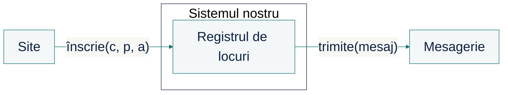

# Cine coordonează o operație care iese din sistem? {.transition}

Registrul a acceptat cererea, serviciul extern a raportat un eșec. Ce îi spunem utilizatorului?

::: notes
În cursul 7 am urmărit un singur obiect de-a lungul vieții lui. Azi o operație traversează o graniță: o parte a muncii este făcută de un serviciu pe care nu îl controlăm. Întrebarea cursului: cine coordonează, ce promitem când componenta din exterior eșuează și ce se întâmplă când cererea vine a doua oară.

**Organizare:** minutul 0 din 100; interval 0–15 (15 min), inclusiv coperta, citatul, întrebarea deschisă, problema, exercițiul de predicție și slide-ul despre graniță. 35 de slide-uri cu copertă. []{.pace at=0 of=100}
:::

---

# Citatul zilei

> „Orice organizație care proiectează un sistem (în sens larg) va produce o soluție a cărei structură este o copie a structurii de comunicare a organizației.”
>
> Original: “Any organization that designs a system (defined broadly) will produce a design whose structure is a copy of the organization's communication structure.”

— **Melvin E. Conway**

[Sursa: Conway’s Law — formularea autorului](https://www.melconway.com/Home/Conways_Law.html)

::: notes
Granițele dintre componente urmează adesea granițele dintre organizații: serviciul de mesagerie din exemplul de azi este operat de altă firmă, deci îl cunoaștem numai prin interfața lui și prin ce presupunem despre el. Conway descrie o tendință, nu o regulă de proiectare; pentru noi, concluzia este că o graniță organizațională trebuie făcută explicită în model, cu presupunerile ei.

**Sursă:** pagina autorului, formularea introdusă prin „Here is one form of the paper's thesis”; nu o confundați cu variantele din alte surse. Reverificată la 12 noiembrie 2026. Vezi `docs/quotations.md`.
:::

---

# O confirmare care nu a venit

Gândiți-vă la o plată, o înscriere, o comandă online: ați apăsat butonul, pagina s-a blocat sau a afișat o eroare, iar confirmarea nu a venit.

**Ați apăsat din nou? Ce s-a întâmplat: două comenzi, niciuna sau una cu două confirmări? De unde ați fi putut afla ce s-a înregistrat de fapt?**

::: notes
Nu căutăm un singur răspuns corect. Pot apărea plăți duble, comenzi înregistrate fără confirmare, confirmări pentru comenzi inexistente, pagini care spun „nu apăsați din nou”. Observăm că utilizatorul nu vede decât răspunsul canalului, iar sistemul trebuie să decidă ce înseamnă o cerere repetată. Azi facem explicite aceste decizii.

**Organizare:** 5 min: întrebare către clasă; notăm câteva exemple, fără să le rezolvăm. []{.pace dur=5}
:::

---

# Înscriere acceptată, confirmare eșuată

Un centru cultural organizează ateliere cu locuri limitate. **Registrul de locuri**, componenta pe care o proiectăm, primește cererile de înscriere de la site și înregistrează înscrierile acceptate. După fiecare înscriere acceptată, registrul cere unui serviciu extern de mesagerie, operat de altă firmă (pe scurt, **mesageria**), să trimită participantului o confirmare.

**Regula convenită cu centrul (beneficiarul):** eșecul confirmării nu anulează o înscriere acceptată; centrul preferă un participant înscris fără confirmare unui participant cu confirmare fără loc.

P1 cere un loc la atelierul A de fotografie nocturnă. Registrul acceptă, dar mesageria răspunde `eșec expediție`. **Ce îi spunem site-ului? Ce rămâne înregistrat?**

*Exemplu didactic; registrul nu trimite el însuși mesaje. Lucrăm pe hârtie; toate datele necesare sunt pe slide-uri.*

::: notes
Îi spunem `acceptat`: înscrierea există, locul este consumat, iar lângă înscriere rămâne rezultatul `netrimisă`: mesageria a raportat `eșec expediție`, fără să știm dacă mesajul a ajuns. Răspunsul nu depinde de mesagerie, ci de regula beneficiarului; dar trebuie să rămână undeva faptul că trimiterea nu a fost confirmată de mesagerie. De aici întrebarea cursului: cine coordonează pașii și ce promitem pentru fiecare.

**Organizare:** 2 min: întrebare către clasă, așteptăm răspunsul. []{.pace dur=2}
:::

---

# Aceeași cerere, a doua oară

**Reguli:** atelierul A are un număr fix de locuri. O cerere de înscriere este acceptată dacă participantul nu este înscris și există loc; în celelalte cazuri este refuzată. După acceptare, registrul cere confirmarea mesageriei, care răspunde `trimis` sau `eșec expediție`; eșecul confirmării nu anulează înscrierea.

**Înainte:** 2 locuri libere, nicio înscriere. Site-ul trimite `înscrie(c1, P1, A)`, unde c1 este identificatorul cererii; registrul acceptă, iar mesageria răspunde `eșec expediție`. Site-ul nu ajunge să afișeze răspunsul și trimite din nou `înscrie(c1, P1, A)`.

Individual, apoi discutăm: regulile de mai sus nu spun nimic despre o cerere primită a doua oară. **Ce ar răspunde un registru care îi aplică regula de acceptare? Ce ar trebui să răspundă și ce ar trebui să rămână înregistrat?**

::: notes
Aplicată a doua oară, regula de acceptare dă `refuz`: P1 este deja înscris. Site-ul ar afișa un refuz pentru o înscriere reușită. Răspunsul pe care îl vrem: `acceptat`, un loc liber, o singură înscriere; identificatorul c1 arată că este aceeași cerere, nu una nouă. Unii studenți vor propune refuzul, alții a doua înscriere: răspunsurile diferite arată de ce regula trebuie scrisă (R5, în etapa următoare). Cu confirmarea, registrul poate încerca din nou trimiterea sau o poate lăsa pentru mai târziu; comparăm variantele în etapa a patra.

**Organizare:** 6 min: 3 individual, 3 discuție. []{.pace dur=6}
:::

---

# Interacțiune, graniță, coordonare

O **interacțiune** este succesiunea apelurilor prin care mai multe componente realizează o operație: cine apelează pe cine, ce trimite, ce primește, ce înregistrează. Ordinea aleasă a pașilor este **fluxul de lucru** al operației.

**Granița** sistemului nostru separă componentele pe care le proiectăm de cele cu care doar comunicăm: unele ne apelează, pe altele le apelăm. Despre o componentă din exterior pe care o apelăm cunoaștem **interfața** ei și ce **presupunem** despre ea; nu îi cunoaștem pașii.

**Coordonarea** este responsabilitatea de a conduce pașii unei operații: de a decide ordinea, de a înregistra rezultatul fiecărui pas și de a răspunde apelantului, inclusiv când un pas eșuează sau când cererea vine a doua oară.

Pentru înscrieri le precizăm pe rând și le verificăm pe scenarii. Nu modelăm plata, lista de așteptare, concurența sau erorile tehnice din interiorul registrului.

::: notes
Legătura cu cursul 5: interfața rămâne semnătura și sensul rezultatelor; noutatea este că pentru o componentă din exterior interfața este tot ce avem, iar restul sunt presupuneri de scris explicit. Legătura cu cursul 6: ce promite registrul când mesageria eșuează este o postcondiție a operației `înscrie`, nu o speranță. Coordonarea este o responsabilitate ca oricare alta: cineva trebuie să o aibă.
:::

---

# Interfețe, coordonare și cereri repetate {.transition}

Ce știm despre mesagerie și ce promitem noi?

::: notes
Citim regulile complete, apoi desenăm granița, repartizăm responsabilitățile și precizăm ce înseamnă o cerere repetată.

**Organizare:** minutul 15 din 100; interval 15–35 (20 min): reguli 4, graniță 4, coordonare 3, reîncercare 2, exercițiu 7. []{.pace at=15}
:::

---

# Regulile înscrierii: context, cerere, acceptare, confirmare

| Regulă | Conținut |
|--------|------------------------------------------|
| R1 (context) | Locurile atelierului A sunt limitate; câte sunt libere spune fiecare scenariu. Participanți cunoscuți, apeluri secvențiale. Fără plată, listă de așteptare, anulare, concurență sau erori tehnice în registru. |
| R2 (cerere) | `înscrie(c, p, a)`: identificatorul cererii c este generat de site, unic pentru fiecare cerere nouă; o reîncercare trimite același c. |
| R3 (acceptare) | O cerere cu c neînregistrat este acceptată exact când p nu este înscris la a și există loc: registrul consumă locul și înregistrează (c, p, a). Altfel: `refuz`, fără modificări, fără apelul mesageriei. |
| R4 (confirmare) | După acceptare, registrul cere mesageriei `trimite(mesaj)`, care răspunde `trimis` sau `eșec expediție`; registrul înregistrează confirmarea `trimisă` sau `netrimisă`. Eșecul confirmării nu anulează înscrierea; site-ul primește `acceptat`. |

::: notes
R4 vine de la beneficiar; noi nu o putem schimba, doar o putem face explicită. R3 spune și ce nu se întâmplă la refuz: niciun apel către mesagerie.
:::

---

# Regulile înscrierii: reîncercare, graniță, efect limitat

| Regulă | Conținut |
|--------|------------------------------------------|
| R5 (reîncercare) | O cerere cu c deja înregistrat primește același `acceptat`, fără alt loc și fără a doua înscriere. Dacă confirmarea este `netrimisă`, registrul poate cere din nou trimiterea; dacă este `trimisă`, nu apelează mesageria. |
| R6 (graniță) | Despre mesagerie presupunem doar că răspunde la fiecare apel cu `trimis` sau `eșec expediție`. `eșec expediție` nu înseamnă că mesajul nu a ajuns; `trimis` nu înseamnă că a fost citit. `netrimisă` consemnează `eșec expediție`, nu nelivrarea. |
| R7 (efect limitat) | O cerere nu modifică alte înscrieri și nici locurile lor. |

::: notes
R6 vine de la furnizorul extern: este tot ce știm. R5 spune ce înseamnă „aceeași cerere”: identificatorul, nu conținutul. Două cereri noi cu același conținut sunt cereri diferite, iar a doua este refuzată de R3.
:::

---

# Granița și interfața mesageriei

Săgeata înseamnă „apelează”. **Diagrama arată numai cine pe cine apelează; ce știm despre mesagerie scriem lângă ea:**

- **Interfața:** `trimite(mesaj)` întoarce `trimis` sau `eșec expediție`.
- **R6 (graniță), ce presupunem:** răspunde la fiecare apel.
- **Ce nu presupunem:** că `eșec expediție` înseamnă „mesajul nu a ajuns”; că `trimis` înseamnă „a fost citit”; cât durează.

::: notes
Lista de sub diagramă nu explică desenul, ci îl completează: o diagramă a graniței nu are unde să arate ce răspunde componenta din exterior și ce presupunem despre ea, deci le scriem separat, ca parte a modelului. Site-ul este în afara graniței în sensul că nu îl proiectăm azi, deși este al centrului; mesageria este în afara ei și organizațional. Despre mesagerie, pe care o apelăm, avem interfața ei și presupunerea R6; despre site, care ne apelează, avem numai presupunerile din R2: generează un identificator unic pentru fiecare cerere nouă și îl păstrează la reîncercare. Presupunerile despre mesagerie sunt partea cea mai fragilă a modelului: dacă una cade (de exemplu, nu răspunde niciodată), promisiunile noastre trebuie recitite. Nu desenăm procese, servere sau protocoale.

**Organizare:** 4 min. []{.pace dur=4}
:::

---

# Cine coordonează?

| Componentă | Responsabilitate |
|:----------|:--------------------------------------------------|
| Site | interpretează formularul, generează identificatorul cererii, reîncearcă cu același identificator, afișează rezultatul |
| **Registru** | decide acceptarea, consumă locul, înregistrează înscrierea și identificatorul, **apelează mesageria**, înregistrează confirmarea, răspunde site-ului |
| Mesagerie | încearcă trimiterea și răspunde `trimis` sau `eșec expediție` |

Registrul **coordonează**: site-ul nu apelează mesageria; interfața mesageriei nu cere acces la locuri. **R4 (confirmare):** confirmarea se cere numai după o înscriere acceptată, iar eșecul ei nu anulează înscrierea. **Dacă site-ul ar trimite el confirmarea, ce ar trebui să știe și ce ar putea merge prost?**

::: notes
Site-ul ar trebui să cunoască rezultatul deciziei și regula R4 și ar trebui să fie el cel care înregistrează rezultatul confirmării, deși nu deține înscrierile; o confirmare ar putea pleca fără înscriere sau o înscriere ar rămâne fără urma confirmării. Coordonarea stă acolo unde stau datele și regulile pe care pașii le modifică. Ca în cursul 5, dependența utilă este apelul operației; cuplarea de regulile registrului ar fi costul variantei cu site-ul coordonator.

**Organizare:** 3 min: întrebare către clasă. []{.pace dur=3}
:::

---

# Aceeași cerere sau o cerere nouă?

**R5 (reîncercare):** o cerere cu c **deja înregistrat** primește același `acceptat`, fără alt loc și fără a doua înscriere. **R3 (acceptare):** o cerere cu c nou se judecă după locuri și înscrieri.

**Pornire:** 2 locuri libere, nicio înscriere; `înscrie(c1, P1, A)` este acceptată. **După:** 1 loc liber; înscrierea (c1, P1, A). Din această stare, două continuări independente:

| | Cererea | Ce este | Rezultat |
|:-|:---------------------|:--------------------|:-----------------------------------|
| 1 | `înscrie(c1, P1, A)` | reîncercare | același `acceptat`; tot 1 loc liber, o înscriere |
| 2 | `înscrie(c9, P1, A)` | cerere nouă | `refuz`: P1 este deja înscris |

**Identificatorul cererii** le deosebește, nu conținutul. Repetarea cererii nu repetă efectul asupra înscrierilor: față de ele, operația este **idempotentă**. În cursul 6, eliberarea repetată nu modifica registrul, dar întorcea alt rezultat (`fara_dulap`); aici R5 cere **același** rezultat.

::: notes
Regulile se citesc din enunț, nu se importă de la muzeu. Fără identificator, registrul nu ar putea distinge „aceeași cerere, trimisă din nou” de „altă cerere cu același conținut” și ar răspunde `refuz` la reîncercare, deși P1 este înscris: site-ul ar afișa un refuz pentru o înscriere reușită. În cursul 6 am observat diferența fără să o numim; acum îi dăm numele consacrat. Idempotența privește efectul repetării, nu egalitatea răspunsurilor: eliberarea repetată din cursul 6 era idempotentă, deși întorcea alt rezultat. Aici efectul asupra înscrierilor nu se repetă, iar R5 cere suplimentar același răspuns. Confirmarea poate fi retrimisă, iar rezultatul ei înregistrat se poate modifica: de aceea spunem „față de înscrieri”. Vezi RFC 9110, §9.2.2: https://www.rfc-editor.org/rfc/rfc9110.html#section-9.2.2.

**Organizare:** 2 min. []{.pace dur=2}
:::

---

# Ce răspunde registrul?

**Reguli:** cerere nouă: acceptată dacă participantul nu este înscris și există loc. Reîncercare: `acceptat`, fără alt loc; confirmarea `netrimisă` poate fi retrimisă. `eșec expediție` nu anulează înscrierea; refuzul nu modifică nimic și nu apelează mesageria.

**Pornire (rândurile 1–3, independente):** 1 loc liber; (c1, P1, A), confirmare `netrimisă`.

| | Cererea | Rezultat | Locuri | Mesageria? |
|:-|:------------------------------|:---------|:-------|:------------|
| 1 | `înscrie(c1, P1, A)` | ? | ? | ? |
| 2 | `înscrie(c9, P1, A)` | ? | ? | ? |
| 3 | `înscrie(c2, P2, A)`, cu `eșec expediție` | ? | ? | ? |
| 4 | după 3: `înscrie(c3, P3, A)` | ? | ? | ? |

**Individual, apoi discutăm:** completați tabelul. La 1, retrimiterea este obligatorie?

::: notes
Ultima coloană spune dacă mesageria este apelată. 1: `acceptat`, 1 loc, reîncercare; registrul poate apela din nou mesageria (R5 permite) și actualizează confirmarea dacă răspunde `trimis`. 2: `refuz`, 1 loc, nu; P1 este deja înscris. 3: `acceptat`, 0 locuri, da; confirmarea lui P2 rămâne `netrimisă`. 4: `refuz`, 0 locuri, nu; nu mai sunt locuri. Mesageria este apelată numai după o acceptare nouă sau la o reîncercare cu confirmare `netrimisă`.

**Organizare:** 7 min: 3 individual, 4 discuție; ajungem la minutul 35. []{.pace dur=7}
:::

---

# Urmărim fluxul {.transition}

Înregistrăm înainte sau după ce apelăm mesageria?

::: notes
Scriem interacțiunea pas cu pas pentru cazul normal și pentru eșecul confirmării, apoi reîncercările; comparăm două ordini ale pașilor.

**Organizare:** minutul 35 din 100; interval 35–60 (25 min): S1 5, S2 4, exercițiul S3–S4 8, două ordini 5, garanții 3. []{.pace at=35}
:::

---

# Scenariul S1 (înscriere confirmată)

**Din I** (2 locuri libere, nicio înscriere): `înscrie(c1, P1, A)`; mesageria răspunde `trimis`.

| Pas | Apel sau răspuns | Ce înregistrează registrul |
|:----|:--------------------------------------|:----------------------------|
| 1 | Site → Registru: `înscrie(c1, P1, A)` | — |
| 2 | Registru: c1 nou, P1 neînscris, loc liber → **acceptă** | 1 loc liber; (c1, P1, A); confirmare `în așteptare` |
| 3 | Registru → Mesagerie: `trimite(mesaj)` | — |
| 4 | Mesagerie → Registru: `trimis` | confirmare `trimisă` |
| 5 | Registru → Site: `acceptat` | — |

Decizia și înregistrarea (pasul 2) preced apelul mesageriei (pasul 3). **Ce știe registrul între pașii 3 și 4?**

::: notes
Între 3 și 4, registrul știe că înscrierea există și că răspunsul confirmării nu a venit încă; de aceea confirmarea are o valoare proprie, `în așteptare`, nu lipsește. În vocabularul cursului 7, înscrierea nu are un ciclu de viață cu etape; `în așteptare`, `trimisă` și `netrimisă` sunt valori ale unei date a înscrierii, rezultatul confirmării. Tabelul interacțiunii este reprezentarea pe care o verificăm: fiecare rând spune cine acționează și ce rămâne înregistrat. Nu desenăm încă o diagramă de secvență; tabelul conține aceleași informații, plus coloana înregistrărilor.

**Organizare:** 5 min, cu întrebarea. []{.pace dur=5}
:::

---

# Scenariul S2 (confirmare eșuată)

**R4 (confirmare):** eșecul confirmării nu anulează înscrierea; site-ul primește `acceptat`.

**Din I** (2 locuri libere, nicio înscriere): `înscrie(c1, P1, A)`; răspuns `eșec expediție`.

| Pas | Apel sau răspuns | Ce înregistrează registrul |
|:----|:--------------------------------------|:----------------------------|
| 1 | Site → Registru: `înscrie(c1, P1, A)` | — |
| 2 | Registru: **acceptă** | 1 loc liber; (c1, P1, A); confirmare `în așteptare` |
| 3 | Registru → Mesagerie: `trimite(mesaj)` | — |
| 4 | Mesagerie → Registru: `eșec expediție` | confirmare **`netrimisă`** |
| 5 | Registru → Site: `acceptat` | — |

**Față de S1, diferă numai confirmarea înregistrată; înscrierea rămâne acceptată.**

::: notes
Faptul că eșecul se vede numai în coloana înregistrărilor este intenționat: regula beneficiarului spune că înscrierea nu depinde de confirmare. Ceea ce rămâne de rezolvat este confirmarea `netrimisă`; o rezolvăm în etapa următoare, nu ascunzând-o. Nu presupunem că mesajul nu a ajuns (R6).

**Organizare:** 4 min. []{.pace dur=4}
:::

---

# Reîncercarea după eșec și după succes

**R5 (reîncercare):** o cerere cu identificator deja înregistrat primește același `acceptat`, fără alt loc și fără a doua înscriere. La `trimisă`, mesageria nu este apelată. **Alegerea noastră pentru acest exercițiu:** la `netrimisă`, o apelăm o dată și înregistrăm rezultatul. R5 permite această alegere, fără să o impună.

**Scenariul S3 (reîncercare după eșec):** continuarea scenariului S2 (confirmare eșuată: 1 loc liber; (c1, P1, A) cu confirmare `netrimisă`): `înscrie(c1, P1, A)`; mesageria răspunde `trimis`, dacă este apelată.

**Scenariul S4 (reîncercare după succes):** continuarea scenariului S1 (înscriere confirmată: 1 loc liber; (c1, P1, A) cu confirmare `trimisă`): `înscrie(c1, P1, A)`.

Pe hârtie, apoi discutăm: scrieți pașii fiecărui scenariu ca în tabelele anterioare. Ce pas din S1 lipsește din amândouă? **Dacă în S3 mesageria ar răspunde din nou `eșec expediție`, ce ar primi site-ul și câte mesaje ar fi putut primi P1?**

::: notes
S3: Site → Registru; registrul găsește c1 înregistrat, confirmare `netrimisă`; Registru → Mesagerie `trimite`; Mesagerie → Registru `trimis`; confirmarea devine `trimisă`; Registru → Site `acceptat`. Un rând cu mesageria; locurile rămân 1; nu apare altă înscriere. S4: Site → Registru; c1 înregistrat, confirmare `trimisă`; Registru → Site `acceptat`. Niciun rând cu mesageria; nimic nu se schimbă. Din amândouă lipsește pasul 2 al lui S1: decizia de acceptare și înregistrarea înscrierii nu se repetă. În ambele, răspunsul este același ca prima dată, cum cere R5. Cu un al doilea `eșec expediție` în S3: site-ul primește tot `acceptat`, confirmarea rămâne `netrimisă`, iar P1 ar fi putut primi niciun mesaj, unul sau două, fiindcă `eșec expediție` nu spune dacă mesajul a ajuns (R6). Registrul nu poate afla care dintre cazuri s-a produs.

**Organizare:** 8 min: 3 pe hârtie, 5 discuție. []{.pace dur=8}
:::

---

# Două ordini ale pașilor

**R4 (confirmare):** eșecul confirmării nu anulează înscrierea. **R6 (graniță):** `eșec expediție` nu înseamnă că mesajul nu a ajuns.

**Pornire:** c1 nou, P1 neînscris, un loc liber. **Fluxul F (exemplu didactic):** apelează întâi mesageria; înregistrează numai la `trimis`, iar la `eșec expediție` întoarce `refuz`.

| Mesagerie | Înregistrăm, apoi trimitem | Fluxul F |
|:---------|:-----------------------------|:-----------------------------|
| `trimis` | `acceptat`; înscriere, confirmare `trimisă` | `acceptat`; înscriere |
| `eșec expediție` | `acceptat`; înscriere, confirmare `netrimisă` | `refuz`; nicio înscriere; mesaj posibil livrat |

Ce încalcă F? Ce ar crede P1 dacă a primit totuși mesajul? **Dar un flux care apelează întâi mesageria și înregistrează apoi înscrierea, oricare ar fi răspunsul: prin ce ar diferi de al nostru?**

::: notes
F încalcă R4: un `eșec expediție` anulează înscrierea, deși beneficiarul a cerut invers. R6 arată o consecință suplimentară: dacă mesajul a ajuns, P1 are o confirmare fără loc, exact cazul pe care centrul voia să îl evite. Împotriva lui F, argumentul nu are nevoie de căderea registrului între pași, pe care R1 o exclude. Fluxul din ultima întrebare este altceva: în limitele lui R1 întoarce aceleași rezultate și lasă aceleași înregistrări ca al nostru. Diferă numai dacă operația se întrerupe între cei doi pași: al nostru lasă o înscriere fără confirmare, celălalt un mesaj posibil livrat fără înscriere. Preferința beneficiarului din R4 alege ordinea noastră. Este justificarea ordinii, nu o garanție: reluarea după o cădere rămâne printre limitele de pe slide-ul următor. Ordinea pașilor nu este un detaliu de implementare: ea decide ce rămâne înregistrat când ceva nu merge.

**Organizare:** 5 min: discuție cu toată clasa. []{.pace dur=5}
:::

---

# Ce garantează registrul și ce nu

**Context:** apeluri secvențiale, fără erori tehnice în registru; mesageria răspunde la fiecare apel.

| Garantăm | Nu garantăm |
|:-----------------------------------|:-----------------------------------|
| o cerere acceptată consumă exact un loc | că participantul a primit mesajul |
| o reîncercare primește același rezultat și nu consumă alt loc | că participantul l-a citit |
| rezultatul confirmării este înregistrat la fiecare înscriere | reluarea după o cădere a registrului |
| un refuz nu modifică nimic și nu produce mesaje | comportamentul la cereri concurente |

Garanțiile depind de granița și presupunerile enunțului.

::: notes
A spune ce nu garantăm este parte din proiectare, nu o scuză: cine citește contractul știe ce trebuie adăugat dacă una dintre limite devine cerință (de exemplu, o confirmare de citire). Căderea registrului între pași ar cere un mecanism de reluare, exclus de R1; îl numim ca limită, nu îl inventăm.

**Organizare:** 3 min; ajungem la minutul 60. []{.pace dur=3}
:::

---

# Comparăm variante de recuperare {.transition}

Mesageria a răspuns `eșec expediție`. Cine cere din nou trimiterea și când?

::: notes
Urmărim un flux care greșește la reîncercare, apoi comparăm trei variante de recuperare după `eșec expediție`, cu presupunerile și costurile lor.

**Organizare:** minutul 60 din 100; interval 60–80 (20 min): fluxul G 8, variante 4, exercițiu 5, decizie 3. []{.pace at=60}
:::

---

# Un flux care înregistrează de două ori

**Fluxul G (exemplu didactic, construit pentru verificare):** registrul **nu înregistrează identificatorul cererii** și verifică numai dacă există loc liber; înregistrează, apoi apelează mesageria.

**Reguli:** o reîncercare (același identificator) nu consumă alt loc și primește același `acceptat`; o cerere nouă a unui participant înscris este refuzată.

**Din I** (2 locuri libere, nicio înscriere), sub G: `înscrie(c1, P1, A)` cu `eșec expediție`; apoi reîncercarea `înscrie(c1, P1, A)`; apoi `înscrie(c2, P2, A)`.

Pe hârtie, apoi discutăm: după fiecare cerere, **locurile libere, înscrierile și răspunsul**. Ce regulă încalcă G și la care pas? Dacă G ar verifica și „participantul nu este înscris”, ce ar răspunde la reîncercare?

::: notes
Sub G: prima cerere → `acceptat`, 1 loc, înscrierea lui P1 (confirmare `netrimisă`); reîncercarea este tratată ca o cerere nouă → `acceptat`, 0 locuri, a doua înscriere a lui P1; P2 → `refuz`, deși un singur participant este înscris. G încalcă R5 la a doua cerere; refuzul lui P2 contrazice R3, fiindcă un loc ar fi trebuit să rămână liber, iar fără verificarea „participantul nu este înscris” G ar încălca R3 și la o cerere nouă a lui P1. Cu verificarea participantului, G ar răspunde `refuz` la reîncercare: corect pentru locuri, dar site-ul ar afișa un refuz pentru o înscriere reușită, fără să poată deosebi „deja înscris” de „fără loc”. Identificatorul cererii este ceea ce face reîncercarea recunoscută.

**Organizare:** 8 min: 3 pe hârtie, 5 discuție. []{.pace dur=8}
:::

---

# Trei variante după `eșec expediție`

**R4 (confirmare):** eșecul nu anulează înscrierea. **R6 (graniță):** `eșec expediție` nu înseamnă că mesajul nu a ajuns.

| Var. | Ce face registrul | Presupune | Cost |
|:----|:-------------------------|:----------------------|:------------------------|
| **A** | retrimite imediat, de cel mult două ori | eșecul poate fi trecător | site-ul așteaptă; mesajul se poate dubla |
| **B** | păstrează `netrimisă`; oferă o operație de retrimitere | cineva o apelează | un apelant în plus; alt eșec sau un mesaj duplicat |
| **C** | anulează înscrierea | `eșec expediție` înseamnă „mesajul nu a ajuns” | încalcă R4; confirmare posibilă fără loc |

Retrimiterea nu garantează livrarea; alegerea stabilește **cine** suportă costul eșecului.

::: notes
A și B respectă R4 și se pot combina: o retrimitere imediată, apoi B. În B, retrimiterea este o operație separată a registrului; cine o apelează (un program periodic, un operator) este de notat. C ajunge la același rezultat ca fluxul F de mai devreme, privit ca variantă de recuperare. Costurile nu sunt egale: A mută așteptarea la utilizator, B adaugă o responsabilitate nouă în sistem. Nu există variantă fără presupuneri; întrebarea este care presupuneri sunt scrise.

**Organizare:** 4 min. []{.pace dur=4}
:::

---

# Care variantă și cu ce justificare?

**R4 (confirmare):** eșecul nu anulează înscrierea. **R6 (graniță):** `eșec expediție` nu stabilește dacă mesajul a ajuns. **R5 (reîncercare):** o cerere deja acceptată primește același `acceptat`.

**Variantele:** A, retrimitere imediată; B, confirmare `netrimisă` și retrimitere printr-o operație separată; C, anularea înscrierii.

Individual, apoi discutăm:

1. În A și în B, cum poate primi participantul două mesaje? Ce rezultat al confirmării rămâne atunci înregistrat?
2. În B, cine răspunde de retrimitere? Ce se întâmplă dacă nimeni nu apelează operația?
3. Ce ați alege pentru centru și ce l-ați întreba pe beneficiar înainte de a alege?

::: notes
1: primul apel întoarce `eșec expediție`, deși mesajul a ajuns, ceea ce R6 nu exclude; al doilea întoarce `trimis`. Participantul are două mesaje, iar registrul înregistrează `trimisă`, fără să poată observa dublarea. C nu intră în comparație: încalcă R4 indiferent dacă mesajul a ajuns. 2: registrul oferă operația; cine o apelează (un program periodic, un operator) este o decizie de notat, altfel B înseamnă, în fapt, „niciodată”. 3: nu există un singur răspuns. Întrebări utile pentru beneficiar: cât poate aștepta utilizatorul pe site, cine ar apela retrimiterea și când, cât de supărător este un mesaj primit de două ori. A mizează pe un eșec trecător, fără să îl garanteze; pentru verificarea ei pe scenarii, trasarea trebuie să arate și câte apeluri s-au făcut.

**Organizare:** 5 min: 2 individual, 3 discuție. []{.pace dur=5}
:::

---

# Decizia noastră: varianta B

**R4 (confirmare):** înscrierea rămâne acceptată la `eșec expediție`. **R5 (reîncercare):** putem retrimite o confirmare `netrimisă`. **R6 (graniță):** nu cunoaștem livrarea efectivă.

**Alegem B: retrimitere ulterioară**, cu responsabilități explicite:

- `înscrie` apelează mesageria o dată la acceptare și o dată la reîncercare dacă rezultatul este `netrimisă`;
- propunem `retrimite confirmările()`, apelată de un operator al centrului, care încearcă o dată fiecare confirmare `netrimisă` și actualizează rezultatul;
- păstrăm înscrierile și locurile; amânarea cere un operator și poate produce mesaje duplicate.

**C contrazice R4.** A rămâne o alternativă; ar cere precizarea numărului de încercări și noi trasări.

::: notes
Aceasta este o decizie de proiectare pentru exemplul nostru, nu o regulă deja cerută de beneficiar. Operația separată este o extensie propusă, apelată secvențial cu înscrierile. Nu adăugăm o valoare nouă a rezultatului confirmării: `netrimisă` exista deja. Scenariile S1–S6 rămân neschimbate; pentru extensie, după S2, un apel al operatorului cu răspuns `trimis` schimbă numai rezultatul confirmării. Un al doilea apel nu mai trimite acel mesaj. Dacă operatorul nu intervine, nu promitem retrimiterea; niciun număr finit de încercări nu garantează livrarea.

**Organizare:** 3 min; ajungem la minutul 80. []{.pace dur=3}
:::

---

# Cine oferă garanția? {.transition}

Un text despre înscriere promite ceva. Cine se angajează să îl respecte?

::: notes
La o graniță, un text de proiectare poate promite lucruri pe care componenta noastră nu le controlează: livrarea, rapiditatea, „atomicitatea” unor pași care trec pe la mesagerie. Verificăm fiecare promisiune: cine o oferă (registrul, site-ul, mesageria sau nimeni) și ce regulă sau presupunere a enunțului o susține. Legătura cu slide-ul „Ce garantează registrul și ce nu”: acum citim cu aceeași întrebare un text scris de un asistent AI.

Capturi reale, obținute înaintea cursului: Claude Haiku 4.5, prin Claude Code 2.1.328, la 19 noiembrie 2026, fiecare rulare într-un context nou, fără unelte și fără contextul proiectului. Trei prompturi cu același enunț: paragraful pentru participanți (patru rulări), nota pentru echipa de operare și garanțiile pentru echipa de dezvoltare (câte opt). Am ales fragmentele pentru discuție; selecția nu descrie comportamentul tipic al modelului. Toate rulările sunt în arhiva capturilor. La curs nu rulăm instrumente. Enunțul trimis folosea denumirile anterioare ale enunțului: „expeditor de confirmări” pentru mesagerie, `esec` pentru `eșec expediție` și 2 locuri în R1; fragmentele citate le păstrează („chiar dacă expeditorul nu livrează”). Dacă un student întreabă, spuneți că este același serviciu.

**Organizare:** minutul 80 din 100; interval 80–95 (15 min): sarcina 2, promisiunile 1–2 3, promisiunile 3–4 3, „atomicitate” 2, livrarea 2, comparația 1, decizia 2. []{.pace at=80}
:::

---

# Ce cerem asistentului AI?

**Instrucțiunea exactă**, urmată de enunț:

> Centrul cultural vrea să publice pe site un paragraf „Ce vă garantăm la înscriere”, pentru participanți, și ne cere, ca proiectanți ai registrului, textul lui. Scrie paragraful, apoi, separat, o scurtă justificare tehnică pentru centru: pe ce se sprijină fiecare promisiune din paragraf. Nu scrie cod. Răspunde în română, în maximum 300 de cuvinte.

**Context:** enunțul curent, R1–R7 și scenariile S1–S6, plus varianta B aleasă mai devreme: `înscrie` apelează mesageria o dată la acceptare și o dată la o reîncercare cu confirmarea `netrimisă`; un operator al centrului apelează `retrimite confirmările()`.

**Cum citim răspunsul:** pentru fiecare promisiune, cine o oferă — **registrul**, **site-ul**, **mesageria** sau **nimeni**? Ce regulă a enunțului o susține?

**Predicție:** ce ar putea promite paragraful fără ca registrul să controleze?

::: notes
Promptul nu cere prudență și nu menționează riscuri: este cererea pe care ar face-o un beneficiar. Același enunț a fost trimis și cu alte două instrucțiuni, o notă de proiectare pentru echipa de operare și garanțiile pentru echipa de dezvoltare („consistența datelor, livrarea confirmărilor și comportamentul la repetarea cererilor”); fragmente din ele apar trei slide-uri mai încolo. Predicții probabile: „veți primi confirmarea”, „imediat”, „automat”.

**Sursă:** `promisiuni-prompt.md` și `context-garantii.md`, arhiva din 19 noiembrie 2026.

**Organizare:** 2 min; predicții prin ridicarea mâinii. []{.pace dur=2}
:::

---

# Paragraful: promisiunile 1 și 2

**Asistentul AI — Claude Haiku 4.5, 19 noiembrie 2026, una dintre patru rulări; fragmente:**

> **1. Locul dumneavoastră este rezervat.** […] Chiar dacă mesajul de confirmare nu ajunge, rămâneți înscris.
>
> **2. Veți primi confirmare imediat.** După acceptare, vă trimitem un mesaj de confirmare. Dacă nu ajunge, îl reîncercăm automat.
>
> *Din justificare:* […] La reîncercări, dacă mesajul anterior nu a ajuns, se reîncercă trimiterea (R5).

**R4 (confirmare):** după acceptare, registrul cere mesageriei trimiterea; eșecul ei nu anulează înscrierea. **R5 (reîncercare):** la o reîncercare cu confirmarea `netrimisă`, registrul poate cere din nou trimiterea. **R6 (graniță):** presupunem doar că mesageria răspunde `trimis` sau `eșec expediție`; `eșec expediție` nu înseamnă că mesajul nu a ajuns. **Varianta B (retrimitere ulterioară):** în rest, o cere un operator.

Individual, apoi discutăm: **cine oferă fiecare promisiune și pe ce regulă se sprijină?**

::: notes
Promisiunea 1 este a registrului: R3 consumă locul la acceptare, iar R4 spune că eșecul confirmării nu anulează înscrierea. Promisiunea 2 nu o oferă nimeni. „Veți primi” și „imediat” ar fi promisiuni ale mesageriei, iar R6 nu i le atribuie: știm doar că răspunde. „Dacă nu ajunge, îl reîncercăm automat” presupune că registrul află dacă mesajul a ajuns; nu află, află doar `eșec expediție`. Retrimiterea nu este nici automată: are loc numai dacă site-ul reîncearcă (R5 o permite, nu o impune) sau dacă operatorul apelează `retrimite confirmările()`. Justificarea citează R5, dar R5 vorbește despre `netrimisă`, nu despre un mesaj care „nu a ajuns”: confuzia pe care R6 o exclude explicit. Omisiunile: titlul paragrafului, a doua propoziție a promisiunii 1 („Atunci când cererea este acceptată, locul la atelier este al dumneavoastră.”) și restul justificării.

**Organizare:** 3 min: 1 individual, 2 discuție. []{.pace dur=3}
:::

---

# Paragraful: promisiunile 3 și 4

**Aceeași rulare; fragmente:**

> **3. Fără înscrisuri duble.** Dacă din accident reîncearcă aceeași cerere, primiți același răspuns și nu se va crea a doua înscrisă.
>
> **4. Locurile sunt echitabil repartizate.** Nu vor fi acceptați mai mulți participanți decât locurile disponibile.

**R2 (cerere):** site-ul generează identificatorul cererii; când reîncearcă, trimite același identificator, iar o cerere nouă primește altul. **R3 (acceptare):** o cerere nouă este acceptată numai dacă participantul nu este înscris și există loc; altfel `refuz`. **R5 (reîncercare):** o cerere cu identificatorul deja înregistrat primește același `acceptat`, fără alt loc și fără a doua înscriere.

Individual, apoi discutăm: **cine oferă fiecare promisiune?** Participantul apasă din nou butonul, iar site-ul trimite o **cerere nouă**. Ce primește? Mai este adevărată promisiunea 3?

::: notes
Promisiunea 4 este a registrului (R3). Promisiunea 3 are două părți cu garanți diferiți. „Nu se va crea a doua înscriere” o oferă registrul pentru orice cerere: o reîncercare nu înregistrează nimic nou (R5), iar o cerere nouă a unui participant înscris este refuzată (R3). „Primiți același răspuns” depinde și de site: registrul recunoaște reîncercarea numai după identificator, iar R2 este o presupunere despre site. Dacă apăsarea butonului produce o cerere nouă, răspunsul este `refuz`, deși participantul este înscris: fără a doua înscriere, dar nu cu același răspuns. Paragraful promite participantului ceva ce depinde de o componentă pe care nu o proiectăm azi.

**Organizare:** 3 min: 1 individual, 2 discuție. []{.pace dur=3}
:::

---

# Alte rulări: ce numesc „atomicitate”?

**Aceleași reguli; nota pentru echipa de operare, rularea 08; fragmente din lista de garanții:**

> **Atomicitate pe cerere:** o cerere acceptată consumă exact un loc; reîncercările nu generează înscrisuri duble.
>
> […]
>
> **Înregistrare:** fiecare acceptare și rezultat al confirmării este consemnat permanent.

**R1 (context):** erorile tehnice din interiorul registrului nu sunt modelate. **R5 (reîncercare):** o cerere cu identificatorul deja înregistrat nu consumă alt loc și nu creează a doua înscriere.

**Cine oferă fiecare garanție? Care se sprijină doar pe o presupunere a enunțului? Ce proprietate descrie, de fapt, „atomicitate pe cerere”?**

::: notes
Prima garanție este a registrului (R3, R5), dar numele este greșit: ce descrie este idempotența față de înscrieri, numită mai devreme, nu atomicitatea (efecte integral sau deloc). Alte rulări folosesc „atomicitate” la fel; analistul AI din capturile din 12 noiembrie 2026 o făcea și el. „Consemnat permanent” este adevărat în model numai pentru că R1 exclude erorile tehnice: este o presupunere a enunțului, nu un mecanism proiectat; dacă R1 cade, trebuie construit.

**Sursă:** răspunsul integral `haiku45-nota-08`, arhiva din 19 noiembrie 2026; „[…]” marchează punctele omise dintre cele două.

**Organizare:** 2 min. []{.pace dur=2}
:::

---

# Alte rulări: ce spun despre livrare?

**Garanțiile pentru echipa de dezvoltare, două rulări; fragmente** (mesageria se numea aici „expeditor”):

Rularea 02:

> […] înscrierea rămâne valabilă și locul consumat, chiar dacă expeditorul nu livrează.

Rularea 08:

> […] Livrarea efectivă la participant nu este garantată de sistem.

**R4 (confirmare):** eșecul confirmării nu anulează înscrierea. **R6 (graniță):** despre mesagerie presupunem doar că răspunde `trimis` sau `eșec expediție`; `eșec expediție` nu înseamnă că mesajul nu a ajuns.

**Ce presupune fiecare fragment despre mesagerie? Care este susținut de R6?**

::: notes
Prima jumătate a fragmentului din rularea 02 este garanția registrului (R4); „chiar dacă expeditorul nu livrează” citește însă `eșec expediție` ca nelivrare, exact ce exclude R6. Fragmentul din rularea 08 enunță corect o limită: aceeași sarcină produce, în altă rulare, formularea prudentă. Nu căutăm doar greșeli; fiecare afirmație se verifică la fel.

**Sursă:** răspunsurile integrale `haiku45-garantii-02` și `haiku45-garantii-08`, arhiva din 19 noiembrie 2026; „[…]” marchează începutul omis al punctului.

**Organizare:** 2 min. []{.pace dur=2}
:::

---

# Comparația noastră: cine oferă fiecare garanție

| Afirmația | Cine o oferă | Sprijin în enunț |
|:--------------------------------|:------------------|:-------------------------------|
| locul rămâne la eșec; o singură înscriere; locuri limitate | registrul | R3 (acceptare), R4 (confirmare), R5 (reîncercare) |
| același răspuns la reîncercare | registrul, cu site-ul | R5; R2 (cerere): același identificator |
| „atomicitate pe cerere” | registrul; este idempotența | R3, R5 |
| „veți primi confirmare imediat” | nimeni | R6 (graniță): doar un răspuns |
| „reîncercăm automat” | nimeni | varianta B: un operator |
| „consemnat permanent” | nimeni; o presupunere | R1 (context): fără erori tehnice |

::: notes
Tabelul este al nostru, separat de capturi; formularea prudentă din rularea 08 nu are nevoie de garant: este o limită, susținută de R6, iar „chiar dacă expeditorul nu livrează” face aceeași confuzie ca justificarea promisiunii 2. Trei categorii: garanții pe care le oferă registrul; garanții care depind de o componentă din exterior (site-ul, prin R2); afirmații pe care nu le oferă nimeni, fie pentru că privesc mesageria, fie pentru că sunt doar presupuneri ale enunțului.

**Organizare:** 1 min. []{.pace dur=1}
:::

---

# Decizia noastră

**Păstrăm** promisiunile 1 și 4 și partea promisiunii 3 despre a doua înscriere: le oferă registrul.

**Rescriem promisiunea 2:** „După acceptare cerem trimiterea unei confirmări. Dacă nu o primiți, înscrierea rămâne valabilă.” Nu promitem livrarea, rapiditatea sau o retrimitere automată.

**Corectăm termenii:** ce rularea 08 a notei numește „atomicitate pe cerere” (reîncercările nu creează a doua înscriere) este **idempotența** față de înscrieri. **Atomicitatea** înseamnă că efectele unei operații se produc integral sau deloc; nu o promitem între registru și mesagerie.

**Pentru o garanție mai puternică** (de exemplu, livrarea confirmată), o cerem furnizorului mesageriei, în interfața lui; nu o scriem noi în locul lui.

::: notes
Nu scriem nici „centrul o poate retrimite”: operația `retrimite confirmările()` încearcă numai confirmările `netrimisă`; dacă mesageria a răspuns `trimis`, iar mesajul nu a ajuns, registrul nu are ce retrimite. Promisiunea despre același răspuns rămâne condiționată de site; o păstrăm în documentația site-ului, nu în textul pentru participanți. Analistul AI din capturile anterioare, din 12 noiembrie 2026, numea și el „atomicitate” garanția că o cerere acceptată modifică starea o singură dată. Regula de lucru, valabilă pentru orice text de proiectare: lângă fiecare garanție scriem cine o oferă și pe ce se sprijină; o garanție fără garant este o speranță. Legătura cu transferul: la tipografie, garanția lipsă trebuie cerută componentei din exterior.

**Organizare:** 2 min; încheierea etapei la minutul 95. []{.pace dur=2}
:::

---

# Transferăm granița {.transition}

Aceleași întrebări, alt serviciu extern.

::: notes
Transferăm metoda: granița, presupunerile, ce garantăm local; nu regulile centrului cultural.

**Organizare:** minutul 95 din 100; interval 95–100 (5 min): exercițiu și încheiere. []{.pace at=95}
:::

---

# Diplomele și tipografia

**Enunț nou:** registrul secretariatului înregistrează diplomele aprobate și cere unei **tipografii externe** tipărirea fiecăreia, prin `comandă(d)`, care întoarce `primit` sau `eșec comandă`. O diplomă aprobată rămâne aprobată, indiferent de tipărire. Registrul poate retrimite o comandă.

Scrieți, în câte o propoziție:

1. Ce componentă proiectăm și ce componentă este în afara graniței?
2. Ce presupunem despre tipografie și ce **nu** presupunem când răspunde `eșec comandă`?
3. După un `eșec comandă`, registrul retrimite comanda. Ce îi trebuie ca diploma să nu fie tipărită de două ori? La confirmări acceptam un mesaj duplicat; de ce nu și aici?

::: notes
1: registrul diplomelor aprobate, cu comenzile lui, este în interior; tipografia, în exterior. 2: presupunem că răspunde `primit` sau `eșec comandă` la fiecare comandă; nu presupunem că `eșec comandă` înseamnă că nu tipărește. 3: diploma rămâne aprobată; înregistrăm rezultatul `eșec comandă`, fără să deducem că nu s-a tipărit, și retrimitem comanda cu același identificator. Identificatorul permite recunoașterea retrimiterii, dar nu garantează singur o singură tipărire: tipografia trebuie să promită, în interfața ei, că recunoaște identificatorul și nu repetă tipărirea, iar enunțul nu oferă această garanție. Un mesaj duplicat era un cost acceptat de centru; o diplomă tipărită de două ori nu este, deci aici idempotența trebuie cerută componentei din exterior. La laborator reunim ciclul de viață din cursul 7 cu interacțiunea de azi. Feedbackul pentru proiect poate fi cerut oricând.

**Organizare:** 5 min, încheiere la minutul 100. []{.pace dur=5}
:::
