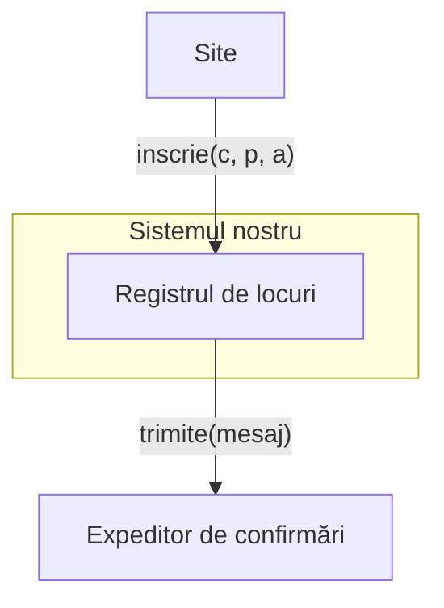

# Cine coordonează o operație care iese din sistem? {.transition}

Partea noastră a reușit, partea celuilalt a eșuat. Ce îi spunem utilizatorului?

::: notes
În cursul 7 am urmărit un singur obiect de-a lungul vieții lui. Azi o operație traversează o graniță: o parte a muncii este făcută de un serviciu pe care nu îl controlăm. Întrebarea cursului: cine coordonează, ce promitem când cealaltă parte eșuează și ce se întâmplă când cererea vine a doua oară.

**Organizare:** minutul 0 din 100; interval 0–15 (15 min), inclusiv coperta, citatul, întrebarea deschisă, problema, exercițiul de predicție și slide-ul despre graniță. 33 de slide-uri cu copertă. []{.pace at=0 of=100}
:::

---

# Citatul zilei

> „Orice organizație care proiectează un sistem (în sens larg) va produce o proiectare a cărei structură reproduce structura de comunicare a organizației.”
>
> Original: “Any organization that designs a system (defined broadly) will produce a design whose structure is a copy of the organization's communication structure.”

— **Melvin E. Conway**

[Sursa: Conway’s Law — formularea autorului](https://www.melconway.com/Home/Conways_Law.html)

::: notes
Granițele dintre componente urmează adesea granițele dintre organizații: expeditorul de confirmări din exemplul de azi este operat de altă firmă, deci îl cunoaștem numai prin interfața lui și prin ce presupunem despre el. Conway descrie o tendință, nu o regulă de proiectare; pentru noi, concluzia este că o graniță organizațională trebuie făcută explicită în model, cu presupunerile ei.

**Sursă:** pagina autorului, formularea introdusă prin „Here is one form of the paper's thesis”; nu o confundați cu variantele din alte surse. Reverificată la 12 noiembrie 2026. Vezi `docs/quotations.md`.
:::

---

# O confirmare care nu a venit

Gândiți-vă la o plată, o înscriere, o comandă online: ați apăsat butonul, pagina a rămas pe loc sau a dat eroare, iar confirmarea nu a venit.

**Ați apăsat din nou? Ce s-a întâmplat: două comenzi, niciuna, sau una cu două confirmări? De unde ați fi știut care este starea reală?**

::: notes
Nu căutăm un singur răspuns corect. Pot apărea plăți duble, comenzi înregistrate fără confirmare, confirmări pentru comenzi inexistente, pagini care spun „nu apăsați din nou”. Observăm că utilizatorul nu vede decât răspunsul canalului, iar sistemul trebuie să decidă ce înseamnă o cerere repetată. Azi facem explicite aceste decizii.

**Organizare:** 5 min: întrebare către clasă; notăm câteva exemple, fără să le rezolvăm. []{.pace dur=5}
:::

---

# Înscriere acceptată, confirmare eșuată

Un centru cultural organizează ateliere cu locuri limitate. **Registrul de locuri**, componenta pe care o proiectăm, primește cererile de înscriere de la site și înregistrează înscrierile acceptate. După fiecare înscriere acceptată, registrul cere unui **expeditor de confirmări**, un serviciu extern operat de altă firmă, să trimită participantului o confirmare.

**Regula convenită cu centrul (beneficiarul):** eșecul confirmării nu anulează o înscriere acceptată; centrul preferă un participant înscris fără confirmare unui participant cu confirmare fără loc.

P1 cere un loc la atelierul A. Registrul acceptă, dar expeditorul răspunde `esec`. **Ce îi spunem site-ului? Ce rămâne înregistrat?**

*Exemplu didactic; registrul nu trimite el însuși mesaje. Lucrăm pe hârtie; toate datele necesare sunt pe slide-uri.*

::: notes
Îi spunem `acceptat`: înscrierea există, locul este consumat, iar lângă înscriere rămâne înregistrat că confirmarea nu a fost trimisă. Răspunsul nu depinde de expeditor, ci de regula beneficiarului; dar trebuie să rămână undeva faptul că o parte a muncii nu s-a făcut. De aici întrebarea cursului: cine coordonează pașii și ce promitem pentru fiecare.

**Organizare:** 2 min: întrebare către clasă, așteptăm răspunsul. []{.pace dur=2}
:::

---

# Preziceți interacțiunea eșuată

**Reguli:** atelierul A are 2 locuri; o cerere nouă este acceptată dacă participantul nu este înscris și există loc; după acceptare registrul cere expeditorului confirmarea, care răspunde `trimis` sau `esec`; eșecul confirmării nu anulează înscrierea; site-ul reîncearcă aceeași cerere cu același identificator.

**Înainte:** 2 locuri libere, nicio înscriere. Site-ul trimite `inscrie(c1, P1, A)`; expeditorul răspunde `esec`. Site-ul nu afișează nimic utilizatorului și trimite din nou `inscrie(c1, P1, A)`.

Individual, apoi discutăm: după a doua cerere, **câte locuri sunt libere, câte înscrieri are P1 și ce răspuns primește site-ul?** Ce ar trebui să facă registrul cu confirmarea?

::: notes
Un loc liber, o singură înscriere, răspunsul `acceptat` de două ori. A doua cerere are același identificator, deci este aceeași cerere, nu una nouă; registrul nu consumă alt loc. Cu confirmarea, registrul poate încerca din nou trimiterea sau o poate lăsa pentru mai târziu; ambele sunt decizii de proiectare pe care le comparăm în a doua parte. Răspunsurile diferite ale studenților arată de ce regula trebuie scrisă.

**Organizare:** 6 min: 3 individual, 3 discuție. []{.pace dur=6}
:::

---

# Interacțiune, graniță, coordonare

O **interacțiune** este succesiunea apelurilor prin care mai multe componente realizează o operație: cine apelează pe cine, ce trimite, ce primește, ce înregistrează.

**Granița** sistemului nostru separă componentele pe care le proiectăm de cele pe care doar le folosim. Despre o componentă din exterior cunoaștem **interfața** ei și ce **presupunem** despre ea; nu îi cunoaștem pașii.

**Coordonarea** este responsabilitatea de a conduce pașii unei operații: de a decide ordinea, de a înregistra rezultatul fiecărui pas și de a răspunde apelantului, inclusiv când un pas eșuează sau când cererea vine a doua oară.

Pentru înscrieri le precizăm pe rând și le verificăm pe scenarii. Nu modelăm plata, lista de așteptare, concurența sau erorile tehnice din interiorul registrului.

::: notes
Legătura cu cursul 5: interfața rămâne semnătura și sensul rezultatelor; noutatea este că pentru o componentă din exterior interfața este tot ce avem, iar restul sunt presupuneri de scris explicit. Legătura cu cursul 6: ce promite registrul când expeditorul eșuează este o postcondiție a operației `inscrie`, nu o speranță. Coordonarea este o responsabilitate ca oricare alta: cineva trebuie să o aibă.
:::

---

# Interfețe, coordonare și cereri repetate {.transition}

Ce știm despre expeditor și ce promitem noi?

::: notes
Citim regulile complete, apoi desenăm granița, repartizăm responsabilitățile și precizăm ce înseamnă o cerere repetată.

**Organizare:** minutul 15 din 100; interval 15–35 (20 min): reguli 4, graniță 4, coordonare 3, reîncercare 2, exercițiu 7. []{.pace at=15}
:::

---

# Regulile înscrierii: context, cerere, acceptare, confirmare

| Regulă | Conținut |
|--------|------------------------------------------|
| R1 (context) | Atelierul A are 2 locuri; participanții sunt cunoscuți; cererile se procesează secvențial. Fără plată, listă de așteptare, anulare, concurență sau erori tehnice în registru. |
| R2 (cerere) | `inscrie(c, p, a)`: identificatorul cererii c este generat de site, unic pentru fiecare încercare nouă; o reîncercare trimite același c. |
| R3 (acceptare) | O cerere cu c neînregistrat este acceptată exact când p nu este înscris la a și există loc: registrul consumă locul și înregistrează (c, p, a). Altfel: `refuz`, fără modificări, fără apelul expeditorului. |
| R4 (confirmare) | După acceptare, registrul cere expeditorului `trimite(mesaj)`, care răspunde `trimis` sau `esec`; registrul înregistrează confirmarea `trimisă` sau `netrimisă`. Eșecul confirmării nu anulează înscrierea; site-ul primește `acceptat`. |

::: notes
R4 vine de la beneficiar; noi nu o putem schimba, doar o putem face explicită. R3 spune și ce nu se întâmplă la refuz: niciun apel către expeditor.
:::

---

# Regulile înscrierii: reîncercare, graniță, efect limitat

| Regulă | Conținut |
|--------|------------------------------------------|
| R5 (reîncercare) | O cerere cu c deja înregistrat primește același `acceptat`, fără alt loc și fără a doua înscriere. Dacă confirmarea este `netrimisă`, registrul poate cere din nou trimiterea; dacă este `trimisă`, nu apelează expeditorul. |
| R6 (granița) | Despre expeditor presupunem doar că răspunde la fiecare apel cu `trimis` sau `esec`. `esec` nu înseamnă că mesajul nu a ajuns; `trimis` nu înseamnă că a fost citit. |
| R7 (efect limitat) | O cerere nu modifică alte înscrieri și nici locurile lor. |

::: notes
R6 vine de la furnizorul extern: este tot ce știm. R5 spune ce înseamnă „aceeași cerere”: identificatorul, nu conținutul. Două cereri noi cu același conținut sunt cereri diferite, iar a doua este refuzată de R3.
:::

---

# Granița și interfața expeditorului

:::::: {.columns align=center}
::: {.column width="50%"}

:::
::: {.column width="46%"}
**Interfața expeditorului:** `trimite(mesaj)` întoarce `trimis` sau `esec`. Atât știm.

**Ce presupunem (R6):** răspunde la fiecare apel.

**Ce nu presupunem:** că `esec` înseamnă „mesajul nu a ajuns”; că `trimis` înseamnă „a fost citit”; cât durează.
:::
::::::

Săgeata înseamnă „apelează”; site-ul și expeditorul sunt în afara graniței, iar ce știm despre fiecare diferă.

::: notes
Site-ul este în afara graniței în sensul că nu îl proiectăm azi, deși este al centrului; expeditorul este în afara ei și organizațional. Pentru ambele avem numai interfața: ce ne trimit și ce le întoarcem. Presupunerile despre expeditor sunt partea cea mai fragilă a modelului: dacă una cade (de exemplu, nu răspunde niciodată), promisiunile noastre trebuie recitite. Nu desenăm procese, servere sau protocoale.

**Organizare:** 4 min. []{.pace dur=4}
:::

---

# Cine coordonează?

| Componentă | Responsabilitate |
|:----------|:--------------------------------------------------|
| Site | interpretează formularul, generează identificatorul cererii, reîncearcă cu același identificator, afișează rezultatul |
| **Registru** | decide acceptarea, consumă locul, înregistrează înscrierea și identificatorul, **apelează expeditorul**, înregistrează confirmarea, răspunde site-ului |
| Expeditor | încearcă trimiterea și răspunde `trimis` sau `esec` |

Registrul **coordonează**: site-ul nu apelează expeditorul, iar expeditorul nu cunoaște locurile. **Dacă site-ul ar trimite el confirmarea, ce ar trebui să știe și ce ar putea merge prost?**

::: notes
Site-ul ar trebui să cunoască rezultatul deciziei și regula R4 și ar trebui să fie el cel care înregistrează rezultatul confirmării, deși nu deține înscrierile; o confirmare ar putea pleca fără înscriere sau o înscriere ar rămâne fără urma confirmării. Coordonarea stă acolo unde stau datele și regulile pe care pașii le modifică. Ca în cursul 5, dependența utilă este apelul operației; cuplarea de regulile registrului ar fi costul variantei cu site-ul coordonator.

**Organizare:** 3 min: întrebare către clasă. []{.pace dur=3}
:::

---

# Aceeași cerere sau o cerere nouă?

**R5 (reîncercare):** o cerere cu identificator c **deja înregistrat** este o reîncercare: același `acceptat`, fără alt loc, fără a doua înscriere. **R3 (acceptare):** o cerere cu c nou este judecată după locuri și după înscrierile existente.

| Cererea | Ce este | Ce decide rezultatul |
|:------------------------------------------|:------------|:------------------------------|
| `inscrie(c1, P1, A)` după `inscrie(c1, P1, A)` | reîncercare | înscrierea deja înregistrată pentru c1 |
| `inscrie(c9, P1, A)` după `inscrie(c1, P1, A)` | cerere nouă | P1 este deja înscris → `refuz` |

**Identificatorul cererii** este ceea ce le deosebește, nu conținutul. În cursul 6, repetarea eliberării dădea alt rezultat (`fara_dulap`); aici regula cere **același** rezultat.

::: notes
Regulile se citesc din enunț, nu se importă de la muzeu. Fără identificator, registrul nu ar putea distinge „aceeași cerere, trimisă din nou” de „altă cerere cu același conținut” și ar răspunde `refuz` la reîncercare, deși P1 este înscris: site-ul ar afișa un refuz pentru o înscriere reușită. În literatură, o operație care poate fi repetată fără alt efect se numește idempotentă; nu avem nevoie de termen, ci de regula R5 scrisă.

**Organizare:** 2 min. []{.pace dur=2}
:::

---

# Ce răspunde registrul?

**Reguli:** o cerere nouă este acceptată dacă participantul nu este înscris și există loc; o reîncercare (același identificator) primește același `acceptat`, fără alt loc; eșecul confirmării nu anulează înscrierea; refuzul nu modifică nimic și nu apelează expeditorul.

**Starea de pornire, comună:** 1 loc liber; (c1, P1, A) cu confirmare `netrimisă`.

| | Cererea | Rezultat | Locuri libere după | Expeditor apelat? |
|:-|:----------------------------------|:---------|:-------------|:-------------|
| 1 | `inscrie(c1, P1, A)` | ? | ? | ? |
| 2 | `inscrie(c9, P1, A)` | ? | ? | ? |
| 3 | `inscrie(c2, P2, A)`, cu `esec` | ? | ? | ? |
| 4 | după 3: `inscrie(c3, P3, A)` | ? | ? | ? |

Individual, apoi discutăm: la rândul 1, ce poate face registrul cu confirmarea `netrimisă`?

::: notes
1: `acceptat`, 1 loc, reîncercare; registrul poate apela din nou expeditorul (R5 permite) și actualizează confirmarea dacă răspunde `trimis`. 2: `refuz`, 1 loc, nu; P1 este deja înscris. 3: `acceptat`, 0 locuri, da; confirmarea lui P2 rămâne `netrimisă`. 4: `refuz`, 0 locuri, nu; nu mai sunt locuri. Expeditorul este apelat numai după o acceptare nouă sau la o reîncercare cu confirmare `netrimisă`.

**Organizare:** 7 min: 3 individual, 4 discuție; ajungem la minutul 35. []{.pace dur=7}
:::

---

# Urmărim fluxul {.transition}

Înregistrăm înainte sau după ce apelăm expeditorul?

::: notes
Scriem interacțiunea pas cu pas pentru cazul normal și pentru eșecul confirmării, apoi reîncercările; comparăm două ordini ale pașilor.

**Organizare:** minutul 35 din 100; interval 35–60 (25 min): S1 5, S2 4, exercițiul S3–S4 8, două ordini 5, garanții 3. []{.pace at=35}
:::

---

# Scenariul S1 (înscriere confirmată)

**Din I** (2 locuri libere, nicio înscriere): `inscrie(c1, P1, A)`; expeditorul răspunde `trimis`.

| Pas | Apel sau răspuns | Ce înregistrează registrul |
|:--|:--------------------------------------|:----------------------------|
| 1 | Site → Registru: `inscrie(c1, P1, A)` | — |
| 2 | Registru: c1 nou, P1 neînscris, loc liber → **acceptă** | 1 loc liber; (c1, P1, A); confirmare `în așteptare` |
| 3 | Registru → Expeditor: `trimite(mesaj)` | — |
| 4 | Expeditor → Registru: `trimis` | confirmare `trimisă` |
| 5 | Registru → Site: `acceptat` | — |

Decizia și înregistrarea (pasul 2) preced apelul expeditorului (pasul 3). **Ce știe registrul între pașii 3 și 4?**

::: notes
Între 3 și 4, registrul știe că înscrierea există și că răspunsul confirmării nu a venit încă; de aceea confirmarea are o valoare proprie, `în așteptare`, nu lipsește. Tabelul interacțiunii este reprezentarea pe care o verificăm: fiecare rând spune cine acționează și ce rămâne înregistrat. Nu desenăm încă o diagramă de secvență; tabelul conține aceleași informații, plus coloana înregistrărilor.

**Organizare:** 5 min, cu întrebarea. []{.pace dur=5}
:::

---

# Scenariul S2 (confirmare eșuată)

**R4 (confirmare):** eșecul confirmării nu anulează înscrierea; site-ul primește `acceptat`.

**Din I** (2 locuri libere, nicio înscriere): `inscrie(c1, P1, A)`; expeditorul răspunde `esec`.

| Pas | Apel sau răspuns | Ce înregistrează registrul |
|:--|:--------------------------------------|:----------------------------|
| 1 | Site → Registru: `inscrie(c1, P1, A)` | — |
| 2 | Registru: **acceptă** | 1 loc liber; (c1, P1, A); confirmare `în așteptare` |
| 3 | Registru → Expeditor: `trimite(mesaj)` | — |
| 4 | Expeditor → Registru: `esec` | confirmare **`netrimisă`** |
| 5 | Registru → Site: `acceptat` | — |

Singura diferență față de S1 este rândul 4: înscrierea, locul și răspunsul sunt identice. Aceasta este R4 scrisă ca interacțiune.

::: notes
Faptul că eșecul se vede numai în coloana înregistrărilor este intenționat: regula beneficiarului spune că înscrierea nu depinde de confirmare. Ceea ce rămâne de rezolvat este confirmarea `netrimisă`; o rezolvăm în etapa următoare, nu ascunzând-o. Nu presupunem că mesajul nu a ajuns (R6).

**Organizare:** 4 min. []{.pace dur=4}
:::

---

# Scenariile S3 și S4: reîncercările

**Reguli:** o cerere cu identificator deja înregistrat este o reîncercare: același `acceptat`, fără alt loc, fără a doua înscriere; dacă confirmarea este `netrimisă`, registrul cere din nou trimiterea și actualizează rezultatul; dacă este `trimisă`, nu apelează expeditorul.

**Scenariul S3 (reîncercare după eșec):** continuarea lui S2 (1 loc liber; (c1, P1, A) cu confirmare `netrimisă`): `inscrie(c1, P1, A)`; expeditorul răspunde `trimis`, dacă este apelat.

**Scenariul S4 (reîncercare după succes):** continuarea lui S1 (1 loc liber; (c1, P1, A) cu confirmare `trimisă`): `inscrie(c1, P1, A)`.

Pe hârtie, apoi discutăm: scrieți pașii fiecărui scenariu ca în tabelele anterioare. **Câte rânduri au „Registru → Expeditor”? Ce se schimbă în înregistrări?**

::: notes
S3: Site → Registru; registrul găsește c1 înregistrat, confirmare `netrimisă`; Registru → Expeditor `trimite`; Expeditor → Registru `trimis`; confirmarea devine `trimisă`; Registru → Site `acceptat`. Un rând cu expeditorul; locurile rămân 1; nu apare altă înscriere. S4: Site → Registru; c1 înregistrat, confirmare `trimisă`; Registru → Site `acceptat`. Niciun rând cu expeditorul; nimic nu se schimbă. În ambele, răspunsul este același ca prima dată, cum cere R5.

**Organizare:** 8 min: 3 pe hârtie, 5 discuție. []{.pace dur=8}
:::

---

# Două ordini ale pașilor

**R4 (confirmare):** eșecul confirmării nu anulează înscrierea. **R6 (granița):** `esec` nu înseamnă că mesajul nu a ajuns.

**Fluxul F (exemplu didactic, construit pentru comparație):** registrul apelează **întâi** expeditorul și înregistrează înscrierea **numai** dacă răspunsul este `trimis`; la `esec` întoarce `refuz`.

| | Fluxul nostru (înregistrează, apoi trimite) | Fluxul F (trimite, apoi înregistrează) |
|:---------|:-----------------------------|:-----------------------------|
| S1, `trimis` | `acceptat`; înscriere, confirmare `trimisă` | `acceptat`; înscriere |
| S2, `esec` | `acceptat`; înscriere, confirmare `netrimisă` | `refuz`; nicio înscriere; mesajul **poate fi ajuns** |

Ce încalcă F? Ce ar crede P1 dacă a primit totuși mesajul?

::: notes
F încalcă R4: un `esec` anulează înscrierea, deși beneficiarul a cerut invers. Și contrazice R6: F presupune că `esec` înseamnă „mesajul nu a ajuns”; dacă a ajuns, P1 are o confirmare fără loc, exact cazul pe care centrul voia să îl evite. Ordinea pașilor nu este un detaliu de implementare: ea decide ce promite operația. Nu discutăm aici căderea registrului între pași (R1 o exclude); argumentul ține și fără ea.

**Organizare:** 5 min: discuție cu toată clasa. []{.pace dur=5}
:::

---

# Ce garantează registrul și ce nu

**Contractul nostru, în contextul R1 (cereri secvențiale, fără erori tehnice în registru):**

| Garantăm | Nu garantăm |
|:-----------------------------------|:-----------------------------------|
| o cerere acceptată consumă exact un loc | că participantul a primit mesajul |
| o reîncercare primește același rezultat și nu consumă alt loc | că participantul l-a citit |
| rezultatul confirmării este înregistrat la fiecare înscriere | ce se întâmplă dacă registrul cade între pașii 2 și 4 |
| un refuz nu modifică nimic și nu produce mesaje | înscrieri concurente |

Coloana din dreapta nu este o listă de defecte: sunt afirmații pe care **nu le susținem**, pentru că depind de ce este în afara graniței sau în afara enunțului.

::: notes
A spune ce nu garantăm este parte din proiectare, nu o scuză: cine citește contractul știe ce trebuie adăugat dacă una dintre limite devine cerință (de exemplu, o confirmare de citire). Căderea registrului între pași ar cere un mecanism de reluare, exclus de R1; îl numim ca limită, nu îl inventăm.

**Organizare:** 3 min; ajungem la minutul 60. []{.pace dur=3}
:::

---

# Comparăm variante de recuperare {.transition}

Confirmarea nu a fost trimisă. Cine o retrimite, când, și ce presupune?

::: notes
Urmărim un flux care greșește la reîncercare, apoi comparăm trei variante de recuperare după `esec`, cu presupunerile și costurile lor.

**Organizare:** minutul 60 din 100; interval 60–80 (20 min): fluxul G 8, variante 4, exercițiu 5, decizie 3. []{.pace at=60}
:::

---

# Un flux care înregistrează de două ori

**Fluxul G (exemplu didactic, construit pentru verificare):** registrul **nu înregistrează identificatorul cererii** și verifică numai dacă există loc liber; înregistrează, apoi apelează expeditorul.

**Reguli:** o reîncercare (același identificator) nu consumă alt loc și primește același `acceptat`; o cerere nouă a unui participant înscris este refuzată.

**Din I** (2 locuri libere, nicio înscriere), sub G: `inscrie(c1, P1, A)` cu `esec`; apoi reîncercarea `inscrie(c1, P1, A)`; apoi `inscrie(c2, P2, A)`.

Pe hârtie, apoi discutăm: după fiecare cerere, **locurile libere, înscrierile și răspunsul**. Ce regulă încalcă G și la care pas? Dacă G ar verifica și „participantul nu este înscris”, ce ar răspunde la reîncercare?

::: notes
Sub G: prima cerere → `acceptat`, 1 loc, înscrierea lui P1 (confirmare `netrimisă`); reîncercarea este tratată ca o cerere nouă → `acceptat`, 0 locuri, a doua înscriere a lui P1; P2 → `refuz`, deși un singur participant este înscris. G încalcă R5 la pasul 2 și R3 (P1 era deja înscris). Cu verificarea participantului, G ar răspunde `refuz` la reîncercare: corect pentru locuri, dar site-ul ar afișa un refuz pentru o înscriere reușită, fără să poată deosebi „deja înscris” de „fără loc”. Identificatorul cererii este ceea ce face reîncercarea recunoscută.

**Organizare:** 8 min: 3 pe hârtie, 5 discuție. []{.pace dur=8}
:::

---

# Trei variante după `esec`

**R4 (confirmare):** eșecul nu anulează înscrierea. **R6 (granița):** `esec` nu înseamnă că mesajul nu a ajuns.

| Varianta | Ce face registrul | Presupune | Cost |
|:------|:-------------------------|:------------------|:------------------------|
| **A** | reîncearcă imediat trimiterea, de câteva ori | eșecul este trecător | site-ul așteaptă; la final, poate tot `netrimisă` |
| **B** | înregistrează `netrimisă`; `retrimite_confirmarile()` reia mai târziu | cineva apelează operația | o operație și o stare în plus; confirmarea vine mai târziu |
| **C** | anulează înscrierea | `esec` înseamnă „mesajul nu a ajuns” | încalcă R4; confirmare posibilă fără loc |

Niciuna nu face expeditorul mai sigur; ele decid **cine** poartă costul eșecului.

::: notes
A și B respectă R4 și se pot combina: o reîncercare imediată, apoi B. În B, retrimiterea este o operație separată a registrului; cine o apelează (un program periodic, un operator) este de notat. C este fluxul F de mai devreme, privit ca strategie de recuperare. Costurile nu sunt egale: A mută așteptarea la utilizator, B adaugă o responsabilitate nouă în sistem. Nu există variantă fără presupuneri; întrebarea este care presupuneri sunt scrise.

**Organizare:** 4 min. []{.pace dur=4}
:::

---

# Care variantă și cu ce justificare?

**Reguli:** eșecul confirmării nu anulează înscrierea (R4); `esec` nu înseamnă că mesajul nu a ajuns (R6); o reîncercare primește același `acceptat` (R5).

**Variantele:** A, reîncercare imediată a trimiterii; B, confirmare `netrimisă` și retrimitere printr-o operație separată; C, anularea înscrierii.

Individual, apoi discutăm:

1. Care variante respectă R4 și R6? Ce presupune fiecare despre expeditor?
2. În B, cine răspunde de retrimitere? Ce se întâmplă dacă nimeni nu apelează operația?
3. Ce ar trebui să înregistreze registrul ca A și B să poată fi verificate pe scenarii?

::: notes
1: A și B respectă R4; C nu. A presupune eșec trecător, B presupune un apelant al retrimiterii, C presupune că `esec` înseamnă nelivrare, contrar R6. 2: registrul oferă operația; cine o apelează (un program periodic, un operator) este o decizie de notat, altfel B degenerează în „niciodată”. 3: rezultatul confirmării la fiecare înscriere și, pentru A, numărul încercărilor; fără aceste date, scenariile nu pot fi verificate.

**Organizare:** 5 min: 2 individual, 3 discuție. []{.pace dur=5}
:::

---

# Decizia noastră

**Alegem B, cu cel mult o reîncercare imediată** (A, limitată):

- respectă R4 (înscrierea rămâne) și R6 (nu interpretăm `esec`);
- costul este explicit: operația `retrimite_confirmarile()` și cineva care o apelează;
- registrul înregistrează la fiecare înscriere rezultatul confirmării, deci S2–S4 rămân verificabile.

**Nu alegem C:** contrazice regula beneficiarului.

O altă echipă poate alege A singur, cu justificarea ei; ce nu acceptăm este o variantă fără presupuneri scrise.

::: notes
Decizia este a noastră și se sprijină pe reguli și scenarii; nu este „varianta corectă” în sine. Dacă enunțul ar spune că expeditorul răspunde rar `esec` și repede, A singur ar fi defensabil; dacă ar interzice așteptarea utilizatorului, B singur. Reverificăm S3: reîncercarea cu confirmare `netrimisă` apelează expeditorul, cum cere R5.

**Organizare:** 3 min; ajungem la minutul 80. []{.pace dur=3}
:::

---

# Verificăm un flux delegat {.transition}

Un tabel al interacțiunii propus de altcineva spune cine coordonează?

::: notes
Analizăm capturi reale, obținute înaintea cursului: Claude Haiku 4.5, prin Claude Code 2.1.322, la 12 noiembrie 2026, fără unelte și fără contextul proiectului. Evaluatorul (agent AI de revizuire) a primit într-un context nou enunțul, sarcina și răspunsul integral. Am rulat câte două încercări și am ales câte una pentru discuție; selecția nu descrie performanța tipică a modelului. Toate încercările sunt în arhiva capturilor. La curs nu rulăm instrumente.

**Organizare:** minutul 80 din 100; interval 80–95 (15 min): sarcină 3, analiză 4, promptul evaluatorului AI 2, revizuire 4, decizie 2. []{.pace at=80}
:::

---

# Ce cerem asistentului AI?

> Propune tabelul interacțiunii pentru inscrie: pașii în ordine, cine apelează pe cine, ce se trimite, ce se întoarce și ce înregistrează registrul la fiecare pas, inclusiv cazul în care expeditorul răspunde esec și cazul unei reîncercări. Repartizează responsabilitățile între site, registru și expeditor. Precizează ce garantează registrul și ce presupune despre expeditor. Verifică S1–S6 […]. Nu scrie cod. Răspunde în română, în maximum 450 de cuvinte.

**Context:** regulile R1–R7 de mai devreme, integral: identificatorul cererii, acceptarea, confirmarea care nu anulează înscrierea, reîncercarea, granița, efectul limitat.

**Date:** I = 2 locuri libere, nicio înscriere; scenariile S1–S6: înscrierea confirmată, confirmarea eșuată, reîncercarea după eșec și după succes, cererea nouă a unui participant înscris, locurile epuizate.

::: notes
Instrucțiunea este cea trimisă efectiv, urmată de enunțul integral; omisiunea marcată din citat este enumerarea datelor de verificat pentru fiecare scenariu. Un evaluator (agent AI de revizuire) a primit apoi și sarcina exactă.

**Organizare:** 3 min. []{.pace dur=3}
:::

---

# Ce propune analistul AI?

**Analistul AI — Claude Haiku 4.5, captură din 12 noiembrie 2026; fragmente:**

> **4. Acceptare și solicitare confirmare**
> - Registru consumă un loc […]
> - Registru înregistrează: `(c, p, a, stare_confirmare = pendentă)`
> - Registru apelează Expeditor: `trimite(mesaj_pentru_p)` […]
>
> **5. Procesare reîncercare** […] Dacă `(p, a) ≠ (p', a')` → Pasul 6 (refuz pentru protecție) […]
>
> **Registrul garantează:** O cerere c acceptată modifică starea **o singură dată** (atomicitate) […]

**Reguli:** înscrierea se înregistrează la acceptare, iar eșecul confirmării nu o anulează (R4); o reîncercare primește același `acceptat` (R5); enunțul nu spune ce se întâmplă cu un identificator refolosit pentru alt participant sau atelier.

În ce ordine sunt înregistrarea și apelul expeditorului? **Refuzul „pentru protecție” este cerut de enunț?**

::: notes
Ordinea este cea cerută: locul consumat și înscrierea înregistrată (cu confirmarea în așteptare, numită „pendentă”) înaintea apelului expeditorului; S1–S6 din răspunsul integral sunt corecte. Refuzul de la pasul 5 este o adăugire: enunțul nu descrie un identificator refolosit cu alt conținut; adăugirea este defensabilă, dar trebuie etichetată ca întrebare pentru beneficiar, nu ca regulă. Întrebați și ce înseamnă „atomicitate”: este cuvântul modelului pentru „o cerere acceptată modifică registrul o singură dată, oricâte reîncercări urmează”; îl glosăm, nu îl reproșăm. Cealaltă analiză păstrată înregistrează înscrierea abia după răspunsul expeditorului.

**Organizare:** 4 min: răspuns individual, apoi discuție. []{.pace dur=4}
:::

---

# Promptul evaluatorului AI

**Evaluator (agent AI de revizuire), context nou:** enunțul, sarcina analistului AI și răspunsul integral; fără observațiile noastre.

**Instrucțiunea exactă, la începutul promptului:**

> Ești evaluator (agent AI de revizuire). Verifică propunerea exclusiv față de enunț și sarcină. Pentru fiecare observație indică fragmentul, regula și un scenariu concret, cu starea de pornire și rezultatul așteptat. Verifică ordinea pașilor, momentul înregistrării înscrierii față de apelul expeditorului, tratarea răspunsului esec, reîncercarea, consumul locurilor, responsabilitățile și presupunerile despre expeditor. Confirmă și afirmațiile corecte; nu presupune că trebuie să existe greșeli. Nu scrie cod. Răspunde în română, în maximum 350 de cuvinte.

**Predicție, înainte de a vedea răspunsul:** va semnala evaluatorul AI refuzul „pentru protecție” de la pasul 5 ca neconvenit în enunț, sau îl va confirma?

::: notes
Instrucțiunea cere verificarea ordinii pașilor și a presupunerilor; nu îi semnalăm ce am observat noi și nu îi cerem un număr minim de defecte.

**Sursă:** instrucțiunea integrală din `evaluator-instructiune.md`; intrarea completă în `evaluator-prompt.md`, arhiva din 12 noiembrie 2026.

**Organizare:** 2 min; predicții prin ridicarea mâinii, fără discuție. []{.pace dur=2}
:::

---

# O revizuire care lasă decizia oamenilor

**Evaluatorul AI — Claude Haiku 4.5, captură din 12 noiembrie 2026; fragmente:**

> Pasul 4 respectă R4: *după* o acceptare (înregistrare), registrul apelează expeditorul; eșecul confirmării nu anulează înscrierea. ✓
>
> ### 1. Protecție ne-modelată în Pasul 5 […] Fără această clarificare, protecția e rezonabilă dar **depășeşte specificația**.
>
> Singura abatere de la enunț este protecția în Pasul 5 […], care e **plauzibilă dar non-specificată**.

**Reguli:** înregistrarea precede apelul expeditorului, iar eșecul nu anulează înscrierea (R4); identificatorul cererii este generat de site, unic pentru fiecare încercare nouă (R2); enunțul nu descrie refolosirea lui cu alt conținut.

Observația 1 este susținută de enunț? **Ce rămâne de decis, și cine decide?**

::: notes
Observația este corectă: regulile nu descriu cazul, deci refuzul este o propunere, nu o cerință. Evaluatorul AI nu decide în locul nostru: spune că protecția este plauzibilă și că enunțul ar fi trebuit să o precizeze. Rămân de decis două lucruri, de către oameni: dacă acceptăm adăugirea (și o ducem beneficiarului ca întrebare) și dacă interpretarea „poate” → „va reapela” din R5 este cea dorită, semnalată tot de evaluator. Cealaltă revizuire păstrată confirmă adăugirea ca „validare defensivă rezonabilă”, fără să o deosebească de reguli. O revizuire bună nu este una care găsește multe greșeli, ci una care spune ce este susținut și ce nu.

**Organizare:** 4 min: răspunsuri individuale, apoi discuție. []{.pace dur=4}
:::

---

# Decizia noastră

**Păstrăm** din propunere ordinea pașilor (înregistrare, apoi apelul expeditorului), reîncercarea fără alt loc, refuzul fără apel și verificarea S1–S6: toate sunt susținute de reguli.

**Acceptăm** observația evaluatorului AI: refuzul unui identificator refolosit cu alt conținut nu este în enunț. Îl păstrăm **ca întrebare pentru beneficiar**, nu ca regulă; până la răspuns, site-ul rămâne responsabil să nu refolosească identificatorul.

**Reformulăm** în vocabularul nostru: „atomicitate” devine „o cerere acceptată modifică registrul o singură dată, oricâte reîncercări urmează”.

::: notes
Verdictul aparține oamenilor și se sprijină pe regulă și scenariu. O propunere bună și o revizuire bună nu scurtează decizia: ele o fac verificabilă. Întrebarea pentru beneficiar se notează cu fișierele pe care le-ar atinge, ca în `docs/open-questions.md` pentru curs.

**Organizare:** 2 min; încheierea etapei la minutul 95. []{.pace dur=2}
:::

---

# Transferăm granița {.transition}

Aceleași întrebări, alt serviciu extern.

::: notes
Transferăm metoda: granița, presupunerile, ce garantăm local; nu regulile centrului cultural.

**Organizare:** minutul 95 din 100; interval 95–100 (5 min): exercițiu și încheiere. []{.pace at=95}
:::

---

# Diplomele și tipografia

**Enunț nou:** secretariatul eliberează diplome și cere unei **tipografii externe** tipărirea fiecăreia, prin `comanda(diploma)`, care întoarce `primit` sau `esec`. O diplomă eliberată rămâne eliberată, indiferent de tipărire. Secretariatul poate retrimite o comandă.

Scrieți, în câte o propoziție:

1. Ce este în interiorul sistemului nostru și ce este în exterior.
2. Ce presupunem despre tipografie și ce **nu** presupunem când răspunde `esec`.
3. Ce garantăm local după un `esec` și ce poartă comanda ca o retrimitere să nu producă două tipăriri.

::: notes
1: registrul diplomelor eliberate și comenzile sunt în interior; tipografia, în exterior. 2: presupunem că răspunde `primit` sau `esec`; nu presupunem că `esec` înseamnă că nu tipărește. 3: diploma rămâne eliberată, cu comanda înregistrată ca `netrimisă`; comanda poartă identificatorul diplomei (sau al comenzii), ca tipografia să poată recunoaște o retrimitere; ce face tipografia cu el este o presupunere de scris. La laborator reunim ciclul de viață din cursul 7 cu interacțiunea de azi. Feedbackul pentru proiect poate fi cerut oricând.

**Organizare:** 5 min, încheiere la minutul 100. []{.pace dur=5}
:::
