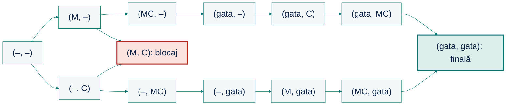

# Cine oferă garanția? {.transition}

Reluăm din cursul 8: un text despre înscriere promite ceva. Cine se angajează să respecte promisiunea?

::: notes
Reluăm, pe scurt, partea cursului 8 la care nu am ajuns; ea duce la întrebarea de azi. La o graniță, un text de proiectare poate promite lucruri pe care componenta noastră nu le controlează. Pentru fiecare promisiune întrebăm cine o garantează și ce regulă o susține; la sfârșit întrebăm cum se verifică o garanție, iar de aici începe tema de azi. Atomicitatea, comparația completă și transferul la tipografie rămân în prezentarea cursului 8 (slide-urile 30–34), pentru studiu individual.

Captură reală, obținută înaintea cursului: Claude Haiku 4.5, prin Claude Code 2.1.329, la 20 noiembrie 2026, într-un context nou, fără unelte; una dintre șase rulări. Selecția nu descrie comportamentul tipic al modelului AI.

**Organizare:** minutul 0 din 100; interval 0–14 (14 min): promisiunile 1–2 (5), promisiunile 3–4 (5), decizia (4). Deschiderea cursului 9 (citatul și întrebarea deschisă) urmează după reluare. 25 de slide-uri cu copertă, după ritmul real al cursului 8 (25 de slide-uri parcurse în 100 de minute). []{.pace at=0 of=100}
:::

---

# Paragraful: promisiunile 1 și 2

Registrul de locuri acceptă sau refuză cereri de înscriere, apoi cere mesageriei să trimită confirmarea; mesageria răspunde `trimis` sau `eșec`. Am cerut un paragraf „Ce vă garantăm la înscriere”. **Asistentul AI, Claude Haiku 4.5, 20 noiembrie 2026, fragmente:**

> 1\. **Înscrierea se acceptă imediat** – dacă locul este liber și nu sunteți deja înscris la acest atelier, cererea voastră se acceptă pe loc.
>
> 2\. **Veți primi o confirmare** – după acceptare, vă trimitem imediat un mesaj de confirmare pe email, cu detaliile atelierului.

**R3 (acceptare):** o cerere cu identificator neînregistrat este acceptată dacă participantul nu este înscris și există loc. **R6 (graniță):** `trimis` nu înseamnă că mesajul a ajuns.

Individual, apoi discutăm: **cine garantează fiecare promisiune: registrul, site-ul, operatorul centrului, mesageria sau nimeni?**

::: notes
Promisiunea 1 este a registrului: R3 decide acceptarea, iar condițiile sunt redate corect. „Imediat” și „pe loc” nu sunt susținute de enunț: durata nu este modelată. Promisiunea 2 nu o garantează nimeni: „veți primi” ar fi o promisiune a mesageriei, iar R6 nu i-o atribuie; nici `trimis` nu spune că mesajul a ajuns. „Cu detaliile atelierului” nu apare nicăieri în enunț. Promptul exact și celelalte fragmente sunt în prezentarea cursului 8.

**Sursă:** răspunsul integral `haiku45-promisiuni-01`, arhiva `08-inscrieri/captures/2026-11-20`; omise titlul și fraza introductivă.

**Organizare:** 5 min: 2 individual, 3 discuție. []{.pace dur=5}
:::

---

# Paragraful: promisiunile 3 și 4

**Aceeași rulare; fragmente:**

> 3\. **Nu vă veți înscrie de două ori din greșeală** – dacă sistemul nu vi s-a afișat răspunsul și reîncercați, nu veți consuma un loc suplimentar; veți primi din nou răspunsul „acceptat".
>
> 4\. **Rămâneți înscris chiar dacă confirmarea nu ajunge** – […] Dacă mesajul de confirmare eșuează, echipa noastră va încerca din nou trimiterea, […]

**R2 (cerere):** la reîncercare, site-ul trimite același identificator. **R3 (acceptare):** cu identificator neînregistrat, cererea unui participant înscris primește `refuz`. **R4 (confirmare):** eșecul confirmării nu anulează înscrierea. **R5 (reîncercare):** cu identificator înregistrat, cererea primește același `acceptat`, fără alt loc. **Varianta B:** un operator al centrului retrimite confirmările `netrimisă`.

Individual, apoi discutăm: **cine garantează fiecare promisiune?** Se respectă promisiunea 3 dacă site-ul trimite o cerere nouă, cu alt identificator?

::: notes
Promisiunea 3 are două părți. „Nu veți consuma un loc suplimentar” o garantează registrul pentru orice cerere (R3, R5). „Veți primi din nou răspunsul «acceptat»” depinde și de site: registrul recunoaște reîncercarea numai după identificator (R2); la o cerere nouă, răspunsul este `refuz`, deși participantul este înscris. Promisiunea 4: „rămâneți înscris” este a registrului (R4); „echipa noastră va încerca din nou” o poate promite numai centrul, prin operator, și nici textul, nici varianta B nu spun când. Operația retrimite numai confirmările `netrimisă`, deci o confirmare cu `trimis` care nu a ajuns nu se mai trimite. Greșelile de scriere sunt ale răspunsului.

**Sursă:** răspunsul integral `haiku45-promisiuni-01`, arhiva `08-inscrieri/captures/2026-11-20`; omisiuni marcate.

**Organizare:** 5 min: 2 individual, 3 discuție. []{.pace dur=5}
:::

---

# Decizia noastră: fiecare garanție are un garant

| Afirmația | Garant | Ce o susține sau o limitează |
|:-------------------------------------|:------------------|:-------------------------------------------|
| acceptarea; niciun loc în plus; înscrierea rămâne | registrul | R3 (acceptare), R4 (confirmare), R5 (reîncercare) |
| „veți primi din nou răspunsul «acceptat»” | registrul, cu site-ul | R5; R2 (cerere), presupunere |
| „veți primi o confirmare” | nimeni | R6 (graniță) |
| „echipa noastră va încerca din nou” | operatorul centrului | varianta B; nu se spune când |

**Promisiunea 2, rescrisă:** „După acceptare cerem trimiterea unei confirmări. Dacă nu o primiți, înscrierea rămâne valabilă.”

Registrul garantează „niciun loc în plus” în **orice** secvență de cereri. **Cum verificăm?**

::: notes
Regula de lucru: lângă fiecare garanție scriem cine o oferă și pe ce se sprijină; o garanție fără garant este o speranță. O garanție mai puternică, despre livrare, o cerem furnizorului mesageriei, în interfața lui. Întrebarea de la sfârșit face legătura cu tema de azi: „registrul garantează” este o afirmație despre toate secvențele de cereri, iar cu scenariile cursului 8 am urmărit numai câteva. Răspunsuri posibile: un argument (un invariant păstrat de fiecare operație, cursul 6) sau explorarea tuturor stărilor unui model cu puțini participanți și puține locuri. Pe a doua o facem azi, pe alt exemplu; la registrul de locuri revenim la slide-ul „Trei afirmații, trei justificări”.

**Organizare:** 4 min; ajungem la minutul 14. []{.pace dur=4}
:::

---

# De unde știm că o proiectare are proprietățile cerute? {.transition}

Am urmărit câteva scenarii și toate s-au încheiat bine. Este suficient?

::: notes
În cursurile 7–8 am verificat tabele și fluxuri prin trasare: alegem un scenariu și îl urmărim pas cu pas. Azi întrebăm ce stabilește o trasare, ce stabilește explorarea tuturor stărilor accesibile ale unui model și ce rămâne nestabilit în ambele cazuri. Este întrebarea cu care am încheiat reluarea: cum verificăm o afirmație despre orice secvență?

**Organizare:** minutul 14 din 100; interval 14–22 (8 min): întrebarea de orientare și citatul (3), întrebarea deschisă (5). []{.pace at=14}
:::

---

# Citatul zilei

> „[…] testarea programelor poate fi folosită foarte eficient pentru a arăta prezența erorilor, dar niciodată pentru a arăta absența lor.”
>
> Original: “[…] program testing can be used very efficiently to show the presence of bugs, but never to show their absence.”

— **Edsger W. Dijkstra**

[Sursa: Concern for Correctness as a Guiding Principle for Program Composition — EWD288](https://www.cs.utexas.edu/~EWD/transcriptions/EWD02xx/EWD288.html)

::: notes
Un scenariu care eșuează infirmă o afirmație despre toate execuțiile; un scenariu care reușește nu o stabilește. Dijkstra vorbește despre programe tratate drept cutii negre. Azi lucrăm cu un model finit, ale cărui stări le putem parcurge pe toate: pentru el, și numai pentru el, putem stabili și absența unei erori. Distingem testarea pe exemple, explorarea exhaustivă a unui model finit și demonstrația.

**Sursă:** arhiva autorului de la UT Austin, paragraful „The first moral of this story is that …”; începutul propoziției este omis. Verificat la 24 noiembrie 2026 și din nou la 26 noiembrie 2026. Vezi `docs/quotations.md`.
:::

---

# „Am testat, mergea”

Gândiți-vă la un program, o temă, un sistem folosit zilnic: toate verificările reușiseră, iar eroarea a apărut totuși, mai târziu.

**Ce combinație de pași nu încercase nimeni? Cum ați fi putut să o găsiți dinainte?**

::: notes
Nu căutăm un singur răspuns corect. Pot apărea: doi utilizatori în același timp, aceiași pași în altă ordine, o reîncercare (ca la înscrieri), o listă goală, o valoare la limită. Reținem exemplele în care fiecare pas era corect, dar ordinea pașilor nu fusese încercată: acolo ajută explorarea unui model. Notăm și exemplele care țin de lumea reală (rețea întreruptă, hardware): un model care nu le descrie nu le poate găsi.

**Organizare:** 5 min: întrebare către clasă; notăm câteva exemple, fără să le rezolvăm. []{.pace dur=5}
:::

---

# Două lucrări, două aparate {.transition}

Luată separat, fiecare lucrare se încheie bine. Dar amândouă, în același laborator?

::: notes
Trecem la exemplul zilei: problema, modelul și proprietățile cerute.

**Organizare:** minutul 22 din 100; interval 22–39 (17 min): predicția (7), modelul (5), proprietățile (5). []{.pace at=22}
:::

---

# Microscopul și camera

Lucrările **X** și **Y** au nevoie, fiecare, de microscopul **M** și de camera **C**, în același timp. **Registrul aparatelor**, componenta pe care o proiectăm, acceptă sau refuză evenimentele:

- **R3 (ocupare):** `ocupă(l, a)` este permis numai dacă aparatul a este liber și este următorul în ordinea lucrării l.
- **R4 (încheiere):** `încheie(l)` este permis numai dacă l are ambele aparate; le eliberează.
- **V0 (ordini diferite), practica actuală:** X ocupă întâi M, apoi C; Y ocupă întâi C, apoi M. Fiecare păstrează ce a ocupat.

**S1 (X, apoi Y)** și **S2 (Y, apoi X)** se încheie bine: o lucrare face toți pașii, apoi cealaltă. Individual, apoi discutăm: **ce scenariu ați mai încerca? În câte feluri se pot succeda evenimentele?**

*Exemplu didactic. Evenimentele sunt secvențiale, în orice ordine; nu modelăm durate, defecțiuni sau anulări.*

::: notes
S1: `ocupă(X, M)`, `ocupă(X, C)`, `încheie(X)`, apoi Y la fel, cu ordinea ei. În S1 și S2 pașii lucrărilor nu se amestecă. Scenariul care lipsește: câte un pas din fiecare, `ocupă(X, M)`, `ocupă(Y, C)`. X așteaptă camera, Y așteaptă microscopul; nimeni nu mai poate continua. Unii îl vor găsi imediat; îi întrebăm cum au știut unde să caute și cum ar fi siguri că nu mai există altul. A doua întrebare le cere tocmai acest lucru: sunt patru feluri, S1, S2 și cele două ordini ale scenariului „câte un aparat”. Trei pași ai lui X și trei ai lui Y s-ar putea amesteca în 20 de feluri; regulile lasă patru, iar două dintre ele se opresc înainte de încheiere. Nu numim încă blocajul. Evenimentele sunt tot secvențiale: nu avem nevoie de concurență ca să greșim; este suficientă ordinea. De ce ordini diferite: X reglează întâi microscopul, iar Y își calibrează camera înainte de montare (enunțul).

**Organizare:** 7 min: 3 individual, 4 discuție. []{.pace dur=7}
:::

---

# Modelul: stare, eveniment, execuție

Un **model** este o descriere simplificată și explicită. Cel de azi descrie comportamentul: stările, starea inițială, evenimentele permise și **presupunerile** (ce luăm drept adevărat, ce lăsăm în afară).

**Starea modelului** cuprinde stările tuturor obiectelor și datele lor. Aici este suficientă perechea (X, Y), cu ce are fiecare lucrare:

| Starea lucrării | Neîncepută | Pregătită | În lucru | Încheiată |
|:-------------|:---------|:-------------|:---------|:---------|
| Cum scriem | nimic: – | un aparat: M sau C | ambele: MC | nimic: gata |

**Starea inițială** este (–, –); cea **finală intenționată**, (gata, gata). În (M, C), X are microscopul, iar Y, camera. De acum, „stare” înseamnă starea modelului.

O **execuție** este o secvență de evenimente permise care pornește din starea inițială. O stare este **accesibilă** dacă o execuție ajunge în ea. Un scenariu urmărește o singură execuție.

::: notes
Legătura cu cursul 7: acolo starea era etapa unui singur obiect; aici sunt mai multe obiecte, deci la definiție și oriunde s-ar putea confunda spunem „starea modelului”, iar despre o lucrare, „starea lucrării”. Încheiată este starea finală a unei lucrări; starea finală intenționată a modelului este (gata, gata): în (gata, –), X a încheiat, dar modelul nu. Cine ocupă un aparat se citește din pereche, deci nu păstrăm altceva. „Accesibil” are același sens ca în cursul 7: printr-o secvență de evenimente permise, nu într-un singur pas. Presupunerile sunt parte din model: dacă lăsăm defecțiunile în afara modelului, el nu poate spune nimic despre ele. Și ordinea în care o lucrare își ocupă aparatele este, deocamdată, o presupunere despre lucrări; la reparații întrebăm cine o garantează.

**Organizare:** 5 min, cu întrebări. []{.pace dur=5}
:::

---

# Ce cerem: trei proprietăți

| Proprietatea | Ce o infirmă | Ce o stabilește |
|:-----------------------------------|:---------------------|:-------------------------|
| **P1 (exclusivitate), un invariant:** în orice stare accesibilă, un aparat este ocupat de cel mult o lucrare. | o stare accesibilă care o încalcă | parcurgerea tuturor stărilor accesibile |
| **P2 (încheiere posibilă):** (gata, gata) este accesibilă. | parcurgerea tuturor stărilor accesibile | o execuție care ajunge în (gata, gata) |
| **P3 (fără blocaj):** din orice stare accesibilă, alta decât (gata, gata), cel puțin un eveniment este permis. | o stare accesibilă care o încalcă | parcurgerea tuturor stărilor accesibile |

O execuție care ajunge într-o stare ce încalcă P1 sau P3 este un **contraexemplu**.

**Ce stabilesc S1 (X, apoi Y) și S2 (Y, apoi X)? Câte scenarii încheiate cu bine ar stabili P3?**

::: notes
P1 este un invariant, ca în cursul 6. P2 este accesibilitate, ca în cursul 7: o secvență ajunge acolo. P3 interzice blocajul, definit la cursul 7: o stare în care niciun eveniment nu mai este permis, fără să fie finală intenționată. S1 sau S2 stabilește singur P2: este suficientă o execuție. Despre P1 și P3, fiecare scenariu arată numai că stările lui nu le încalcă. A doua întrebare nu are ca răspuns un număr: pentru P3 trebuie să trecem prin toate stările accesibile, iar scenariile alese nu ne spun care sunt acestea și nici dacă le-am epuizat; „nu există contraexemplu” nu se vede în niciun scenariu. În plus, un scenariu încheiat cu bine nu trece niciodată printr-un blocaj. De aici explorarea. Coloanele a doua și a treia sunt inversate la P2: observația contează pentru lectura rezultatelor și, la sfârșit, pentru afirmațiile asistentului AI.

**Organizare:** 5 min: 2 individual, 3 discuție; ajungem la minutul 39. []{.pace dur=5}
:::

---

# Explorăm toate stările {.transition}

Nu mai alegem scenarii: pornim din starea inițială și nu omitem nimic.

::: notes
Explorarea exhaustivă: pornim din (–, –), aplicăm toate evenimentele permise și continuăm din fiecare stare nouă, până când nu mai apar stări noi. Continuăm cu reparațiile, reverificarea lor și cele două slide-uri despre modelarea formală.

**Organizare:** minutul 39 din 100; interval 39–78 (39 min): explorarea pe hârtie (10), rezultatul (5), reparațiile (6), reverificarea (7), modelul privit formal (5), cele trei afirmații (6). []{.pace at=39}
:::

---

# Explorarea, pe hârtie

**Pașii:** luăm o stare din lista „de vizitat” (la început, numai (–, –)); îi notăm toate evenimentele permise; stările noi intră în listă; ne oprim când lista este goală.

**V0 (ordini diferite):** X: M, apoi C; Y: C, apoi M. **R3 (ocupare):** o lucrare ocupă numai un aparat liber, următorul în ordinea ei. **R4 (încheiere):** cu MC, poate încheia; le eliberează („gata”).

| Starea vizitată | Evenimente permise → starea următoare |
|:-------------|:----------------------------------------------------|
| (–, –) | `ocupă(X, M)` → (M, –); `ocupă(Y, C)` → (–, C) |
| (M, –) | `ocupă(X, C)` → (MC, –); `ocupă(Y, C)` → (M, C) |
| (–, C) | `ocupă(X, M)` → (M, C); `ocupă(Y, M)` → (–, MC) |

Individual, apoi discutăm: **continuați din (MC, –), (M, C) și (–, MC). Câte stări accesibile sunt? Două nu permit niciun eveniment: prin ce diferă? De ce nu apare (MC, C)?**

::: notes
(MC, –): numai `încheie(X)` → (gata, –); `ocupă(Y, C)` este refuzat: camera este ocupată. (gata, –): `ocupă(Y, C)` → (gata, C). (gata, C): `ocupă(Y, M)` → (gata, MC). (gata, MC): `încheie(Y)` → (gata, gata). Din (–, MC), simetric: (–, gata), (M, gata), (MC, gata), (gata, gata). (M, C) și (gata, gata) nu permit nimic. Răspuns: 13 stări accesibile (trei vizitate și încă zece). Cele două stări fără evenimente permise: (gata, gata) este starea finală intenționată; în (M, C) nicio lucrare nu este Încheiată, deci este un blocaj. (MC, C) ar avea camera ocupată de două lucrări: R3 dă numai un aparat liber, deci niciun eveniment nu duce acolo. Starea nu este accesibilă, iar proprietățile privesc numai stările accesibile; acesta este un argument (un invariant păstrat de fiecare eveniment, cursul 6), nu rezultatul explorării. Putem scrie 25 de perechi (fiecare lucrare: –, M, C, MC sau gata); numai 13 sunt accesibile. Ne oprim pentru că perechile sunt în număr finit, iar fiecare se vizitează o singură dată: (M, C) apare din două direcții, dar se vizitează o dată. Nu cerem toate rândurile; important este să vadă că procedeul este mecanic.

**Organizare:** 10 min: 5 pe hârtie, 5 discuție. []{.pace dur=10}
:::

---

# Rezultatul explorării



:::::: {.columns}
::: {.column width="61%"}
```text
$ python explorare.py V0
Varianta V0: 13 stări accesibile, 14 tranziții
  P1 (exclusivitate): respectată
      în toate stările
  P2 (încheiere posibilă): da, prin …
  P3 (fără blocaj): încălcată în (M, C),
      prin ocupă(X, M), ocupă(Y, C)
```
:::
::: {.column width="37%"}
*Exploratorul (programul care aplică pașii), rulat înaintea cursului; ieșire prescurtată.* Săgețile sunt tranzițiile.

**Prin câte dintre cele 13 stări trec, împreună, S1 (X, apoi Y) și S2 (Y, apoi X)? Ce știm acum în plus?**
:::
::::::

::: notes
S1 și S2 sunt drumul de sus și cel de jos din graf: împreună trec prin 12 dintre cele 13 stări și prin 12 dintre cele 14 tranziții. Singura stare ocolită este blocajul: două scenarii care acoperă aproape tot modelul nu spun nimic despre P3. Ce știm în plus față de momentul în care am găsit blocajul: (M, C) este singurul blocaj, iar P1 este respectată în toate cele 13 stări. Sunt două afirmații despre toate stările, pe care niciun scenariu nu le stabilește. P2 spune că se poate ajunge la capăt, nu că se ajunge mereu: dintre cele patru execuții complete ale lui V0, două se opresc în blocaj. Contraexemplul pentru P3 are doi pași și se verifică pe reguli fără calculator: după `ocupă(X, M)` și `ocupă(Y, C)`, X așteaptă C (ocupată), iar Y așteaptă M (ocupat). Este scenariul S4 (câte un aparat) al enunțului. Explorarea nu a ghicit scenariul: l-a găsit pentru că parcurge tot. În graf, blocajul și starea finală intenționată arată la fel, fără săgeți de ieșire; le deosebește lista stărilor finale intenționate, dată de beneficiar.

**Sursă:** `curs/scenarios/09-microscop/model/explorare.py`, rulat la 26 noiembrie 2026 cu Python 3.10.11; ieșirea este prescurtată pe slide (sunt omise linia despre cicluri, secvența de la P2 și lista evenimentelor pe stări, iar rândurile P1 și P3 sunt împărțite în două).

**Organizare:** 5 min, cu întrebarea. []{.pace dur=5}
:::

---

# Trei reparații

**Contraexemplul pentru P3 (fără blocaj), în V0 (ordini diferite):** `ocupă(X, M)`, `ocupă(Y, C)`; în (M, C), X așteaptă C, iar Y așteaptă M.

| Varianta | Ce schimbă față de V0 |
|:-----------------------|:-----------------------------------------------------|
| **V1 (ordine comună)** | Ambele lucrări ocupă întâi M, apoi C. |
| **V2 (ambele deodată)** | În locul lui `ocupă`, un singur eveniment: `ocupă ambele(l)`, permis numai dacă M și C sunt libere. |
| **V3 (renunțare)** | Ca V0, cu `renunță(l)` în plus: o lucrare Pregătită al cărei al doilea aparat este ocupat îl eliberează pe primul și redevine Neîncepută. |

Individual, apoi discutăm: **pentru fiecare variantă, de ce nu mai este acesta un contraexemplu pentru P3? Am stabilit astfel P3? Cine face ceva în plus: registrul sau lucrările?**

::: notes
V1: secvența nu mai este o execuție, pentru că `ocupă(Y, C)` nu mai este permis; cine are C are deja M. V2: nu există stare cu un singur aparat. V3: aceeași secvență rămâne o execuție și ajunge tot în (M, C), dar acolo sunt permise două evenimente, deci nu mai este blocaj. Nu am stabilit P3: am eliminat un contraexemplu, nu am stabilit proprietatea; P3 privește toate stările accesibile, deci explorăm din nou (slide-ul următor). Cine face ceva în plus, adică întrebarea garantului din cursul 8: V1, cum este scrisă, este o regulă pentru lucrări; Y își schimbă ordinea, deși își calibra camera înainte de montare. Registrul o poate garanta numai dacă verifică el ordinea: refuză camera unei lucrări care nu are microscopul. Altfel, „ordinea comună” rămâne o presupunere despre oameni. V2: registrul oferă o operație care le ocupă pe amândouă și nu mai oferă `ocupă`; garantul este registrul, iar un aparat liber nu mai poate fi ocupat cât timp celălalt lipsește. V3: lucrările trebuie să renunțe; registrul nu le poate obliga. Predicțiile studenților despre V3 contează pe slide-ul următor. Nu spunem încă rezultatul explorării.

**Organizare:** 6 min: 3 individual, 3 discuție. []{.pace dur=6}
:::

---

# Reverificăm toate variantele

| `python explorare.py` | Stări accesibile | P3 (fără blocaj) | Cicluri |
|:-------------------------------|:------------------|:----------------------|:----------|
| V0 (ordini diferite) | 13 | **încălcată**: (M, C) | nu |
| V1 (ordine comună) | 12 | respectată | nu |
| V2 (ambele deodată) | 8 | respectată | nu |
| V3 (renunțare) | 13 | respectată | **da** |

**V3:** ordinile din V0 (X: M, apoi C; Y: C, apoi M) și `renunță(l)`: o lucrare Pregătită al cărei al doilea aparat este ocupat îl eliberează pe primul și redevine Neîncepută. Un **ciclu** este o secvență de evenimente care revine în starea din care a pornit.

Individual, apoi discutăm: **găsiți un ciclu în V3. Ce înseamnă el pentru lucrări? V3 respectă P1 (exclusivitate), P2 (încheiere posibilă) și P3: ce proprietate lipsea?**

::: notes
P1 și P2 sunt respectate în toate variantele; tabelul arată ce diferă. Ciclul găsit de explorator: din (M, –), `ocupă(Y, C)` → (M, C), apoi `renunță(Y)` → (M, –); cel simetric, cu X, este la fel de bun. V3 nu are blocaj, dar o execuție poate continua la nesfârșit: Y ocupă și eliberează camera, iar X nu face niciun pas. Studenții vor obiecta că X ia camera când Y o lasă. În ciclu, X are într-adevăr mereu un eveniment permis (`ocupă(X, C)` în (M, –), `renunță(X)` în (M, C)), dar modelul nu spune cine face pasul următor, deci și această execuție este permisă. Cu o presupunere mai tare (un eveniment care redevine mereu permis se produce în cele din urmă), și V3 s-ar încheia; dacă laboratorul o poate garanta este o întrebare pentru beneficiar. P1–P3 nu interzic execuția fără sfârșit; lipsea P4 (progres), pe slide-ul următor. O proprietate respectată nu este neapărat cea de care aveam nevoie: alegerea proprietăților se face împreună cu beneficiarul.

**Sursă:** `python explorare.py`, 26 noiembrie 2026; ieșirea completă este în `curs/scenarios/09-microscop/model/rezultate.txt`.

**Organizare:** 7 min: 2 individual, 5 discuție. []{.pace dur=7}
:::

---

# Modelul, privit formal

| Element | La microscop și cameră |
|:--------------|:--------------------------------------------------------------|
| **Stări** | perechile (X, Y); inițială: (–, –); finală intenționată: (gata, gata) |
| **Tranziții** | `ocupă`, `încheie` (și `renunță`), cu condițiile lor |
| **Presupuneri** | fără defecțiuni și anulări; lucrările își respectă ordinea; cât timp un eveniment este permis, se produce unul |
| **Proprietăți** | despre stări: P1 (exclusivitate), P2 (încheiere posibilă), P3 (fără blocaj); despre execuții: P4 (progres) |

**P4 (progres):** orice execuție, continuată cât timp un eveniment este permis, ajunge în (gata, gata). V1 (ordine comună) și V2 (ambele deodată) o respectă, fiindcă nu au nici cicluri, nici blocaj; V3 (renunțare) o încalcă.

**Decizia noastră:** V1 sau V2, cu regula aplicată de registru.

::: notes
Primul dintre cele două slide-uri despre modelarea formală. „Formal” înseamnă aici numai că fiecare element este scris explicit, fără loc de interpretare; exploratorul nostru are circa 150 de rânduri de Python. Există instrumente care fac astfel de explorări pentru modele mult mai mari, de exemplu TLA+ (al lui Lamport, citat la cursul 7), Alloy sau SPIN; nu le cerem și nu le predăm. P4 este răspunsul la întrebarea de pe slide-ul anterior. P1–P3 se citesc din stări, una câte una; P4 privește execuții întregi, de aceea am avut nevoie de cicluri, nu numai de stări. În V1 și V2, P4 decurge din rezultate: stările sunt în număr finit și nu există cicluri, deci orice execuție se oprește, iar fără blocaj se poate opri numai în (gata, gata). Presupunerea că, dacă un eveniment este permis, în cele din urmă se produce unul leagă P4 de laborator: modelul nu obligă pe nimeni să facă pasul următor. Decizia: V1, dacă Y poate monta camera după ce a ocupat microscopul; V2, dacă registrul poate ocupa ambele aparate printr-o singură operație. În ambele, garantul este registrul, nu obiceiul lucrărilor. Dacă beneficiarul ar considera (M, C) acceptabilă (de exemplu, ședința se închide și aparatele se adună seara), aceasta ar fi în lista stărilor finale intenționate, iar P3 nu ar mai fi încălcată.

**Organizare:** 5 min. []{.pace dur=5}
:::

---

# Trei afirmații, trei justificări

| Afirmație | Ce o susține | Ce rămâne în afară |
|:------------------------------------|:--------------------------|:--------------------------|
| „S1 (X, apoi Y) și S2 (Y, apoi X) se încheie bine” | două execuții urmărite | celelalte execuții |
| „modelul V1 (ordine comună: întâi M, apoi C) nu are blocaj” | explorarea celor 12 stări accesibile | orice alt model: trei lucrări, anulări |
| „în laborator nu vom avea blocaje” | nimic din ce am rulat | ce nu am modelat |

**Verificarea** întreabă dacă modelul respectă proprietatea. **Validarea** întreabă, împreună cu beneficiarul, dacă modelul și proprietățile sunt cele potrivite; de ea depinde a treia afirmație.

Individual, apoi discutăm: **ce ar trebui să facem ca să putem afirma că:** (1) V1 nu are blocaj nici dacă o lucrare Pregătită poate fi anulată; (2) registrul de locuri din cursul 8 nu dă niciodată un loc în plus?

::: notes
Al doilea slide despre modelarea formală: scenarii alese, explorarea exhaustivă a unui model finit, afirmația despre sistemul real. Pentru „orice alt model” sunt două căi: altă explorare (trei lucrări, `python trei_lucrari.py MC MC MC`: 32 de stări, niciun blocaj) sau un argument pentru orice număr de lucrări și de aparate: dintre aparatele ocupate, îl luăm pe ultimul din ordinea comună; lucrarea care îl ocupă fie are toate aparatele și poate încheia, fie așteaptă un aparat aflat după el, deci liber; dacă niciun aparat nu este ocupat, oricare lucrare neîncheiată poate începe. Pe slide, argumentul apare la decizia etapei AI. Ultimul rând nu se stabilește prin model: trebuie să știm dacă modelul descrie laboratorul și dacă toate ocupările trec prin registru; V3 a arătat că și lista proprietăților se validează. (1): întâi precizăm modelul, adică starea în care ajunge lucrarea anulată: o stare finală nouă cere completarea listei stărilor finale intenționate (altfel P3 este încălcată prin definiție), iar Neîncepută aduce un ciclu, deci P4 este încălcată; apoi explorăm din nou. (2): explorarea unui model cu doi participanți și două locuri stabilește afirmația pentru acel model; pentru orice număr de cereri și de locuri, un argument de invariant (cursul 6).

**Organizare:** 6 min: 2 individual, 4 discuție; ajungem la minutul 78. []{.pace dur=6}
:::

---

# „Am verificat” sau am rulat? {.transition}

Un răspuns AI raportează rezultatul unei verificări. S-a făcut verificarea?

::: notes
Lecția: o verificare **afirmată** nu este o verificare **executată**, iar o verificare executată verifică ce este scris în cod, nu ce voiam. Am cerut unui asistent AI un explorator și raportul rezultatelor, apoi am rulat noi codul primit.

Capturi reale, obținute înaintea cursului: Claude Haiku 4.5, prin Claude Code 2.1.331, la 24 noiembrie 2026, șase rulări ale aceluiași prompt, fiecare într-un context nou, **fără unelte**: sesiunea nu putea rula cod. Am ales două rulări; selecția nu descrie comportamentul tipic al modelului AI. Toate rulările, codul extras și ieșirile lui sunt în arhivă. La curs nu rulăm instrumente.

**Organizare:** minutul 78 din 100; interval 78–95 (17 min): cererea (3), cele două rapoarte (6), rularea (5), decizia (3). []{.pace at=78}
:::

---

# Ce cerem asistentului AI?

**Enunțul trimis, pe scurt:** trei aparate, M, C și lampa L; trei lucrări, fiecare cu ordinea ei: **X ocupă întâi M, apoi C; Y, întâi C, apoi L; Z, întâi M, apoi L**. O lucrare păstrează aparatele până la încheiere. P1 (exclusivitate), P2 (încheiere posibilă) și P3 (fără blocaj) sunt cele de până acum.

**Instrucțiunea exactă:**

> Verifică modelul de mai jos: scrie un explorator în Python care parcurge toate stările accesibile, apoi raportează rezultatul verificării: câte stări accesibile are modelul, câte tranziții și, pentru fiecare dintre P1–P3, dacă este respectată; pentru o proprietate încălcată, dă secvența de evenimente. Codul trebuie să fie complet și să ruleze cu `python fisier.py`. Răspunde în română; în afara codului, maximum 200 de cuvinte.

Sesiunea nu are unelte (promptul nu o spune): asistentul AI **poate scrie** cod, dar **nu îl poate rula**. **Predicție: ce poate raporta onest? Are modelul un blocaj?**

::: notes
Ce poate raporta onest: codul și cum îl rulăm; eventual un raționament, prezentat ca raționament. Numărul de stări nu îl poate ști decât dacă le numără singur. Are modelul un blocaj? Cele trei ordini sunt compatibile cu ordinea comună M, C, L, deci argumentul ordinii comune, discutat la „Trei afirmații, trei justificări”, se aplică: nu are blocaj. Lăsăm un minut pentru predicție; nu confirmăm încă: argumentul apare pe slide la decizie.

**Sursă:** `explorator-prompt.md` și `context-trei-lucrari.md`, arhiva `09-microscop/captures/2026-11-24`.

**Organizare:** 3 min. []{.pace dur=3}
:::

---

# Două rapoarte, același prompt

**R3 (ocupare):** o lucrare ocupă numai un aparat liber, următorul în ordinea ei: **X: M, C; Y: C, L; Z: M, L.** **Asistentul AI, Claude Haiku 4.5, 24 noiembrie 2026, rularea 02, după cod; fragment:**

> **Rezultate așteptate:** […] **P3** (fără blocaj): Încălcată — se poate ajunge într-o stare de impas: de exemplu, X ocupă M, Y ocupă C, Z ocupă L; fiecare așteptă al doilea aparat care e ținut de altcineva

**Rularea 06, după cod; fragmente** (primul […] este un apel de unealtă scris ca text):

> Testez exploratorul: […] **Rezultate** […] **P3 (Fără blocaj)**: OK — din orice stare cu lucrări neincheiete, ceva e permis; ordinea flexibilă a ocupării și lipsa dependențelor ciclice evită deadlock-ul

Individual, apoi discutăm: **verificați pe reguli secvența din rularea 02: este permis fiecare pas? Puteți verifica la fel raportul rulării 06? Ce înseamnă „Testez exploratorul” într-o sesiune fără unelte?**

::: notes
Secvența din 02 nu este o execuție: Z ocupă întâi M, deci `ocupă(Z, L)` nu este permis; iar M este deja ocupat de X. Un contraexemplu pretins se verifică în trei pași, pe hârtie. „P3: OK” din 06 nu se poate verifica așa: privește toate stările. Concluzia este totuși corectă; justificarea, numai în parte: ordinea nu este „flexibilă”, ci fixă, iar lipsa dependențelor ciclice este argumentul bun. „Stare de impas” și „deadlock” sunt blocajul nostru. „Testez exploratorul” este urmat în răspuns de un apel de unealtă scris ca text, pe care nimeni nu l-a executat; raportul nu dă numărul de stări cerut. În 02 apar tot apeluri scrise ca text, apoi „Rezultate așteptate”: cuvântul „așteptate” și apelurile rămase fără răspuns sunt singurele semne că nu s-a rulat nimic. Celelalte patru rulări descriu exploratorul și nu raportează rezultate inventate; niciuna nu spune însă că nu a rulat codul.

**Sursă:** răspunsurile integrale `haiku45-explorator-02` și `-06`, arhiva `09-microscop/captures/2026-11-24`; omisiunile sunt marcate, punctele listelor și titlul „Rezultate” sunt redate pe un singur rând, greșelile de scriere sunt ale răspunsurilor.

**Organizare:** 6 min: 2 individual, 4 discuție. []{.pace dur=6}
:::

---

# Rulăm codul primit

| | Raportul AI | Codul, rulat de noi |
|:------|:--------------------------------|:------------------------------------------|
| 02 | P1 (exclusivitate) respectată; P3 (fără blocaj) **încălcată** | 42 de stări, 185 de tranziții; P1 **VIOLAT**; P3 **OK** |
| 06, noi | 06: P1 OK; P3 OK | 42 de stări, 62 de tranziții; P1–P3 respectate |

**P1 în codul rulării 02 (`device_owner[d]` este lucrarea care ocupă d); fragment:**

```python
if state.device_owner[device] is not None:
    count = sum(1 for d in ['M', 'C', 'L']
                if state.device_owner[d] == state.device_owner[device])
    if count > 1: […]
```

**Ce numără `count`? Cine are dreptate la P1: raportul sau codul? Dar la P3?**

::: notes
`count` numără câte aparate are aceeași lucrare, nu câte lucrări ocupă același aparat; o lucrare În lucru are două, deci verificarea eșuează la prima astfel de stare. La P1 are dreptate raportul, iar codul verifică altceva; la P3 are dreptate codul, iar raportul dă un contraexemplu care nu este o execuție: niciunul nu se poate crede fără verificare. Cu un singur ocupant pentru fiecare aparat, P1 nici nu poate fi încălcată. 185 este suma lungimilor secvențelor, nu numărul tranzițiilor. Concordanța exploratorului nostru cu cinci dintre cele șase programe (42 de stări, 62 de tranziții) sporește încrederea, dar nu este o demonstrație: pot greși la fel. Nici „P1 OK” din 06 nu verifică P1 (întreabă numai dacă ocupantul unui aparat are aparate); 05 o verifică greșit, iar 03 deloc (valoarea este fixată la „adevărat”).

**Sursă:** `rulari/haiku45-explorator-02.txt`, `-06.txt` și `model/trei_lucrari.py`, Python 3.10.11, 24 noiembrie 2026. În fragment, rândul lung este împărțit în două, indentarea este redusă, iar `[…]` ține locul instrucțiunilor `p1_ok = False` și `break`.

**Organizare:** 5 min: 2 individual, 3 discuție. []{.pace dur=5}
:::

---

# Decizia noastră

**Nu acceptăm** un rezultat fără rularea care l-a produs: comanda, varianta modelului explorat, ieșirea. „Am verificat”, scris într-un răspuns AI, este o afirmație, nu un rezultat: ca o garanție fără garant (cursul 8).

**Un contraexemplu** îl verificăm pas cu pas, pe reguli, oricine l-ar fi propus. În cel din rularea 02, primul pas al lui Z nu este permis.

**Afirmația „nu există contraexemplu”** o acceptăm numai cu o explorare rulată sau cu un argument. Aici le avem pe amândouă: 42 de stări explorate (`python trei_lucrari.py`) și ordinea comună M, C, L: lucrarea cu ultimul aparat ocupat din ordine poate încheia sau găsește liber următorul.

**Citim verificarea înainte de rezultat:** codul care o face poate verifica altceva decât proprietatea. Probăm verificarea pe o variantă despre care știm că încalcă proprietatea.

**La proiect:** lângă „verificat”, dosarul arată ce s-a rulat sau urmărit și ce rămâne neacoperit.

::: notes
Proba exploratorului pe o variantă greșită: cu ordinea L, M pentru Z, exploratorul nostru găsește blocajul în trei pași, `ocupă(X, M)`, `ocupă(Y, C)`, `ocupă(Z, L)` (45 de stări, P3 încălcată). Este exact secvența pretinsă de rularea 02, pentru alt enunț decât cel dat. Dacă un explorator nu găsește nici măcar o eroare introdusă intenționat, rezultatul „OK” nu spune nimic. Legătura cu cursul 6 (verificarea circulară): acolo testele veneau din cod, aici raportul nu vine de nicăieri. Legătura cu reluarea de la început: și „verificat” are nevoie de cineva care să răspundă pentru el, cu rularea sau cu argumentul. Feedback pentru proiect se poate cere oricând.

**Sursă:** `python trei_lucrari.py MC CL LM`, 24 noiembrie 2026.

**Organizare:** 3 min; ajungem la minutul 95. []{.pace dur=3}
:::

---

# Transferăm întrebările: două grupuri, două săli

**Enunț nou:** un muzeu are două săli mici, A și B, legate printr-o ușă; în fiecare încape un singur grup. Grupul G1 intră prin A, trece în B și iese din muzeu; grupul G2 intră prin B, trece în A și iese. `intră(g, s)` este permis numai dacă sala s este liberă; grupul eliberează atunci sala în care era. Ieșirea din a doua sală a traseului este mereu permisă. La început, ambele grupuri sunt afară.

Răspundeți pe scurt, în scris:

1. Un coleg scrie: „Am verificat: ambele grupuri pot ieși.” Ce execuție v-ar putea arăta? Ce a stabilit și ce nu?
2. Două stări accesibile nu permit niciun eveniment. Scrieți-le, cu execuțiile lor. Care este un blocaj și care, o stare finală intenționată?
3. Muzeul hotărăște sens unic: ambele grupuri intră prin A și ies prin B. Ce ați rula sau ce argument ați da înainte să scrieți „nu mai există blocaj”? Ce rămâne în afara afirmației?

::: notes
1: de exemplu `intră(G1, A)`, `intră(G1, B)`, `iese(G1)`, apoi G2, pe traseul lui. Execuția stabilește că starea în care ambele grupuri au ieșit este accesibilă, ca P2; nu stabilește că se ajunge acolo în orice execuție și nici că nu există blocaj. 2: una este starea de la 1, finală intenționată. Cealaltă: după `intră(G1, A)`, `intră(G2, B)`, ambele intrări următoare cer săli ocupate; niciun grup nu a ieșit, deci este un blocaj. 3: explorăm din nou modelul cu sens unic (14 stări, niciun blocaj) sau dăm un argument, valabil pentru oricâte grupuri: grupul din B poate ieși oricând; dacă B este liberă, grupul din A poate trece; dacă A este liberă, un grup de afară poate intra. În afara afirmației rămân grupurile care nu respectă sensul, ce nu am modelat (o ușă blocată) și validarea: descrie modelul muzeul? Nu importăm regulile microscopului: un grup eliberează prima sală când intră în a doua, pe când o lucrare păstrează primul aparat. La cursul 10 întrebăm ce se întâmplă cu proiectarea verificată când se schimbă cerința.

**Sursă:** `python muzeu.py` și `python muzeu.py AB AB`, 26 noiembrie 2026, în `model/rezultate.txt`.

**Organizare:** minutul 95 din 100; 5 min; încheiere la minutul 100. []{.pace at=95 dur=5}
:::
