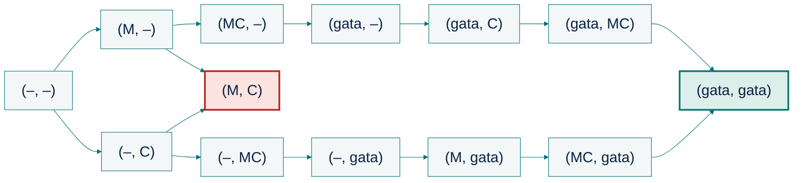

# De unde știm că o proiectare respectă regulile? {.transition}

Am urmărit patru scenarii și toate s-au încheiat bine. Ajunge?

::: notes
În cursurile 7–8 am verificat tabele și fluxuri prin trasare: alegem un scenariu și îl urmărim pas cu pas. Azi întrebăm ce stabilește o trasare, ce stabilește explorarea tuturor stărilor accesibile ale unui model și ce rămâne nestabilit în ambele cazuri. Începem cu ce a rămas din cursul 8: cine garantează o promisiune. Continuarea firească: cum verificăm garanția.

**Organizare:** minutul 0 din 100; interval 0–8 (8 min), inclusiv coperta, citatul și întrebarea deschisă. 26 de slide-uri cu copertă, după ritmul real al cursului 8 (25 de slide-uri parcurse în 100 de minute). []{.pace at=0 of=100}
:::

---

# Citatul zilei

> „[…] testarea programelor poate fi folosită foarte eficient pentru a arăta prezența erorilor, dar niciodată pentru a arăta absența lor.”
>
> Original: “[…] program testing can be used very efficiently to show the presence of bugs, but never to show their absence.”

— **Edsger W. Dijkstra**

[Sursa: Concern for Correctness as a Guiding Principle for Program Composition — EWD288](https://www.cs.utexas.edu/~EWD/transcriptions/EWD02xx/EWD288.html)

::: notes
Un scenariu care eșuează infirmă o afirmație despre toate execuțiile; un scenariu care reușește nu o stabilește. Dijkstra vorbește despre programe tratate drept cutii negre. Azi lucrăm cu un model finit, ale cărui stări le putem parcurge pe toate: pentru el, și numai pentru el, putem stabili și absența unei erori. Distingem testarea pe exemple, explorarea exhaustivă a unui model finit și demonstrația.

**Sursă:** arhiva autorului la UT Austin, paragraful „The first moral of this story is that …”; începutul propoziției este omis. Verificat la 24 noiembrie 2026. Vezi `docs/quotations.md`.
:::

---

# „Am testat, mergea”

Gândiți-vă la un program, o temă, un sistem folosit zilnic: verificările treceau, iar eroarea a apărut totuși, mai târziu.

**Ce combinație de pași nu încercase nimeni? Cum ați fi putut să o găsiți dinainte?**

::: notes
Nu căutăm un singur răspuns corect. Pot apărea: doi utilizatori în același timp, aceiași pași în altă ordine, o reîncercare, o listă goală, o valoare la limită. Reținem exemplele în care fiecare pas era corect, dar ordinea lor nu fusese încercată: acolo ajută explorarea unui model. Notăm și exemplele care țin de lumea reală (rețea căzută, hardware): un model care nu le descrie nu le poate găsi.

**Organizare:** 5 min: întrebare către clasă; notăm câteva exemple, fără să le rezolvăm. []{.pace dur=5}
:::

---

# Cine oferă garanția? {.transition}

Reluăm din cursul 8: un text despre înscriere promite ceva. Cine se angajează să respecte promisiunea?

::: notes
Este partea cursului 8 la care nu am ajuns, în formă scurtă. La o graniță, un text de proiectare poate promite lucruri pe care componenta noastră nu le controlează. Pentru fiecare promisiune întrebăm cine o garantează și ce regulă o susține. Atomicitatea, comparația completă și transferul la tipografie rămân în prezentarea cursului 8 (slide-urile 30–34), pentru studiu individual.

Captură reală, obținută înaintea cursului: Claude Haiku 4.5, prin Claude Code 2.1.329, la 20 noiembrie 2026, într-un context nou, fără unelte; una dintre șase rulări. Selecția nu descrie comportamentul tipic al modelului.

**Organizare:** minutul 8 din 100; interval 8–22 (14 min): promisiunile 1–2 5, promisiunile 3–4 5, decizia 4. []{.pace at=8}
:::

---

# Paragraful: promisiunile 1 și 2

Registrul acceptă sau refuză înscrieri, apoi cere unei mesagerii externe confirmarea. Am cerut un paragraf „Ce vă garantăm la înscriere”. **Asistentul AI, Claude Haiku 4.5, 20 noiembrie 2026, fragmente:**

> 1\. **Înscrierea se acceptă imediat** – dacă locul este liber și nu sunteți deja înscris la acest atelier, cererea voastră se acceptă pe loc.
>
> 2\. **Veți primi o confirmare** – după acceptare, vă trimitem imediat un mesaj de confirmare pe email, cu detaliile atelierului.

**R3 (acceptare):** o cerere cu identificator neînregistrat este acceptată dacă participantul nu este înscris și există loc. **R6 (graniță):** `trimis` nu înseamnă că mesajul a ajuns.

Individual, apoi discutăm: **cine garantează fiecare: registrul, site-ul, operatorul, mesageria sau nimeni?**

::: notes
Promisiunea 1 este a registrului: R3 decide acceptarea, iar condițiile sunt redate corect. „Imediat” și „pe loc” nu au sprijin în enunț: durata nu este modelată. Promisiunea 2 nu o garantează nimeni: „veți primi” ar fi o promisiune a mesageriei, iar R6 nu i-o atribuie; nici `trimis` nu spune că mesajul a ajuns. „Cu detaliile atelierului” nu apare nicăieri în enunț. Promptul exact și celelalte fragmente sunt în prezentarea cursului 8.

**Sursă:** răspunsul integral `haiku45-promisiuni-01`, arhiva `08-inscrieri/captures/2026-11-20`; omise titlul și fraza introductivă.

**Organizare:** 5 min: 2 individual, 3 discuție. []{.pace dur=5}
:::

---

# Paragraful: promisiunile 3 și 4

**Aceeași rulare; fragmente:**

> 3\. **Nu vă veți înscrie de două ori din greșeală** – dacă sistemul nu vi s-a afișat răspunsul și reîncercați, nu veți consuma un loc suplimentar; veți primi din nou răspunsul „acceptat".
>
> 4\. **Rămâneți înscris chiar dacă confirmarea nu ajunge** – […] Dacă mesajul de confirmare eșuează, echipa noastră va încerca din nou trimiterea, […]

**R2 (cerere):** la reîncercare, site-ul trimite același identificator. **R3 (acceptare):** cu identificator neînregistrat, cererea unui participant înscris primește `refuz`. **R4 (confirmare):** eșecul confirmării nu anulează înscrierea. **R5 (reîncercare):** cu identificator deja înregistrat, `acceptat`. **Varianta B:** un operator al centrului apelează `retrimite confirmările()`, pentru cele `netrimisă`.

Individual, apoi discutăm: **cine garantează fiecare promisiune?** Ce primește participantul dacă site-ul trimite o cerere nouă?

::: notes
Promisiunea 3 are două părți. „Nu veți consuma un loc suplimentar” o garantează registrul pentru orice cerere (R3, R5). „Veți primi din nou răspunsul «acceptat»” depinde și de site: registrul recunoaște reîncercarea numai după identificator (R2); la o cerere nouă, răspunsul este `refuz`, deși participantul este înscris. Promisiunea 4: „rămâneți înscris” este a registrului (R4); „echipa noastră va încerca din nou” o poate promite numai centrul, prin operator, și nici textul, nici varianta B nu spun când. Operația încearcă numai confirmările `netrimisă`, deci o confirmare cu `trimis` care nu a ajuns nu se mai trimite. Greșelile de scriere sunt ale răspunsului.

**Sursă:** răspunsul integral `haiku45-promisiuni-01`, arhiva `08-inscrieri/captures/2026-11-20`; omisiuni marcate.

**Organizare:** 5 min: 2 individual, 3 discuție. []{.pace dur=5}
:::

---

# Decizia noastră: fiecare garanție are un garant

| Afirmația | Garant | Ce o susține sau o limitează |
|:-------------------------------------|:------------------|:-------------------------------------------|
| acceptarea; niciun loc în plus; înscrierea rămâne | registrul | R3 (acceptare), R4 (confirmare), R5 (reîncercare) |
| „veți primi din nou răspunsul «acceptat»” | registrul, cu site-ul | R5; R2 (cerere), presupunere |
| „veți primi o confirmare” | nimeni | R6 (graniță) |
| „echipa noastră va încerca din nou” | operatorul centrului | varianta B; nu se spune când |

**Promisiunea 2, rescrisă:** „După acceptare cerem trimiterea unei confirmări. Dacă nu o primiți, înscrierea rămâne valabilă.”

Registrul garantează „niciun loc în plus” în **orice** secvență de cereri. **Cum verificăm?**

::: notes
Regula de lucru: lângă fiecare garanție scriem cine o oferă și pe ce se sprijină; o garanție fără garant este o speranță. O garanție mai puternică, despre livrare, o cerem furnizorului mesageriei, în interfața lui. Întrebarea de la sfârșit este puntea către azi: „registrul garantează” este o afirmație despre toate execuțiile. Cu scenariile S1–S6 am verificat șase execuții. Răspunsuri posibile: un argument (invariant păstrat de fiecare operație, cursul 6), o explorare a tuturor stărilor unui model cu puțini participanți și puține locuri. Pe a doua o facem azi, pe alt exemplu.

**Organizare:** 4 min; ajungem la minutul 22. []{.pace dur=4}
:::

---

# Două lucrări, două aparate {.transition}

Fiecare își urmează corect pașii. Ce se poate întâmpla împreună?

::: notes
Trecem la exemplul zilei: problema, modelul, proprietățile cerute, apoi evenimentele permise în câteva stări.

**Organizare:** minutul 22 din 100; interval 22–42 (20 min): predicția 6, modelul 5, proprietățile 4, exercițiul 5. []{.pace at=22}
:::

---

# Microscopul și camera

Lucrările **X** și **Y** au nevoie, fiecare, de un microscop **M** și de o cameră **C** în același timp. Registrul aparatelor acceptă sau refuză evenimentele:

- **R3 (ocupare):** `ocupă(l, a)` este permis numai dacă a este liber și l îl cere acum. Lucrarea este Pregătită cu un aparat și În lucru cu ambele.
- **R4 (încheiere):** `încheie(l)` este permis numai În lucru; eliberează ambele aparate, iar lucrarea este Încheiată (stare finală intenționată).
- **V0 (ordini diferite), obiceiul de azi:** X cere întâi M, apoi C; Y cere întâi C, apoi M. Fiecare păstrează ce a ocupat.

**S1 (X, apoi Y)** și **S2 (Y, apoi X)**: prima lucrare face toți pașii, apoi cealaltă; ambele se încheie bine. Individual, apoi discutăm: **recomandați V0? Ce scenariu ați mai încerca?**

*Exemplu didactic; evenimente secvențiale, în orice ordine; fără durate, defecțiuni, anulări.*

::: notes
S1: `ocupă(X, M)`, `ocupă(X, C)`, `încheie(X)`, apoi Y la fel, cu ordinea ei. În S1 și S2 pașii lucrărilor nu se amestecă. Scenariul care lipsește: câte un pas din fiecare, `ocupă(X, M)`, `ocupă(Y, C)`. X așteaptă camera, Y așteaptă microscopul; nimeni nu mai poate continua. Unii îl vor găsi imediat; întrebați-i cum au știut unde să caute și cum ar fi sigur că nu mai există altul. Nu numim încă blocajul. Apelurile sunt tot secvențiale: nu avem nevoie de simultaneitate ca să greșim, ajunge ordinea.

**Organizare:** 6 min: 2 individual, 4 discuție. []{.pace dur=6}
:::

---

# Modelul: stare, eveniment, execuție

Un **model** este o descriere simplificată și explicită: stările posibile, starea inițială, evenimentele permise și **presupunerile** (ce lăsăm în afară).

**Starea modelului** cuprinde stările tuturor lucrărilor și datele lor. Aici ajunge perechea (X, Y), în care scriem ce are fiecare lucrare:

| Ce are lucrarea | nimic | un aparat | ambele | a eliberat tot |
|:---|:---|:---|:---|:---|
| Starea lucrării | Neîncepută | Pregătită | În lucru | Încheiată |
| Cum scriem | – | M sau C | MC | gata |

**Starea inițială** este (–, –). În (M, C), X are microscopul, iar Y camera.

O **execuție** este o secvență de evenimente permise, din starea inițială. O stare este **accesibilă** dacă o execuție ajunge la ea. Un scenariu urmărește o singură execuție.

::: notes
Legătura cu cursul 7: acolo starea era etapa unui singur obiect; aici sunt mai multe obiecte, deci spunem mereu „starea modelului” când vorbim despre toate la un loc. Cine ocupă un aparat se citește din pereche, deci nu păstrăm altceva. „Accesibil” are același sens ca în cursul 7: printr-o secvență de evenimente permise, nu într-un singur pas. Presupunerile sunt parte din model: dacă lăsăm afară defecțiunile, modelul nu poate spune nimic despre ele.

**Organizare:** 5 min, cu întrebări. []{.pace dur=5}
:::

---

# Ce cerem: trei proprietăți

| Proprietatea | Ce o infirmă | Ce o stabilește |
|:-------------------------------------|:---------------------|:------------------------|
| **P1 (exclusivitate):** în orice stare accesibilă, un aparat este ocupat de cel mult o lucrare | o stare accesibilă în care este falsă | toate stările accesibile |
| **P2 (încheiere posibilă):** (gata, gata) este accesibilă | toate stările accesibile | o execuție care ajunge acolo |
| **P3 (fără blocaj):** în orice stare accesibilă, alta decât (gata, gata), un eveniment este permis | o stare accesibilă fără evenimente permise | toate stările accesibile |

Execuția care ajunge la o stare ce infirmă P1 sau P3 este un **contraexemplu**. Îl verificăm pas cu pas; „nu există contraexemplu” nu se vede în niciun scenariu.

**Ce ne spun scenariile S1 (X, apoi Y) și S2 (Y, apoi X) despre fiecare proprietate?**

::: notes
P1 este un invariant, ca în cursul 6. P2 este accesibilitate, ca în cursul 7: o secvență ajunge. P3 interzice blocajul, definit la cursul 7: o stare în care niciun eveniment nu mai este permis, fără să fie finală intenționată. S1 sau S2 stabilește singur P2: ajunge o execuție. Despre P1 și P3, fiecare scenariu arată numai că stările lui nu le infirmă. Coloanele două și trei sunt inversate la P2: observația care contează pentru lectura rezultatelor și, la sfârșit, pentru afirmațiile asistentului AI.

**Organizare:** 4 min. []{.pace dur=4}
:::

---

# Ce evenimente sunt permise?

**V0 (ordini diferite):** X cere M, apoi C; Y cere C, apoi M. **R3 (ocupare):** numai un aparat liber. **R4 (încheiere):** numai cu ambele aparate; le eliberează.

| | Starea modelului (X, Y) | Evenimente permise | Starea următoare |
|:-|:------------------|:---------------------|:---------------------|
| 1 | (–, C) | ? | ? |
| 2 | (MC, –) | ? | ? |
| 3 | (M, C) | ? | ? |
| 4 | (gata, gata) | ? | ? |
| 5 | (MC, C) | ? | ? |

Individual, apoi discutăm. **Prin ce diferă rândurile 3 și 4? Are sens întrebarea de la rândul 5?**

::: notes
1: `ocupă(X, M)` → (M, C); `ocupă(Y, M)` → (–, MC). 2: numai `încheie(X)` → (gata, –); `ocupă(Y, C)` este refuzat, camera este ocupată. 3: niciunul. 4: niciunul. Rândul 3 este un blocaj: nicio lucrare nu este Încheiată și nimic nu mai este permis; rândul 4 este starea finală intenționată. 5: (MC, C) încalcă P1 (camera are doi ocupanți); din reguli nu se ajunge acolo, deci nu contează ce evenimente ar permite. Proprietățile privesc stările accesibile, nu toate perechile pe care le putem scrie: din 25 de perechi (fiecare lucrare: –, M, C, MC, gata), numai câteva sunt accesibile. Câte? Urmează.

**Organizare:** 5 min: 2 individual, 3 discuție; ajungem la minutul 42. []{.pace dur=5}
:::

---

# Explorăm toate stările {.transition}

Nu mai alegem scenarii: pornim din starea inițială și nu lăsăm nimic pe dinafară.

::: notes
Explorarea exhaustivă: pornim din (–, –), aplicăm toate evenimentele permise și continuăm din fiecare stare nouă, până nu mai apar stări noi. Continuăm cu reparațiile, reverificarea lor și cele două slide-uri despre modelarea formală.

**Organizare:** minutul 42 din 100; interval 42–78 (36 min): explorarea pe hârtie 8, rezultatul 5, reparații 5, reverificare 7, modelul formal 5, limitele 6. []{.pace at=42}
:::

---

# Explorarea, pe hârtie

**Pașii:** luăm o stare din lista „de vizitat”, la început (–, –); notăm toate evenimentele permise; fiecare stare nouă intră în listă; ne oprim când lista este goală.

**V0 (ordini diferite):** X cere M, apoi C; Y cere C, apoi M. **R3 (ocupare):** numai un aparat liber. **R4 (încheiere):** numai cu ambele aparate; le eliberează.

| Starea vizitată | Evenimente permise → starea următoare |
|:-------------|:----------------------------------------------------|
| (–, –) | `ocupă(X, M)` → (M, –); `ocupă(Y, C)` → (–, C) |
| (M, –) | `ocupă(X, C)` → (MC, –); `ocupă(Y, C)` → (M, C) |
| (–, C) | `ocupă(X, M)` → (M, C); `ocupă(Y, M)` → (–, MC) |

Individual, apoi discutăm: **continuați, rând cu rând, din (–, MC) și din stările la care ajungeți. De ce știm că ne vom opri? Câte stări accesibile credeți că sunt?**

::: notes
(–, MC): `încheie(Y)` → (–, gata). (–, gata): `ocupă(X, M)` → (M, gata). (M, gata): `ocupă(X, C)` → (MC, gata). (MC, gata): `încheie(X)` → (gata, gata). Partea cealaltă, din (MC, –), este simetrică; (M, C) nu permite nimic. Ne oprim pentru că perechile sunt cel mult 25, iar fiecare se vizitează o singură dată. (M, C) apare din două direcții, dar se vizitează o singură dată. Răspuns: 13 stări accesibile. Nu cerem toate rândurile; important este să vadă că procedeul este mecanic.

**Organizare:** 8 min: 4 pe hârtie, 4 discuție. []{.pace dur=8}
:::

---

# Rezultatul explorării



:::::: {.columns}
::: {.column width="55%"}
```text
$ python explorare.py V0
13 stări accesibile, 14 tranziții
P1: respectată în toate stările
P2: da, prin ocupă(X, M), ocupă(X, C), …
P3: încălcată în (M, C),
    prin ocupă(X, M), ocupă(Y, C)
```
:::
::: {.column width="43%"}
Fiecare săgeată este un eveniment permis. *Rulat înaintea cursului; ieșire prescurtată.*

P2 (încheiere posibilă): da; P3 (fără blocaj): nu. **Ce ar crede cineva care a verificat numai P2?**
:::
::::::

::: notes
P2 spune că se poate ajunge la capăt, nu că se ajunge mereu. Cine verifică numai că „se poate încheia” declară V0 bună; un singur drum spre (gata, gata) nu spune nimic despre celelalte. Contraexemplul pentru P3 are doi pași și se verifică pe reguli fără calculator: după `ocupă(X, M)` și `ocupă(Y, C)`, X cere C (ocupată), Y cere M (ocupat). Este scenariul S4 (câte un aparat) al enunțului. Explorarea nu a ghicit scenariul: l-a găsit pentru că parcurge tot.

**Sursă:** `curs/scenarios/09-microscop/model/explorare.py`, rulat la 24 noiembrie 2026 cu Python 3.10.11; ieșirea este prescurtată pe slide (sunt omise numele variantei, numele proprietăților, linia despre cicluri și finalul secvenței P2).

**Organizare:** 5 min, cu întrebarea. []{.pace dur=5}
:::

---

# Trei reparații

**Contraexemplul pentru P3 (fără blocaj), sub V0:** `ocupă(X, M)`, `ocupă(Y, C)`; în (M, C), X cere C, Y cere M, niciun aparat nu este liber.

| Varianta | Ce schimbă față de V0 |
|:-----------------------|:-----------------------------------------------------|
| **V1 (ordine comună)** | ambele lucrări cer întâi M, apoi C |
| **V2 (ambele deodată)** | un singur eveniment, `ocupă ambele(l)`, permis numai dacă M și C sunt libere; duce direct În lucru |
| **V3 (renunțare)** | ca V0, plus `renunță(l)`: o lucrare Pregătită, al cărei al doilea aparat este ocupat, îl eliberează pe primul și redevine Neîncepută |

Individual, apoi discutăm: **de ce nu mai este acesta un contraexemplu pentru P3 în fiecare variantă? Ce cost aduce fiecare? Pe care ați verifica-o cel mai atent?**

::: notes
V1: cine are C are deja M, deci nu se mai poate ca fiecare să aibă câte unul; cine are M găsește mereu C liberă; costul: Y renunță la ordinea ei și nu mai poate pregăti camera cât timp X are microscopul. V2: nu există stare cu un singur aparat; costul: un aparat liber nu poate fi pregătit din timp, iar registrul trebuie să ofere o operație care le atinge pe amândouă. V3: aceeași secvență rămâne o execuție și ajunge tot în (M, C), dar de acolo sunt permise două evenimente, deci nu mai este blocaj; costul: munca de pregătire se pierde. Predicțiile lor despre V3 contează pe slide-ul următor. Nu spuneți încă rezultatul explorării.

**Organizare:** 5 min: 2 individual, 3 discuție. []{.pace dur=5}
:::

---

# Reverificăm toate variantele

**P1 (exclusivitate)** și **P2 (încheiere posibilă)** sunt respectate de toate variantele.

| Varianta | Stări accesibile | P3 (fără blocaj) | Cicluri |
|:-------------------------------|:------------------|:----------------------|:----------|
| V0 (ordini diferite) | 13 | **nu**: (M, C) | nu |
| V1 (ordine comună) | 12 | da | nu |
| V2 (ambele deodată) | 8 | da | nu |
| V3 (renunțare) | 13 | da | **da** |

**V3:** ca V0, plus `renunță(l)`: o lucrare Pregătită, al cărei al doilea aparat este ocupat, îl eliberează pe primul. Un **ciclu** se întoarce în starea din care a pornit.

Individual, apoi discutăm: **găsiți un ciclu în V3. Ce înseamnă el pentru lucrări, deși V3 respectă P1–P3? Ce proprietate lipsea?**

::: notes
Ciclul găsit de explorator: din (M, –), `ocupă(Y, C)` → (M, C), apoi `renunță(Y)` → (M, –); cel simetric, cu X, este la fel de bun. V3 nu are blocaj, dar poate continua la nesfârșit: Y ocupă și eliberează camera, iar X nu mai apucă niciun pas. P1–P3 nu interzic asta; lipsea P4 (progres): orice execuție, continuată cât timp un eveniment este permis, ajunge după un număr finit de pași în (gata, gata). În V1 și V2, P4 decurge din rezultate: fără cicluri și cu un număr finit de stări, orice execuție se oprește, iar fără blocaj se poate opri numai în (gata, gata). Presupunerea ascunsă: cât timp un eveniment este permis, până la urmă se produce unul. O proprietate respectată nu este neapărat cea de care aveam nevoie: alegerea proprietăților se face cu beneficiarul. Alegem V1 sau V2 după costuri; rezultatele nu aleg în locul nostru. De exemplu, V1 dacă microscopul se pregătește înaintea camerei, V2 dacă registrul poate da ambele aparate printr-o singură operație.

**Sursă:** `python explorare.py`, 24 noiembrie 2026; ieșirea completă este în `curs/scenarios/09-microscop/model/rezultate.txt`.

**Organizare:** 7 min: 2 individual, 5 discuție. []{.pace dur=7}
:::

---

# Modelul, privit formal

| Element | La microscop și cameră |
|:---------------------------|:-------------------------------------------------|
| **Stări** | perechile (X, Y), cu –, M, C, MC, gata |
| **Stare inițială** | (–, –) |
| **Tranziții** | `ocupă`, `încheie` (și `renunță`), cu condițiile lor |
| **Stări finale intenționate** | (gata, gata) |
| **Presupuneri** | fără defecțiuni și anulări; cât timp se poate, se produce un eveniment |
| **P4 (progres)** | orice execuție, continuată cât se poate, ajunge în (gata, gata) |

În graf, **starea finală intenționată** și **blocajul** nu au săgeți de ieșire; le deosebește lista stărilor finale, dată de beneficiar.

::: notes
Primul dintre cele două slide-uri despre modelarea formală. „Formal” înseamnă aici numai că fiecare element este scris explicit, fără loc de interpretare; exploratorul nostru are circa 150 de rânduri de Python. Există instrumente care fac asta pentru modele mult mai mari (de exemplu TLA+, al lui Lamport, citat la cursul 7, sau Alloy, SPIN); nu le cerem și nu le predăm. Presupunerea că un eveniment permis se produce până la urmă este cea folosită la P4. Dacă beneficiarul ar considera (M, C) acceptabilă (de exemplu, ședința se închide și aparatele se adună seara), ar fi în lista stărilor finale intenționate, iar P3 nu ar mai fi încălcată.

**Organizare:** 5 min. []{.pace dur=5}
:::

---

# Trei afirmații, trei justificări

| Afirmație | Ce o susține | Ce rămâne în afară |
|:-----------------------------------|:---------------------------|:---------------------------|
| „scenariile S1 și S2 se încheie bine” | două execuții urmărite | celelalte execuții |
| „modelul V1 nu are blocaj” | explorarea celor 12 stări ale lui | orice alt model: trei lucrări, defecțiuni |
| „în laborator nu ne vom bloca” | nimic din ce am rulat | dacă oamenii respectă V1; ce nu am modelat |

Individual, apoi discutăm: **ce ar trebui să facem ca să putem afirma fiecare dintre următoarele?**

1. „V1 nu are blocaj nici cu trei lucrări.”
2. „V1 nu are blocaj nici dacă o lucrare poate fi anulată în starea Pregătită.”
3. „Registrul de locuri din cursul 8 nu dă niciodată un loc în plus.”

::: notes
Al doilea slide despre modelarea formală: scenarii alese, explorarea exhaustivă a unui model finit, afirmația despre sistemul real. 1: alt model, deci altă explorare; sau un argument pentru orice număr de lucrări: dacă toate cer aparatele în aceeași ordine, lucrarea care ține cel mai din urmă dintre aparatele ocupate cere un aparat aflat și mai departe, deci liber, și poate continua. Argumentul trece dincolo de explorare. 2: întâi precizăm modelul: în ce stare ajunge lucrarea anulată? Dacă într-o stare finală nouă, lista stărilor finale intenționate trebuie completată, altfel P3 este încălcată de definiție; dacă în Neîncepută, apare un ciclu și cade P4. Apoi reexplorăm. 3: explorarea unui model cu doi participanți și două locuri, pentru acel model; pentru orice număr de cereri și de locuri, un argument de invariant (cursul 6). Este întrebarea de la minutul 22. Al treilea rând al tabelului nu se stabilește prin model: trebuie să știm dacă oamenii respectă regula și dacă modelul descrie laboratorul. Verificarea întreabă dacă modelul respectă proprietatea; **validarea** întreabă, împreună cu beneficiarul, dacă modelul și proprietățile sunt cele potrivite.

**Organizare:** 6 min: 2 individual, 4 discuție; ajungem la minutul 78. []{.pace dur=6}
:::

---

# „Am verificat” sau am rulat? {.transition}

Un răspuns AI raportează rezultatul unei verificări. S-a făcut verificarea?

::: notes
Lecția: o verificare **afirmată** nu este o verificare **executată**, iar o verificare executată verifică ce este scris în cod, nu ce voiam. Am cerut unui asistent AI un explorator și raportul rezultatelor, apoi am rulat noi codul primit.

Capturi reale, obținute înaintea cursului: Claude Haiku 4.5, prin Claude Code 2.1.331, la 24 noiembrie 2026, șase rulări ale aceluiași prompt, fiecare într-un context nou, **fără unelte**: sesiunea nu putea rula cod. Am ales două rulări; selecția nu descrie comportamentul tipic al modelului. Toate rulările, codul extras și ieșirile lui sunt în arhivă. La curs nu rulăm instrumente.

**Organizare:** minutul 78 din 100; interval 78–95 (17 min): cererea 3, cele două rapoarte 6, rularea 5, decizia 3. []{.pace at=78}
:::

---

# Ce cerem asistentului AI?

**Enunțul trimis, pe scurt:** trei aparate, M, C și lampa L; trei lucrări, fiecare cu ordinea ei: **X cere M, apoi C; Y cere C, apoi L; Z cere M, apoi L**. O lucrare păstrează aparatele până la încheiere. P1 (exclusivitate), P2 (încheiere posibilă) și P3 (fără blocaj) sunt cele de până acum.

**Instrucțiunea exactă:**

> Verifică modelul de mai jos: scrie un explorator în Python care parcurge toate stările accesibile, apoi raportează rezultatul verificării: câte stări accesibile are modelul, câte tranziții și, pentru fiecare dintre P1–P3, dacă este respectată; pentru o proprietate încălcată, dă secvența de evenimente. Codul trebuie să fie complet și să ruleze cu `python fisier.py`. Răspunde în română; în afara codului, maximum 200 de cuvinte.

Sesiunea nu are unelte (promptul nu o spune): asistentul AI **poate scrie** cod, dar **nu îl poate rula**. **Predicție: ce poate raporta cinstit? Are modelul un blocaj?**

::: notes
Ce poate raporta cinstit: codul și cum îl rulăm; eventual un raționament, prezentat ca raționament. Numărul de stări nu îl poate ști decât dacă le numără singur. Are blocaj? Cele trei ordini sunt compatibile cu ordinea comună M, C, L, deci argumentul de la V1 se aplică: nu are blocaj. Dați un minut pentru predicție; nu confirmați încă.

**Sursă:** `explorator-prompt.md` și `context-trei-lucrari.md`, arhiva `09-microscop/captures/2026-11-24`.

**Organizare:** 3 min. []{.pace dur=3}
:::

---

# Două rapoarte, același prompt

**R3 (ocupare):** un aparat liber, următorul în ordinea lucrării: **X: M, C; Y: C, L; Z: M, L.** **Claude Haiku 4.5, 24 noiembrie 2026, rularea 02, după cod; fragment:**

> **Rezultate așteptate:** […] **P3** (fără blocaj): Încălcată — se poate ajunge într-o stare de impas: de exemplu, X ocupă M, Y ocupă C, Z ocupă L; fiecare așteptă al doilea aparat care e ținut de altcineva

**Rularea 06, după cod; fragmente** (primul […] este un apel de unealtă scris ca text):

> Testez exploratorul: […] **Rezultate** […] **P3 (Fără blocaj)**: OK — din orice stare cu lucrări neincheiete, ceva e permis; ordinea flexibilă a ocupării și lipsa dependențelor ciclice evită deadlock-ul

Individual, apoi discutăm: **verificați pe reguli secvența din rularea 02: este permis fiecare pas? Puteți verifica la fel raportul rulării 06? Ce înseamnă „Testez exploratorul” într-o sesiune fără unelte?**

::: notes
Secvența din 02 nu este o execuție: Z cere întâi M, deci `ocupă(Z, L)` nu este permis; iar M este deja la X. Un contraexemplu pretins se verifică în trei pași, pe hârtie. „P3: OK” din 06 nu se poate verifica așa: privește toate stările. Concluzia este totuși corectă; justificarea, numai în parte: ordinea nu este „flexibilă”, ci fixă, iar lipsa dependențelor ciclice este argumentul bun. „Testez exploratorul” este urmat în răspuns de un apel de unealtă scris ca text, pe care nimeni nu l-a executat; raportul nu dă numărul de stări cerut. În 02 apar la fel apeluri scrise ca text, apoi „Rezultate așteptate”: cuvântul „așteptate” este singurul semn că nu s-a rulat. Celelalte patru rulări descriu exploratorul și nu raportează rezultate inventate: un răspuns cinstit există.

**Sursă:** răspunsurile integrale `haiku45-explorator-02` și `-06`, arhiva `09-microscop/captures/2026-11-24`; omisiunile sunt marcate, punctele listelor și titlul „Rezultate” sunt redate pe un singur rând, greșelile de scriere sunt ale răspunsurilor.

**Organizare:** 6 min: 2 individual, 4 discuție. []{.pace dur=6}
:::

---

# Rulăm codul primit

| | Raportul scris | Codul lui, rulat de noi |
|:---------|:--------------------------|:---------------------------------------------|
| 02 | P1 respectată; P3 **încălcată** | 42 de stări, 185 de tranziții; P1 **VIOLAT**; P3 **OK** |
| 06 | P1 OK; P3 OK | 42 de stări; 62 de tranziții; P1 OK; P3 OK |
| noi | — | 42 de stări, 62 de tranziții; P1–P3 respectate |

**P1 (un aparat, cel mult o lucrare), verificată de 02; fragment:**

```python
if state.device_owner[device] is not None:
    count = sum(1 for d in ['M', 'C', 'L']
                if state.device_owner[d] == state.device_owner[device])
    if count > 1: […]
```

`device_owner[d]` este lucrarea care ocupă d. **Ce numără `count`?**

::: notes
`count` numără câte aparate are aceeași lucrare, nu câte lucrări ocupă același aparat. O lucrare În lucru are două aparate, deci „VIOLAT” apare în orice stare normală de lucru. Reprezentarea cu un singur ocupant pentru fiecare aparat face ca P1 să nu poată fi încălcată: o verificare corectă ar fi trivială. Și numărul tranzițiilor este greșit (adună lungimile secvențelor). Două niveluri: raportul 02 este infirmat de propriul cod la P1 și P3; codul, la rândul lui, verifică altceva decât P1. Concordanța exploratorului nostru cu cinci dintre cele șase programe (42 de stări, 62 de tranziții) crește încrederea, dar nu este o demonstrație: pot greși la fel, dacă au citit la fel enunțul. Nici „P1 OK” din 06 nu este o verificare a lui P1: codul întreabă numai dacă ocupantul unui aparat este într-o stare în care are aparate. Rularea 05 are și ea o verificare greșită a lui P1, iar 03 nu o verifică deloc (valoarea este fixată la adevărat).

**Sursă:** `rulari/haiku45-explorator-02.txt`, `-06.txt` și `model/trei_lucrari.py`, Python 3.10.11, 24 noiembrie 2026. În fragmentul de cod, rândul lung este împărțit în două și indentarea este redusă; `[…]` ține locul instrucțiunilor `p1_ok = False` și `break`; fragmentul se repetă pentru fiecare stare și fiecare `device`.

**Organizare:** 5 min: 2 individual, 3 discuție. []{.pace dur=5}
:::

---

# Decizia noastră

**Nu acceptăm** un rezultat fără rularea care l-a produs: comanda, versiunea modelului, ieșirea. „Am verificat” scris într-un răspuns este o afirmație, nu un rezultat.

**Un contraexemplu** îl verificăm pas cu pas, pe reguli, oricine l-ar fi propus. Cel din rularea 02 cade la primul pas al lui Z.

**„Nu există contraexemplu”** îl acceptăm numai cu o explorare rulată sau cu un argument. Aici le avem pe amândouă: 42 de stări explorate și ordinea comună M, C, L.

**Citim verificarea înainte de rezultat:** codul care o face poate verifica altceva decât proprietatea. Probăm verificarea pe o variantă despre care știm că încalcă proprietatea.

**La proiect:** când dosarul spune „verificat”, arată ce s-a rulat sau ce scenariu s-a urmărit și ce nu acoperă.

::: notes
Proba exploratorului pe o variantă greșită: cu ordinea L, M pentru Z, exploratorul nostru găsește blocajul în trei pași, `ocupă(X, M)`, `ocupă(Y, C)`, `ocupă(Z, L)` (45 de stări, P3 încălcată). Este exact secvența pretinsă de rularea 02, pentru alt enunț decât cel dat. Dacă un explorator nu găsește nici măcar o eroare pusă intenționat, rezultatul „OK” nu spune nimic. Legătura cu cursul 6 (verificarea circulară): acolo testele veneau din cod, aici raportul vine din nicăieri. Feedback pentru proiect se poate cere oricând.

**Sursă:** `python trei_lucrari.py MC CL LM`, 24 noiembrie 2026.

**Organizare:** 3 min; ajungem la minutul 95. []{.pace dur=3}
:::

---

# Transferăm întrebările: două grupuri, două săli

**Enunț nou:** un muzeu are două săli mici, A și B, legate printr-o ușă; în fiecare încape un singur grup. Grupul G1 a intrat în A și vrea să treacă prin B; grupul G2 a intrat în B și vrea să treacă prin A. `intră(g, s)` este permis numai dacă sala s este liberă; grupul eliberează atunci sala în care era. Din sala a doua, grupul iese din muzeu.

Răspundeți pe scurt, în scris:

1. Scrieți starea modelului și evenimentele permise din ea. Este un blocaj sau o stare finală intenționată?
2. Un coleg scrie: „Am verificat: ambele grupuri pot ieși.” Ce îi cereți?
3. Ce ați schimba și ce ați verifica din nou?

::: notes
1: starea (G1 în A, G2 în B); niciun eveniment permis: `intră(G1, B)` și `intră(G2, A)` cer săli ocupate. Blocaj: niciun grup nu a ieșit. 2: execuția. Din această stare nu există; dacă a pornit din altă stare (un singur grup în muzeu), este alt model. Este o afirmație de accesibilitate, deci ajunge o execuție, dar trebuie arătată. 3: de exemplu, sens unic (toți prin A, apoi prin B), adică V1; sau un grup intră numai dacă ambele săli sunt libere, adică V2; apoi reexplorăm. Nu importăm regulile microscopului. La cursul 10 întrebăm ce se întâmplă cu proiectarea verificată când se schimbă cerința.

**Organizare:** minutul 95 din 100; 5 min; încheiere la minutul 100. []{.pace at=95 dur=5}
:::
