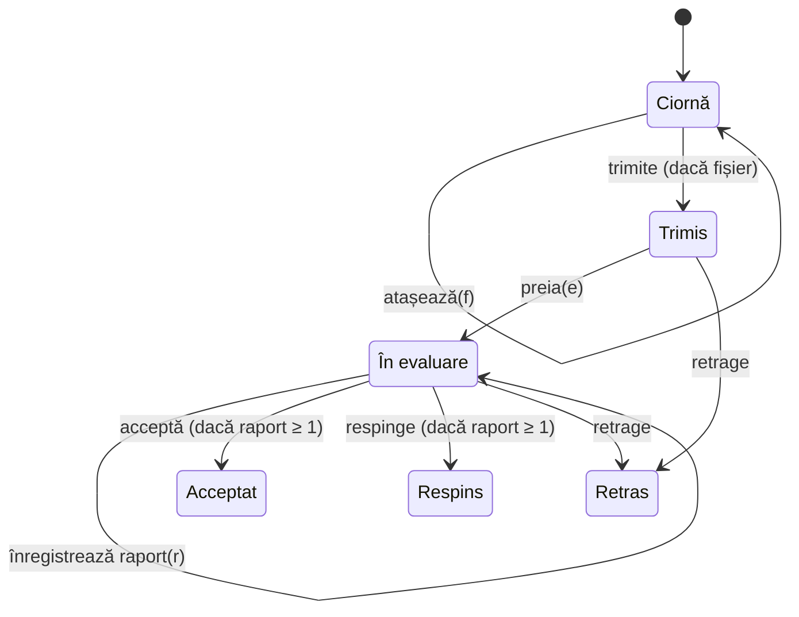

Manuscrisele progresează din **Ciornă** prin **Trimis** și **În evaluare**, unde deciziile (acceptare/respingere) cer cel puțin un raport înregistrat, sau pot fi retrase. Stările finale—**Acceptat**, **Respins**, **Retras**—nu au tranziții de ieșire; anumite acțiuni (trimite fără fișier, decizie fără raport, retragere din Ciornă) sunt refuzate prin menținerea stării și datelor.