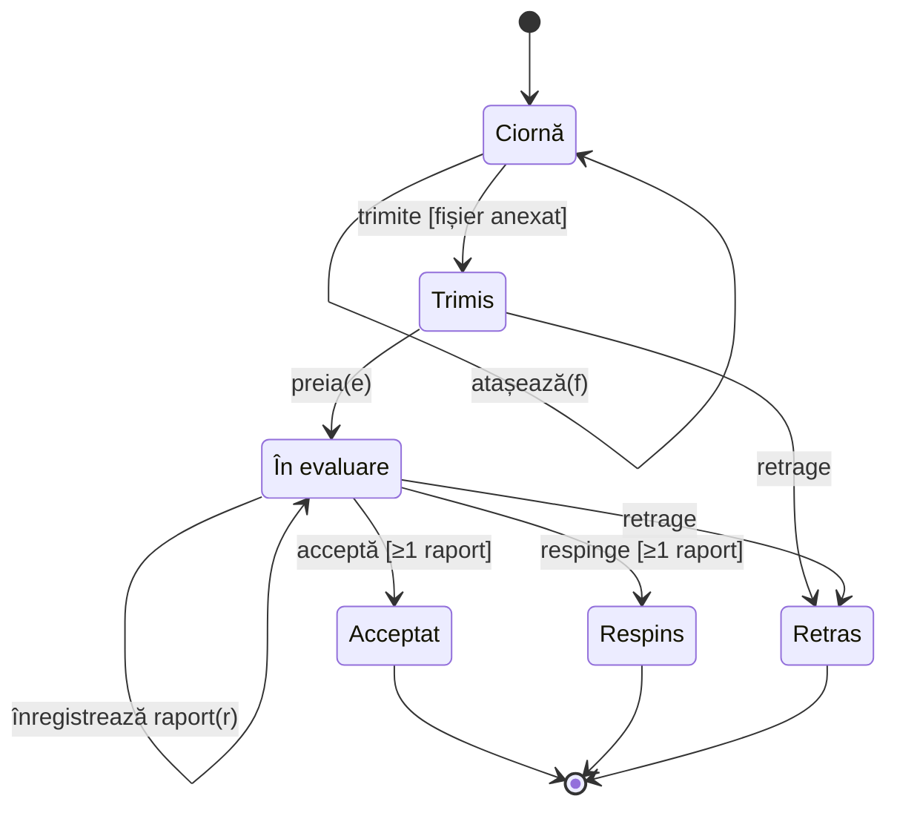

Diagrama include toate șase stări și tranzițiile permise între ele. Condițiile dintre paranteze drepte specifică când tranzițiile sunt valide: `trimite` necesită fișier anexat, iar `acceptă`/`respinge` necesită cel puțin un raport înregistrat. Stările Acceptat, Respins și Retras sunt finale intenționate (R8), fără tranziții de ieșire; evenimentele refuzate rămân în starea curentă conform R7.