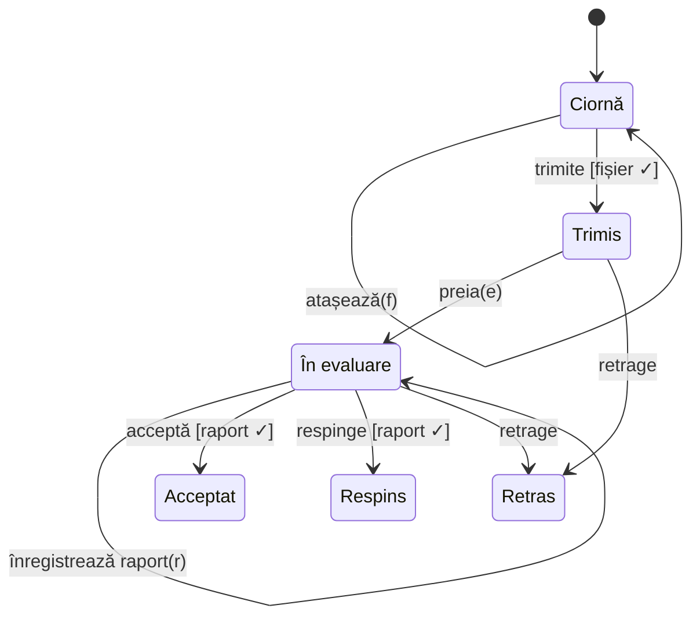

Manuscrisul parcurge șase stări: Ciornă (inițială) → Trimis → În evaluare → una din stările finale (Acceptat, Respins, Retras). Tranziția către Trimis necesită fișier atașat; acceptarea sau respingerea necesită cel puțin un raport înregistrat. Stările finale (Acceptat, Respins, Retras) nu permit tranziții de ieșire, iar datele (fișier, editor, rapoarte) se păstrează pe întreg ciclul de viață conform R8.