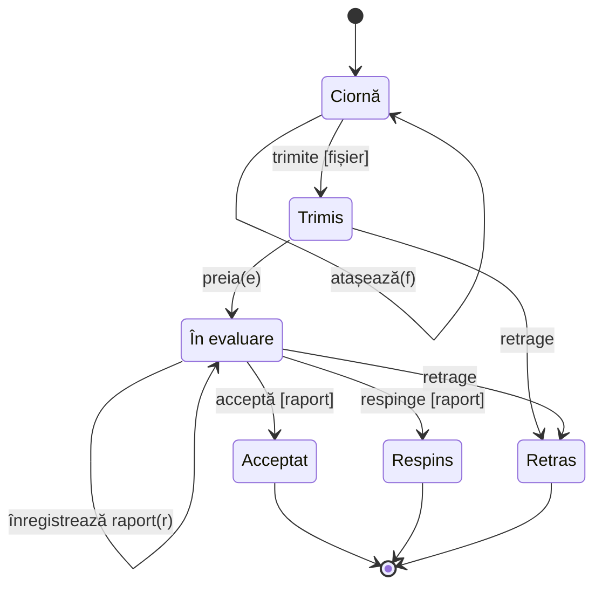

Diagrama ilustrează ciclul de viață al manuscrisului: de la Ciornă prin Trimis și În evaluare, cu posibilitatea retragerii din orice stare de pre-decizie, până la stările finale (Acceptat, Respins sau Retras). Condițiile de tranzițiie sunt exprimate în paranteze pătrate: trimite necesită fișier atașat, iar acceptă/respinge necesită cel puțin un raport înregistrat. Stările finale n-au tranziții de ieșire, conform R8.