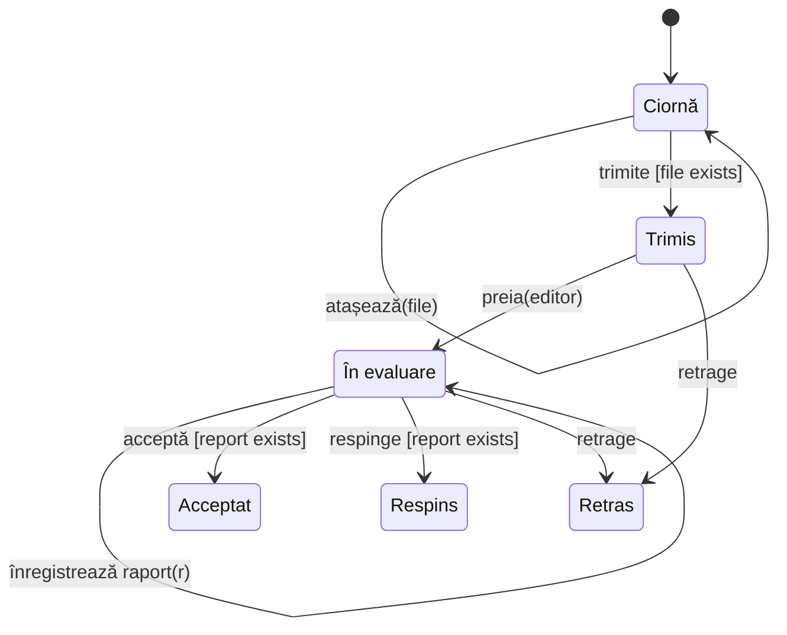

Diagrama prezintă ciclul de viață al unui manuscris prin șase stări și tranziții permise, inclusiv self-loopuri pentru operații ce nu schimbă starea (atașare, înregistrare rapoarte). Acceptarea și respingerea necesită cel puțin un raport înregistrat; stările finale (Acceptat, Respins, Retras) nu au tranziții de ieșire. Orice eveniment fără tranziție permisă în starea curentă, sau cu condiție neîndeplinită, este refuzat și manuscrisul rămâne neschimbat.