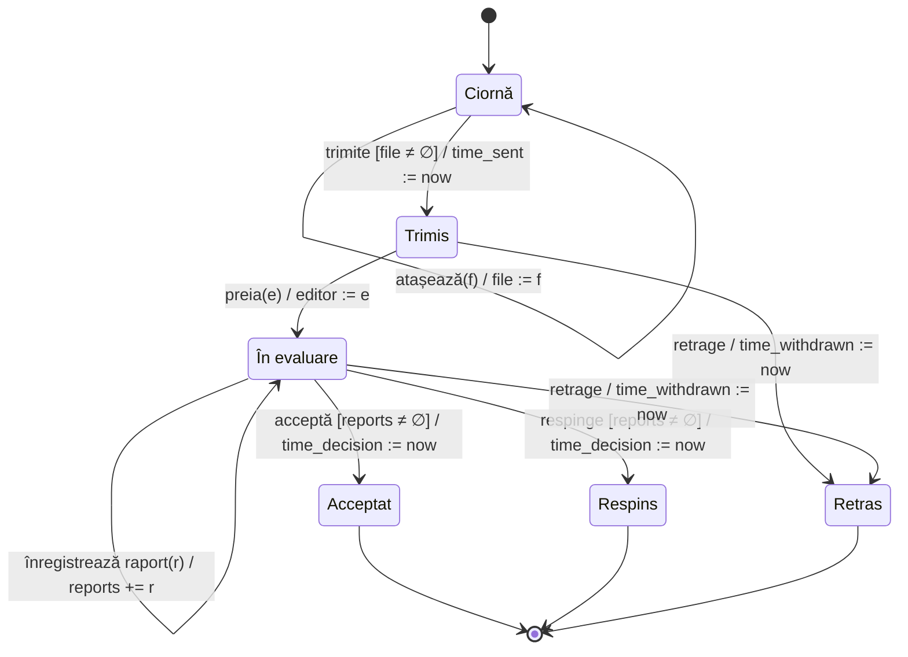

Diagrama prezintă ciclul de viață al unui manuscris prin șase stări: Ciornă (inițială), Trimis, În evaluare, și trei stări finale (Acceptat, Respins, Retras). Tranzițiile sunt etichetate conform standardului UML cu eveniment, condiție (în paranteze pătrate) și efect asupra datelor (după bară oblică). Stările finale nu au tranziții de ieșire, iar unele tranziții impun condiții prealabile—de exemplu, acceptarea și respingerea necesită cel puțin un raport înregistrat.