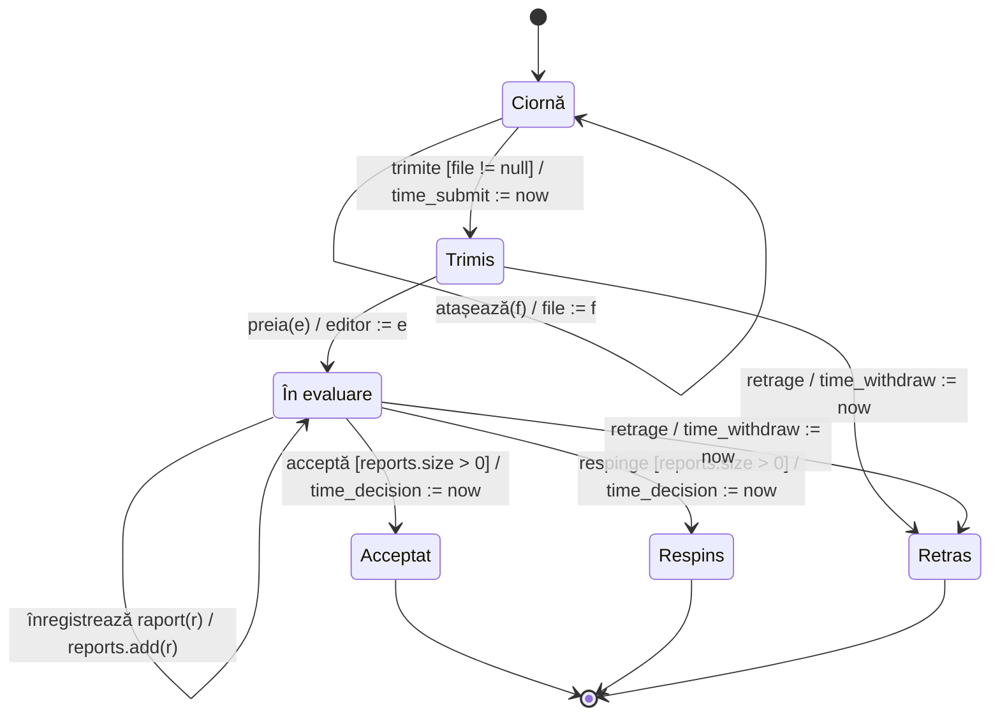

Diagrama modelează ciclul de viață al unui manuscris prin șase stări: **Ciornă** (inițială) unde se atașează fișiere, **Trimis** după validare, **În evaluare** cu înregistrare de rapoarte, și trei stări finale (**Acceptat**, **Respins**, **Retras**). Tranzițiile impun condiții (fișier prezent pentru trimitere, rapoarte înregistrate pentru decizie) și înregistrează momente și date; absence unei tranziții reprezentează refuzul unui eveniment în acea stare. Ciclul reflectă regulile R3–R6, iar stările finale nu au ieșiri conform R8.