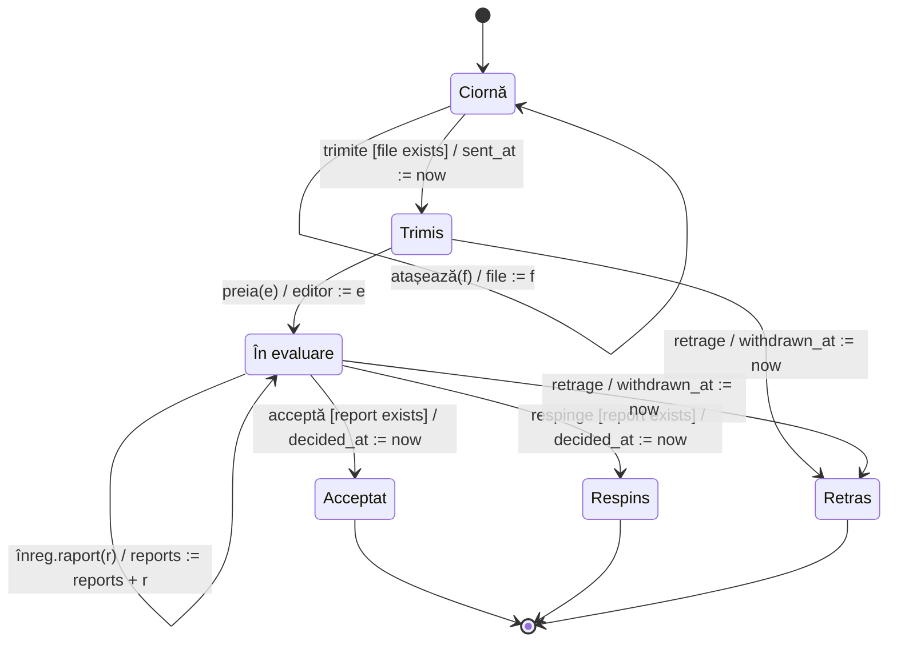

Diagrama de stări reflectă ciclic de viață complet al manuscrisului: de la **Ciornă** (cu posibilitate de reatașare), prin **Trimis** și **Evaluare** (cu rapoarte acumulate), către stările finale **Acceptat**, **Respins** sau **Retras**. Transițiile refuzate (trimitere fără fișier, decizie fără raport, retragere din Ciornă, operații din stări finale) nu apar în diagramă conform regulilor. Datele înregistrate (fișier, editor, rapoarte, timpi) se păstrează la fiecare tranziție, iar stările finale n-au tranziții de ieșire.