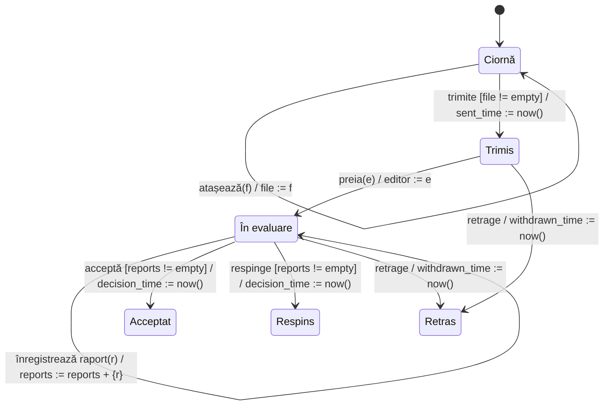

Diagrama ilustrează ciclul de viață al manuscriselor: pornind din Ciornă, unde se pot atașa și modifica fișiere, manuscrisul progresează prin Trimis către În evaluare, unde se înregistrează rapoarte. Acceptarea sau respingerea necesită prezența cel puțin unui raport și marchează tranziția către stări finale (Acceptat, Respins), iar retragerea este posibilă din Trimis sau În evaluare. Stările finale sunt intenționate și nu permit tranziții de ieșire, iar toate datele (fișier, editor, rapoarte, momente) se păstrează pe tot parcursul ciclului.