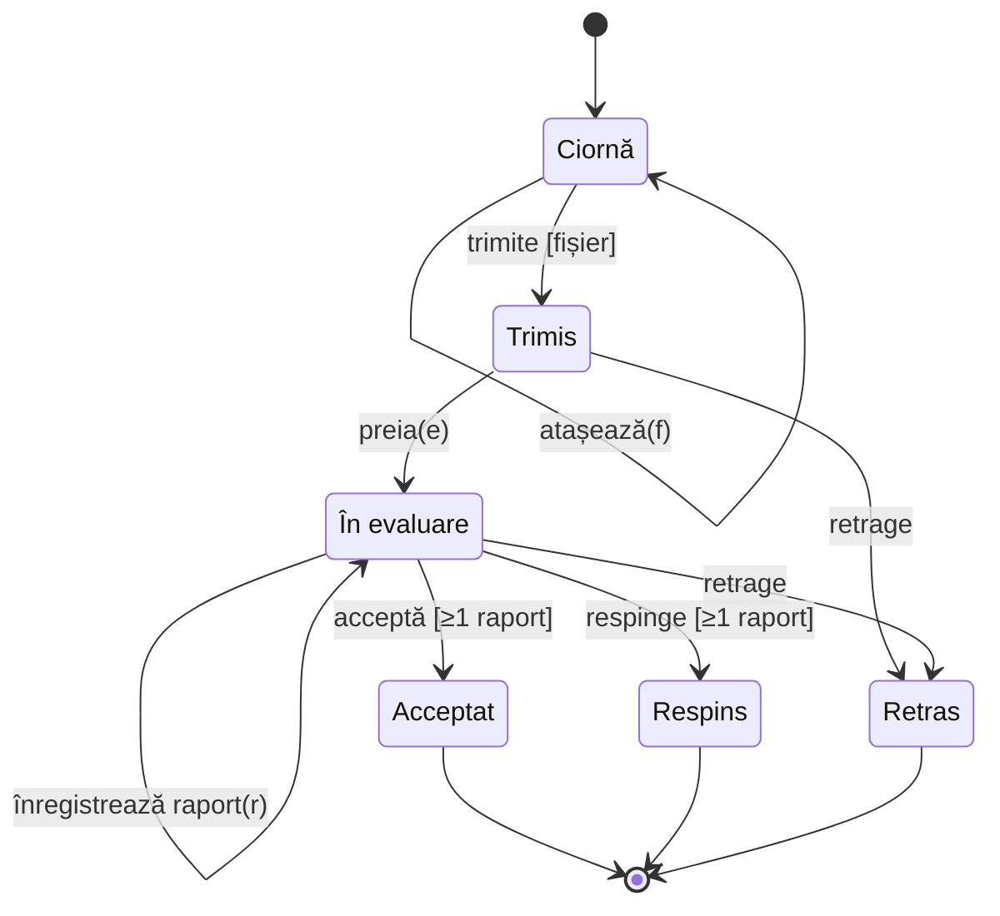

Manuscrisul pornește în Ciornă, unde se pot atașa fișiere și de unde se trimite (dacă are fișier) în starea Trimis. Un editor prelucrează manuscrisul şi-l duce în evaluare, unde se înregistrează rapoarte și se iau decizii (acceptare sau respingere) numai dacă există cel puțin un raport. Din orice stare intermediară (Trimis sau În evaluare), manuscrisul poate fi retras. Stările Acceptat, Respins și Retras sunt finale și nu permit tranziții suplimentare.