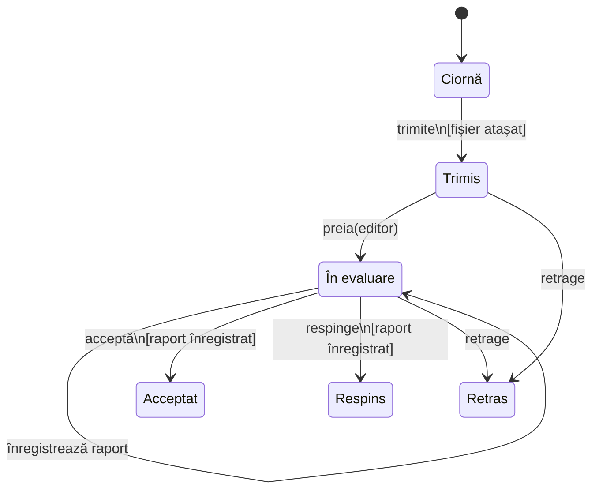

Manuscrisul pornește din Ciornă și trece în Trimis după atașare și trimitere. Din Trimis, editorul îl preluează pentru evaluare, unde pot fi adăugate rapoarte și apoi luată o decizie (acceptare/respingere) sau poate fi retras. Acceptat, Respins și Retras sunt stări finale intenționate, fără tranziții de ieșire.