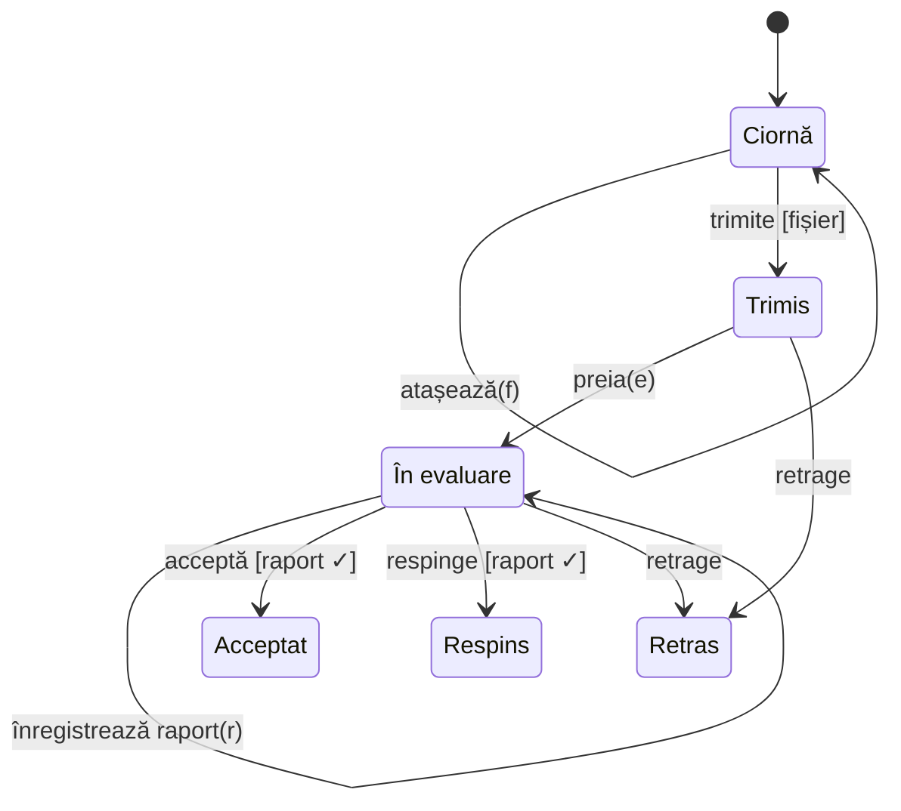

Diagrama arată ciclul de viață: manuscrisul pornește în Ciornă, se trimite cu fișier (R3), este preluat de editor (R4), rapoarte se adaugă fără schimbare de stare (R4), iar decizia necesită cel puțin un raport (R5). Retragerea este posibilă din Trimis și În evaluare (R6), iar Acceptat, Respins și Retras sunt finale intenționate fără tranziții de ieșire (R8).