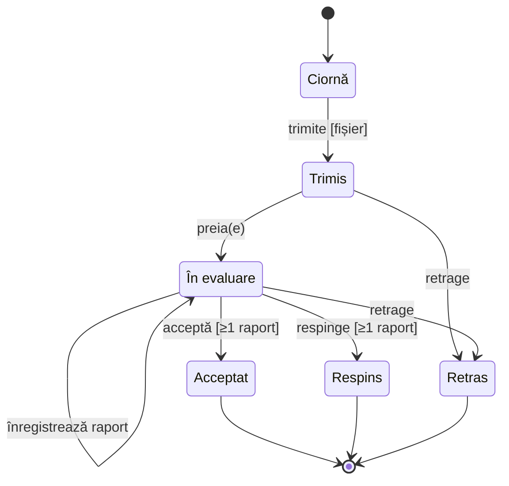

Diagrama prezintă ciclul de viață al manuscrisului cu șase stări și tranzițiile permise de reguli: de la Ciornă prin Trimis și În evaluare spre stările finale. Stările Acceptat, Respins și Retras sunt finale intenționate (R8) și nu permit tranziții de ieșire, iar tranzițiile critice sunt condiționate: trimite necesită fișier atașat (R3), iar acceptare/respingere necesită cel puțin un raport (R5).