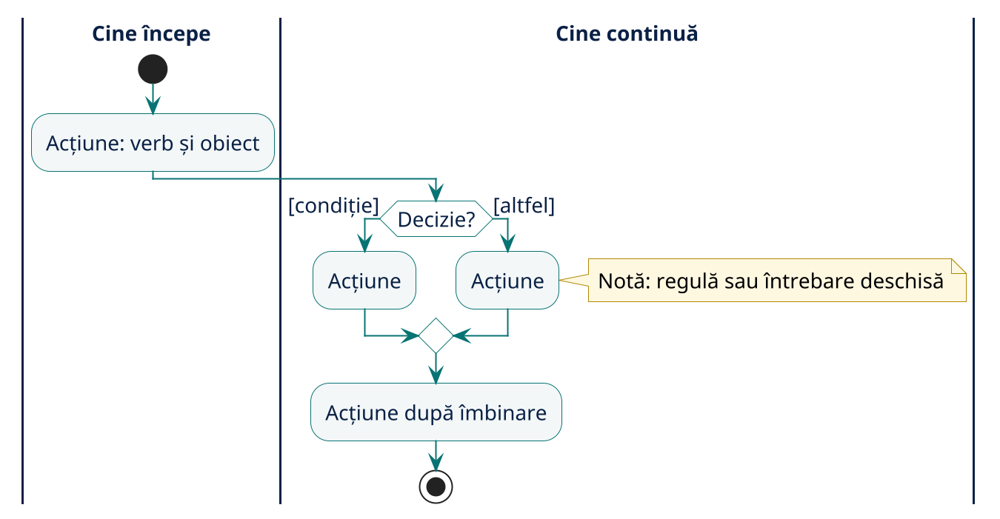
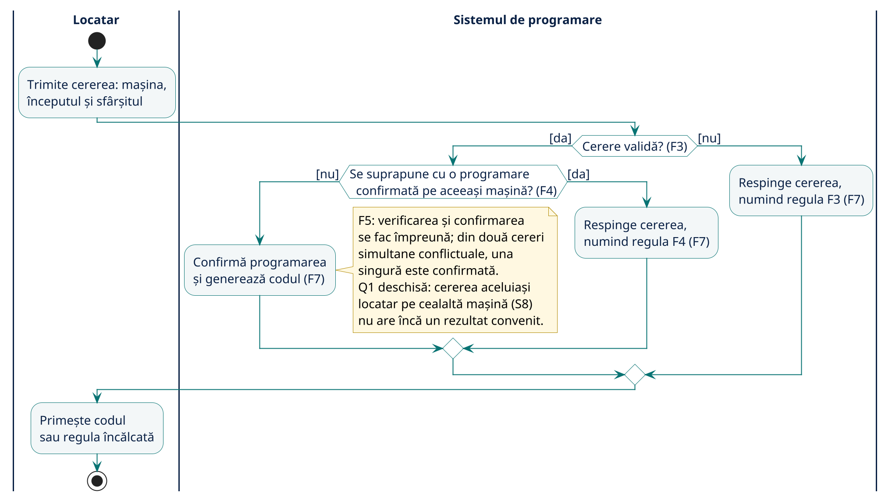
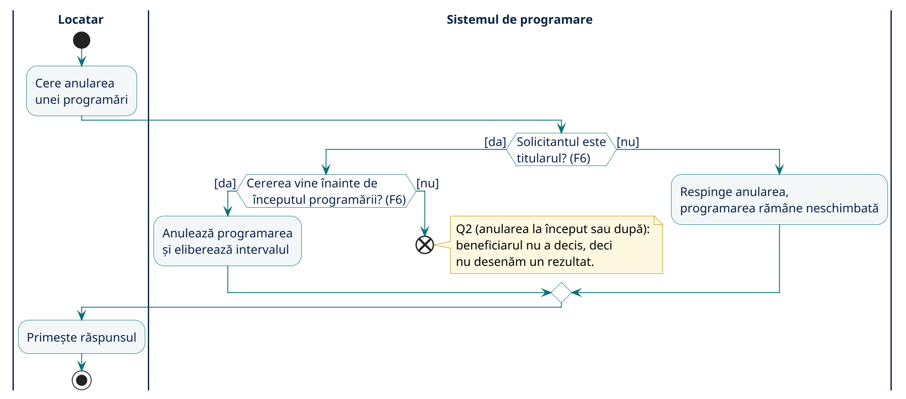

# Înțelegem aceeași problemă? {.transition}

**0–10 min · Răspundem în chat, apoi discutăm împreună**

Cum știm că două persoane interpretează la fel o regulă?

::: notes
Transferăm în alt domeniu metoda din cursul 2: înțelegem cererea și încercăm exemple; în a doua jumătate desenăm fluxul unei cereri ca diagramă de activitate și îl verificăm față de enunț. Online, conversația în pereche devine un schimb în plen: fiecare răspunde întâi singur în chat, apoi câțiva colegi explică la microfon și își răspund unul altuia. Mesajele din chat nu se colectează și nu se notează.

**Organizare:** minutul 0 din 100; interval 0–10 (10 min), inclusiv coperta și citatul. Puneți în chat linkurile prezentării, fișei și specificației diagramei, plus adresa `/now` dacă porniți sesiunea sincronizată; 17 slide-uri cu copertă. Nu presupunem teoria din cursurile 3–4. []{.pace at=0 of=100}
:::

---

# Citatul zilei

> „Simplitatea este o condiție necesară pentru fiabilitate.”
>
> Original: “Simplicity is prerequisite for reliability.”

— **Edsger W. Dijkstra**

[Sursa: How do we tell truths that might hurt? — EWD498](https://www.cs.virginia.edu/~evans/cs655/readings/ewd498.html)

::: notes
O regulă clară poate fi explicată unui coleg și încercată pe un exemplu. Simplitatea descrierii nu înseamnă să omitem tocmai cazul care desparte două interpretări.

**Sursă:** transcriere universitară; afirmație marcată drept adnotare manuscrisă. Original: arhiva Dijkstra, UT Austin, EWD498.
:::

---

# O spălătorie pentru cămin

Locatarii se programează la **Albastra** sau **Verdea**, într-o singură zi viitoare **D**, între **08:00 și 22:00**. Identitatea lor este deja verificată.

**Regulă convenită:** pe aceeași mașină, programările confirmate nu se suprapun; una poate începe exact când se termină alta.

Ioana are Albastra **10:00–11:00**. Radu cere aceeași mașină **11:00–12:00**.

1. **Acceptăm cererea? Ce informație justifică răspunsul?**
2. **Ce întrebare i-ați pune beneficiarului al cărei răspuns ar schimba proiectarea?**

**În chat:** scrieți răspunsul, dar trimiteți-l abia la semnal; apoi câțiva colegi îl explică la microfon.

::: notes
Acceptăm: intervalele sunt alăturate, nu suprapuse. Exersăm argumentul din regulă înainte de o formulă de comparare a intervalelor. Nu se cer instalări, repository sau alegerea unei tehnologii. Trimiterea simultană păstrează răspunsurile independente; citim cu voce tare două răspunsuri diferite, dacă apar.

Întrebări probabile: același locatar pe ambele mașini simultan, cine câștigă la două cereri simultane, anularea, o durată maximă sau o limită de programări. Un coleg care nu a scris întrebarea alege una din chat și spune ce s-ar schimba după răspuns. „Reguli pe care le putem explica” și fișa arată care sunt deja convenite și care rămân deschise (Q1–Q3).

**Organizare:** 6 min: 2 pentru cerere, 2 pentru întrebări în chat, 2 pentru câteva întrebări discutate la microfon. []{.pace dur=6}
:::

---

# Construim o explicație comună {.transition}

**10–25 min · Un coleg explică, altul cere exemple; apoi preia el explicația**

Ce știm și ce trebuie întrebat?

::: notes
O întrebare deschisă nu anulează toate regulile cunoscute. Distingem informația convenită, consecința dedusă, ipoteza, întrebarea și propunerea de proiectare folosindu-le în conversație. Schimbarea rolurilor devine o ștafetă: cine a cerut exemplul explică următoarea regulă.

**Organizare:** minutul 10 din 100; interval 10–25 (15 min). Fișa este o referință, fără formular de completat. []{.pace at=10}
:::

---

# Reguli pe care le putem explica

- **Cererea:** locatar, mașină și interval valid în D, între 08:00 și 22:00; începutul precedă sfârșitul.
- **Disponibilitatea:** fără suprapuneri pe aceeași mașină; intervalele alăturate sunt permise.
- **Anularea:** titularul poate anula înainte de început; intervalul devine disponibil. Alt locatar nu poate anula.
- **Întrebare:** poate același locatar folosi două mașini în intervale suprapuse? Beneficiarul nu a decis.

**Ștafetă:** un coleg explică o regulă printr-un exemplu; altul cere un contraexemplu sau sursa, apoi explică el regula următoare. La întrebare, scrieți în chat **DA** sau **NU** ca ipoteză; câte un coleg pentru fiecare variantă spune ce s-ar schimba.

[Fișa completă: F1–F8, Q1–Q3 și exemple](https://github.com/traiansf/traiansf.github.io/blob/main/class/amss-2026/lab/scenarios/01-specificare/scenario.md)

::: notes
Citim și limitele din fișă: confirmarea are cod, respingerea explică regula; plăți, notificări, recurență și administrare sunt excluse. F5 garantează exact o acceptare pentru două cereri simultane conflictuale pe o mașină liberă; nu convenim prioritatea. Anularea la sau după început și limitele viitoare sunt întrebări separate. DA și NU sunt ipoteze etichetate, nu decizii: Q1 rămâne deschisă.

**Organizare:** 14 min: 3 citire individuală, 5 ștafetă, 4 ipoteze pentru întrebare, 2 răspunsuri comune. Dați cuvântul pe nume sau după mâinile ridicate; vorbitorul numește colegul următor. []{.pace dur=14}
:::

---

# Punem explicația la încercare {.transition}

**25–50 min · Un coleg propune un scenariu, altul răspunde; apoi discutăm o schimbare**

Ce exemplu desparte două interpretări?

::: notes
Scopul schimbului este să observăm ce ar înțelege altcineva din explicația noastră. Nu cerem un număr de greșeli sau un tabel completat pentru fiecare scenariu. O regulă nouă poate afecta și programările deja confirmate; nu o aplicăm retrospectiv fără să stabilim ce a cerut beneficiarul.

**Organizare:** minutul 25 din 100; interval 25–50 (25 min): scenarii 13, schimbare 11, tranziție 1. Un student poate prelua prezentarea și moderarea scenariilor. []{.pace at=25}
:::

---

# Alegeți un scenariu pentru un coleg

**Fiecare scenariu pornește separat:** Ioana are Albastra 10:00–11:00; celelalte intervale sunt libere. Toate cererile sunt pentru D.

| Scenariu | Ce încearcă cineva |
|---|---|
| Suprapunere | Radu cere Albastra 10:30–11:30. |
| Limită | Radu cere Albastra 11:00–12:00. |
| Anulare | La 09:00 Ioana anulează; Radu cere apoi 10:00–11:00. |
| Întrebare deschisă | Ioana cere și Verdea 10:30–11:30. |

Fără suprapuneri pe aceeași mașină; alăturarea este permisă. Titularul poate anula înainte de început. Suprapunerea aceluiași locatar pe mașini diferite rămâne neconvenită.

**Ce rezultat puteți promite și de ce?** Răspunde întâi colegul numit; obiecțiile, în chat.

::: notes
Rezultate: respingere, confirmare, anulare urmată de confirmare, respectiv rezultat încă neconvenit. Comparați două scenarii care au făcut colegii să ezite; nu trebuie parcurse toate public. Extensie: Radu nu poate anula programarea Ioanei; încercarea o păstrează. Un coleg poate propune și un scenariu nou, de exemplu un interval vid sau unul în afara programului.

**Organizare:** 13 min: 2 alegerea primului scenariu, 8 ștafeta scenariilor cu obiecțiile din chat, 3 discuție. Cine alege scenariul numește colegul care răspunde; acesta alege apoi scenariul următor. Ceilalți scriu în chat „de acord” sau o obiecție. []{.pace dur=13}
:::

---

# „De mâine, maximum 90 de minute”

Beneficiarul propune o **durată maximă de 90 de minute**. Până acum nu exista o limită convenită.

Ioana are deja confirmată pentru **D = mâine** o programare la Albastra, **10:00–12:00**.

Gândiți individual, apoi discutăm împreună:

1. Ce întrebare puneți înainte de a modifica programarea Ioanei? Scrieți-o în chat, la semnal.
2. Comparați două răspunsuri posibile ale beneficiarului: câte un coleg explică fiecare variantă.
3. Dacă regula se aplică numai cererilor noi, ce se întâmplă cu programarea existentă și cu o cerere nouă de 120 de minute?

::: notes
Clarificăm dacă limita afectează numai cereri noi sau și programări confirmate și momentul intrării în vigoare. Nu anulăm sau scurtăm automat programarea existentă. La punctul 3, programarea Ioanei rămâne, iar o cerere nouă supusă limitei este respinsă. Sistemul nu decide regula în locul beneficiarului. Limita rămâne o propunere: diagrama din atelier nu o include.

**Organizare:** 11 min: 2 individual și chat, 5 cele două variante explicate de colegi diferiți, 4 compararea răspunsurilor; ajungem la minutul 50. []{.pace dur=11}
:::

---

# Desenăm fluxul unei cereri {.transition}

**50–95 min · Atelier: diagrama de activitate**

Ce pași, decizii și rezultate are o cerere de programare?

::: notes
Aceleași reguli, într-o altă reprezentare: diagrama de activitate arată ordinea pașilor, cine îi face și ce decizie desparte confirmarea de respingere. O diagramă este corectă când fiecare element se poate verifica pe enunț, nu când arată îngrijit. Fiecare student alege cum lucrează: pe hârtie, în notație text sau cu un asistent AI, cu verificarea rezultatului. Online, diagramele se arată prin ecran partajat, ca fotografie a foii sau ca text PlantUML ori Mermaid trimis în chat.

**Organizare:** minutul 50 din 100; interval 50–95 (45 min): sarcina și notația 6, lucru individual și verificare proprie 16, verificarea la jumătate 8, corecturi 6, diagrama de referință 8, tranziția 1. Încheierea, 95–100, urmează pe ultimul slide. []{.pace at=50}
:::

---

# Atelier: fluxul unei cereri de programare

**Desenați o diagramă de activitate UML** a unei cereri de programare, până la confirmare sau respingere: pe hârtie, în notație text sau cu un asistent AI. **Extensie:** anularea.

- **F3 (cererea):** o mașină din listă și un interval în D, între 08:00 și 22:00, cu începutul înaintea sfârșitului.
- **F4 (suprapunerea):** programările confirmate pe aceeași mașină nu se suprapun; alăturarea este permisă.
- **F5 (cereri simultane):** din două cereri simultane conflictuale, una singură este confirmată.
- **F6 (anularea):** titularul poate anula înainte de început; alt locatar nu poate.
- **F7 (răspunsul):** confirmarea are un cod; respingerea numește regula încălcată.
- **Q1 (mașini diferite):** suprapunerile aceluiași locatar pe mașini diferite rămân deschise.

[Enunțul](https://github.com/traiansf/traiansf.github.io/blob/main/class/amss-2026/lab/scenarios/01-specificare/scenario.md) · [Specificația diagramei de activitate](https://github.com/traiansf/traiansf.github.io/blob/main/class/amss-2026/lab/diagrame/activitate.md)

::: notes
Fluxul principal are două decizii, validitatea cererii și suprapunerea, și trei rezultate. F5 nu adaugă o ramură: verificarea suprapunerii și confirmarea trebuie să se petreacă împreună, ceea ce diagrama poate spune printr-o notă. Specificația are un exemplu lucrat din alt domeniu și un prompt sugerat pentru cine folosește AI.

**Organizare:** 3 min: citim sarcina împreună; fiecare student alege modul de lucru. Repetați în chat linkurile enunțului și specificației. Cine folosește AI dă asistentului enunțul și specificația, nu doar sarcina. []{.pace dur=3}
:::

---

# Elementele diagramei de activitate

**Nod inițial** (cerc plin) și **nod final** (cerc încercuit) · **acțiune** în culoarul celui care o face · **săgeata** dă ordinea pașilor · **decizie** (romb) cu o **condiție** între paranteze drepte pe fiecare ieșire · **îmbinare** (romb) unde ramurile se reunesc · **notă** pentru o regulă sau o întrebare deschisă.

::: notes
Culoarele arată cine face fiecare acțiune. Condițiile unei decizii se exclud și acoperă toate cazurile. Bifurcarea și reunirea (bare groase), pentru acțiuni care se desfășoară în paralel, sunt în specificație; fluxul cererii nu are nevoie de ele. Diagrama de stări din cursul 2 arăta stările unui exemplar; diagrama de activitate arată pașii unui flux.

**Organizare:** 3 min. []{.pace dur=3}
:::

---

# Lista de verificare

1. Un nod inițial; fiecare drum ajunge la un nod final.
2. Fiecare acțiune stă în culoarul celui care o face: locatarul sau sistemul de programare.
3. Fiecare ieșire a unei decizii are o condiție; condițiile se exclud și acoperă toate cazurile.
4. Fiecare condiție vine din F3 (cererea) sau F4 (suprapunerea, alăturarea permisă). Nicio verificare neconvenită, ca o durată maximă.
5. F5 (cereri simultane) apare ca notă: verificarea și confirmarea se fac împreună.
6. F7 (răspunsul): codul la confirmare, regula încălcată la respingere.
7. Întrebările deschise, ca Q1 (mașini diferite), sunt note, nu decizii.
8. Cu Ioana pe Albastra 10:00–11:00, scenariul S2 (Radu, 10:30–11:30) duce la respingere, iar S3 (Radu, 11:00–12:00) la confirmare.

**Prima variantă e gata?** Verificați-o punct cu punct; scrieți în chat punctul la care ați ezitat.

::: notes
Punctele 4–7 se verifică numai cu enunțul în față: fiecare condiție și fiecare rezultat trebuie să aibă o regulă care le susține. Un rezultat AI trece prin aceeași listă; o randare fără erori nu verifică niciun punct. Erori de urmărit: o verificare a programărilor locatarului pe Verdea (Q1 transformată în regulă), suprapunerea scrisă cu „≤” (respinge S3), lipsa ramurii pentru cererea invalidă, toate acțiunile într-un singur culoar.

**Organizare:** 16 min: lucru individual 11, verificare proprie și întrebări în chat 5. Lăsați slide-ul pe ecran; răspundeți la microfon punctelor care apar des în chat și cereți doi voluntari, unul cu o diagramă pe hârtie și unul cu o diagramă în notație text sau generată. []{.pace dur=16}
:::

---

# La jumătate: verificăm diagrama unui coleg

Unul sau doi voluntari își partajează ecranul. Clasa parcurge diagrama cu lista de verificare; fiecare observație, în chat la semnal, numește **punctul din listă** și **regula din enunț**.

- **F3 (cererea):** cererea indică o mașină din listă și un interval în D, între 08:00 și 22:00, iar începutul precedă sfârșitul.
- **F4 (suprapunerea):** programările confirmate pe aceeași mașină nu se suprapun, iar alăturarea este permisă.
- **F5 (cereri simultane):** din două cereri simultane conflictuale, una singură este confirmată.
- **F7 (răspunsul):** confirmarea are un cod, iar respingerea numește regula.
- **Q1 (mașini diferite)** rămâne deschisă: nu o transformăm în regulă.

**Apoi corectați-vă propria diagramă** pe baza observațiilor.

::: notes
Pornim de la o diagramă cu o eroare instructivă, nu de la cea mai bună. Observațiile fără punct din listă și fără regulă nu se rețin: „arată ciudat” nu este o observație. Când diagrama a fost generată cu AI, voluntarul spune ce a verificat și ce a corectat. Corectura comună este punctul de plecare pentru comparația cu referința.

**Organizare:** 14 min: 8 verificarea în plen (voluntarul partajează diagrama sau o fotografie a foii; un coleg care a scris o observație în chat o explică la microfon, iar autorul diagramei răspunde), 6 corecturi individuale. Cât timp voluntarul partajează, studenții urmăresc slide-ul cu regulile prin sesiunea sincronizată; altfel reveniți la el între observații. []{.pace dur=14}
:::

---

# Diagrama de referință: cererea

Comparați cu diagrama corectată împreună: ce lipsește, ce este în plus și ce este doar o altă formă a aceluiași flux? **În chat:** o diferență.

::: notes
Două decizii, trei rezultate, două culoare. Ordinea deciziilor poate fi inversă, iar validitatea poate fi despărțită în mai multe decizii: acceptăm ambele forme, dacă fiecare condiție vine din F3 sau F4. F5 apare ca notă, nu ca a treia decizie, pentru că nu cere o verificare nouă, ci ca verificarea și confirmarea să fie un singur pas. Identitatea verificată (F2) este o premisă, nu o acțiune a fluxului. Raționamentul complet este în referința laboratorului.

**Organizare:** 6 min. []{.pace dur=6}
:::

---

# Diagrama de referință: anularea

**F6 (anularea):** titularul poate anula înainte de început, iar intervalul se eliberează; alt locatar nu poate anula, iar programarea rămâne.

::: notes
Ramura Q2 se oprește într-un nod final de flux (cercul cu X): diagrama arată că acolo lipsește o decizie, fără să o ia în locul beneficiarului. O diagramă care respinge sau acceptă anularea la ora de început a transformat Q2 în regulă.

**Organizare:** 2 min; ajungem la minutul 95. []{.pace dur=2}
:::

---

# Ce a clarificat laboratorul?

Fiecare scrie în chat un exemplu; doi sau trei colegi îl dezvoltă la microfon:

- o regulă pe care au înțeles-o diferit la început;
- o întrebare care schimbă rezultatul promis;
- un element al diagramei corectat la verificare, cu regula din enunț care l-a cerut.

Păstrați ce vă ajută pentru studiu. **Nu avem documente de predat, iar chatul nu se notează; diagramele rămân ale voastre.**

::: notes
Ascultăm două sau trei exemple, fără prezentări formale din partea tuturor. Alegem din chat exemple diferite și îi invităm pe autori să le explice. Urmărim dacă studenții pot lega rezultatul și fiecare element al diagramei de enunț și pot distinge o regulă neconvenită de una deja garantată.

**Organizare:** 5 min; încheiere la minutul 100. []{.pace dur=5}
:::
