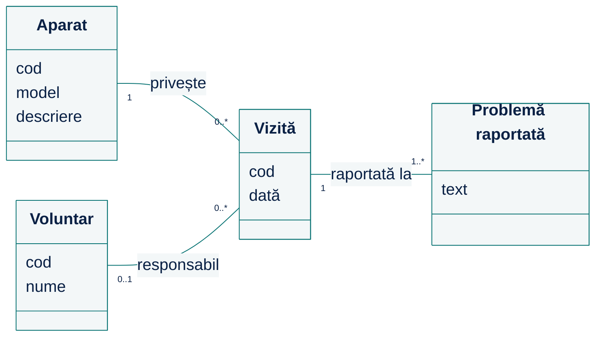

# Ce modelăm azi

Organizatorii unui atelier comunitar de reparații (beneficiarul) țin evidența aparatelor aduse, a vizitelor, a problemelor raportate și a voluntarilor responsabili. **Același aparat poate reveni de mai multe ori:** ce păstrăm despre fiecare vizită?

Construim un model al domeniului și îl verificăm pe stări concrete. Apoi îl desenăm ca **diagramă de clase conceptuală** și o verificăm împreună pe o listă.

Exemplu didactic. Pentru prima parte, hârtia și conversația sunt suficiente.

::: notes
Fixăm problema înainte de exercițiu: un aparat cu mai multe vizite, fiecare cu problemele și responsabilul ei. Aplicăm distincțiile din cursurile 3–4: reguli convenite, identitate, relații și exemple care verifică un model. A doua jumătate transformă schița într-o diagramă de clase conceptuală; desenul vine după ce am înțeles relațiile, nu în locul lor.

**Organizare:** minutul 0 din 100; deschidere 0–10 (10 min): ce modelăm azi și planul celor două jumătăți 3, citatul 2, recapitularea din cursul 4 5. 15 slide-uri cu copertă. []{.pace at=0 of=100 dur=3}
:::

---

# Citatul zilei

> „**Model:** un sistem de abstractizări care descrie aspecte alese ale unui domeniu […]”
>
> Original: “**model:** A system of abstractions that describes selected aspects of a domain […]”

— **Eric Evans**

[Sursa: Domain-Driven Design Reference, Definitions, p. 6 (PDF)](https://www.domainlanguage.com/wp-content/uploads/2016/05/DDD_Reference_2015-03.pdf#page=6)

::: notes
Selectăm aspectele necesare urmăririi vizitelor; nu proiectăm întregul atelier și nu începem de la clase sau de la schema unei baze de date. Și diagrama de la sfârșit este o abstractizare: arată concepte și relații, nu tabele. Reluăm citatul din cursul 4.

**Sursă:** publicația autorului, Definitions, intrarea model, pagina PDF 6. Termenul definit este titlul intrării; îl redăm înaintea definiției, ca să se vadă pe slide ce se definește. Fragment păstrat din materialul anterior verificat în `docs/quotations.md`; finalul după domain este omis explicit.

**Organizare:** 2 min. []{.pace dur=2}
:::

---

# Ce urmărim când cerem un model

Din cursul 4: un model pe care îl putem discuta cu altă persoană conține:

- **sensuri:** conceptele și ce înseamnă fiecare;
- **reguli:** identitate, apartenență și numărul permis de asocieri;
- **exemple și contraexemple:** stări pe care regulile le permit și stări pe care le exclud;
- **limite:** ce excludem explicit;
- **întrebări deschise:** ce nu stabilește încă enunțul.

O schiță ajută când putem explica fiecare relație printr-o regulă sau un exemplu.

::: notes
Recapitulăm lista de la sfârșitul cursului 4, fără exemplele arhivei foto: așa vom judeca schițele și diagramele de azi. Întrebați întâi clasa ce își amintește, apoi parcurgeți lista. În laborator le vom întâlni pe rând: aparat, vizită, problemă raportată și voluntar responsabil; regulile R1–R5; vizitele J1–J3 ca exemple; limita R6; întrebările adresate organizatorilor. Diagrama de clase conceptuală va exprima sensurile, relațiile și cardinalitățile; exemplele rămân verificarea ei. Lista nu este un șablon de livrabil.

**Organizare:** 5 min, fără exercițiu. []{.pace dur=5}
:::

---

# Același aparat, altă vizită {.transition}

**10–50 min · Observăm, schițăm în perechi, verificăm pe stări**

Ce trebuie să păstrăm când un aparat revine la atelier?

::: notes
Pornim de la date concrete: ce este același și ce este distinct. Schița este suportul conversației; nu cerem documente de predat și nici încă notație UML.

**Organizare:** minutul 10 din 100; interval 10–50 (40 min): observații 6, schiță în perechi 14, verificarea schiței altei perechi 11, schimbarea regulii 8, tranziție 1. Perechi sau un trio când este nevoie. []{.pace at=10}
:::

---

# Trei vizite la atelier

**A17 și A18 sunt aparate fizice distincte**, deși ambele sunt prăjitoare de pâine model T2.

| Vizită | Aparat | Problemă raportată | Responsabil |
|---|---|---|---|
| J1 · 3 sept. | A17 | P1: „Pârghia nu rămâne jos” | Mara (M1) |
| J2 · 8 oct. | A17 | P2: „Cablul este deteriorat” | Radu (M2) |
| J3 · 8 oct. | A18 | P3: „Pârghia nu rămâne jos” | Încă nimeni |

1. **Ce este același și ce este distinct? Ce pierde atelierul dacă păstrează numai „problema curentă” a fiecărui aparat?**
2. **Ce întrebare le-ați pune organizatorilor al cărei răspuns ar schimba modelul?**

::: notes
A17 apare în două vizite distincte; modelul T2 nu identifică aparatul. P1 și P3 au același text, dar sunt raportări distincte; J2 și J3 au aceeași dată, dar sunt vizite distincte. Păstrarea numai a ultimei probleme ar pierde P1, raportată la J1; dacă și responsabilul ar fi asociat aparatului, s-ar pierde și asocierea J1–Mara. Problema raportată nu este încă un diagnostic confirmat.

Întrebări probabile: mai multe probleme la aceeași vizită (R3 le permite), ștergerea sau corectarea unei vizite (rămân deschise în R6), doi voluntari la aceeași vizită (pregătește schimbarea de la sfârșitul etapei), proprietarul aparatului (exclus în R6). Cereți legătura cu modelul: ce relație s-ar schimba după răspuns.

**Organizare:** 6 min: 2 individual, 2 în pereche, 2 în plen. Datele sunt didactice. []{.pace dur=6}
:::

---

# Reguli pentru schița voastră

- **Aparat–vizită (R1–R2):** fiecare are cod propriu. O vizită are dată și privește exact un aparat; un aparat are zero sau mai multe vizite.
- **Vizită–problemă (R3):** o vizită are cel puțin o problemă raportată; fiecare problemă aparține exact unei vizite. Textele pot coincide.
- **Vizită–voluntar (R4):** o vizită are zero sau un responsabil; un voluntar poate răspunde de mai multe vizite. Voluntarul se identifică prin cod.
- **Revenire (R5):** vizita nouă păstrează istoricul vizitelor anterioare; problemele și responsabilul se asociază fiecărei vizite separat.

Unul schițează și explică J1 și J2: **cum rămâne Mara responsabilă de J1 după ce Radu devine responsabil de J2?** Celălalt cere regula și un exemplu. La semnal, schimbați rolurile și explicați J3.

[Enunțul complet: R1–R6 și datele](https://github.com/traiansf/traiansf.github.io/blob/main/class/amss-2026/lab/scenarios/02-modelare/scenario.md) · R6: fără inventar, plăți sau proprietari.

::: notes
Aici parcurgem enunțul, pornind de la întrebările puse la „Trei vizite”: mai multe probleme la aceeași vizită (R3), ștergerea sau corectarea unei vizite (deschise în R6), proprietarul (exclus în R6), doi voluntari (R4 spune zero sau unul; revenim la sfârșitul etapei). Responsabilul se leagă de vizită, nu de aparat (R4–R5). O vizită nouă nu suprascrie datele celor anterioare și nu preia automat problemele lor. Numele voluntarilor pot coincide, la fel ca modelele aparatelor; codurile le disting. O problemă raportată descrie observația celui care a adus aparatul, nu un diagnostic confirmat. În tipologia din cursul 3, R1–R5 sunt reguli ale domeniului: politica atelierului, valabilă și într-un registru pe hârtie; R6 este limita exercițiului, nu o cerință. Sunt suficiente cuvinte, un tabel sau o schiță pe hârtie; notația UML vine în a doua jumătate.

**Organizare:** 14 min: 3 citire și întrebări, 5 propunere, 4 schimbarea rolurilor și explicarea lui J3, 2 discuție. []{.pace dur=14}
:::

---

# Încercăm schița altei perechi

1. **Aparat fără vizite:** A19 a fost înregistrat, dar nu a venit încă la atelier. R2 permite zero vizite. Are schița loc pentru el?
2. **Același text:** P1 în J1 și P3 în J3 spun „Pârghia nu rămâne jos”. R3 permite texte egale. Rămân distincte în schiță?
3. **Două probleme:** la o nouă vizită J4, A18 vine cu două probleme raportate. R3 permite una sau mai multe. Poate schița exprima starea?

**Pe schița perechii A, perechea B alege o stare și explică prima** cum o exprimă modelul; autorii ascultă, apoi clarifică. Repetați pe schița B, cu rolurile inversate.

::: notes
Toate cele trei stări trebuie să poată fi exprimate: A19 există fără nicio vizită, P1 și P3 rămân înregistrări distincte, iar J4 are două probleme, fiecare legată numai de J4. O convenție diferită de desenare nu este o eroare dacă sensul relațiilor rămâne clar. Aceleași trei stări revin în lista de verificare a diagramei. Revenirea (cine răspundea de J1 după J2) a fost sarcina de construcție; rămâne o stare de rezervă dacă o pereche termină devreme.

**Organizare:** 11 min: 1 citire, 7 schimb și comparație, 3 discuție comună. Schimbul poate fi oral, cu foaia pe masă. []{.pace dur=11}
:::

---

# Doi voluntari pentru aceeași vizită

**Organizatorii schimbă R4 (voluntar):** o vizită poate avea **zero, unul sau doi voluntari responsabili**. Limita se aplică oricărei vizite; celelalte reguli rămân neschimbate.

**Inițial:** J1 o are pe Mara (M1), iar J2 pe Radu (M2); ambele vizite sunt pentru A17.

Gândiți individual, apoi explicați colegului:

1. Ce relație și ce cardinalitate (numărul permis de asocieri) se schimbă?
2. Două cereri succesive ale organizatorilor: adăugarea Marei la J2, apoi adăugarea Ioanei (M3) la J2. Pentru fiecare, ca la cursul 3 (**starea inițială → cine cere ce → rezultatul observabil**): se acceptă sau se respinge, și cine rămâne asociat fiecărei vizite?

::: notes
Cardinalitatea vizită → voluntari devine 0–2; voluntar → vizite rămâne zero sau mai multe. Nu schimbăm identitatea aparatului sau a vizitei. Organizatorii schimbă o regulă a domeniului; exemplele de acceptare, în forma din cursul 3, verifică noua regulă înainte de orice implementare. Cererile se încearcă succesiv: (1) J1–Mara, J2–Radu → adăugăm Mara la J2 → acceptat; J1–Mara, J2–Mara și Radu. (2) Pornind de aici, cerem și Ioana la J2 → respins; J1–Mara, J2–Mara și Radu rămân. Un rezultat care elimină un responsabil existent pentru a face loc celui nou nu respectă cererea de adăugare. Problemele și asocierile vizită–aparat se păstrează în ambele exemple. Întrebare utilă pentru organizatori: răspund amândoi de tot sau fiecare de o parte? Diagrama din a doua jumătate modelează R4 inițial; schimbarea revine ca întrebare pe diagrama de referință.

**Organizare:** 8 min: 2 individual, 4 în pereche, 2 compararea explicațiilor; etapa se încheie la minutul 50. []{.pace dur=8}
:::

---

# O diagramă de clase conceptuală {.transition}

**50–95 min · Fiecare desenează diagrama, apoi o verificăm împreună**

Exprimă diagrama tot ce cer regulile, și numai atât?

::: notes
Trecem de la schiță la o notație comună: diagrama de clase UML, folosită conceptual. Clasele sunt concepte, nu tabele sau clase dintr-un program. Desenul nu adaugă reguli: fiecare element trebuie să vină din enunț. Fiecare student alege cum lucrează: de mână, direct în Mermaid sau generând diagrama cu un asistent AI pe care o verifică apoi pe listă. Nu există etapă AI separată.

**Organizare:** minutul 50 din 100; interval 50–95 (45 min): sarcina 4, lucru individual 16, verificarea la jumătate 10 și corecturi 6, diagrama de referință 8, tranziție 1. []{.pace at=50}
:::

---

# Sarcina: modelul atelierului ca diagramă

Desenați o **diagramă de clase conceptuală**: clase pentru concepte, atribute, relații cu nume și **cardinalități la ambele capete**. Fără operații, tipuri de date, identificatori tehnici sau chei străine; nimic din R6 (limite: piese, plăți, proprietari).

- **R1–R2 (aparat, vizită):** un aparat are cod, model și descriere; o vizită are cod și dată și privește exact un aparat; un aparat are zero sau mai multe vizite.
- **R3 (problemă raportată):** o vizită are cel puțin una; fiecare aparține exact unei vizite; textele pot coincide.
- **R4–R5 (voluntar, revenire):** un voluntar are cod și nume; o vizită are zero sau un responsabil; un voluntar poate răspunde de mai multe vizite; o vizită nouă nu înlocuiește datele celor vechi.

**Alegeți:** de mână · în Mermaid · generată cu un asistent AI, apoi verificată pe listă.

[Enunțul complet](https://github.com/traiansf/traiansf.github.io/blob/main/class/amss-2026/lab/scenarios/02-modelare/scenario.md) · [Specificația diagramei](https://github.com/traiansf/traiansf.github.io/blob/main/class/amss-2026/lab/diagrame/clase-conceptuale.md)

::: notes
Specificația descrie elementele (clasă, atribut, relație, cardinalitate, nume de rol, generalizare, notă), notația Mermaid cu limitele ei, lista de verificare, un exemplu rezolvat din alt domeniu (un club de drumeții) și un prompt sugerat. Cine folosește un asistent AI îi dă enunțul complet și specificația, nu un rezumat, și verifică rezultatul pe listă; o diagramă desenată fără erori nu spune nimic despre corectitudine. Cine desenează de mână pornește de la schița din prima jumătate.

Cardinalitatea se citește la capătul opus: numărul de lângă Vizită spune câte vizite are un aparat. Un `id` sau un `aparatId` în Vizită este o decizie de stocare, nu un fapt al domeniului: codurile din R1, R2 și R4 sunt ale atelierului și pot apărea ca atribute.

**Organizare:** 4 min: parcurgem sarcina și deschidem specificația; fiecare își alege modul de lucru. Nu consumăm timp cu instalări: hârtia este suficientă. []{.pace dur=4}
:::

---

# Lista de verificare

1. **Concepte:** fiecare clasă este un concept din R1–R4; nimic din R6 (limite).
2. **Identitate:** A17 și A18 (același model), P1 și P3 (același text) sunt instanțe distincte (R1, R3).
3. **Atribute:** numai valori din enunț; niciun `id` tehnic, nicio cheie străină, niciun tip.
4. **Relații, nu atribute:** problema și responsabilul nu sunt texte în Vizită sau în Aparat.
5. **Cardinalități la ambele capete**, fiecare dintr-o frază: „exact un aparat”, „zero sau mai multe vizite” (R2); „cel puțin o problemă”, „exact unei vizite” (R3); „zero sau un responsabil”, „mai multe vizite” (R4).
6. **Locul relației:** responsabilul și problemele țin de vizită, nu de aparat (R5: revenire).
7. **Stări:** se pot desena A19 fără vizite (R2), P1 și P3 cu același text, J4 cu două probleme (R3).
8. **Fără operații** și fără generalizare: enunțul nu o cere.

::: notes
Lista este varianta pentru atelier a listei din specificație, cu regulile scrise lângă fiecare punct. Fiecare punct se verifică arătând fraza din enunț. Greșeli de urmărit cât lucrează studenții: `problema` ca atribut text al vizitei; responsabilul legat de aparat; o singură cardinalitate pe linie sau citită invers (1 lângă Vizită pentru „o vizită privește un aparat”); `1..*` în loc de `0..*` între aparat și vizite, care ar exclude A19; `id`, `aparatId`, `createdAt`, tabele intermediare; un concept Organizator sau Atelier fără atribute cerute. La un răspuns AI: chei străine, tipuri `String`, clase pentru proprietari sau piese (R6), un cod impus problemei raportate (R3 nu îl cere).

**Organizare:** 16 min de lucru individual, cu lista pe ecran. Treceți printre bănci; alegeți unul sau doi voluntari pentru verificarea la jumătate, de preferință cu diagrame diferite (una de mână, una generată). []{.pace dur=16}
:::

---

# Verificăm o diagramă la jumătate

Un voluntar își arată diagrama: pe hârtie, pe ecran sau ca text Mermaid. **Clasa o verifică punct cu punct**, cu regula alături:

- **Concepte și limite:** aparat, vizită, problemă raportată, voluntar; nimic din R6 (limite).
- **Atribute:** valori din enunț; niciun `id` tehnic, nicio cheie străină, niciun tip.
- **Cardinalități:** o vizită privește exact un aparat, un aparat are zero sau mai multe vizite (R2); o vizită are cel puțin o problemă, fiecare aparține exact unei vizite (R3); o vizită are zero sau un responsabil, un voluntar poate răspunde de mai multe vizite (R4).
- **Stări:** A19 fără vizite, P1 și P3 cu același text, J4 cu două probleme.

Un coleg citește diagrama ca propoziții („o vizită privește…”); autorul confirmă sau corectează. **Apoi fiecare își corectează propria diagramă.**

::: notes
Citirea cu voce tare a fiecărei relații, în ambele sensuri, găsește repede o cardinalitate inversată. Dacă voluntarul a generat diagrama cu un asistent AI, cereți clasei să verifice citatele lui pe enunț: o regulă citată nu înseamnă o regulă respectată. Lăudați un element corect cu regula lui; o diagramă bună este la fel de utilă pentru verificare. O convenție de desen diferită (orientarea, ordinea cutiilor, nume de relații echivalente) nu este o eroare.

**Organizare:** 16 min: 10 verificarea unei diagrame (a doua dacă rămâne timp), 6 corecturi individuale. Diagrama voluntarului se proiectează sau se fotografiază; dacă nu se oferă nimeni, verificați o diagramă scrisă de profesor cu o greșeală tipică (de exemplu, problema ca atribut al vizitei). []{.pace dur=16}
:::

---

# Diagrama de referință

Cardinalitățile vin din R2 (vizită), R3 (problemă raportată) și R4 (voluntar); codurile sunt ale atelierului. **După schimbarea R4 (voluntar), ce se schimbă pe diagramă?**

::: notes
Arătăm referința după ce clasa a convenit corecturile diagramei verificate. Justificarea: patru concepte; problema raportată este clasă, pentru că P1 și P3 au același text, dar sunt distincte, iar o vizită poate avea mai multe (J4). Responsabilul și problemele se leagă de vizită (R5). Aparatul are `0..*` vizite, ca A19 să existe fără vizite (R2). Problema raportată nu are cod: R3 cere să o distingem, nu impune un identificator; un cod ar fi o alegere de reprezentare, nu o greșeală. Diagrama nu are operații, tipuri sau chei. Alternative acceptabile: alte nume de relații cu același sens, rolul „responsabil” scris la capătul dinspre voluntar, o notă pentru „nu un diagnostic”. După schimbarea R4, `0..1` lângă Voluntar devine `0..2`; nimic altceva.

Sursa conține caractere invizibile după primul `0..*`: Mermaid ar ascunde altfel eticheta sub cutia Vizită. Justificarea completă este în `lab/scenarios/02-modelare/reference.md`.

**Organizare:** 8 min: 3 diagrama convenită în plen, 3 comparația cu referința, 2 întrebarea despre schimbare. Etapa se încheie la minutul 95. []{.pace dur=8}
:::

---

# Ce putem explica acum?

Câteva exemple din grupă:

- Ce stare a arătat că o relație sau o cardinalitate era greșită?
- Ce element al diagramei ați corectat după verificare și pe ce regulă v-ați sprijinit?
- Ce ați acceptat, corectat sau respins dintr-un răspuns AI sau din diagrama unui coleg, și de ce?

Păstrați schițele și diagramele care vă ajută la studiu. **Activitatea se încheie prin discuție; nu avem documente de predat.**

::: notes
Urmărim dacă studenții leagă schimbarea sau păstrarea unui element de o regulă și un exemplu; o diagramă confirmată după verificare este un rezultat la fel de bun. Specificația diagramei rămâne utilă pentru proiect, unde echipele își aleg singure reprezentările.

**Organizare:** minutul 95 din 100; 5 min, două sau trei răspunsuri scurte, fără prezentări formale; încheiere la minutul 100. []{.pace at=95 dur=5}
:::
