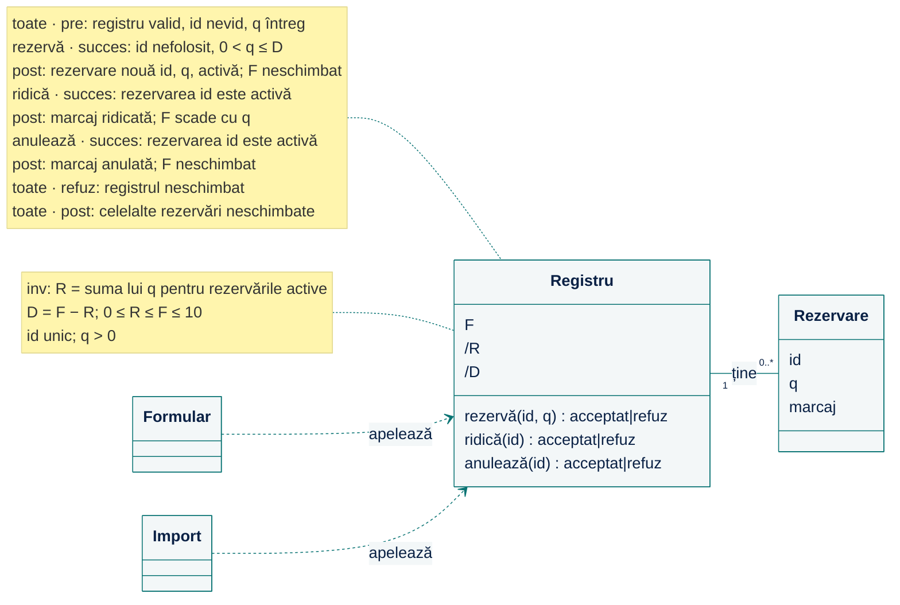

# Ce proiectăm azi

Un depozit are 10 adaptoare de alimentare identice, pe care clienții le pot rezerva și ridica. Operatorul înregistrează cererile. **Rezervat nu înseamnă ridicat:** ce promite registrul când acceptă sau refuză o cerere?

Lucrăm individual și discutăm în plen. Apoi desenăm **o diagramă de clase cu operațiile și contractele lor** și o verificăm împreună.

Exemplu didactic. Schițele și diagramele sunt facultative; nu predăm documente.

::: notes
Aplicăm responsabilitățile din cursul 5 și contractele din cursul 6. Nu cerem o aplicație sau o diagramă de stări. Valori precum activă/ridicată/anulată sunt deja date în enunț. Contractele formulate în prima jumătate devin notele diagramei din a doua.

**Organizare:** minutul 0 din 100; deschidere 0–10 (10 min): problema 3, citatul 2, recapitularea și sensurile cantităților 5. 16 slide-uri cu copertă. []{.pace at=0 of=100 dur=3}
:::

---

# Citatul zilei

> „Precondiția obligă clientul; postcondiția obligă furnizorul.”
>
> Original: “The precondition binds the client, the postcondition binds the supplier.”

— **Bertrand Meyer**

[Sursa: Object-Oriented Software Construction, ediția a doua, „Using assertions”, p. 873](https://bertrandmeyer.com/OOSC2/)

::: notes
Reluăm citatul din cursul 6. Clientul lui Meyer este apelantul operației. Refuzul unei cantități indisponibile poate fi un rezultat promis, dacă operația acceptă asemenea cereri. Nu trebuie să scoatem acel caz din contract numind disponibilitatea precondiție.

**Sursă:** citatul păstrat din materialele anterioare, verificat atunci în fragmentul indexat al cărții de pe site-ul autorului, subsecțiunea „Using assertions”, p. 873. La 27 octombrie 2026 pagina autorului este accesibilă, PDF-ul nu; limita verificării este consemnată în `docs/quotations.md`.

**Organizare:** 2 min. []{.pace dur=2}
:::

---

# Ce luăm din cursurile 5–6

**Responsabilitate:** cine decide și cine poate modifica registrul?

**Contract:** precondiția (ce presupunem despre apel), condiția de succes (când reușim) și postcondițiile (ce întoarcem și ce păstrăm, la succes și la refuz).

**Invariant:** ce relații trebuie să fie adevărate în orice stare? O stare este **validă** dacă îi respectă pe toți.

Astăzi: **F** = bucăți fizic în depozit; **R** = suma cantităților rezervate activ; **D = F − R** = disponibil. „A activă(4)” înseamnă rezervarea A, activă, pentru 4 bucăți. Inițial avem 10 bucăți, fără reaprovizionare sau retururi; apelurile sunt secvențiale: fiecare începe după încheierea celui anterior.

::: notes
Rezervarea reduce disponibilul, nu stocul fizic. Ridicarea reduce simultan stocul fizic și rezervatul. Abrevierile sunt repetate pe slide-urile de lucru. Litera R numește cantitatea rezervată; regulile poartă mereu un număr și cuvinte-cheie, de exemplu R2 (rezervare). P reprezintă totalul ridicat și va fi introdus doar în discuția de referință, dacă ajută.

**Organizare:** 5 min. []{.pace dur=5}
:::

---

# Cine răspunde de modificarea registrului? {.transition}

**10–18 min · Individual, apoi explicații în plen**

Aceeași cerere vine din formular și din import.

::: notes
Începem cu o predicție individuală înainte de compararea responsabilităților. Responsabilitatea stabilită aici decide, în a doua jumătate, la ce clasă punem operațiile.

**Organizare:** minutul 10 din 100; interval 10–18 (8 min): predicție 3, explicații și discuție 4, tranziție 1. []{.pace at=10}
:::

---

# Șase bucăți disponibile, două canale

**Starea inițială I:** F=10; A activă(4); identificatorul B nefolosit; R=4, D=6. **F** = fizic, **R** = rezervat activ, **D** = disponibil.

**R2 (rezervare):** rezervăm o cantitate întreagă pozitivă, cel mult egală cu D, cu un identificator nefolosit; R crește, D scade, F rămâne identic. Altfel refuzăm, fără modificări. **R5 (istoric și efect limitat):** formularul și importul folosesc aceleași reguli; celelalte rezervări se păstrează.

1. Individual: din I, scenariul S1 (`rezervă(B,6)`) și, independent, scenariul S2 (`rezervă(B,7)`) — ce rezultat și ce cantități rămân?
2. În plen: verificăm regula în fiecare canal sau într-un registru comun, pe care îl apelează ambele? Cine împiedică importul să ocolească regula?

[Enunțul complet: R1–R5 și scenariile S1–S7](https://github.com/traiansf/traiansf.github.io/blob/main/class/amss-2026/lab/scenarios/03-contracte/scenario.md)

::: notes
S1: acceptat, F=10, R=10, D=0. S2: refuz, exact I. Registrul comun verifică toate apelurile; o verificare în formular poate ajuta utilizatorul, dar nu trebuie să fie singura. Verificări copiate în fiecare canal pot diverge la o schimbare a regulii. B este identificatorul unei rezervări noi; I numește starea inițială. Linkul de pe slide duce la enunțul complet (R1–R5, S1–S7), ca referință; regulile necesare fiecărui exercițiu sunt pe slide-uri.

**Organizare:** 7 min: 3 individual, 4 în plen (un voluntar explică, un coleg verifică). []{.pace dur=7}
:::

---

# Ce garantează operațiile? {.transition}

**18–50 min · Construim și explicăm contracte**

Un refuz păstrează și cantitățile, și rezervările.

::: notes
Precondițiile comune sunt registru valid, identificatori nevizi, cantități întregi și apeluri secvențiale. Pozitivitatea, disponibilitatea și identificatorul nefolosit decid succesul; refuzurile sunt specificate. Spre deosebire de muzeu, aici enunțul specifică și refuzul ridicării sau anulării cu un identificator necunoscut. Ce garantează operația și în ce condiții se citește din fiecare enunț.

**Organizare:** minutul 18 din 100; interval 18–50 (32 min): rezervare 11, ridicare și anulare 12, două operații succesive 8, tranziție 1. []{.pace at=18}
:::

---

# Contractul rezervării

**Starea inițială I:** F=10, A activă(4), identificatorul B nefolosit, R=4, D=6; F fizic, R rezervat activ, D disponibil.

**R1 (context):** cantitățile sunt numere întregi, identificatorii sunt nevizi, registrul este valid, iar apelurile sunt secvențiale. **R2 (rezervare):** pentru o cantitate q>0, un identificator nefolosit și q≤D, operația creează o rezervare activă nouă de q bucăți; F nu se modifică. Altfel refuză, fără modificări. **R5 (istoric și efect limitat):** celelalte rezervări se păstrează.

Individual, formulați contractul (precondiții, condiție de succes, postcondiții). În plen, un coleg îl explică, iar alt coleg verifică:

- scenariul S2 (`rezervă(B,7)`) și scenariul S7 (`rezervă(B,0)`), fiecare din I;
- succesul din scenariul S1 (`rezervă(B,6)`) și păstrarea lui A;
- relația **D = F − R** și lipsa cantităților negative: ajung ele singure?

::: notes
Ambele refuzuri păstrează exact I. Succesul creează B activă(6); F=10, R=10, D=0. Dacă discuția rămâne la invarianți, propuneți după `rezervă(B,6)` registrul greșit A activă(2), B activă(6), F=10, R=8, D=2: respectă invarianții, dar a modificat cantitatea lui A; îl exclude R5 (istoric și efect limitat), nu un invariant. De aceea contractul nu poate spune doar „disponibil nenegativ”. Nu cerem o transcriere obligatorie.

**Organizare:** 11 min: 4 individual, 7 în plen. []{.pace dur=11}
:::

---

# Ridicarea nu mărește cantitatea disponibilă

**Starea inițială I:** F=10, A activă(4), R=4, D=6. F fizic, R rezervat activ, D disponibil.

**R3 (ridicare) și R4 (anulare):** numai o rezervare activă de q bucăți poate fi ridicată sau anulată; o marcăm ridicată, respectiv anulată. La ridicare, F și R scad cu q, iar D nu se modifică. La anulare, F rămâne, R scade cu q, iar D crește cu q. **R5 (istoric și efect limitat):** păstrăm identificatorul, cantitatea și celelalte rezervări; la refuz, tot registrul.

Individual: scenariul S3 (`ridică(A)`) și scenariul S4 (`anulează(A)`), **independent din I**. În plen, un coleg explică unul, alt coleg pe celălalt, apoi:

**Scenariul S5:** din I, `ridică(A)`, apoi `anulează(A)`. Ce rezultat și ce stare produce fiecare pas? De ce nu putem „reda” cele 4 bucăți?

::: notes
S3: F=6, R=0, D=6, A ridicată(4). S4: F=10, R=0, D=10, A anulată(4). S5: primul pas ca S3; al doilea refuză și păstrează exact acea stare. Cele patru bucăți au părăsit fizic depozitul; nu există retur în domeniu. Invarianți: 0≤R≤F≤10, D=F−R. Opțional, F plus cantitatea ridicată rămâne 10. Dacă cineva propune după `ridică(A)` starea F=6, R=4, D=2: A nu mai este activă, deci R trebuie să fie 0.

**Organizare:** 12 min: 4 individual, 8 în plen. []{.pace dur=12}
:::

---

# Două rezervări, două operații succesive

**Starea de pornire (după scenariul S1):** F=10; A activă(4), B activă(6); R=10, D=0. F fizic, R rezervat activ, D disponibil.

**Reguli:** pentru o rezervare activă de q bucăți, anularea scade R cu q, fără modificarea lui F; ridicarea scade F și R cu q; D=F−R. Păstrăm identificatorul, cantitatea și celelalte rezervări; la refuz, întregul registru. **Identificatorul nu se reutilizează.**

1. Individual: executăm `anulează(A)`, apoi `ridică(B)`. Ce cantități și ce rezervări avem după fiecare pas?
2. În plen, un voluntar explică; un coleg verifică primul păstrarea rezervării neatinse de operație. Ramură separată, imediat după anularea lui A: `rezervă(A,2)`. Ce se păstrează la refuz?

::: notes
După anulare: F=10, R=6, D=4, A anulată(4), B activă(6). După ridicarea lui B: F=4, R=0, D=4, A anulată(4), B ridicată(6). Ramura este pornită din starea de după anulare, nu după ambii pași, ca scenariul S6 (reutilizarea lui A): refuz, exact acea stare. Aici D=4≥2, deci singurul motiv de refuz este identificatorul reutilizat: refuzul vine din R5 (istoric și efect limitat), nu din disponibilitate.

**Organizare:** 8 min: 3 individual, 5 explicații și verificări în plen; etapa se încheie la minutul 50. []{.pace dur=8}
:::

---

# Atelier: diagrama de clase cu operații {.transition}

**50–95 min · Fiecare desenează diagrama, apoi o verificăm împreună**

Unde stă fiecare operație și ce promite ea, scris pe diagramă?

::: notes
Contractele discutate devin note pe o diagramă de clase: operațiile la componenta care are responsabilitatea lor, apelanții legați prin dependențe, invarianții separați de postcondiții. Fiecare student alege cum lucrează: de mână, direct în Mermaid sau generând diagrama cu un asistent AI pe care o verifică apoi pe listă. Nu există etapă AI separată.

**Organizare:** minutul 50 din 100; interval 50–95 (45 min): sarcina 4, lucru individual 16, verificarea la jumătate 10 și corecturi 6, diagrama de referință 8, tranziție 1. []{.pace at=50}
:::

---

# Sarcina: operațiile registrului pe diagramă

Desenați o **diagramă de clase cu operații**: registrul, rezervările, apelanții (formular, import) și operațiile `rezervă(id, q)`, `ridică(id)`, `anulează(id)`, cu rezultatele lor. Contractele și invarianții sunt **note** (pre, succes, post, refuz, inv).

- **R1 (context):** apeluri secvențiale, registru valid, identificatori nevizi, cantități întregi.
- **R2 (rezervare):** reușește cu un identificator nefolosit și 0<q≤D și creează o rezervare activă; altfel refuz, fără modificări.
- **R3 (ridicare), R4 (anulare):** numai pentru o rezervare activă; ridicarea scade F cu q, anularea nu modifică F; altfel refuz, fără modificări.
- **R5 (istoric și efect limitat):** identificatorii nu se reutilizează; celelalte rezervări nu se modifică; formularul și importul folosesc aceleași operații.

**Alegeți:** de mână · în Mermaid · cu un asistent AI, apoi verificată pe listă. [Enunțul complet](https://github.com/traiansf/traiansf.github.io/blob/main/class/amss-2026/lab/scenarios/03-contracte/scenario.md) · [Specificația diagramei](https://github.com/traiansf/traiansf.github.io/blob/main/class/amss-2026/lab/diagrame/clase-operatii.md)

::: notes
Specificația pornește de la diagrama conceptuală din Laboratorul 2 și adaugă operații, parametri, rezultate, dependențe, atribute derivate (`/D`) și note cu restricții; are o listă de verificare, un exemplu rezolvat din alt domeniu (abonamente la o sală de escaladă) și un prompt sugerat. Cine folosește un asistent AI îi dă enunțul complet și specificația și verifică rezultatul pe listă; o diagramă desenată fără erori nu spune nimic despre corectitudine. Cine desenează de mână pornește de la contractele din prima jumătate.

**Organizare:** 4 min: parcurgem sarcina și deschidem specificația; fiecare își alege modul de lucru. Hârtia este suficientă; nu consumăm timp cu instalări. []{.pace dur=4}
:::

---

# Lista de verificare

1. **Responsabilitate:** fiecare operație apare o dată, la registru; formularul și importul doar o apelează (R5).
2. **Rezultate:** fiecare operație poate întoarce și `refuz` (R2–R4).
3. **Precondiții:** numai R1 (context). Identificatorul nefolosit, q>0, q≤D și „rezervare activă” sunt **părți ale condiției de succes**: enunțul promite refuz pentru ele.
4. **Succes:** postcondiția spune exact ce se modifică; F scade numai la ridicare (R3).
5. **Refuz:** întregul registru rămâne neschimbat (R2–R4).
6. **Efect limitat:** „celelalte rezervări neschimbate” este postcondiție, nu invariant (R5).
7. **Invarianți:** D=F−R, 0≤R≤F≤10, identificatori unici, cantități pozitive.
8. **Scenarii:** din I (F=10, A activă(4)), notele dau S2 (`rezervă(B,7)`: refuz) și S3 (`ridică(A)`: F=6, R=0, D=6).

::: notes
Lista este varianta pentru atelier a listei din specificație, cu regulile scrise lângă fiecare punct. Greșeli de urmărit: „pre: q ≤ D” sau „pre: id nefolosit” (refuzul ar rămâne nespecificat); `ridică()` pusă la Rezervare, care nu poate modifica F; operații `setF()`; verificări copiate în Formular și Import; „inv: celelalte rezervări nu se modifică”; „inv: D > 0” (încălcat după S1); postcondiții vagi („registrul se actualizează”). La un răspuns AI: tipuri `boolean` sau excepții în loc de `refuz`, clase `RezervareService`/`Repository`, precondiții care acoperă condiția de succes (ca în analiza AI păstrată din 27 octombrie).

**Organizare:** 16 min de lucru individual, cu lista pe ecran. Treceți printre bănci; alegeți unul sau doi voluntari pentru verificarea la jumătate, de preferință cu diagrame diferite (una de mână, una generată). []{.pace dur=16}
:::

---

# Verificăm o diagramă la jumătate

Un voluntar își arată diagrama: pe hârtie, pe ecran sau ca text Mermaid. **Clasa o verifică punct cu punct**, cu regula alături:

- **Responsabilitate:** operațiile apar o singură dată, la registru; formularul și importul doar le apelează (R5).
- **Precondiții și condiția de succes:** la precondiții numai R1 (context); identificatorul nefolosit, 0<q≤D și „rezervare activă” decid succesul (R2–R4).
- **Postcondiții:** ce se modifică la succes; la refuz, registrul neschimbat; celelalte rezervări neschimbate (R5), ca postcondiție.
- **Invarianți:** D=F−R, 0≤R≤F≤10, identificatori unici.

Un coleg calculează, numai din note, scenariul S5 din I (F=10, A activă(4)): `ridică(A)`, apoi `anulează(A)`. **Apoi fiecare își corectează propria diagramă.**

::: notes
Calculul din note arată imediat dacă o notă este incompletă: dacă nu spune ce se întâmplă cu o rezervare deja ridicată, al doilea pas din S5 nu are rezultat. Așteptat: primul pas acceptat (F=6, R=0, D=6, A ridicată), al doilea `refuz`, starea neschimbată. Dacă voluntarul a generat diagrama cu un asistent AI, verificați citatele pe enunț. Lăudați un element corect cu regula lui; nu căutăm obligatoriu o greșeală. O convenție de desen diferită nu este o eroare.

**Organizare:** 16 min: 10 verificarea unei diagrame (a doua dacă rămâne timp), 6 corecturi individuale. Diagrama voluntarului se proiectează sau se fotografiază; dacă nu se oferă nimeni, verificați o diagramă scrisă de profesor cu precondiția „q ≤ D”. []{.pace dur=16}
:::

---

# Diagrama de referință

`marcaj` este activă, ridicată sau anulată (R3–R4). R și D sunt derivate, deci scad sau cresc odată cu F și cu marcajul.

::: notes
Arătăm referința după ce clasa a convenit corecturile diagramei verificate. Justificarea: registrul are responsabilitatea modificărilor, deci toate operațiile sunt la el; formularul și importul depind de el și nu copiază regula (R5). Precondițiile sunt numai R1; identificatorul nefolosit, 0<q≤D și „rezervare activă” sunt părți ale condiției de succes, pentru că refuzul lor este promis. R și D sunt atribute derivate: postcondițiile spun numai ce se întâmplă cu F și cu marcajul, iar R scade cu q și D rămâne la ridicare decurg din formule. „Celelalte rezervări neschimbate” este o postcondiție comună, nu un invariant. Identificatorul nu se reutilizează: „id nefolosit” se referă la toate rezervările, inclusiv cele încheiate (R5).

Alternative acceptabile: R și D păstrate ca atribute obișnuite, cu postcondiții pentru ele și invarianții care le leagă (costul este sincronizarea); câte o notă pentru fiecare operație; numele `stare` în loc de `marcaj`. Justificarea completă este în `lab/scenarios/03-contracte/reference.md`.

**Organizare:** 8 min: 3 diagrama convenită în plen, 5 comparația cu referința. Etapa se încheie la minutul 95. []{.pace dur=8}
:::

---

# Ce putem explica acum?

Un exemplu din discuția voastră pentru fiecare întrebare:

- Cine asigură respectarea regulii și cum se vede asta pe diagramă?
- Ce promite un refuz, dincolo de mesaj?
- De ce „celelalte rezervări neschimbate” nu este un invariant?
- Ce ați corectat în diagrama voastră, într-un răspuns AI sau în diagrama unui coleg?

**Repere:** ambele canale apelează aceleași operații ale registrului; un refuz lasă registrul identic; D=F−R≥0 este un invariant; fiecare operație păstrează celelalte rezervări.

::: notes
Ascultați două sau trei exemple scurte. O explicație bună numește starea de pornire, operația și rezultatul, plus regula. Nu cereți predări, susțineri individuale sau un număr de defecte. Notați numai dificultățile recurente pentru pregătirea următoare.

**Organizare:** minutul 95 din 100; 5 min; încheiere la minutul 100. []{.pace at=95 dur=5}
:::
