# Ce proiectăm azi

Pentru proiecțiile și filmele cluburilor studențești, serviciul tehnic al facultății împrumută echipamente pe bază de rezervare; studenții le ridică de la un **ghișeu cu operator**. Registrul rezervărilor acceptă sau refuză ridicarea; numai după acceptare cere unui **serviciu extern de mesagerie** o notificare. **Notificarea eșuează, ghișeul reîncearcă:** ce are voie să se întâmple cu rezervarea?

Lucrăm individual și discutăm în plen, apoi, în **atelierul de diagrame**, fiecare desenează diagrama de stări a rezervării: de mână, în Mermaid sau generată cu un asistent AI și revizuită.

Exemplu didactic. Schițele sunt facultative; nu predăm documente. Asistentul AI este opțional; nu sunt necesare conturi AI.

::: notes
Aplicăm stările și tranzițiile din cursul 7 și interacțiunile peste graniță din cursul 8. Nu cerem o aplicație, explorarea automată a stărilor sau analiza formală din cursul 9. Stările Rezervată, Ridicată și Anulată sunt precizate în enunț. Prima jumătate discută problema; a doua jumătate desenează aceeași problemă ca diagramă de stări UML.

**Organizare:** minutul 0 din 100; deschidere 0–10 (10 min): problema 3, citatul 2, recapitularea 5. 17 slide-uri cu copertă. []{.pace at=0 of=100 dur=3}
:::

---

# Citatul zilei

> „O mare parte a informaticii se ocupă de mașini de stări.”
>
> Original: “Much of computer science is about state machines.”

— **Leslie Lamport**

[Sursa: Computation and State Machines (2008), p. 1](https://lamport.azurewebsites.net/pubs/state-machine.pdf#page=4)

::: notes
Reluăm citatul din cursul 7. Rezervarea de azi este o mașină de stări cu trei stări, pe care o vom și desena; interacțiunea cu mesageria nu adaugă stări noi ale rezervării, ci pași și o dată în plus: rezultatul notificării.

**Sursă:** manuscris pe site-ul autorului, prima propoziție din Introduction, pagina numerotată 1 (pagina PDF 4); reverificată la 12 noiembrie 2026. Vezi `docs/quotations.md`.

**Organizare:** 2 min. []{.pace dur=2}
:::

---

# Ce luăm din cursurile 7–8

**Stare și tranziție:** starea (etapa cu nume a ciclului de viață) și datele păstrate decid ce evenimente sunt permise acum; o tranziție are stare curentă, eveniment, condiție, stare următoare și efect; un eveniment nepermis este **refuzat**, fără modificări; la succes se modifică numai datele precizate.

**Interacțiune și graniță:** cine apelează pe cine, ce se întoarce, ce se înregistrează la fiecare pas; despre un serviciu din afara graniței cunoaștem doar interfața și ce presupunem.

**Reîncercare:** aceeași cerere, trimisă din nou cu același identificator, primește același rezultat, iar efectul ei nu se repetă; o cerere nouă cu același conținut este judecată după reguli.

Astăzi: rezervările au stările **Rezervată**, **Ridicată**, **Anulată**; apelurile sunt secvențiale; mesageria răspunde `trimis` sau `eșec expediție`. `netrimisă` consemnează `eșec expediție`, fără să stabilească dacă mesajul a ajuns.

::: notes
Recapitulăm fără exemplele cursurilor: așa judecăm propunerile de azi. Întrebările de verificare rămân aceleași: ce este permis acum, ce se înregistrează, cine coordonează, ce promitem când componenta din exterior eșuează. Diagrama de stări din cursul 7 („Același tabel, desenat”) revine în atelier.

**Organizare:** 5 min. []{.pace dur=5}
:::

---

# Ce are voie să se întâmple cu o rezervare? {.transition}

**10–28 min · Individual, apoi explicații în plen**

Alt student, aceeași rezervare: refuzat de stare sau de condiție?

::: notes
Începem cu predicții individuale, apoi construim tabelul de tranziții și îl explicăm în plen. Tabelul este punctul de plecare al diagramei din atelier.

**Organizare:** minutul 10 din 100; interval 10–28 (18 min): predicții 6, tabel 12. []{.pace at=10}
:::

---

# Trei scenarii de prezis

**Starea inițială I:** A (titular T1) și B (titular T2) sunt în Rezervată; niciun identificator înregistrat.

**R3 (ridicare):** `ridică(c, r, s)` cu c nou este acceptată exact când r este Rezervată și s este titularul: r trece în Ridicată, cu momentul ridicării și c înregistrate; rezultat `ridicat`; altfel `refuz`, fără modificări și fără notificare. **R6 (anulare):** `anulează(r)` este permis numai pentru o rezervare Rezervată, care trece în Anulată, fără notificare; în celelalte cazuri: `refuz`. **R2 (stări):** Anulată este o stare finală intenționată: nu permite evenimente.

1. Individual, din I: scenariul S2 (alt student), `ridică(c1, A, T2)`; scenariul S7 (anulare, apoi ridicare), `anulează(B)`, apoi `ridică(c2, B, T2)`; după scenariul S1 (ridicare confirmată; A Ridicată), scenariul S6 (anulare după ridicare), `anulează(A)`. Rezultat, stare, ce se înregistrează.
2. În plen: pentru fiecare refuz, ce îl decide: **starea** sau **condiția**?

[Enunțul complet: R1–R8 și scenariile S1–S7](https://github.com/traiansf/traiansf.github.io/blob/main/class/amss-2026/lab/scenarios/04-comportament/scenario.md)

::: notes
S2: refuz, decis de condiție (T2 nu este titularul); I neschimbată, c1 neînregistrat. S7: anularea acceptată, B Anulată; ridicarea refuzată, decisă de stare (Anulată este finală); fără notificare. S6: refuz, decis de stare (anularea cere Rezervată); A rămâne Ridicată, cu c1 și notificarea înregistrate. Linkul duce la enunțul complet, ca referință; regulile necesare fiecărui exercițiu sunt pe slide-uri.

**Organizare:** 6 min: 3 individual, 3 în plen. []{.pace dur=6}
:::

---

# Tabelul de tranziții

**Reguli:** o cerere `ridică` cu c nou este acceptată numai din Rezervată și numai pentru titular: rezervarea trece în Ridicată, se înregistrează momentul ridicării și c, iar notificarea devine `trimisă` sau `netrimisă`. **R5 (reîncercare):** pentru un c deja înregistrat, registrul întoarce același `ridicat`, fără să schimbe starea, și retrimite notificarea `netrimisă`. `anulează` este permis numai din Rezervată și duce în Anulată. În celelalte cazuri evenimentul este refuzat, fără modificări; datele nu se șterg.

Individual, completați tabelul (stare curentă, eveniment, condiție, stare următoare, efect). În plen, un coleg îl explică rând cu rând, iar alt coleg verifică:

- în ce stare se află rezervarea când sosește o **reîncercare**? Are rândul ei?
- o cerere nouă (c neînregistrat) pentru o rezervare Ridicată: o refuză starea sau condiția?
- ce rămâne înregistrat după `anulează(B)`: titularul, echipamentul?

::: notes
Rândurile așteptate: Rezervată + `ridică` cu c nou și s titular → Ridicată; Ridicată + `ridică` cu c înregistrat → Ridicată (reîncercare, notificarea poate fi actualizată); Rezervată + `anulează` → Anulată. Reîncercarea sosește în Ridicată, nu în Rezervată: c este înregistrat numai la acceptare. Mulți o pun în Rezervată; întrebarea colegului care verifică o scoate la iveală. Cererea nouă în Ridicată merită discuția: citită față de rândul din Rezervată, o refuză starea; citită față de rândul reîncercării din Ridicată, o refuză condiția (c nu este înregistrat). Ambele lecturi sunt corecte; tabelul trebuie doar să dea `refuz`, fără modificări. Reîncercarea în Ridicată este permisă; de aceea Ridicată nu este o stare finală intenționată în sensul cursului 7. După anulare, titularul și echipamentul rămân (R8). În Ridicată, reîncercarea poate actualiza notificarea: păstrarea stării nu înseamnă păstrarea tuturor datelor.

**Organizare:** 12 min: 6 individual, 6 în plen; ajungem la minutul 28. []{.pace dur=12}
:::

---

# Cine coordonează ridicarea? {.transition}

**28–50 min · Interacțiunea pas cu pas, apoi reîncercările**

Mesageria a răspuns `eșec expediție`. Ce promite registrul ghișeului?

::: notes
Scriem interacțiunea pentru cazul normal și pentru eșecul notificării, apoi reîncercarea și cererea nouă. Granița și presupunerile despre mesagerie rămân pe slide. Pașii scriși aici sunt materia extensiei din atelier: diagrama de secvență.

**Organizare:** minutul 28 din 100; interval 28–50 (22 min): interacțiune 10, reîncercări 12. []{.pace at=28}
:::

---

# Interacțiunea pentru `ridică`

**Din I, independent:** A este Rezervată, cu titularul T1; c1 este neînregistrat. **R3 (ridicare):** acceptarea trece A în Ridicată și înregistrează momentul ridicării și c1.

**R4 (notificare):** după o ridicare acceptată, registrul cere mesageriei `trimite(mesaj)`, care răspunde `trimis` sau `eșec expediție`; registrul înregistrează notificarea `trimisă` sau `netrimisă`; **eșecul nu anulează ridicarea**, ghișeul primește `ridicat`. **R7 (graniță):** presupunem doar că mesageria răspunde; `eșec expediție` nu înseamnă că mesajul nu a ajuns. Refuzul nu apelează mesageria.

Individual, scrieți pașii (cine → cui, ce se trimite sau se întoarce, ce înregistrează registrul) pentru:

- scenariul S1 (ridicare confirmată): `ridică(c1, A, T1)`, mesageria răspunde `trimis`;
- scenariul S3 (notificare eșuată): `ridică(c1, A, T1)`, mesageria răspunde `eșec expediție`.

În plen, un coleg explică S1, alt coleg S3, apoi: **în ce pas schimbă registrul starea: înainte sau după apelul mesageriei? Ce s-ar întâmpla cu S3 în ordinea inversă?**

::: notes
S1: ghișeu → registru; registrul verifică (A Rezervată, T1 titular, c1 nou), trece A în Ridicată, înregistrează momentul ridicării și c1, notificarea în așteptare; registru → mesagerie `trimite`; mesagerie → registru `trimis`; registrul înregistrează `trimisă`; registru → ghișeu `ridicat`. S3: identic, cu `eșec expediție` și `netrimisă`; răspunsul rămâne `ridicat`. Tranziția precede apelul. În ordinea inversă (starea schimbată numai la `trimis`), la `eșec expediție` studentul ar pleca cu echipamentul, iar A ar rămâne Rezervată: registrul ar putea accepta încă o ridicare pentru aceeași rezervare, iar R4 ar fi încălcată.

**Organizare:** 10 min: 4 individual, 6 în plen. []{.pace dur=10}
:::

---

# Reîncercare sau cerere nouă?

**R5 (reîncercare):** o cerere cu c deja înregistrat primește același `ridicat`, fără a doua ridicare; dacă notificarea este `netrimisă`, mesageria este apelată din nou și rezultatul se actualizează; dacă este `trimisă`, nu. **R3 (ridicare):** o cerere cu c nou pentru o rezervare care nu mai este Rezervată: `refuz`, fără modificări, fără notificare.

Individual, scenariile fiind **independente** unul de altul:

- scenariul S4 (reîncercare după eșec): continuarea lui S3 (notificare eșuată: A Ridicată, c1 înregistrat, notificare `netrimisă`): `ridică(c1, A, T1)`, mesageria răspunde `trimis`;
- scenariul S5 (cerere nouă după ridicare): continuarea lui S1 (ridicare confirmată: A Ridicată, c1 înregistrat, notificare `trimisă`): `ridică(c7, A, T1)`.

În plen, un coleg explică S4, alt coleg S5: **Ce deosebește cererile pentru același student și aceeași rezervare? Ce garantează registrul ghișeului în fiecare caz?**

::: notes
S4: c1 înregistrat → reîncercare; notificarea `netrimisă` → mesageria apelată din nou → `trimisă`; răspuns `ridicat`; A rămâne Ridicată, o singură ridicare. S5: c7 nou → cerere nouă; A nu este Rezervată → `refuz`, nimic nu se modifică, mesageria nu este apelată. Le deosebește numai identificatorul cererii. Garanții: o rezervare este ridicată cel mult o dată; reîncercarea primește același rezultat; rezultatul notificării este înregistrat; refuzul nu produce mesaje. Nu garantăm livrarea sau citirea mesajului.

**Organizare:** 12 min: 4 individual, 8 în plen; ajungem la minutul 50. []{.pace dur=12}
:::

---

# Atelier: diagrama de stări {.transition}

**50–95 min · Individual: de mână, în Mermaid sau cu un asistent AI; verificare în plen**

Diagrama se randează fără erori. Este și corectă?

::: notes
Desenăm ce am discutat: tabelul de tranziții devine diagramă de stări UML. Fiecare student alege cum lucrează; scopul este o diagramă corectă la sfârșitul atelierului, verificată față de enunț, nu o diagramă frumoasă. Nu predăm, nu încărcăm și nu notăm diagramele.

**Organizare:** minutul 50 din 100; interval 50–95 (45 min): sarcina și lucrul individual 18, autoverificare 2, verificarea în plen 10, corectare sau extensie 7, diagrama de referință 8. []{.pace at=50}
:::

---

# Diagrama de stări a rezervării

**Individual:** desenați diagrama de stări UML a unei rezervări, după enunț. Alegeți: **de mână**, pe hârtie; **în Mermaid** (`stateDiagram-v2`); sau **generată cu un asistent AI** din enunț și specificație, apoi revizuită de voi, punct cu punct.

**Reguli:** R2 (stări): o rezervare este în exact una dintre stările Rezervată, Ridicată, Anulată; Anulată este o stare finală intenționată. R3 (ridicare): `ridică(c, r, s)` cu c neînregistrat este acceptată numai din Rezervată și numai pentru titular: r trece în Ridicată, se înregistrează momentul ridicării și c. R4 (notificare): apoi registrul cere mesageriei `trimite(mesaj)` și înregistrează notificarea `trimisă` sau `netrimisă`. R5 (reîncercare): cu c deja înregistrat, starea nu se schimbă, iar notificarea `netrimisă` se retrimite. R6 (anulare): `anulează(r)` numai din Rezervată, spre Anulată, fără notificare. În celelalte cazuri, evenimentul este refuzat, fără modificări.

**Notația:** o tranziție are eticheta `eveniment [condiție] / efect`; evenimentele refuzate nu se desenează.

[Enunțul](https://github.com/traiansf/traiansf.github.io/blob/main/class/amss-2026/lab/scenarios/04-comportament/scenario.md) · [Specificația diagramei de stări: elemente, Mermaid, listă de verificare](https://github.com/traiansf/traiansf.github.io/blob/main/class/amss-2026/lab/diagrame/stari.md)

::: notes
Prezentați pe scurt specificația: subsetul UML, notația Mermaid, lista de verificare, exemplul cantinei și secțiunea despre asistentul AI. Cine folosește un asistent AI îi dă enunțul și specificația, nu tabelul discutat; apoi verifică fiecare punct al listei față de enunț. Cine lucrează în Mermaid poate folosi mermaid.live sau previzualizarea GitHub. Treceți printre bănci: întrebați „ce regulă susține această săgeată?” și „unde este reîncercarea?”. Notați una-două diagrame cu greșeli instructive (reîncercarea pe Rezervată, o stare pentru notificare, săgeți pentru refuzuri) și rugați autorii să le arate la verificarea în plen.

**Organizare:** 18 min: explicarea sarcinii 2, lucru individual 16. []{.pace dur=18}
:::

---

# Lista de verificare

1. **Stările** sunt exact cele din R2 (stări): Rezervată, Ridicată, Anulată; nicio stare pentru refuz, notificare sau condiție.
2. **Starea inițială:** pseudostarea inițială duce în Rezervată, fără eveniment (crearea rezervărilor nu este modelată).
3. **Tranzițiile permise** de R3 (ridicare), R5 (reîncercare) și R6 (anulare) apar fiecare o dată, inclusiv buclele.
4. **Condițiile** (c neînregistrat sau înregistrat, s titularul) sunt între paranteze drepte, pe tranziția lor, și se exclud.
5. **Efectele** numesc numai datele înregistrate (momentul ridicării, c, notificarea) și apelul `trimite(mesaj)`.
6. **Refuzurile nu se desenează:** nicio săgeată pentru un eveniment refuzat; din Anulată nu pleacă nicio săgeată.
7. **Scenariile** S1–S7 din enunț se pot urmări pe diagramă și dau starea așteptată.

Individual: verificați-vă diagrama punct cu punct; pentru fiecare punct, găsiți regula din enunț care îl susține.

::: notes
Punctele sunt lista generală din specificație, aplicată enunțului. Punctul 7 este cel mai puternic: o diagramă care trece de S4 (reîncercare după eșec) și de S5 (cerere nouă după ridicare) are bucla în Ridicată, cu condiția pe c. Cine a generat diagrama cu un asistent AI verifică la fel: o randare curată nu arată că diagrama este corectă.

**Organizare:** 2 min, autoverificare individuală; ajungem la minutul 70. []{.pace dur=2}
:::

---

# Verificare în plen: diagrama unui coleg

Un voluntar își arată diagrama, pe tablă sau ca text Mermaid pe proiector. Un coleg o verifică după listă, punct cu punct; fiecare observație numește punctul și regula din enunț.

- **Punctul 1:** `trimisă` și `netrimisă` sunt stări sau date? R2 (stări) numește trei stări; rezultatul notificării este o dată a rezervării.
- **Punctele 3–4:** unde pleacă bucla reîncercării? R3 (ridicare) înregistrează c numai la o ridicare acceptată; R5 (reîncercare) cere același `ridicat`, fără schimbarea stării.
- **Punctul 6:** există săgeți pentru `anulează` în Ridicată sau pentru `ridică` în Anulată? R6 (anulare) și R2 le refuză.
- **Punctul 7:** scenariul S4 (reîncercare după eșec): A Ridicată, c1 înregistrat, notificare `netrimisă`; `ridică(c1, A, T1)`. Ce săgeată folosește?

Decidem în plen ce corectăm; o diagramă corectă este la fel de utilă ca una cu greșeli.

::: notes
Bucla reîncercării pleacă din Ridicată: în Rezervată, c nu poate fi încă înregistrat. S4 folosește bucla Ridicată → Ridicată, cu condiția „c înregistrat” și efectul retrimiterii; un student care a pus bucla pe Rezervată nu găsește nicio săgeată pentru S4 și ar refuza o reîncercare permisă. O stare „Notificare netrimisă” face ca R2 să nu mai fie respectată și dublează Ridicată. Dacă primul voluntar are o diagramă corectă, confirmați-o punct cu punct și luați un al doilea voluntar, de preferință unul care a folosit alt mod de lucru (de mână, Mermaid, AI). Cine a folosit un asistent AI spune ce a corectat la revizuire.

**Organizare:** 10 min: unul sau doi voluntari, câte 4–5 min; ajungem la minutul 80. []{.pace dur=10}
:::

---

# Extensie: diagrama de secvență a lui `ridică`

Pentru cine are diagrama de stări verificată: desenați diagrama de secvență UML a scenariului S3 (notificare eșuată), urmat de scenariul S4 (reîncercare după eșec). Ceilalți își corectează diagrama de stări.

**Reguli:** participanții sunt ghișeul, registrul rezervărilor (sistemul nostru) și mesageria (în afara graniței). R3 (ridicare): o ridicare acceptată trece A în Ridicată și înregistrează momentul și c1. R4 (notificare): apoi registrul cere `trimite(mesaj)`; la `eșec expediție` înregistrează `netrimisă`, iar ghișeul primește tot `ridicat`. R5 (reîncercare): cu același c1, starea rămâne Ridicată, iar notificarea `netrimisă` se retrimite; la `trimis` devine `trimisă`. R7 (graniță): despre mesagerie presupunem doar că răspunde `trimis` sau `eșec expediție`.

**Notația:** mesaj sincron și răspuns; note pentru ce înregistrează registrul; granița în jurul registrului.

[Specificația diagramei de secvență: elemente, Mermaid, listă de verificare](https://github.com/traiansf/traiansf.github.io/blob/main/class/amss-2026/lab/diagrame/secventa.md)

::: notes
Diagrama de referință este în `lab/scenarios/04-comportament/reference.md`; o puteți arăta celor care termină. Punctele de urmărit: schimbarea stării (nota) înaintea apelului `trimite`; răspunsul `ridicat` după `eșec expediție`; la reîncercare, nicio notă de schimbare a stării; ghișeul nu apelează niciodată mesageria.

**Organizare:** 7 min: corectare sau extensie; ajungem la minutul 87. []{.pace dur=7}
:::

---

# Diagrama de referință

```mermaid
%%{init: {"theme":"base","themeVariables":{"primaryColor":"#F3F7F8","primaryTextColor":"#0A2145","primaryBorderColor":"#087373","lineColor":"#087373","fontFamily":"Arial","fontSize":"22px"},"themeCSS":".edgeLabel div, .edgeLabel p, .edgeLabel span {white-space: nowrap !important; max-width: none !important;}"}}%%
stateDiagram-v2
    direction LR
    accTitle: Diagrama de stări a unei rezervări
    accDescr: Din pseudostarea inițială se ajunge în Rezervată. Din Rezervată, ridicarea cu un identificator neînregistrat, cerută de titular, duce în Ridicată; anularea duce în Anulată. Ridicată are o buclă pentru reîncercarea cu un identificator înregistrat. Din Anulată nu pleacă nicio săgeată.
    state "Rezervată" as Rz
    state "Ridicată" as Rd
    state "Anulată" as An
    [*] --> Rz
    Rz --> Rd: ridică(c, r, s)<br/>[c neînregistrat, s titularul lui r]<br/>/ înregistrează momentul și c,<br/>trimite(mesaj), înregistrează notificarea
    Rd --> Rd: ridică(c, r, s) [c înregistrat la r]<br/>/ dacă notificarea este netrimisă,<br/>trimite(mesaj) și o actualizează
    Rz --> An: anulează(r)
```

Fără săgeți pentru refuzuri: `anulează` în Ridicată, orice eveniment în Anulată, o cerere nouă în Ridicată. `trimisă` și `netrimisă` sunt date, nu stări. Bucla face ca Ridicată să nu fie finală.

::: notes
Comparăm diagrama corectată în plen cu referința, punct cu punct. Variante acceptabile: bucla reîncercării împărțită în două, după notificare (`[c înregistrat, notificare netrimisă] / trimite(mesaj)…` și `[c înregistrat, notificare trimisă]`, fără efect); efecte scrise mai pe scurt, dacă numesc aceleași date; eticheta tranziției de anulare fără efect. Nu sunt acceptabile: o săgeată spre starea finală UML din Anulată (obiectul ar ieși din Anulată), bucle pentru refuzuri, stări pentru notificare. Rezultatul `ridicat` sau `refuz` întors ghișeului nu apare pe diagramă: îl spun tabelul și diagrama de secvență. Justificarea fiecărui element este în referința laboratorului.

**Organizare:** 8 min; ajungem la minutul 95. []{.pace dur=8}
:::

---

# Ce putem explica acum?

Un exemplu din discuția voastră pentru fiecare întrebare:

- Ce evenimente sunt permise într-o stare și ce decide un refuz: starea sau condiția?
- În ce pas schimbă registrul starea față de apelul mesageriei, și de ce?
- Ce deosebește o reîncercare de o cerere nouă și unde apare reîncercarea pe diagramă?
- Ce a prins lista de verificare și nu a semnalat randarea?

**Repere:** tranziția precede apelul mesageriei; eșecul notificării este înregistrat, nu ascuns; reîncercarea sosește în Ridicată și primește același rezultat; refuzurile nu au săgeți; o diagramă care se randează trebuie verificată față de enunț.

::: notes
Ascultați două sau trei exemple scurte. O explicație bună numește starea de pornire, evenimentul sau pasul, rezultatul și regula. Nu cereți predări, susțineri individuale sau un număr de defecte. Notați numai dificultățile recurente pentru pregătirea următoare. Exercițiul despre ghișeul care nu a primit răspunsul rămâne în sprijinul facultativ, pentru studiu individual.

**Organizare:** 5 min; încheiere la minutul 100. []{.pace dur=5}
:::
