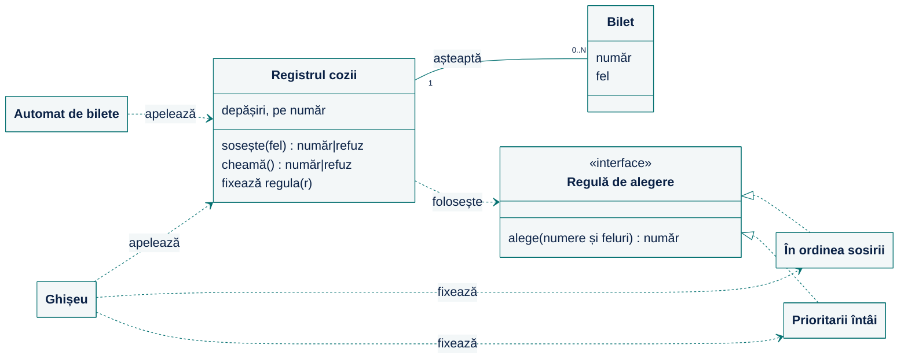

# Ce proiectăm azi

La secretariat, studenții iau un bilet de ordine de la un **automat**; la **ghișeu**, secretara cheamă următorul bilet. **Registrul cozii**, componenta pe care o proiectăm, alege pe cine chemăm. Biletele sunt obișnuite sau prioritare, iar secretariatul schimbă regula de alegere de la o perioadă la alta.

**Niciun bilet nu trebuie depășit la nesfârșit. Cum verificăm asta pentru regula de azi și cum proiectăm registrul ca să rămână adevărat și pentru regula de mâine?**

Lucrăm individual și discutăm în plen, apoi, în **atelierul de diagrame**, fiecare realizează diagrama de clase cu interfață: o desenează de mână, o scrie în Mermaid sau o generează cu un asistent AI și o revizuiește.

Exemplu didactic. Schițele sunt facultative; nu predăm documente. Asistentul AI este opțional; nu sunt necesare conturi AI.

::: notes
Prima jumătate aplică cursul 9: proprietăți, contraexemple, ce stabilește o explorare și până unde. A doua aplică cursul 10: ce variază, ce trece prin interfață, unde stă regula stabilă. Nu cerem reconstrucția sau migrarea unui sistem existent (cursul 11) și nici un instrument de verificare formală.

**Organizare:** minutul 0 din 100; deschidere 0–10 (10 min): problema 3, citatul 2, recapitularea 5. 17 slide-uri cu copertă. []{.pace at=0 of=100 dur=3}
:::

---

# Citatul zilei

> „[…] testarea programelor poate fi folosită foarte eficient pentru a arăta prezența erorilor, dar niciodată pentru a arăta absența lor.”
>
> Original: “[…] program testing can be used very efficiently to show the presence of bugs, but never to show their absence.”

— **Edsger W. Dijkstra**

[Sursa: Concern for Correctness as a Guiding Principle for Program Composition — EWD288](https://www.cs.utexas.edu/~EWD/transcriptions/EWD02xx/EWD288.html)

::: notes
Reluăm citatul din cursul 9. Azi vedem ambele jumătăți: un scenariu care arată o eroare și o explorare completă a unui model mic, care nu arată absența erorii în modelul cu un loc în plus.

**Sursă:** arhiva autorului la UT Austin, paragraful „The first moral of this story is that …”; începutul propoziției este omis. Verificat la 24 noiembrie 2026. Vezi `docs/quotations.md`.

**Organizare:** 2 min. []{.pace dur=2}
:::

---

# Ce luăm din cursurile 9–10

**Model și proprietate:** starea modelului cuprinde tot ce contează pentru evenimentele următoare. O proprietate despre toate stările accesibile este infirmată de un **contraexemplu**, o execuție pe care o verificăm pas cu pas.

**Explorare:** parcurgerea tuturor stărilor accesibile stabilește proprietatea pentru **acel model finit**, în limitele lui. Pentru un model mai mare este nevoie de altă explorare sau de un argument despre toate cazurile.

**Abstractizare:** o interfață este justificată de o variație **confirmată**. **Regula stabilă** stă într-un singur loc. Ce trece prin interfață hotărăște ce poate încălca o realizare.

**Cost:** interfața ieftinește variația pentru care a fost făcută și scumpește schimbarea a ceea ce trece prin ea.

::: notes
Recapitulăm fără exemplele cursurilor. Întrebările de azi: ce proprietate, pe ce model, cu ce limite; ce variază, ce rămâne, cine răspunde de ce rămâne. Verificarea afirmată nu este o verificare executată.

**Organizare:** 5 min. []{.pace dur=5}
:::

---

# Cine așteaptă prea mult? {.transition}

**10–50 min · Individual, apoi explicații în plen**

Regula merge pe scenariile pe care le-am încercat. Merge?

::: notes
Predicții pe o regulă simplă, o regulă reparată, rezultatul explorării ei și un contraexemplu într-un model mai mare; apoi unde stă limita, în două proiectări, și ce trece prin interfață. De aici pornește diagrama.

**Organizare:** minutul 10 din 100; interval 10–50 (40 min): predicții 9, explorarea 5, contraexemplul 10, două proiectări 10, interfața 6. []{.pace at=10}
:::

---

# „Prioritarii întâi”

**R4 (chemare):** `cheamă()` alege un bilet care așteaptă, îl scoate din coadă și îi întoarce numărul. **R6 (depășire):** un bilet este depășit când este chemat unul sosit după el.

**Prioritarii întâi:** cel mai vechi bilet prioritar; dacă nu așteaptă niciunul, cel mai vechi bilet.

**A1 (chemat o dată):** un bilet este chemat cel mult o dată. **A2 (fără blocaj):** cât timp așteaptă un bilet, `cheamă()` este acceptat. **A3 (așteptare limitată):** niciun bilet nu este depășit de mai mult de două ori.

1. Individual, S2 (un obișnuit): sosește o1; apoi, de trei ori, sosește un prioritar (p2, p3, p4) și urmează o chemare. Cine este chemat? De câte ori este depășit o1?
2. Care proprietate este infirmată? Ce le-ar stabili pe celelalte două? Ce regulă propuneți?

[Enunțul complet: R1–R6, A1–A3, S1–S3](https://github.com/traiansf/traiansf.github.io/blob/main/class/amss-2026/lab/scenarios/05-validare/scenario.md)

::: notes
1: sunt chemați p2, p3, p4; o1 este depășit de trei ori. 2: A3; S2 este un contraexemplu. A1 și A2 privesc toate stările accesibile: A1 decurge din R4 (biletul chemat iese din coadă), A2 din R4 (există un bilet de ales); sunt argumente, nu scenarii. Dacă cineva spune „S2 arată că A1 este respectată”, întrebați ce arată pentru alte execuții. Regula propusă: de obicei apare „după câțiva prioritari, un obișnuit”: este regula de pe slide-ul următor. Alte propuneri bune: limita pe bilet; notați-o, revine la etapa a doua. Prioritarii pot fi și ei depășiți? Sub această regulă, nu.

**Organizare:** 9 min: 4 individual, 5 în plen. []{.pace dur=9}
:::

---

# „Doi la rând”: explorarea

**Doi la rând:** ca „Prioritarii întâi”, dar, după doi prioritari chemați unul după altul, urmează cel mai vechi bilet obișnuit, dacă așteaptă vreunul. **A3 (așteptare limitată):** niciun bilet nu este depășit de mai mult de două ori.

Modelul explorat are cel mult **N = 2** bilete care așteaptă. Rulat înaintea laboratorului:

```text
$ python explorare.py prioritari 2
prioritari, cel mult 2 bilete: 16 stări accesibile, 27 tranziții
  A3 (așteptare limitată): încălcată, prin sosește(o), sosește(p), cheamă()=p, …
$ python explorare.py doi_la_rand 2
doi_la_rand, cel mult 2 bilete: 33 stări accesibile, 56 tranziții
  A3 (așteptare limitată): respectată; depășiri maxime: 2
```

Scenariul S2 (un obișnuit) se încheie acum bine: p2, p3, o1. **Ce putem afirma despre „Doi la rând”? Dar despre secretariatul cu treizeci de scaune?**

::: notes
Putem afirma: în modelul cu cel mult două bilete care așteaptă, în nicio execuție un bilet nu este depășit de mai mult de două ori. Explorarea a acoperit și execuții foarte lungi: stările se repetă, deci 33 de stări ajung. Nu putem afirma nimic despre N = 3 sau N = 30: sunt alte modele. Nu dezvăluiți rezultatul pentru N = 3. Cine vrea poate rula exploratorul pe calculatorul propriu; nu este nevoie.

**Sursă:** `lab/scenarios/05-validare/model/explorare.py`, rulat la 24 noiembrie 2026, Python 3.10.11; ieșirile complete sunt în `model/rezultate.txt`.

**Organizare:** 5 min. []{.pace dur=5}
:::

---

# Un loc în plus

**Doi la rând:** cel mai vechi prioritar; după doi prioritari la rând, cel mai vechi obișnuit. **R6 (depășire):** este chemat un bilet sosit după el. **R3 (sosire):** când așteaptă N bilete, sosirea este refuzată.

| | **S3 (doi obișnuiți), N = 3** | Biletul chemat | Depășiri o1 | Depășiri o2 |
|:--|:-------------------------------|:------------------|:-----------|:-----------|
| 1 | sosesc o1, o2, p3 | — | 0 | 0 |
| 2 | `cheamă()` | ? | ? | ? |
| 3 | sosește p4; `cheamă()` | ? | ? | ? |
| 4 | sosește p5; `cheamă()` | ? | ? | ? |
| 5 | `cheamă()` | ? | ? | ? |

Individual, apoi în plen: **este un contraexemplu pentru A3 (cel mult două depășiri)? De ce nu a fost găsit cu N = 2? Cum ați repara regula?**

::: notes
Un coleg trasează, altul verifică. 2: p3; o1 = 1, o2 = 1. 3: p4; 2, 2. 4: doi prioritari la rând, deci o1; o2 nu este depășit de o1 (o1 a sosit înainte): o2 = 2; p5 așteaptă. 5: p5; o2 = 3. A3 este infirmată. Cu N = 2, cei doi obișnuiți ar umple coada și niciun prioritar nu ar mai putea sosi (R3): contraexemplul are nevoie de trei locuri. Regula numără prioritarii la rând, nu depășirile unui bilet: după o1, numărătoarea repornește și îl ignoră pe o2. Exploratorul găsește același contraexemplu la N = 3, 142 de stări. Reparații propuse: un obișnuit după un singur prioritar (pe S3 merge, iar explorarea o confirmă pentru N = 2 și N = 3; cu trei obișnuiți și N = 4 apare un contraexemplu: aceeași lecție, cu un loc în plus); numărarea depășirilor fiecărui bilet (ajunge). Rețineți a doua: este varianta L de pe slide-ul următor.

**Organizare:** 10 min: 5 individual, 5 în plen; ajungem la minutul 34. []{.pace dur=10}
:::

---

# Unde stă limita?

**A3 (așteptare limitată):** cel mult două depășiri. **R6 (depășire):** este chemat un bilet sosit după el.

- **Varianta E (fiecare regulă):** regula primește coada, cu depășirile, și are grijă singură de A3.
- **Varianta L (limita în registru):** registrul cheamă cel mai vechi bilet, dacă a fost depășit de două ori; altfel întreabă regula.

Individual, apoi în plen:

1. L, cu „Prioritarii întâi” (cel mai vechi prioritar, altfel cel mai vechi), pe S3 (o1, o2, p3; chemare; p4; chemare; p5; două chemări): respectă A3?
2. **C1 (programați):** cel mai vechi programat, altfel ca „Prioritarii întâi”. Ce verificați din nou în E și în L?
3. Explorarea nu infirmă L cu „Prioritarii întâi”, N = 2–5. Ce argument ar acoperi orice N și orice regulă?

::: notes
1: p3, p4, apoi o1 (depășit de două ori), apoi o2 (depășit de două ori, acum cel mai vechi), apoi rămâne p5; A3 este respectată. 2: în E, A3 trebuie verificată la fiecare regulă nouă; în L, o dată, la registru, iar regula nouă nu o poate încălca. 3: un bilet care îl depășește pe cel mai nou dintre două bilete îl depășește și pe cel mai vechi; deci cel mai vechi are cel puțin atâtea depășiri ca oricare altul. Când el ajunge la două, este chemat, iar chemarea lui nu depășește pe nimeni. Niciun bilet nu trece de două, pentru orice N și orice regulă care întoarce un bilet care așteaptă. Este argumentul de invariant din cursul 6: adevărat la început, păstrat de fiecare eveniment. Explorarea l-a sugerat; argumentul l-a stabilit. Costul lui L: regula „Prioritarii întâi” nu mai este respectată întotdeauna; este o decizie a beneficiarului, de întrebat.

**Sursă:** `python explorare.py limita N`: 13, 38, 94, 213 stări pentru N = 2–5; 24 noiembrie 2026.

**Organizare:** 10 min: 4 individual, 6 în plen. []{.pace dur=10}
:::

---

# Ce trece prin interfață?

**Varianta L (limita în registru):** registrul cheamă cel mai vechi bilet dacă a fost depășit de două ori; altfel întreabă regula de alegere, prin `alege(…)`. **R5 (regula de alegere):** regula se schimbă; azi, „În ordinea sosirii” și „Prioritarii întâi”. **A1 (chemat o dată):** registrul scoate din coadă biletul chemat.

Discutăm în plen, înainte de a desena:

- Ce îi trebuie unei reguli ca să aleagă: numerele, felurile, depășirile, registrul întreg?
- Ce întoarce `alege` și ce verifică registrul înainte de a chema biletul?
- Secretara fixează regula, de la ghișeu, prin `fixează regula(r)`. Cine cunoaște realizările?
- **C2 (după oră):** o regulă nouă alege și după ora la care a fost luat biletul. Ce se schimbă?

::: notes
Îi trebuie numerele și felurile biletelor care așteaptă, în ordinea sosirii. Nu îi trebuie depășirile: limita este a registrului; dacă le-ar primi odată cu biletele, o realizare greșită le-ar putea și modifica. Registrul întreg ar permite unei reguli să scoată sau să adauge bilete. Întoarce numărul unui bilet dintre cele primite; registrul verifică acest lucru, altfel ar putea chema un bilet care nu așteaptă. Realizările le cunoaște ghișeul, de unde secretara fixează regula (R5); registrul cunoaște numai interfața. C2: prin interfață trebuie să treacă și ora sosirii, deci se schimbă datele biletului și contractul interfeței; realizările existente o ignoră.

**Organizare:** 6 min; ajungem la minutul 50. []{.pace dur=6}
:::

---

# Atelier: diagrama de clase cu interfață {.transition}

**50–95 min · Individual: de mână, în Mermaid sau cu un asistent AI; verificare în plen**

Ce poate strica o realizare scrisă de altcineva?

::: notes
Desenăm varianta L. Fiecare student alege cum lucrează; scopul este o diagramă corectă la sfârșitul atelierului, verificată față de enunț. Nu predăm, nu încărcăm și nu notăm diagramele.

**Organizare:** minutul 50 din 100; interval 50–95 (45 min): sarcina și lucrul individual 16, autoverificare 4, verificarea în plen 10, schimbările pe diagramă 7, referința 8. []{.pace at=50}
:::

---

# Diagrama registrului cozii

**Individual:** realizați diagrama de clase cu interfață a variantei L: o desenați **de mână**, o scrieți **în Mermaid** (`classDiagram`) sau o generați **cu un asistent AI**, din enunț și specificație, și o revizuiți punct cu punct.

**Reguli:** R2 (bilet): număr, în ordinea sosirii, și fel. R3 (sosire): `sosește(fel)`, de la automat, dă un număr sau `refuz`. R4 (chemare): `cheamă()`, de la ghișeu, dă numărul biletului chemat sau `refuz`. R5 (regula de alegere): azi „În ordinea sosirii” și „Prioritarii întâi”; secretara o fixează de la ghișeu, prin `fixează regula(r)`. R6 (depășire): un bilet este depășit când este chemat unul sosit după el. A3 (așteptare limitată): cel mult două depășiri. **Varianta L:** dacă cel mai vechi bilet a fost depășit de două ori, registrul îl cheamă; altfel întreabă regula.

**Notația:** «interface», realizare, „folosește”, „fixează”; contractul ca notă. **Cine termină** urmărește C1 (programați) și C2 (după oră).

[Enunțul](https://github.com/traiansf/traiansf.github.io/blob/main/class/amss-2026/lab/scenarios/05-validare/scenario.md) · [Specificația diagramei de clase cu interfață](https://github.com/traiansf/traiansf.github.io/blob/main/class/amss-2026/lab/diagrame/clase-interfata.md)

::: notes
Arătați unde sunt, în specificație, tabelul elementelor, notația Mermaid, lista de verificare, exemplul livrărilor și promptul; nu le parcurgeți. Cine folosește un asistent AI îi dă enunțul și specificația, nu discuția noastră; îi dă și varianta L, de pe slide: enunțul nu o conține. Asistentul AI tinde să bifeze singur lista de verificare (în toate cele cinci rulări păstrate, vezi ghidul): cereți elementul din diagramă, nu bifa. Întrebări la bănci: „cine cunoaște realizările?”, „ce primește `alege`?”, „unde sunt depășirile?”. Notați una-două diagrame cu greșeli instructive: registrul legat de realizări, limita scrisă în fiecare realizare, depășirile trecute prin interfață, săgeata realizării inversată.

**Organizare:** 16 min: explicarea sarcinii 2, lucru individual 14. []{.pace dur=16}
:::

---

# Lista de verificare

1. **Variația:** singura interfață corespunde variației din R5 (regula de alegere).
2. **Realizările** sunt „În ordinea sosirii” și „Prioritarii întâi”, cu săgeți spre interfață.
3. **Folosirea:** registrul depinde de interfață, nu de realizări; este desenat cine fixează realizarea.
4. **Ce trece prin interfață:** `alege` primește numai ce îi trebuie deciziei, despre biletele care așteaptă, și întoarce numărul unuia dintre ele.
5. **Regula stabilă,** A3 (așteptare limitată), este la registru; nicio realizare nu o poate încălca.
6. **Contractul** lui `alege` este scris: `pre:`, `post:`, inclusiv ce nu modifică.
7. **Datele:** depășirile sunt ținute acolo unde se aplică limita; numărul și felul sunt ale biletului.
8. **Schimbările** C1 (programați) și C2 (după oră): se vede ce se adaugă și ce se modifică.

Individual: verificați-vă diagrama; pentru fiecare punct, găsiți regula care îl susține.

::: notes
Este lista generală din specificație, aplicată enunțului. Punctele 4 și 5 sunt cele mai puternice: presupuneți o realizare scrisă prost, care întoarce mereu ultimul bilet sosit; A3 rămâne respectată? Dar una care întoarce un număr inexistent?

**Organizare:** 4 min, autoverificare individuală; ajungem la minutul 70. []{.pace dur=4}
:::

---

# Verificare în plen: diagrama unui coleg

Un voluntar își arată diagrama, pe tablă sau ca text Mermaid. Un coleg o verifică după punctele de mai jos; ceilalți urmăresc restul listei. Fiecare observație numește punctul și regula din enunț.

- **Punctul 3:** ce se modifică în registru când apare a treia regulă? R5: regula de alegere se schimbă de la o perioadă la alta.
- **Punctul 4:** ce primește `alege`? Ce altceva ar putea face o realizare cu ce primește?
- **Punctul 5:** A3 (așteptare limitată): niciun bilet nu este depășit de mai mult de două ori. O realizare întoarce mereu **ultimul** bilet sosit: este respectată A3?
- **Punctul 7:** cine actualizează depășirile la o chemare? R6 (depășire): un bilet este depășit când este chemat unul sosit după el.

Decidem în plen ce corectăm; o diagramă corectă este la fel de utilă ca una cu greșeli.

::: notes
Punctul 3: nimic, dacă registrul depinde numai de interfață. Punctul 4: cu registrul întreg, o realizare poate scoate bilete; cu lista biletelor, numai alege. Punctul 5: cu limita în registru, da: ultimul sosit îi depășește pe toți, dar cel mai vechi este chemat când ajunge la două depășiri. Cu limita în fiecare realizare, nu. Punctul 7: registrul, la chemare, pentru biletele sosite înaintea celui chemat. Dacă diagrama este corectă, confirmați-o punct cu punct și luați un al doilea voluntar, cu alt mod de lucru. Cine a folosit un asistent AI spune ce a corectat și ce a fost afirmat fără verificare.

**Organizare:** 10 min: unul sau doi voluntari; ajungem la minutul 80. []{.pace dur=10}
:::

---

# Schimbările, pe diagramă

**C1 (programați):** apare felul **programat** și regula „Programații întâi”: cel mai vechi programat, altfel ca „Prioritarii întâi”. **C2 (după oră):** o regulă nouă alege și după ora la care a fost luat biletul. **A3 (așteptare limitată):** niciun bilet nu este depășit de mai mult de două ori.

Pe diagrama corectată, marcați pentru fiecare schimbare ce se **adaugă** și ce se **modifică**:

| | Adăugat | Modificat | A3 se reverifică? |
|:---------------------|:------------------|:------------------|:------------------|
| C1 (programați) | ? | ? | ? |
| C2 (după oră) | ? | ? | ? |

**Pentru care dintre ele a fost făcută interfața? Ce i-ați răspunde unui coleg care propune să treacă prin interfață tot registrul, „ca să nu se mai schimbe niciodată”?**

::: notes
C1: adăugat, realizarea „Programații întâi” și valoarea „programat” a felului; modificat, ghișeul, care fixează regula, și automatul, care dă bilete programate; registrul și interfața, nu. A3 nu se reverifică: argumentul nu depinde de regulă. C2: adăugat, realizarea; modificat, biletul (ora sosirii), contractul interfeței (ce primește `alege`), registrul, care înregistrează ora; A3 nu se reverifică, dar R3 (sosire) da. Coleg: interfața nu s-ar mai schimba, dar orice realizare ar putea încălca A1 și A3; flexibilitatea costă verificarea fiecărei realizări. Cine nu a terminat diagrama o corectează acum.

**Organizare:** 7 min: 4 individual, 3 în plen; ajungem la minutul 87. []{.pace dur=7}
:::

---

# Diagrama de referință



**`alege`:** pre: listă nevidă, în ordinea sosirii; post: un număr din listă. **`cheamă()`:** post: cel mai vechi bilet, dacă a fost depășit de două ori, altfel cel ales; iese din coadă; cele mai vechi: depășiri + 1; refuz: coadă goală, fără modificări. **Inv:** depășiri ≤ 2. Depășirile nu trec prin interfață.

::: notes
Comparăm diagrama corectată în plen cu referința, punct cu punct. Pe slide, contractele sunt sub diagramă, ca să fie lizibile; în referința laboratorului sunt note legate de clase, cum cere specificația. Variante acceptabile: o componentă separată, „Secretariat”, care fixează regula; depășirile ca atribut al biletului, dacă prin interfață trec numai copii cu număr și fel; relația de folosire desenată ca relație cu cardinalitatea 1. Dacă `alege` întoarce un număr care nu este în listă, contractul ei este încălcat; registrul poate verifica numărul primit, iar ce face atunci enunțul nu spune. Neacceptabile: registrul legat de realizări, limita în realizări, `alege(registru)`, bilete cu depășiri date realizărilor spre modificare, săgeata realizării inversată, interfețe pentru bilet sau pentru ghișeu. Varianta E, cu limita în fiecare regulă, este o proiectare posibilă, dar nu cea cerută; costul ei este reverificarea la fiecare regulă nouă. Justificarea completă este în referința laboratorului.

**Organizare:** 8 min; ajungem la minutul 95. []{.pace dur=8}
:::

---

# Ce putem explica acum?

Dați câte un exemplu din discuția voastră pentru fiecare întrebare:

- Ce a arătat scenariul S2 (un obișnuit) și ce a arătat explorarea cu N = 2?
- De ce a fost nevoie de un argument, deși exploratorul nu mai găsea contraexemple?
- Ce variație a justificat interfața și ce nu trece prin ea?
- Ce greșeli a arătat lista de verificare, deși randarea nu le-a semnalat?

**Repere:** un contraexemplu se verifică pas cu pas; o explorare stabilește proprietatea pentru modelul explorat; regula stabilă stă unde nicio realizare nu o poate încălca; interfața se plătește, deci cere o variație confirmată.

::: notes
Ascultați două sau trei exemple scurte. O explicație bună numește proprietatea, modelul și limita lui. Nu cereți predări, susțineri individuale sau un număr de defecte. Laboratorul 6 este deschis, pentru proiect: cine are în proiect o interfață poate pune aceleași întrebări.

**Organizare:** 5 min; încheiere la minutul 100. []{.pace dur=5}
:::
