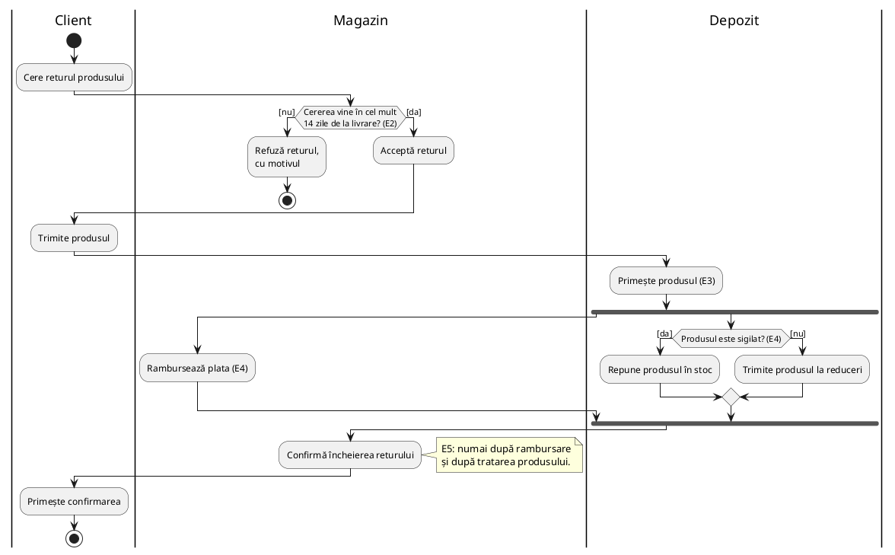
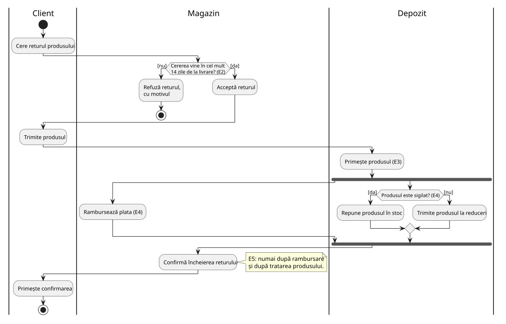

# Diagrama de activitate (UML) — specificație pentru atelier

Această pagină descrie diagrama pe care o desenăm în atelierul [Laboratorului 1](../01-specificare.md), pentru [programarea mașinilor de spălat](../scenarios/01-specificare/scenario.md). O puteți folosi și pentru orice alt flux: o primiți împreună cu enunțul problemei și desenați diagrama pe hârtie, într-o notație text sau cu un asistent AI, verificând rezultatul. Diagrama nu se predă și nu se notează. În proiectul de echipă vă alegeți singuri reprezentările.

## La ce întrebări răspunde

O diagramă de activitate arată **fluxul** unei activități: pașii, ordinea lor, cine îi face și unde se ramifică drumul. Răspunde la întrebări ca:

- Ce pași parcurge o cerere, de la trimitere până la răspuns, și în ce ordine?
- Cine face fiecare pas: utilizatorul, sistemul, o persoană sau o componentă externă?
- Unde se desparte fluxul și după ce condiție? Ce rezultate posibile are?
- Ce pași se desfășoară în paralel și unde se așteaptă unii pe alții?

Nu răspunde la alte întrebări: ce concepte există și cum sunt legate (modelul domeniului), ce stări are un obiect (diagrama de stări din cursul 2 arăta stările unui exemplar), ce conține un mesaj sau cât durează un pas. O casetă „Confirmată” este o stare, nu o acțiune; într-o diagramă de activitate scriem „Confirmă programarea”.

## Elementele folosite

Folosim un subset al diagramei de activitate UML. Ultima coloană arată scrierea în PlantUML (vezi mai jos).

| Element | Desen | Sens | PlantUML |
|---|---|---|---|
| Nod inițial | cerc plin | Începutul fluxului; există unul singur. | `start` |
| Acțiune | dreptunghi cu colțuri rotunjite | Un pas făcut de un singur participant, scris ca verb și obiect: „Rambursează plata”. | `:Rambursează plata;` |
| Flux de control | săgeată | Ordinea pașilor: acțiunea următoare începe după ce s-a încheiat cea anterioară. | ordinea rândurilor |
| Decizie | romb cu o intrare și mai multe ieșiri | Fluxul continuă pe **exact una** dintre ieșiri. | `if (...) then ... else ... endif` |
| Condiție | text între paranteze drepte, pe o ieșire a deciziei | Când se alege acea ieșire. Condițiile aceleiași decizii se exclud și acoperă împreună toate cazurile. | `then ([da])`, `else ([nu])` |
| Îmbinare | romb cu mai multe intrări și o ieșire | Reunește ramurile unei decizii; fluxul continuă pe oricare a sosit, fără să aștepte. | apare automat la `endif` |
| Bifurcare | bară groasă cu o intrare și mai multe ieșiri | Pornește ramuri care se desfășoară **toate**, în paralel. | `fork` și `fork again` |
| Reunire | bară groasă cu mai multe intrări și o ieșire | Fluxul continuă numai după ce **toate** ramurile paralele s-au încheiat. | `end fork` |
| Nod final de activitate | cerc plin într-un cerc | Se încheie întreaga activitate. | `stop` |
| Nod final de flux | cerc cu X | Se încheie numai ramura care ajunge aici; celelalte continuă. | `end` |
| Culoar | coloană cu numele participantului | Participantul care face acțiunile din coloană. | `\|Depozit\|` |
| Notă | dreptunghi cu colțul îndoit | Regula care justifică un element, o ipoteză sau o întrebare deschisă. | `note right ... end note` |

**Decizie sau bifurcare?** La o decizie se alege un singur drum (returul este acceptat *sau* refuzat). La o bifurcare se parcurg toate drumurile (magazinul rambursează plata *și* depozitul tratează produsul). La fel, îmbinarea nu așteaptă, iar reunirea așteaptă toate ramurile.

**Întrebarea din romb.** În UML rombul deciziei rămâne gol, iar condițiile stau pe ieșiri. PlantUML scrie o întrebare în romb („Produsul este sigilat?”) și condițiile pe ieșiri; acceptăm ambele forme, dar condițiile pe ieșiri sunt obligatorii.

Rămân în afara subsetului: nodurile de obiect și fluxurile de obiecte, semnalele trimise și primite, regiunile întreruptibile, partițiile pe două dimensiuni. Dacă un flux pare să ceară așa ceva, descrieți faptul într-o notă.

## Notația text

### PlantUML (notația recomandată)

Folosim [PlantUML](https://plantuml.com/activity-diagram-beta) pentru că desenează elementele UML ale diagramei de activitate, inclusiv culoarele, bifurcarea și nodul final de flux. Mermaid nu are un tip de diagramă de activitate (vezi aproximarea de mai jos).

Reguli de scriere:

- Diagrama stă între `@startuml` și `@enduml`.
- O acțiune începe cu `:` și se termină cu `;`. Textul ei nu poate conține `;` (folosiți virgula). Poate continua pe rândul următor.
- Un culoar se deschide cu `|Nume|`; acțiunile următoare intră în el până la alt culoar.
- `if (Întrebare?) then ([condiție]) ... else ([altă condiție]) ... endif`; pentru mai multe ieșiri, `elseif (...) then ([...])`.
- `note right` (sau `note left`), textul pe rândurile următoare, apoi `end note`; nota se leagă de elementul scris imediat înainte.

Cum vedeți desenul:

- **În browser, fără instalare:** lipiți textul în [serverul online PlantUML](https://www.plantuml.com/plantuml/uml/) sau în [editorul PlantUML](https://editor.plantuml.com/). Textul diagramei ajunge astfel pe un server public; pentru exercițiile de laborator nu este o problemă.
- **În editor:** extensia PlantUML pentru Visual Studio Code afișează diagrama lângă text (folosește Java local sau serverul online, după configurare).
- **Local:** cu Java instalat, `java -jar plantuml.jar diagrama.puml` produce `diagrama.png`; `-tsvg` produce SVG. Diagramele de activitate nu au nevoie de Graphviz.
- **Pe GitHub și GitLab** blocurile `plantuml` din Markdown nu sunt desenate: apar ca text. Într-un repository, păstrați textul și imaginea generată din el, una lângă alta, ca în exemplul de mai jos.

### Mermaid (aproximare)

Mermaid se desenează direct în Markdown pe GitHub, dar nu are diagramă de activitate. Un `flowchart` o aproximează: puteți lucra în Mermaid dacă respectați corespondența de mai jos și știți ce se pierde.

| Element UML | În Mermaid `flowchart` | Ce se pierde |
|---|---|---|
| Nod inițial | `start(( ))`, colorat negru cu `classDef` | — |
| Acțiune | `a["Magazin: rambursează plata"]` | colțurile rotunjite |
| Decizie și îmbinare | `d{"Produsul este sigilat?"}`, respectiv `m{ }` | — |
| Condiție | eticheta săgeții: `d -->\|"[da]"\| a` | — |
| Bifurcare și reunire | un nod mic colorat negru: `f[" "]` | forma de bară; diferența față de o acțiune se vede doar din culoare |
| Nod final | `fin((( )))` | nodul final de flux nu are un simbol propriu |
| Culoar | numele participantului la începutul acțiunii („Depozit: …”) | coloanele; `subgraph` grupează nodurile, dar amestecă așezarea săgeților |
| Notă | un nod separat legat prin săgeată punctată: `n["E5: …"] -.- a` | forma de notă |

## Lista de verificare

Fiecare punct se verifică punând diagrama lângă enunț. Pentru fiecare problemă găsită, numiți punctul și regula din enunț.

1. Există exact un nod inițial, iar fiecare drum ajunge la un nod final; niciun drum nu se oprește într-o acțiune.
2. Fiecare acțiune este un pas din enunț, scris ca verb și obiect, făcut de un singur participant.
3. Culoarele corespund participanților din enunț, iar fiecare acțiune stă în culoarul celui care o face după enunț.
4. Fiecare ieșire a unei decizii are o condiție; condițiile aceleiași decizii se exclud și acoperă împreună toate cazurile.
5. Fiecare condiție și fiecare acțiune se sprijină pe o regulă din enunț, pe care o puteți numi. Nu apar verificări, pași sau rezultate pe care enunțul nu le conține.
6. Fiecare regulă a enunțului care privește fluxul desenat apare ca decizie, acțiune sau notă.
7. Rezultatele promise de enunț (confirmări, coduri, mesaje, motive ale refuzului) apar pe ramurile la care se produc.
8. Ramurile alternative se reunesc prin îmbinare. Bifurcarea și reunirea apar numai pentru pași care se desfășoară efectiv în paralel, iar după ele fluxul continuă abia când toate ramurile s-au încheiat.
9. Întrebările deschise ale enunțului apar ca note, nu ca decizii deja luate; ce exclude enunțul nu apare.
10. Fiecare scenariu din enunț poate fi urmărit pe un drum al diagramei și ajunge la rezultatul așteptat.

## Erori frecvente

- O decizie fără condiții, cu o singură condiție sau cu condiții care se suprapun („[liber]” și „[disponibil]”).
- O ramură care se oprește într-o acțiune, fără nod final.
- Bifurcare folosită pentru o alegere: ar însemna că ambele ramuri se execută.
- Îmbinare după ramuri paralele, unde trebuia o reunire: fluxul ar continua înainte ca toate ramurile să se încheie.
- Toate acțiunile într-un singur culoar sau o acțiune a sistemului în culoarul utilizatorului.
- O verificare rezonabilă, dar neconvenită (o limită de durată, o prioritate), adăugată ca decizie.
- O întrebare deschisă desenată ca decizie, cu un rezultat ales de autor.
- Casete care numesc stări („Confirmată”) în loc de acțiuni („Confirmă programarea”).
- Acțiuni de implementare („Interoghează baza de date”, „Apelează API-ul”) sau prea vagi („Procesează cererea”), care ascund regula verificată.
- O diagramă care se desenează fără erori și arată îngrijit, dar nu a fost comparată cu enunțul.

## Exemplu lucrat: returul unui produs cumpărat online

Exemplu didactic, din alt domeniu decât laboratoarele și cursurile.

**Enunțul exemplului.**

- **E1 (cererea):** clientul cere returul unui produs livrat.
- **E2 (termenul):** magazinul acceptă returul numai dacă cererea vine în cel mult 14 zile de la livrare; altfel îl refuză și îi spune clientului motivul.
- **E3 (primirea):** după acceptare, clientul trimite produsul, iar depozitul îl primește.
- **E4 (tratarea):** după primire, magazinul rambursează plata; în același timp, depozitul repune în stoc un produs sigilat și trimite la reduceri unul desigilat.
- **E5 (confirmarea):** magazinul confirmă încheierea returului numai după ce rambursarea și tratarea produsului s-au încheiat amândouă.
- **Întrebare deschisă:** ce se întâmplă dacă produsul nu ajunge la depozit? Magazinul nu a decis.

**Diagrama în PlantUML.**





[Deschideți exemplul în serverul online PlantUML](https://www.plantuml.com/plantuml/uml/NL8nJiD04Epl5Ll64a82GcCN0OMKI16YGnJ7UPsiE9-jysqAonslo2Vu11Hv5diN9uveB7btPtPczXwwe7tWsgfXQGbT65Igg7o97i5ZOCyMMj-KtB5bAjJmh3Uw9pSegc0Mnpngs953-FbsOD12pJQecpdqP15A1Al1qivhZmkOhMwp3C8M7SpU7Bzd2Y1_mOhxtw_JlYkf6OQw2RHZMyXV5vfMeUrGGAK-WXwDmJPCg4AXAwcQdEIldceAU9Oluf-mRNgApRKqyR2_Q8kskwnGLUC_XN_o6GNg-eDzXpggRAqEMeRdup388Ba8ERC3n73M9sBiP4r76nBa8Y7F4OnkKWWjkmirCKtnRQB_qVgObmp_jnOpzbYoGKy9aAAGBoGxavbysRYAV2q-P87P8gNxZHd60xj6U3rjja5uLlSvEAurGSbjpFeOX9nIceVzgHoyH19vffTodRP7iekBJA6Reum8AbGwxuFCnvVu1m00) pentru a-l modifica.

**Verificarea exemplului**, cu lista de mai sus:

- Punctele 1–3: un nod inițial; drumul returului refuzat se încheie cu `stop`, celălalt la primirea confirmării. Trei culoare, câte unul pentru fiecare participant din E1–E5; rambursarea stă la magazin, tratarea produsului la depozit, cum spune E4.
- Punctul 4: ambele decizii au `[da]` și `[nu]`, care se exclud.
- Punctele 5–6: decizia termenului vine din E2, cea a sigiliului din E4; E5 apare ca notă și, mai ales, ca reunire. Nu am adăugat, de exemplu, o decizie „Produsul este deteriorat?”, pe care enunțul nu o conține.
- Punctul 7: refuzul are motivul (E2); clientul primește confirmarea (E5).
- Punctul 8: rambursarea și tratarea produsului sunt o bifurcare, pentru că E4 spune „în același timp”; reunirea așteaptă ambele ramuri, cum cere E5. În ramura depozitului, decizia despre sigiliu se închide cu o îmbinare.
- Punctul 9: întrebarea despre produsul care nu ajunge la depozit nu apare ca decizie. Dacă vrem să o arătăm, o scriem ca notă, nu ca ramură cu un rezultat ales de noi.
- Punctul 10: un client care cere returul în a cincea zi pentru un produs sigilat parcurge `[da]` la termen, apoi `[da]` la sigiliu, și primește confirmarea după ce s-au încheiat rambursarea și repunerea în stoc.

**Același exemplu în Mermaid**, cu aproximările din tabelul de mai sus:

```mermaid
flowchart TB
    start(( )) --> cere["Client: cere returul produsului"]
    cere --> dTermen{"Cererea vine în cel mult<br>14 zile de la livrare? (E2)"}
    dTermen -->|"[nu]"| refuz["Magazin: refuză returul,<br>cu motivul"] --> final1((( )))
    dTermen -->|"[da]"| accepta["Magazin: acceptă returul"]
    accepta --> trimite["Client: trimite produsul"] --> primeste["Depozit: primește produsul (E3)"]
    primeste --> fork[" "]
    fork --> ramburseaza["Magazin: rambursează plata (E4)"] --> join[" "]
    fork --> dSigilat{"Produsul este<br>sigilat? (E4)"}
    dSigilat -->|"[da]"| stoc["Depozit: repune produsul în stoc"] --> merge{ }
    dSigilat -->|"[nu]"| reduceri["Depozit: trimite produsul la reduceri"] --> merge
    merge --> join
    join --> confirma["Magazin: confirmă încheierea returului"] --> confirmare["Client: primește confirmarea"] --> final2((( )))
    nota["E5: numai după rambursare<br>și după tratarea produsului."] -.- confirma
    classDef nod fill:#000,stroke:#000
    class start,fork,join nod
```



## Cu un asistent AI

Puteți genera diagrama cu orice asistent AI. Dați-i enunțul integral și această specificație, nu doar sarcina; altfel completează singur regulile care lipsesc. Un prompt posibil:

```text
Primești două documente: (1) enunțul unei probleme și (2) specificația
unei diagrame de activitate UML. Desenează în PlantUML diagrama de
activitate pentru [fluxul cerut, de exemplu: o cerere de programare,
de la trimitere până la confirmare sau respingere].

- Folosește numai elementele din specificație.
- Pune fiecare acțiune în culoarul participantului care o face.
- Scrie o condiție pe fiecare ieșire a fiecărei decizii.
- Nu adăuga reguli, verificări sau pași care nu apar în enunț.
  Întrebările deschise ale enunțului apar ca note, nu ca decizii.

După diagramă, listează fiecare decizie și fiecare notă împreună cu
regula din enunț pe care se sprijină.

=== (1) Enunțul ===
[lipiți enunțul integral]

=== (2) Specificația ===
[lipiți această specificație]
```

**Cum verificați rezultatul.** Răspunsul AI este o propunere, iar diagrama finală vă aparține.

1. Desenați diagrama. Faptul că se desenează fără erori arată doar că sintaxa este corectă: nu spune nimic despre reguli.
2. Luați lista de verificare punct cu punct, cu enunțul deschis alături. Pentru fiecare decizie, citiți regula indicată de asistent în enunț și verificați că spune exact asta; o regulă citată poate fi folosită greșit.
3. Căutați adăugirile: orice decizie, acțiune sau rezultat fără o regulă în enunț se elimină sau devine o întrebare deschisă, scrisă ca notă.
4. Căutați omisiunile: fiecare regulă a enunțului care privește fluxul trebuie să apară undeva.
5. Urmăriți scenariile enunțului pe diagramă, unul câte unul.
6. Corectați direct textul diagramei sau cereți o corectură precisă („condiția deciziei X nu vine din enunț; elimin-o”). Nu este nevoie să treacă fiecare corectură printr-un nou prompt.
