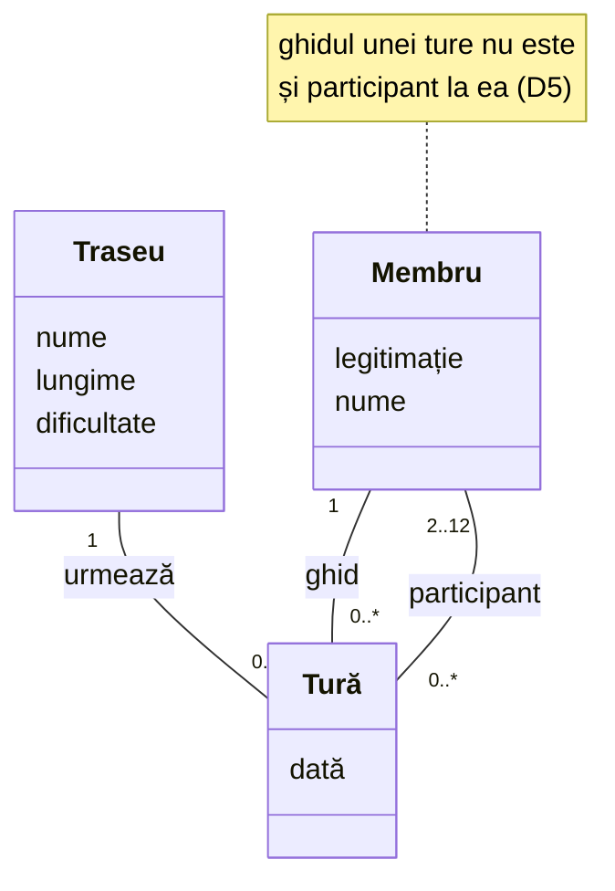
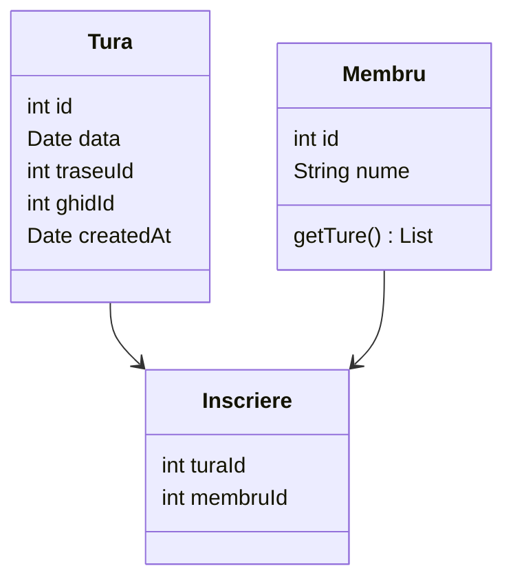

# Diagrama de clase conceptuală

Specificație pentru etapa diagramei din [Laboratorul 2](../02-modelare.md). O folosiți împreună cu enunțul problemei: enunțul spune ce este adevărat în domeniu, specificația spune cum desenăm și cum verificăm diagrama. Puteți desena de mână, scrie diagrama în Mermaid sau o puteți genera cu un asistent AI și apoi verifica. Nu se predă și nu se notează.

O diagramă de clase **conceptuală** descrie domeniul, nu o aplicație: conceptele, valorile pe care le păstrăm despre ele și relațiile dintre ele. Nu conține operații, tipuri de date, identificatori tehnici, chei străine sau tabele. Aceeași notație UML servește mai târziu și proiectării claselor unui program; aici o folosim numai pentru model.

## La ce întrebări răspunde

- Ce **concepte** distingem în domeniu? Ce lucru are identitate proprie, chiar dacă alt lucru îi seamănă?
- Ce valori păstrăm despre fiecare concept (**atribute**)?
- Ce **relații** există între concepte și cum se citesc ele ca propoziții?
- Câte **asocieri** permite fiecare relație, la fiecare capăt (**cardinalitatea**)?
- Ce stări poate exprima modelul și ce stări exclude?

Diagrama nu răspunde la întrebări precum „cine modifică datele?”, „în ce ordine se întâmplă pașii?” sau „cum se stochează?”. Pentru operații folosim [diagrama de clase cu operații](clase-operatii.md) (Laboratorul 3).

## Elementele folosite

Folosim un subset mic din diagrama de clase UML. Vocabularul este cel al cursului 4: o **relație** spune ce fel de concepte se pot asocia („o vizită privește un aparat”), iar o **asociere** este o instanță a ei („J1 privește A17”). În UML, linia dintre două clase se numește *association*, iar instanța ei *link*; în materialele cursului spunem „relație” și „asociere”.

| Element | Desen UML | Ce înseamnă |
|---|---|---|
| **Clasă** | dreptunghi cu numele conceptului | Un concept al domeniului: o categorie de lucruri cu identitate proprie (Aparat, Vizită). Fiecare lucru concret (A17) este o instanță. Numele este un substantiv la singular, din vocabularul enunțului. |
| **Atribut** | un nume în a doua secțiune a dreptunghiului | O valoare păstrată despre fiecare instanță (data vizitei, textul unei probleme). Un atribut nu are identitate proprie și nu numește alt concept. |
| **Identificator al domeniului** | un atribut, de exemplu `cod` | Numai dacă enunțul îl numește (un cod atribuit de atelier, un număr de legitimație). Fiecare instanță are oricum identitate în model; nu adăugăm un `id` pe care domeniul nu îl folosește. |
| **Relație** | linie între două clase, cu un nume | Un tip de asocieri posibile între instanțe ale celor două concepte. Numele se citește ca propoziție: „Vizită *privește* Aparat”. |
| **Cardinalitate** (UML: *multiplicity*) | `1`, `0..1`, `0..*`, `1..*`, `2..12` la capetele liniei | Numărul permis de asocieri. Valoarea de **lângă clasa B** spune câte instanțe ale lui B pot fi asociate cu **o** instanță a clasei de la celălalt capăt. |
| **Nume de rol** | un cuvânt la capătul liniei | Ce rol are clasa de la acel capăt în relație („responsabil”, „ghid”). Obligatoriu când două relații leagă aceleași clase. |
| **Generalizare** | linie cu triunghi gol spre clasa generală | „Orice X este un Y”: X are atributele și relațiile lui Y, plus ale sale. O folosim numai când enunțul o spune. |
| **Notă** | dreptunghi cu colț îndoit, legat de o clasă | O restricție pe care cardinalitatea nu o poate exprima („sursa aparține aceleiași fotografii”) sau o precizare de sens („problemă raportată, nu diagnostic”). |

**Nu folosim** în diagrama conceptuală: operații, tipuri de date (`String`, `int`, `Date`), vizibilitate (`+`, `-`), săgeți de navigare, agregare și compoziție, clase de asociere, chei străine, tabele intermediare. Apartenența („o problemă aparține exact unei vizite”) se exprimă prin cardinalitatea `1`, nu printr-un simbol special.

**Cum citim cardinalitatea.** Pentru linia `Aparat 1 —— 0..* Vizită`: „un aparat are zero sau mai multe vizite” (citim numărul de lângă Vizită) și „o vizită privește exact un aparat” (citim numărul de lângă Aparat). Fiecare capăt are o valoare, și fiecare valoare trebuie să poată fi justificată din enunț.

**Atribut sau relație?** Dacă valoarea este un lucru cu identitate proprie, care poate apărea de mai multe ori, se poate repeta cu același text sau are propriile relații, o modelăm ca o clasă legată printr-o relație. Dacă este o simplă valoare (o dată, un text, o lungime), rămâne atribut. Un atribut care numește alt concept (`aparat` în Vizită, `responsabil: Mara`) ascunde o relație.

## Notația Mermaid

Diagrama se poate scrie în [Mermaid](https://mermaid.js.org/syntax/classDiagram.html), într-un bloc de cod cu eticheta `mermaid`; GitHub îl afișează ca diagramă. Elementele de mai sus se scriu astfel:

| Element | Mermaid |
|---|---|
| Clasă cu atribute | `class Aparat {` pe un rând, câte un atribut pe rând (`cod`, `model`), apoi `}` |
| Nume cu diacritice sau spații | `class Problema["Problemă raportată"]`: în relații folosiți numele scurt `Problema`, pe diagramă apare eticheta |
| Relație cu cardinalități și nume | `Aparat "1" -- "0..*" Vizita : privește` |
| Nume de rol | `Vizita "0..*" -- "0..1" Voluntar : responsabil` (vezi limitele) |
| Generalizare | `Persoana <\|-- Student` (clasa generală în stânga, triunghiul spre ea) |
| Notă | `note for Problema "descrie ce s-a observat<br>nu un diagnostic"` |
| Orientare | `direction TB` (de sus în jos) sau `direction LR` (de la stânga la dreapta) |

Limitele cunoscute ale notației (verificate cu Mermaid 12, la 19 noiembrie 2026; GitHub poate folosi altă versiune):

- **Un singur nume pe relație.** Mermaid scrie eticheta de după `:` la mijlocul liniei; nu are nume de rol separate la fiecare capăt. Scrieți rolul ca etichetă și alegeți-l astfel încât să fie clar la ce capăt se referă („responsabil” este rolul voluntarului). Nu puneți rolul în șirul cardinalității (`"0..1 responsabil"`): textul este trunchiat la desenare.
- **Cardinalitățile sunt scrise mărunt** și se pot suprapune când două relații leagă aceleași clase. Verificați-le în textul sursă, nu doar pe desen; schimbarea orientării (`direction LR`) ajută uneori.
- **Secțiunea operațiilor apare goală.** Mermaid desenează mereu trei secțiuni; în diagrama conceptuală a treia rămâne goală. Nu o completați.
- **Notele se leagă numai de o clasă**, nu de o relație. Pentru o restricție a unei relații, legați nota de una dintre clase și numiți relația în text. Rândurile noi din notă se scriu cu `<br>`; `\n` apare ca text în versiunile recente.
- **Nume de clase:** identificatorul din sursă (`Vizita`) nu acceptă spații; eticheta dintre `["…"]` acceptă diacritice și spații.
- **Linia `--` nu are săgeată.** Săgețile `-->` sugerează navigarea dintr-un program; nu le folosim în modelul conceptual.
- **Poziția cutiilor o alege Mermaid.** O diagramă desenată fără erori arată doar că sintaxa este corectă, nu că modelul respectă enunțul.

## Lista de verificare

Fiecare punct se verifică față de enunț: pentru un „da”, puteți arăta fraza din enunț care îl susține.

1. **Concepte:** fiecare clasă corespunde unui concept numit în enunț sau cerut de o regulă; nicio clasă nu provine din ce enunțul exclude (limitele lui).
2. **Identitate:** lucrurile pe care enunțul le distinge (două aparate cu același model, două probleme cu același text) sunt instanțe distincte ale unei clase, nu valori ale unui atribut.
3. **Atribute:** fiecare atribut este o valoare pe care enunțul o descrie pentru acel concept; identificatorii apar numai dacă enunțul îi numește.
4. **Atribut sau relație:** niciun atribut nu numește alt concept (cheie străină, nume al altei instanțe, listă de alte instanțe); apare o relație.
5. **Relații:** fiecare relație are un nume care se citește ca propoziție adevărată în domeniu; când două relații leagă aceleași clase, fiecare are rolul ei.
6. **Locul relației:** fiecare relație leagă conceptele indicate de enunț (de exemplu, o informație care ține de o vizită nu este legată de aparat).
7. **Cardinalități:** fiecare relație are cardinalitate la **ambele** capete, iar fiecare valoare este susținută de o frază („exact un”, „cel puțin una”, „poate să nu aibă încă”, „mai multe”). Nicio limită nu este inventată sau omisă.
8. **Generalizare:** apare numai unde enunțul spune că orice X este un Y; un rol într-o relație (ghid, responsabil) nu devine subclasă.
9. **Stări-exemplu:** stările din enunț și cazurile-limită permise (o instanță fără asocieri, numărul maxim de asocieri, texte egale) pot fi desenate ca instanțe pe diagramă; stările excluse de reguli nu pot.
10. **Fără implementare:** diagrama nu conține operații, tipuri de date, vizibilitate, identificatori tehnici, chei străine, momente tehnice de creare sau modificare, tabele intermediare.

## Erori frecvente

- **Derivă spre implementare.** `id` pe fiecare clasă, `aparatId` în Vizită (cheie străină), `createdAt`/`updatedAt`, tipuri `String`/`int`, o clasă `VizitaVoluntar` (tabel intermediar), un atribut `probleme: List<Problema>`, operații `getX()`/`setX()`. Toate sunt decizii despre program sau stocare. Relația, cu cardinalitatea ei, spune deja ce leagă o cheie străină.
- **Atribut în loc de relație.** `problema` ca text în Vizită sau `responsabil` ca nume în Aparat: pierde identitatea problemelor cu același text sau istoricul responsabililor.
- **Relația la conceptul greșit.** Responsabilul legat de aparat în loc de vizită: la o nouă vizită, responsabilul vizitei vechi s-ar suprascrie.
- **Cardinalitate lipsă, inversată sau inventată.** O singură valoare pe linie; `1` lângă clasa greșită (citire inversă); `1..*` unde enunțul permite zero; o limită superioară pe care nu o cere nimeni.
- **„Ultimul X” în loc de istoric.** Un atribut `ultimaVizită` sau `problemaCurentă` păstrează numai ultima valoare, deși enunțul cere toate.
- **Clase pentru actori, ecrane sau sistem.** `Organizator`, `Formular`, `Sistem`, `BazăDeDate`: nu sunt concepte ale cărora date le modelăm, decât dacă enunțul le dă atribute și relații.
- **Generalizare din asemănare.** `Ghid` ca subclasă a lui `Membru`, deși ghidul este doar un rol al unui membru într-o anumită tură.
- **Încredere în desen.** Mermaid desenează la fel de curat o cardinalitate greșită și una corectă.

## Exemplu rezolvat: un club de drumeții

Exemplu didactic, din alt domeniu decât problemele laboratoarelor și cursurilor.

**Enunț.**

- **D1 — Membru:** fiecare membru are un număr de legitimație atribuit de club și un nume; doi membri pot avea același nume.
- **D2 — Traseu:** fiecare traseu are un nume unic, o lungime în kilometri și un grad de dificultate (ușor, mediu, dificil).
- **D3 — Tură:** clubul organizează ture; fiecare tură are o dată și urmează exact un traseu. Un traseu poate fi parcurs în mai multe ture sau încă în niciuna.
- **D4 — Ghid:** fiecare tură are exact un ghid, care este membru al clubului. Un membru poate ghida mai multe ture.
- **D5 — Participanți:** la o tură participă cel puțin 2 și cel mult 12 membri, fără ghid. Un membru poate participa la oricâte ture.
- **D6 — Limite:** plățile, echipamentul, transportul și înscrierea online sunt excluse.

**Diagrama.**



**Verificarea pe listă.**

1. Concepte: Membru (D1), Traseu (D2), Tură (D3). Plățile, echipamentul și transportul lipsesc (D6).
2. Identitate: doi membri cu același nume rămân instanțe distincte; legitimația îi deosebește (D1).
3. Atribute: legitimație și nume (D1); nume, lungime, dificultate (D2); dată (D3). Legitimația este un identificator al domeniului, numit de enunț.
4. Atribut sau relație: tura nu are atribute `traseu` sau `ghid`; ambele sunt relații.
5. Relații: „Tura urmează Traseul”, „Membrul este ghidul turei”, „Membrul este participant la tură”. Două relații leagă Tură și Membru, deci fiecare are rolul ei.
6. Locul relației: ghidul ține de tură, nu de traseu: același traseu poate avea alt ghid la altă tură (D3–D4).
7. Cardinalități: tură → traseu `1`, traseu → ture `0..*` (D3); tură → ghid `1`, membru → ture ghidate `0..*` (D4); tură → participanți `2..12`, membru → ture `0..*` (D5).
8. Generalizare: niciuna. „Ghid” este un rol într-o relație, nu un tip de membru: același membru poate ghida o tură și participa la alta.
9. Stări-exemplu: un traseu nou fără ture; o tură cu 12 participanți; doi membri cu același nume. O tură cu 13 participanți sau fără ghid nu se poate desena fără a încălca o cardinalitate. Restricția „ghidul nu este participant la aceeași tură” nu este o cardinalitate, de aceea apare ca notă.
10. Fără implementare: nicio operație, niciun tip, nicio cheie străină.

**Contraexemplu: aceeași problemă, derivată spre implementare.** Diagrama următoare se desenează fără erori, dar nu este un model conceptual: `id`-urile și `createdAt` nu apar în enunț, `traseuId` și `ghidId` sunt chei străine care ascund relațiile, `Inscriere` este un tabel intermediar, iar cardinalitatea 2..12 a dispărut.



## Un prompt sugerat pentru un asistent AI

Dacă alegeți să generați diagrama, dați asistentului AI enunțul **complet** și această specificație, nu un rezumat:

```text
Ești analist (asistent AI). Mai jos ai enunțul unei probleme și specificația
unei diagrame de clase conceptuale. Scrie diagrama în Mermaid (classDiagram),
respectând specificația: concepte, atribute, relații cu nume și cardinalități
la ambele capete, generalizare numai dacă enunțul o cere; fără operații,
tipuri de date, identificatori tehnici, chei străine sau tabele.
După diagramă, pentru fiecare clasă, atribut, relație și cardinalitate, citează
fraza din enunț care o susține. Listează separat tot ce ai presupus fără
sprijin în enunț. Nu adăuga concepte din limitele enunțului.

ENUNȚ:
<lipiți aici enunțul complet>

SPECIFICAȚIE:
<lipiți aici această specificație>
```

## Cum verificăm răspunsul AI

- **O diagramă desenată fără erori nu garantează nimic** despre corectitudine: arată numai că sintaxa Mermaid este validă.
- Parcurgeți lista de verificare punct cu punct **față de enunț**, nu față de explicațiile răspunsului. Pentru fiecare citat dat de asistentul AI, căutați fraza în enunț și verificați că spune ce i se atribuie.
- Citiți lista de presupuneri: fiecare presupunere este o decizie luată în locul vostru. Păstrați-o numai dacă o puteți justifica sau o marcați ca întrebare pentru beneficiar.
- Desenați stările-exemplu din enunț pe diagramă (punctul 9): un exemplu pe care diagrama nu îl poate exprima arată o cardinalitate sau o relație greșită.
- Căutați derivele spre implementare (punctul 10): un singur `id` sau o cheie străină arată că răspunsul descrie o bază de date, nu domeniul.
- Corectați direct diagrama; nu este nevoie de un nou prompt pentru fiecare corecție. Dacă cereți o revizuire unui evaluator (agent AI de revizuire), dați-i într-un context nou enunțul, specificația și diagrama, și verificați și observațiile lui pe enunț.
