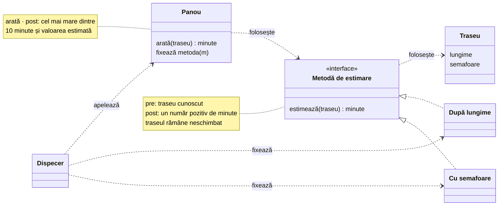

# Diagrama de clase cu interfață

Specificație pentru atelierul de diagrame din [Laboratorul 5](../05-validare.md), după cursurile 9–10. Diagrama arată cum separăm ce variază de ce rămâne: o **interfață**, **realizările** ei și componenta care o folosește. Pornește de la [diagrama de clase cu operații](clase-operatii.md) (Laboratorul 3) și adaugă numai ce este necesar pentru interfețe.

Puteți desena diagrama de mână, o puteți scrie în Mermaid sau o puteți genera cu un asistent AI și revizui. În toate cazurile, o verificați cu [lista de verificare](#lista-de-verificare), punct cu punct, față de enunț. Nu se predă și nu se notează.

## La ce întrebări răspunde

- Ce **variază** și în spatele cărei interfețe stă? Ce realizări are interfața acum?
- Cine **folosește** interfața și cine **fixează** realizarea?
- Ce **trece prin interfață**: ce primește și ce întoarce fiecare operație a ei?
- Unde stă **regula stabilă**, cea care trebuie respectată oricare ar fi realizarea? Ce poate și ce nu poate încălca o realizare?

**Ce nu arată:** ordinea apelurilor, algoritmul din interiorul unei realizări, stările modelului. Nu arată nici dacă variația este confirmată: aceasta se citește din enunț.

## Elementele folosite

Elementele diagramei de clase cu operații (clasă, atribut, operație, relație cu cardinalitate, dependență, notă cu contract) își păstrează sensul. Se adaugă:

| Element | Desen UML | Ce înseamnă |
|---|---|---|
| **Interfață** | dreptunghi cu «interface» deasupra numelui | Ce operații oferă orice realizare a ei, cu intrări, rezultate și sensul lor. Nu are atribute. |
| **Realizare** | săgeată punctată cu vârf triunghiular gol, de la clasă la interfață | Clasa oferă toate operațiile interfeței și respectă contractul ei. Operațiile interfeței nu se mai repetă în realizare. |
| **Folosirea interfeței** | săgeată punctată deschisă, cu eticheta „folosește” | Componenta cunoaște numai interfața, nu realizările. |
| **Fixarea realizării** | săgeată punctată deschisă, cu eticheta „fixează”, spre realizări | Componenta care hotărăște ce realizare se folosește. Cineva trebuie să le cunoască; diagrama arată cine. Componenta comună oferă operația prin care primește realizarea fixată. |
| **Contractul interfeței** | notă legată de interfață, cu `pre:` și `post:` | Ce garantează orice realizare, indiferent de algoritm. |

**Nu folosim:** clase abstracte, moștenire între realizări, o interfață pentru fiecare clasă, fabrici și injectare de dependențe, tipuri ale unui limbaj. Dacă enunțul nu dă o variație, nu desenăm o interfață.

## Notația Mermaid

| Element | Mermaid |
|---|---|
| Interfață | în blocul clasei, primul rând: `<<interface>>` |
| Nume cu spații sau diacritice | `class Sosire["În ordinea sosirii"]` |
| Realizare | `Interfata <\|.. Realizare` |
| Folosire, fixare | `Componenta ..> Interfata : folosește` |
| Contract | `note for Interfata "pre: …<br>post: …"` |

Limitele Mermaid pe care trebuie să le știți:

- Eticheta `class X["…"]` se scrie o singură dată; în relații se folosește identificatorul X.
- Mermaid nu verifică dacă o realizare oferă operațiile interfeței și nici dacă săgeata de realizare are sensul corect: `Interfata <|.. Realizare` și `Realizare ..|> Interfata` înseamnă același lucru; `Realizare <|.. Interfata` se randează la fel de curat și înseamnă invers.
- Rezultatul unei operații se scrie după paranteză, fără spații (`număr|refuz`).
- Unde două săgeți se încrucișează, unele versiuni Mermaid desenează continuu o săgeată punctată; sensul este cel din text.
- **O diagramă randată fără erori arată doar că sintaxa este corectă.**

## Lista de verificare

Fiecare punct se verifică față de enunț: pentru un „da”, arătați regula sau schimbarea care îl susține.

1. **Variația:** interfața corespunde unei variații din enunț; nu există interfețe pentru lucruri care nu variază.
2. **Realizările** sunt exact cele din enunț, fiecare cu săgeata ei de realizare spre interfață.
3. **Folosirea:** componenta comună depinde de interfață, nu de realizări. Este desenat cine fixează realizarea și prin ce operație ajunge la componenta comună.
4. **Ce trece prin interfață:** operațiile interfeței primesc numai ce le trebuie realizărilor pentru decizia lor și întorc un rezultat pe care apelantul îl poate verifica.
5. **Regula stabilă** stă într-un singur loc, în componenta comună; nicio realizare nu o repetă și nicio realizare nu o poate încălca.
6. **Contractul interfeței** este scris: ce presupune (`pre:`), ce garantează orice realizare (`post:`), inclusiv ce nu modifică.
7. **Datele** necesare regulii stabile sunt la componenta care o aplică sau la obiectele pe care le ține ea.
8. **Schimbările** din enunț: pentru fiecare, puteți arăta pe diagramă ce se adaugă și ce se modifică.

## Erori frecvente

- **Săgeata realizării inversată** sau desenată ca dependență obișnuită.
- **Componenta comună depinde și de realizări**, deci le cunoaște pe toate: interfața nu mai ascunde nimic.
- **Nimeni nu fixează realizarea**, sau alegerea este ascunsă în componenta comună printr-o condiție pe nume.
- **Regula stabilă copiată în fiecare realizare.** Merge până când apare una care o uită.
- **Prin interfață trece tot** (componenta întreagă, „ca să fie flexibil”): orice realizare poate modifica orice.
- **Interfață fără variație**, cu o singură realizare, pe care enunțul nu o cere.
- **Interfață cu atribute** sau cu operații de care are nevoie o singură realizare.
- **Încredere în desen:** o diagramă cu toate acestea se randează la fel de curat.

## Exemplu rezolvat: durata unei livrări pe bicicletă

Exemplu didactic, din alt domeniu decât problemele laboratoarelor și cursurilor.

**Enunț.**

- **E1 — context:** un panou afișează, pentru fiecare livrare cu bicicleta, durata estimată. Apelurile sunt secvențiale.
- **E2 — traseu:** un traseu are o lungime și un număr de semafoare.
- **E3 — estimare:** firma schimbă metoda de estimare de la un sezon la altul. Metodele de azi: „După lungime” și „Cu semafoare”.
- **E4 — afișare:** oricare ar fi metoda, durata afișată este de cel puțin 10 minute.
- **E5 — alegere:** dispecerul fixează metoda, prin `fixează metoda(m)`.

**Diagrama.**



**Verificarea pe listă.**

1. Variația: metoda de estimare (E3). Panoul și traseul nu variază.
2. Realizările: cele două din E3.
3. Folosirea: Panoul depinde numai de Metodă; dispecerul fixează metoda, prin operația panoului (E5).
4. Prin interfață trece traseul; rezultatul este un număr de minute, pe care panoul îl poate compara cu 10.
5. Regula stabilă (E4) este la Panou; o metodă care întoarce 3 nu o poate încălca.
6. Contractul este scris; orice metodă întoarce un număr pozitiv și nu modifică traseul.
7. Limita de 10 minute este la Panou, care o aplică.
8. O metodă nouă care folosește lungimea sau semafoarele: o realizare nouă, pe care o fixează dispecerul. O metodă care are nevoie de vreme: se schimbă ce trece prin interfață, deci și contractul ei.

**Contraexemplu: o diagramă care se randează fără erori, dar nu respectă enunțul.** Cu limita de 10 minute scrisă în nota fiecărei realizări, regula E4 este copiată: a treia metodă o poate uita. O săgeată „folosește” de la Panou la „După lungime” ar spune că panoul cunoaște metoda.

## Un prompt sugerat pentru un asistent AI

Dacă generați diagrama cu un asistent AI, dați-i enunțul integral și această specificație; nu îi dați o soluție:

```text
Ești analist (asistent AI). Mai jos sunt un enunț și o specificație pentru o diagramă
de clase cu interfață. Desenează diagrama în Mermaid (classDiagram), respectând
specificația: o interfață numai pentru variația din enunț, realizările ei, cine o
folosește, cine fixează realizarea, contractul interfeței ca notă. Pune regula stabilă
într-un singur loc, astfel încât nicio realizare să nu o poată încălca.
După diagramă, pentru fiecare punct al listei de verificare, citează regula din enunț
pe care te sprijini, apoi spune ce se modifică la fiecare schimbare din enunț.
Listează separat tot ce ai presupus. Nu scrie cod.

<enunțul integral>

<această specificație>
```

## Cum verificăm răspunsul asistentului AI

- **O randare curată nu arată că diagrama este corectă.** Luați lista punct cu punct, față de enunț.
- Începeți cu punctele 4 și 5: presupuneți că o realizare nouă este scrisă greșit. Ce poate strica, dat fiind ce primește?
- Căutați interfețele în plus. Pentru fiecare, cereți variația din enunț; dacă nu există, ștergeți interfața.
- Lista de verificare bifată de asistentul AI nu este verificată: pentru fiecare „da”, găsiți elementul în diagramă, nu în explicație, și căutați punctele care se contrazic între ele.
- „Am verificat că toate proprietățile sunt respectate” este o afirmație, nu un rezultat (cursul 9): cereți scenariul urmărit sau rularea.
- Dacă îi cereți o altă variantă, judecați după motive, nu după cât de repede este de acord cu voi (cursul 10).
- Corectați direct diagrama; nu este nevoie de un nou prompt pentru fiecare corectură.
