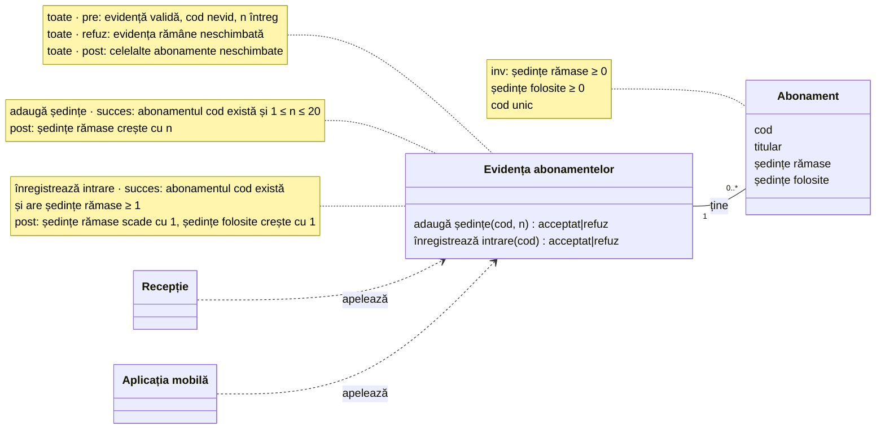

# Diagrama de clase cu operații și restricții

Specificație pentru etapa diagramei din [Laboratorul 3](../03-contracte.md). O folosiți împreună cu enunțul problemei: enunțul spune ce trebuie să garanteze operațiile, specificația spune cum desenăm și cum verificăm diagrama. Puteți desena de mână, scrie diagrama în Mermaid sau o puteți genera cu un asistent AI și apoi verifica. Nu se predă și nu se notează.

Diagrama pornește de la un model al domeniului, desenat ca în [diagrama de clase conceptuală](clase-conceptuale.md) (Laboratorul 2): clase, atribute, relații și cardinalități. Aici adăugăm **operațiile**, cu parametrii și rezultatele lor, puse la componenta care are **responsabilitatea** lor, și **restricțiile** scrise ca note: precondiții, condiția de succes, postcondiții (inclusiv la refuz) și invarianți, ca în cursurile 5–6. Diagrama nu este cod: nu cere un limbaj, tipuri de date complete sau o bază de date.

## La ce întrebări răspunde

- Ce **operații** oferă fiecare componentă celorlalte (**interfața** ei): ce primesc și ce întorc?
- Cine are **responsabilitatea** fiecărei modificări? Cine sunt **apelanții** și de cine **depind**?
- Ce presupune o operație despre apel (**precondiții**)? Când reușește (**condiția de succes**)?
- Ce garantează în fiecare caz (**postcondiții**): ce se modifică la succes, ce rămâne neschimbat, ce se întâmplă la **refuz**?
- Ce relații trebuie să fie adevărate în orice **stare validă** (**invarianți**)?

Diagrama nu arată ordinea apelurilor dintr-un scenariu și nici etapele unui ciclu de viață; pentru acestea există alte diagrame. Scenariile din enunț servesc la verificarea ei.

## Elementele folosite

Elementele diagramei conceptuale (clasă, atribut, relație, cardinalitate, nume de rol, generalizare, notă) își păstrează sensul. Se adaugă:

| Element | Desen UML | Ce înseamnă |
|---|---|---|
| **Clasă a soluției** | dreptunghi, ca o clasă conceptuală | O componentă cu responsabilități (un registru, o evidență) sau un **canal** prin care ajung cererile (formular, import). O clasă conceptuală poate deveni astfel de componentă. |
| **Operație** | `nume(parametri) rezultat`, în a treia secțiune | O operație pe care componenta o oferă apelanților. O scriem o singură dată, la componenta care are responsabilitatea ei. |
| **Parametru** | un nume între paranteze | O valoare primită de la apelant (`id`, `q`). Tipul se notează numai dacă enunțul îl precizează și contează pentru contract. |
| **Rezultat** | după paranteze | Valorile pe care operația le poate întoarce, toate: `acceptat\|refuz`. Un refuz promis de enunț este un rezultat, nu o eroare. |
| **Atribut derivat** | `/D` | O valoare calculată din altele; formula se scrie într-o notă (`D = F − R`). |
| **Dependență** | săgeată punctată, cu eticheta „apelează” | Un apelant folosește operațiile unei componente. Dependența arată că regula nu este copiată în apelant. |
| **Notă cu restricții** | dreptunghi cu colț îndoit, legat de clasă | Contractul unei operații sau invarianții. Fiecare rând începe cu un cuvânt-cheie: `pre:`, `succes:`, `post:`, `refuz:`, `inv:`. |

Cuvintele-cheie din note au sensul din cursul 6:

- **`pre:`** ce trebuie să fie adevărat la apel pentru ca operația să garanteze ceva (de exemplu, apeluri secvențiale, registru valid, identificator nevid). Nu trecem aici cazurile pentru care enunțul promite un refuz.
- **`succes:`** condiția de succes: dintre apelurile admise de precondiție, care reușesc. Se scrie întreagă, cu toate părțile ei.
- **`post:`** ce garantează operația la succes: valorile noi și ce rămâne neschimbat.
- **`refuz:`** ce garantează în celelalte cazuri: rezultatul `refuz` și ce rămâne neschimbat (de obicei, tot).
- **`inv:`** relații adevărate în orice stare validă, verificabile într-o singură stare; se cer înainte și după fiecare operație.

„Celelalte rezervări rămân neschimbate” compară starea de după cu cea de dinainte: este o postcondiție (efect limitat), nu un invariant.

**Nu folosim:** vizibilitate (`+`, `-`), tipuri de limbaj (`void`, `boolean`, `List<…>`), excepții în loc de refuzuri promise, operații de acces (`getF()`, `setF()`) care ar permite ocolirea regulilor, clase de stocare sau de interfață grafică.

## Notația Mermaid

Notația diagramei conceptuale rămâne valabilă (vezi [specificația ei](clase-conceptuale.md#notația-mermaid)). Se adaugă:

| Element | Mermaid |
|---|---|
| Operație cu rezultat | în blocul clasei, `rezervă(id, q) acceptat\|refuz` |
| Nume de operație cu spații | `înregistrează intrare(cod) acceptat\|refuz` |
| Atribut derivat | `/D` |
| Dependență | `Formular ..> Registru : apelează` |
| Notă cu contract | `note for Registru "rezervă · succes: …<br>post: …"` |
| Mai multe note la aceeași clasă | câte un rând `note for Registru "…"` pentru fiecare |

Limitele cunoscute (verificate cu Mermaid 12, la 19 noiembrie 2026; GitHub poate folosi altă versiune):

- **Mermaid recunoaște o operație după paranteze.** Tot ce urmează după `)` devine rezultatul, afișat după două puncte. Un rezultat cu spații se rupe pe mai multe rânduri; scrieți valorile legate prin `|`.
- **Notele se leagă de o clasă, nu de o operație.** Începeți fiecare notă cu numele operației („rezervă · succes: …”), ca să fie clar ce contract descrie. O notă poate ajunge departe de clasă; verificați linia punctată.
- **Nu există secțiuni separate pentru precondiții sau postcondiții** și nici sintaxa UML pentru restricții între acolade (`{inv: …}`, OCL). Folosim note.
- **Notele lungi micșorează toată diagrama.** Păstrați un rând scurt pentru fiecare parte a contractului; ce se repetă la toate operațiile (precondițiile comune, refuzul fără modificări) se scrie o singură dată, într-o notă comună.
- Rândurile noi din notă se scriu cu `<br>`; `\n` apare ca text.
- Simbolurile matematice (`≤`, `≥`, `−`) se afișează corect; `<` și `>` se pot scrie direct în textul notei.
- **O diagramă desenată fără erori arată doar că sintaxa este corectă.**

## Lista de verificare

Fiecare punct se verifică față de enunț: pentru un „da”, puteți arăta regula sau scenariul care îl susține.

1. **Operații:** fiecare operație din enunț apare o singură dată, la componenta care are responsabilitatea modificării pe care o face; nu apar operații pe care enunțul nu le cere.
2. **Apelanți:** canalele (formular, import, aplicație) depind de acea componentă și nu au operații proprii care decid aceeași regulă.
3. **Parametri și rezultate:** fiecare operație primește exact datele din enunț și întoarce toate rezultatele promise, inclusiv `refuz`.
4. **Precondiții:** conțin numai ce enunțul presupune despre apel (context). Niciun caz pentru care enunțul promite un refuz nu este trecut la precondiții.
5. **Condiția de succes:** este completă: fiecare parte cerută de enunț apare (de exemplu identificator nefolosit, cantitate pozitivă, cantitate disponibilă).
6. **Postcondiția la succes:** spune ce valori se modifică și cum (exact, nu „se actualizează”), inclusiv ce rămâne neschimbat la obiectul vizat.
7. **Postcondiția la refuz:** spune ce rămâne neschimbat; dacă enunțul cere „fără modificări”, nota spune că întreaga stare rămâne identică.
8. **Efect limitat:** pentru fiecare operație, o postcondiție spune că celelalte obiecte rămân neschimbate, dacă enunțul o cere; nu este trecută printre invarianți.
9. **Invarianți:** fiecare invariant se poate verifica într-o singură stare și este respectat de starea inițială și de fiecare stare din scenariile enunțului.
10. **Atribute derivate:** fiecare atribut derivat (`/D`) are formula într-o notă; dacă este păstrat separat, un invariant îl leagă de valorile din care se calculează.
11. **Scenarii:** pentru fiecare scenariu din enunț, puteți arăta ce caz al contractului se aplică (succes sau refuz) și obțineți din note rezultatul și starea de după, așa cum le cere enunțul.

## Erori frecvente

- **O parte a condiției de succes trecută la precondiții.** „pre: q ≤ D” lasă nespecificat ce se întâmplă când q > D, deși enunțul promite `refuz`.
- **Refuz fără postcondiție.** „altfel refuz” fără să spună că starea rămâne neschimbată.
- **Efectul limitat scris ca invariant.** „inv: celelalte rezervări nu se modifică” compară două stări; este o postcondiție.
- **Postcondiții vagi.** „post: registrul se actualizează”, „post: stare validă”: nu spun ce valori se modifică. O stare validă poate fi greșită (cantitatea altei rezervări modificată, dar invarianții respectați).
- **Operația la componenta greșită sau dublată.** `ridică()` atât în Rezervare, cât și în Registru; aceeași verificare în Formular și în Import, fără o componentă comună.
- **Operații de acces care ocolesc regulile.** `setF(n)` sau `setMarcaj(m)` publice permit oricărui apelant să modifice starea fără contract.
- **Derivă spre implementare.** Tipuri `void`/`boolean`, excepții în loc de `refuz`, clase `RezervareDAO` sau `RegistruController`, chei străine.
- **Invarianți care nu țin.** Un invariant încălcat de starea inițială sau de un scenariu acceptat din enunț (de exemplu „D > 0”, încălcat după o rezervare a întregului disponibil).
- **Încredere în desen.** O notă cu o condiție greșită se desenează la fel de curat ca una corectă.

## Exemplu rezolvat: abonamente la o sală de escaladă

Exemplu didactic, din alt domeniu decât problemele laboratoarelor și cursurilor.

**Enunț.**

- **E1 — context:** apelurile sunt secvențiale: fiecare începe după încheierea celui anterior. Evidența inițială este validă. Codurile abonamentelor sunt nevide, iar n este un număr întreg.
- **E2 — abonament:** fiecare abonament are un cod unic, un titular, numărul de ședințe rămase și numărul de ședințe folosite.
- **E3 — adăugare:** `adaugă ședințe(cod, n)` reușește exact când există un abonament cu acel cod și 1 ≤ n ≤ 20; ședințele rămase cresc cu n. Altfel întoarce `refuz`, fără nicio modificare.
- **E4 — intrare:** `înregistrează intrare(cod)` reușește exact când există un abonament cu acel cod și are cel puțin o ședință rămasă; ședințele rămase scad cu 1, iar cele folosite cresc cu 1. Altfel întoarce `refuz`, fără nicio modificare.
- **E5 — efect limitat și canale:** o operație nu modifică alte abonamente. Recepția și aplicația mobilă folosesc aceleași operații ale evidenței.

**Diagrama.**



**Verificarea pe listă.**

1. Operații: `adaugă ședințe` (E3) și `înregistrează intrare` (E4), o singură dată, la Evidență, care ține abonamentele și le modifică.
2. Apelanți: Recepția și Aplicația mobilă doar apelează Evidența (E5); niciuna nu verifică singură numărul de ședințe.
3. Parametri și rezultate: `cod` și `n`, cum le dă enunțul; ambele operații pot întoarce `acceptat` sau `refuz` (E3–E4).
4. Precondiții: numai contextul din E1. „Abonamentul există” și „1 ≤ n ≤ 20” nu sunt precondiții: enunțul promite refuz pentru ele.
5. Condiția de succes: abonament existent și 1 ≤ n ≤ 20 (E3); abonament existent și cel puțin o ședință rămasă (E4).
6. Postcondiția la succes: valorile exacte care cresc sau scad; titularul și codul nu se modifică, pentru că nicio postcondiție nu le schimbă și efectul este limitat.
7. Postcondiția la refuz: evidența rămâne neschimbată (E3–E4).
8. Efect limitat: „celelalte abonamente neschimbate”, ca postcondiție comună (E5), nu ca invariant.
9. Invarianți: ședințele nu sunt negative, codurile sunt unice (E2). „Ședințe rămase ≥ 1” nu este invariant: după ultima intrare devin 0.
10. Atribute derivate: niciunul. Dacă am păstra și totalul ședințelor cumpărate, un invariant ar trebui să-l lege de celelalte două.
11. Scenarii: un abonament cu 0 ședințe rămase și o intrare → nu se îndeplinește condiția de succes → `refuz`, evidența neschimbată; același abonament după `adaugă ședințe(cod, 10)` → 10 ședințe rămase, iar o intrare le reduce la 9.

**Contraexemplu: o diagramă care se desenează fără erori, dar nu respectă enunțul.** Precondiția `pre: ședințe rămase ≥ 1` ar lăsa nespecificat refuzul promis de E4. Operația `setȘedințe(n)` la Abonament ar permite oricărui apelant să ocolească regulile. Nota `inv: celelalte abonamente neschimbate` ar trece efectul limitat printre invarianți. O verificare a ședințelor copiată în Recepție și în Aplicația mobilă ar dubla regula.

## Un prompt sugerat pentru un asistent AI

Dacă alegeți să generați diagrama, dați asistentului AI enunțul **complet** și această specificație, nu un rezumat:

```text
Ești analist (asistent AI). Mai jos ai enunțul unei probleme și specificația
unei diagrame de clase cu operații și restricții. Scrie diagrama în Mermaid
(classDiagram), respectând specificația: fiecare operație o singură dată, la
componenta care are responsabilitatea ei, cu parametri și toate rezultatele;
canalele ca apelanți; contractele ca note cu pre:, succes:, post:, refuz:,
iar invarianții cu inv:. Nu trece la precondiții cazurile pentru care
enunțul promite un refuz.
După diagramă, pentru fiecare operație, notă și invariant, citează regula din
enunț care o susține și calculează scenariile din enunț folosind notele.
Listează separat tot ce ai presupus fără sprijin în enunț. Nu scrie cod.

ENUNȚ:
<lipiți aici enunțul complet>

SPECIFICAȚIE:
<lipiți aici această specificație>
```

## Cum verificăm răspunsul AI

- **O diagramă desenată fără erori nu garantează nimic** despre corectitudine: arată numai că sintaxa Mermaid este validă.
- Parcurgeți lista de verificare punct cu punct **față de enunț**, nu față de explicațiile răspunsului. Pentru fiecare citat, căutați regula în enunț și verificați că spune ce i se atribuie.
- Verificați mai întâi punctul 4: o parte a condiției de succes mutată la precondiții este o greșeală frecventă, și la oameni, și la asistenții AI.
- Recalculați voi scenariile din enunț pe baza notelor (punctul 11), fără să vă uitați la calculele răspunsului; comparați apoi.
- Citiți lista de presupuneri: fiecare este o decizie luată în locul vostru.
- Corectați direct diagrama; nu este nevoie de un nou prompt pentru fiecare corecție. Dacă cereți o revizuire unui evaluator (agent AI de revizuire), dați-i într-un context nou enunțul, specificația și diagrama, și verificați și observațiile lui pe enunț.
