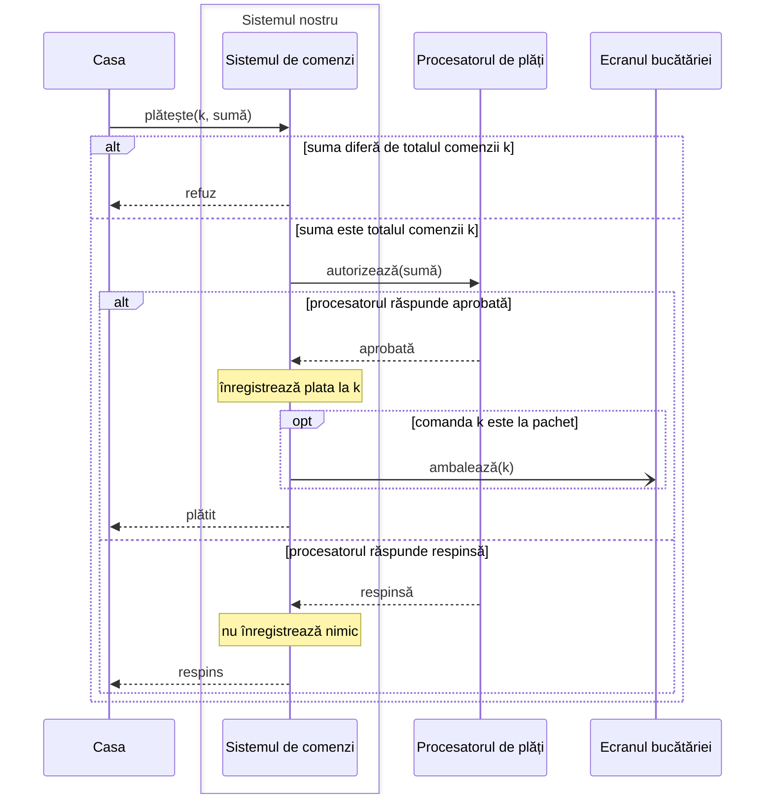

# Diagrama de secvență

Specificație pentru atelierul de diagrame din [Laboratorul 4](../04-comportament.md), după cursurile 7–8. Diagrama de secvență (în UML, *sequence diagram*) desenează o interacțiune: componentele care participă, mesajele dintre ele, în ordinea în care apar, și răspunsurile. Timpul curge de sus în jos. Conține aceleași informații ca tabelul interacțiunii din cursul 8 (cine apelează pe cine, ce se întoarce), iar ce se înregistrează la fiecare pas se scrie în note.

Puteți desena diagrama de mână, o puteți scrie în Mermaid sau o puteți genera cu un asistent AI și revizui. În toate cazurile, o verificați cu [lista de verificare](#lista-de-verificare), punct cu punct, față de enunț. Pentru ciclul de viață al unui singur obiect, folosiți [diagrama de stări](stari.md).

## La ce întrebări răspunde

- Ce componente participă la o operație și unde este granița sistemului nostru?
- Cine apelează pe cine, cu ce operație și ce parametri, și în ce ordine?
- Ce răspunde fiecare apel? Apelantul așteaptă răspunsul sau nu?
- În ce pas se schimbă starea sau se înregistrează o dată: înainte sau după un apel către o componentă din afara graniței?
- Ce ramuri are interacțiunea (acceptare, refuz, eșec al unei componente externe) și cu ce condiții?

**Ce nu arată:** toate stările unui obiect (diagrama de stări), regulile pe care nu le parcurge scenariul desenat și ce se întâmplă în interiorul componentelor din afara graniței.

## Elementele folosite

| Element | Desen UML | Sens |
|---|---|---|
| **Participant** (linie de viață) | dreptunghi cu numele, cu o linie verticală punctată sub el | O componentă care trimite sau primește mesaje. Un om (un operator) poate fi desenat ca **actor** (omuleț). |
| **Graniță** | un chenar cu nume în jurul participanților din sistemul nostru | Ce proiectăm, față de ce cunoaștem doar prin interfață și presupuneri. UML o desenează de obicei separat; în Mermaid o arătăm cu `box`. |
| **Mesaj sincron** | săgeată plină, cu vârf plin | Un apel: apelantul așteaptă răspunsul înainte să continue. Eticheta este operația, cu parametrii: `trimite(mesaj)`. |
| **Răspuns** | săgeată întreruptă, înapoi la apelant | Rezultatul apelului sincron, de exemplu `trimis`, `eșec`, `refuz`. |
| **Mesaj asincron** | săgeată plină, cu vârf deschis | Apelantul trimite mesajul și continuă, fără să aștepte un răspuns. |
| **Notă** | dreptunghi cu colțul îndoit, peste o linie de viață | Ce verifică sau înregistrează o componentă în acel pas (o schimbare de stare, o dată nouă), sau o presupunere. |
| **Fragmentul `alt`** | chenar etichetat `alt`, împărțit în ramuri, fiecare cu o condiție `[...]` | Exact una dintre ramuri are loc: prima a cărei condiție este adevărată. Ultima ramură poate fi `[altfel]`. |
| **Fragmentul `opt`** | chenar etichetat `opt`, cu o condiție `[...]` | Secvența din chenar are loc numai dacă condiția este adevărată; altfel este sărită. |

**Ordinea contează.** Două mesaje desenate unul sub altul au loc în această ordine. O notă scrisă între două mesaje spune că înregistrarea are loc între ele.

**Un scenariu sau toate cazurile.** O diagramă poate desena un singur scenariu (fără fragmente: valorile sunt cunoscute) sau toate cazurile unei operații (cu `alt` și `opt`). Spuneți care dintre ele este, în titlu sau într-o notă.

**Nu folosim:** bucle (`loop`), fragmente paralele (`par`), crearea sau distrugerea participanților, mesaje pierdute sau găsite, referințe la alte interacțiuni (`ref`), bare de activare. Problemele din laborator nu au nevoie de ele.

## Notația Mermaid

Mermaid scrie diagrama ca text; GitHub și editorul [mermaid.live](https://mermaid.live) o randează. Folosiți `sequenceDiagram`.

| Element UML | Mermaid |
|---|---|
| început de diagramă | `sequenceDiagram` |
| participant, cu nume afișat | `participant R as Registrul rezervărilor` |
| actor | `actor O as Operator` |
| graniță | `box Sistemul nostru` … `end`, în jurul declarațiilor de participanți |
| mesaj sincron | `A->>B: operație(parametri)` |
| răspuns | `B-->>A: rezultat` |
| mesaj asincron | `A-)B: operație(parametri)` |
| notă | `Note over B: text` sau `Note right of B: text`; peste doi participanți: `Note over A,B: text` |
| rând nou într-o notă sau etichetă | `<br/>` |
| fragment `alt` | `alt condiție` … `else condiție` … `end` |
| fragment `opt` | `opt condiție` … `end` |
| comentariu | `%% text ignorat` |

Mermaid adaugă singur parantezele drepte în jurul condiției unui fragment: scrieți `alt c este înregistrat`, nu `alt [c este înregistrat]`.

**Limitele Mermaid pe care trebuie să le știți:**

- **Mermaid nu verifică sensul.** Un mesaj trimis componentei greșite, un răspuns care lipsește sau o ramură fără condiție se randează curat.
- **Punctul și virgula (`;`) încheie instrucțiunea.** Într-un mesaj, textul de după el produce o eroare de sintaxă; în diagrama de stări, aceeași greșeală trece fără eroare și creează o stare în plus. Despărțiți acțiunile prin virgulă sau prin `<br/>`.
- **Participanții nedeclarați** apar în ordinea primei folosiri; un nume scris greșit o dată (`Registru` în loc de `R`) creează un participant nou. Declarați toți participanții la început.
- `box` grupează numai participanți declarați unul după altul; participanții din afara graniței se declară în afara lui.
- Mermaid nu deosebește grafic un apel către o componentă de un apel către un om; actorul are doar alt desen.
- Versiunile Mermaid diferă puțin între GitHub, mermaid.live și alte editoare; dacă o construcție nu se randează într-un loc, simplificați-o.

## Lista de verificare

Fiecare punct se verifică față de enunț: căutați regula care îl susține. Numerele punctelor se folosesc la verificarea în plen.

1. **Participanții** sunt componentele din enunț, cu numele lor; cele din sistemul nostru sunt în interiorul graniței, cele externe în afara ei. Niciun participant inventat (o bază de date, un serviciu de cozi).
2. **Mesajele:** fiecare apel are apelantul și destinatarul cerute de enunț, cu operația și parametrii din enunț. Nicio componentă nu apelează o componentă pe care enunțul nu i-o dă de apelat.
3. **Răspunsurile:** fiecare apel sincron are răspunsul lui, cu una dintre valorile din enunț; apelurile asincrone nu au răspuns.
4. **Ordinea:** schimbările de stare și înregistrările (în note) apar în pasul cerut de enunț, față de apelurile către componentele externe.
5. **Ramurile:** fiecare `alt` și `opt` are o condiție din enunț; ramurile unui `alt` se exclud și acoperă cazurile enunțului. Pentru un singur scenariu, fără fragmente: valorile scenariului decid ramura.
6. **Presupunerile:** nimic nu presupune despre o componentă externă mai mult decât enunțul (nicio confirmare de livrare, niciun termen-limită, nicio garanție „exact o dată”).
7. **Scenariul:** citită de sus în jos, diagrama dă, pentru scenariul desenat, rezultatele, starea și datele din enunț.

## Erori frecvente

- **Componenta din afara graniței pusă în interiorul ei**, sau granița lipsă, astfel încât nu se vede ce controlăm.
- **Răspunsul lipsă** al unui apel sincron, sau un răspuns cu o valoare pe care enunțul nu o are.
- **Înregistrarea în pasul greșit**: schimbarea stării desenată după răspunsul componentei externe, deși enunțul o cere înainte, sau invers.
- **Apeluri inventate**: componenta apelantă care apelează direct componenta externă; un apel în ramura de refuz.
- **`alt` cu condiții care se suprapun** sau fără ramura de refuz cerută de enunț.
- **Mesaj asincron pentru un apel al cărui răspuns este folosit** (sau invers): dacă apelantul folosește răspunsul, apelul este sincron.
- **Diagrama de stări amestecată cu diagrama de secvență**: participanți numiți după stări („Rezervată”) sau mesaje numite după tranziții.

## Exemplu rezolvat: plata unei comenzi la cantina facultății

Exemplu didactic, din alt domeniu decât laboratorul.

**Enunțul exemplului.** La casa cantinei, casierul încasează comenzile. **Casa** apelează **sistemul de comenzi**, componenta pe care o proiectăm. Sistemul apelează **procesatorul de plăți**, un serviciu extern, și trimite comenzile la pachet **ecranului bucătăriei**, o componentă externă.

- **P1 — plată:** casa apelează `plătește(k, sumă)` pentru comanda k.
- **P2 — sumă:** dacă suma diferă de totalul comenzii k, sistemul întoarce `refuz`, fără alte apeluri și fără modificări.
- **P3 — autorizare:** altfel, sistemul cere procesatorului `autorizează(sumă)` și așteaptă răspunsul `aprobată` sau `respinsă`. La `aprobată`, înregistrează plata la comanda k și întoarce `plătit`; la `respinsă`, nu înregistrează nimic și întoarce `respins`.
- **P4 — la pachet:** după o plată aprobată, dacă comanda k este la pachet, sistemul trimite ecranului bucătăriei `ambalează(k)`, fără să aștepte un răspuns, înainte să întoarcă `plătit`.
- **P5 — graniță:** despre procesator presupunem doar că răspunde `aprobată` sau `respinsă` la fiecare apel.

**Diagrama** (toate cazurile operației `plătește`):



**Verificarea, punct cu punct:**

1. Patru participanți, cei din enunț; numai sistemul de comenzi este în interiorul graniței (P5 și introducerea).
2. Casa apelează numai sistemul (P1); numai sistemul apelează procesatorul (P3) și ecranul (P4).
3. `plătește` și `autorizează` sunt sincrone și au răspunsuri din enunț; `ambalează` este asincron, fără răspuns (P4).
4. Plata se înregistrează după `aprobată` (P3), iar `ambalează` este trimis înainte de `plătit` (P4).
5. Primul `alt` desparte P2 de P3, al doilea pe cele două răspunsuri ale procesatorului; `opt` are condiția din P4. Ramurile se exclud și acoperă enunțul.
6. Nu presupunem nimic despre ecranul bucătăriei: mesajul asincron nu promite că ambalarea are loc.
7. Pentru scenariul „comandă la pachet, sumă corectă, plată aprobată”, citirea de sus în jos dă: autorizare, plata înregistrată, `ambalează(k)`, `plătit`.

## Un prompt sugerat pentru un asistent AI

Dacă generați diagrama cu un asistent AI, dați-i enunțul integral și această specificație; nu îi dați o soluție. Un prompt posibil:

```text
Mai jos sunt un enunț și o specificație pentru o diagramă de secvență UML.
Desenează diagrama de secvență a operației <operația> pentru <scenariul sau
„toate cazurile”>, în Mermaid (sequenceDiagram), respectând subsetul UML și
convențiile din specificație: granița marcată cu box, răspunsul fiecărui apel
sincron, notele pentru ce se înregistrează, fragmentele alt/opt cu condiții din
enunț. Folosește numai componentele, operațiile și valorile din enunț. După
diagramă, pentru fiecare punct al listei de verificare, citează regula din enunț
pe care se sprijină. Nu adăuga reguli sau garanții noi; dacă enunțul nu decide
ceva, spune ce lipsește.

<enunțul integral>

<această specificație>
```

## Cum verificăm răspunsul AI

- **O randare curată nu arată că diagrama este corectă.** Mermaid randează la fel de curat un apel inventat sau un răspuns greșit.
- Luați lista de verificare punct cu punct și căutați în enunț regula fiecărui participant, mesaj, răspuns, notă și condiție. Ce nu are o regulă (o bază de date, o coadă de mesaje, un termen-limită, o confirmare de livrare) se șterge sau devine o întrebare pentru beneficiar.
- Verificați mai ales ordinea dintre înregistrări și apelurile externe (punctul 4) și ce se presupune despre componentele din afara graniței (punctul 6).
- Citiți diagrama de sus în jos pentru scenariul cerut și comparați rezultatele cu enunțul (punctul 7).
- Corectați direct diagrama; nu este nevoie de un nou prompt pentru fiecare corectură.
