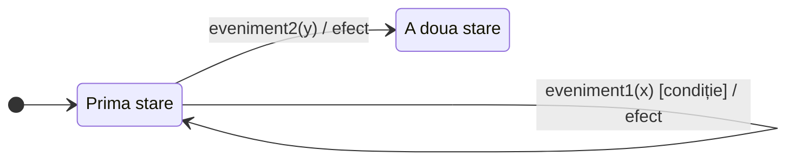
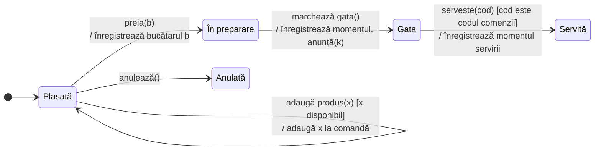

# Diagrama de stări

Specificație pentru atelierul de diagrame din [Laboratorul 4](../04-comportament.md), după cursurile 7–8. Diagrama de stări (în UML, *state machine diagram*) reprezintă ciclul de viață al unui obiect: stările lui, tranzițiile dintre ele și evenimentele care le declanșează. Conține aceleași informații ca tabelul de tranziții din cursul 7 (stare curentă, eveniment, condiție, stare următoare, efect); tabelul se citește mai ușor când întrebarea este „ce se înregistrează”, diagrama când întrebarea este „de unde se ajunge unde”. Diagrama din cursul 7 nota pe săgeți numai evenimentul și condiția și lăsa efectele în tabel; notația UML de aici scrie și efectul pe tranziție, după „/”.

Puteți desena diagrama de mână, o puteți scrie în Mermaid sau o puteți genera cu un asistent AI și revizui. În toate cazurile, o verificați cu [lista de verificare](#lista-de-verificare), punct cu punct, față de enunț.

## La ce întrebări răspunde

- În ce stări poate fi obiectul și în ce stare începe?
- Ce evenimente sunt permise în fiecare stare, cu ce condiție, și în ce stare duc?
- Ce efect are fiecare tranziție: ce date se înregistrează sau se modifică, ce componente sunt apelate?
- Din ce stări nu mai pleacă nicio tranziție (stări finale intenționate)? Ce stări sunt accesibile din starea inițială, printr-o secvență de evenimente permise?

**Ce nu arată:** evenimentele refuzate (lipsa unei săgeți înseamnă refuz), rezultatul întors apelantului, ordinea apelurilor dintre componente (aceasta este întrebarea [diagramei de secvență](secventa.md)) și, de obicei, toate datele obiectului.

## Elementele folosite

| Element | Desen UML | Sens |
|---|---|---|
| **Stare** | dreptunghi cu colțuri rotunjite, cu numele stării | O etapă cu nume a ciclului de viață (Plasată, În evaluare). Numai etapele numite de enunț sunt stări; celelalte valori înregistrate sunt **datele** obiectului. |
| **Pseudostarea inițială** | cerc plin, cu o săgeată fără etichetă | Arată starea în care începe obiectul. Exact una pe diagramă. |
| **Starea finală UML** | cerc plin încercuit | Încheierea ciclului de viață: obiectul nu mai este în nicio stare. **Nu o folosim în laborator** (vezi mai jos). |
| **Tranziție** | săgeată de la starea curentă la starea următoare, cu eticheta `eveniment [condiție] / efect` | Când evenimentul sosește în starea curentă și condiția este adevărată, obiectul trece în starea următoare și se execută efectul. |
| **Eveniment** | primul element al etichetei | Ce sosește la obiect: de obicei apelul unei operații, cu parametrii ei, de exemplu `preia(b)`. |
| **Condiție** | între paranteze drepte, `[...]` | O expresie adevărată sau falsă despre date și parametri, evaluată când sosește evenimentul. Lipsește când starea este singura cerință. |
| **Efect** | după bară, `/ ...` | Ce face tranziția: datele înregistrate sau modificate și apelurile către alte componente. Lipsește când tranziția schimbă numai starea. Un efect care depinde de date se scrie fie ca două tranziții cu condiții care se exclud, fie ca efect condiționat („dacă …”); prima formă este cea riguroasă. |
| **Tranziție spre aceeași stare** (buclă) | săgeată care pleacă din stare și se întoarce în ea | Evenimentul este permis, starea rămâne aceeași, iar datele se pot modifica. Nu este același lucru cu un refuz. |

**Evenimentele refuzate nu se desenează.** În UML, un eveniment care sosește într-o stare fără o tranziție potrivită (eveniment nepermis sau condiție falsă) nu produce nicio tranziție. În enunțurile noastre, un astfel de eveniment este **refuzat**: rezultatul este `refuz`, fără modificări. O buclă pentru un eveniment refuzat ar spune contrariul: că evenimentul este permis.

**Stări finale intenționate fără starea finală UML.** În curs, o stare finală intenționată (Servită, Retras) este o stare cu nume din care nu pleacă nicio tranziție; obiectul rămâne în ea, cu datele păstrate. O săgeată `Servită → ●` (starea finală UML) ar spune altceva: că obiectul iese imediat din Servită și nu mai este în nicio stare. De aceea o stare finală intenționată se recunoaște pe diagramă prin lipsa săgeților care pleacă din ea.

**Nu folosim:** stări compuse sau regiuni concurente, pseudostări de alegere sau de istoric, activitățile interne `entry`, `exit`, `do`, evenimente de timp (`after(...)`). Problemele din laborator nu au nevoie de ele.

## Notația Mermaid

Mermaid scrie diagrama ca text; GitHub și editorul [mermaid.live](https://mermaid.live) o randează. Folosiți `stateDiagram-v2`.

| Element UML | Mermaid |
|---|---|
| început de diagramă | `stateDiagram-v2`; opțional, `direction LR` (de la stânga la dreapta) |
| stare cu nume cu diacritice sau spații | `state "În preparare" as P`, apoi folosiți aliasul `P` |
| pseudostarea inițială | `[*] --> P` |
| tranziție | `P --> G: eveniment [condiție] / efect` |
| tranziție spre aceeași stare | `P --> P: eveniment [condiție] / efect` |
| rând nou într-o etichetă | `<br/>` |
| notă | `note right of P` … `end note` |
| comentariu | `%% text ignorat` |
| starea finală UML (nu o folosim) | `P --> [*]` |

Schelet:



**Limitele Mermaid pe care trebuie să le știți:**

- **Mermaid nu înțelege eticheta.** Textul de după `:` este doar text: Mermaid nu știe ce este eveniment, condiție sau efect și nu verifică nimic despre ele. O etichetă greșită se randează la fel de curat ca una corectă.
- **Punctul și virgula (`;`) încheie instrucțiunea.** `A --> B: e / x; y` taie eticheta după `x`, iar restul devine stări noi, fără niciun mesaj de eroare. În efecte, despărțiți acțiunile prin virgulă sau prin „și”.
- **`[*]` are două sensuri:** ca sursă (`[*] --> A`) este pseudostarea inițială, ca țintă (`A --> [*]`) este starea finală UML.
- **Mermaid nu verifică modelul:** nici stările inaccesibile, nici stările fără ieșire, nici două tranziții ale aceluiași eveniment din aceeași stare cu condiții care se suprapun.
- **Aranjarea este automată.** Mai multe bucle pe aceeași stare își pot suprapune etichetele; scurtați eticheta, folosiți `<br/>` sau numerotați tranzițiile și explicați-le într-un tabel alăturat, ca în cursul 7.
- Un nume de stare scris greșit o singură dată (`Servita` în loc de `S`) creează o stare nouă, randată fără avertisment.
- Versiunile Mermaid diferă puțin între GitHub, mermaid.live și alte editoare; dacă o construcție nu se randează într-un loc, simplificați-o.

## Lista de verificare

Fiecare punct se verifică față de enunț: căutați regula care îl susține. Numerele punctelor se folosesc la verificarea în plen („punctul 4 nu este îndeplinit, din cauza regulii R5”).

1. **Stările** sunt exact cele numite de enunț, cu aceleași nume. Nicio stare pentru un refuz, o eroare, o condiție verificată sau o valoare a datelor.
2. **Starea inițială:** pseudostarea inițială duce, fără eveniment, în starea în care începe obiectul după enunț (sau, dacă enunțul modelează crearea, cu evenimentul creării).
3. **Tranzițiile permise:** fiecare eveniment permis de enunț într-o stare are tranziția lui, spre starea următoare dată de enunț, inclusiv tranzițiile care păstrează starea (buclele). Nicio tranziție nu apare de două ori.
4. **Condițiile:** fiecare condiție din enunț apare între paranteze drepte pe tranziția ei, cu parametrii evenimentului; nicio condiție inventată. Când același eveniment are mai multe tranziții din aceeași stare, condițiile lor se exclud.
5. **Efectele:** după `/`, efectul numește numai ce se înregistrează sau se modifică potrivit enunțului și apelurile pe care enunțul le cere; nimic în plus (nicio ștergere, nicio notificare neprevăzută).
6. **Refuzurile nu se desenează:** nicio săgeată, nici buclă, pentru un eveniment pe care enunțul îl refuză. Din stările finale intenționate nu pleacă nicio săgeată, nici spre starea finală UML.
7. **Scenariile:** fiecare scenariu din enunț se poate urmări pe diagramă, pornind din starea lui: fiecare pas acceptat găsește exact o săgeată, ajunge în starea așteptată și are efectul așteptat; niciun pas refuzat nu găsește vreo săgeată.

## Erori frecvente

- **Stări pentru date.** O valoare înregistrată (un cod verificat, un bucătar înregistrat, un produs adăugat) desenată ca stare. Enunțul spune care sunt stările; restul sunt date, modificate de efecte.
- **Stări sau bucle pentru refuzuri.** O stare „Refuzată” sau „Eroare”, ori o buclă `anulează / refuz` pe În preparare. Refuzul este absența unei săgeți.
- **Tranziția pusă pe starea greșită.** Un eveniment desenat pe o stare în care enunțul nu îl permite: `servește` pe Plasată, deși K5 îl permite numai în Gata. Întrebați: în ce stări permite enunțul evenimentul? Dacă are o condiție, datele de care are ea nevoie sunt deja înregistrate în acea stare?
- **Condiția desenată ca stare.** O verificare („cod corect”, „produs disponibil”) devine stare intermediară, în loc de condiție pe tranziție.
- **Efecte inventate sau lipsă.** Ștergerea produselor la anulare, un anunț pe ecran la anulare, un rezultat întors scris ca efect; sau, invers, lipsa apelului cerut de enunț (`anunță(k)`).
- **Starea finală UML legată de o stare finală intenționată.** `Servită --> [*]` spune că obiectul iese din Servită.
- **Condiții care se suprapun** pentru același eveniment din aceeași stare: diagrama nu mai spune ce tranziție se produce.
- **Diagramă de activitate în loc de diagramă de stări.** Casetele numite cu verbe („Verifică codul”, „Anunță sala”) sunt pași ai unei operații, nu stări ale obiectului.

## Exemplu rezolvat: o comandă la cantina facultății

Exemplu didactic, din alt domeniu decât laboratorul.

**Enunțul exemplului.** Studenții plasează comenzi la un terminal al cantinei; bucătarii le preiau, iar studentul își ridică mâncarea la tejghea, cu un cod de ridicare. Apelurile sunt secvențiale.

- **K1 — stări:** o comandă este în exact una dintre stările Plasată, În preparare, Gata, Servită, Anulată. O comandă nouă începe în Plasată, cu un cod de ridicare. Servită și Anulată sunt stări finale intenționate.
- **K2 — produse:** `adaugă produs(x)` este permis numai în Plasată și numai dacă produsul x este disponibil: x se adaugă la comandă.
- **K3 — preluare:** `preia(b)` este permis numai în Plasată: comanda trece în starea În preparare, iar bucătarul b se înregistrează.
- **K4 — gata:** `marchează gata()` este permis numai în starea În preparare: comanda trece în Gata, momentul se înregistrează, iar sistemul cere ecranului din sală `anunță(k)`, cu numărul k al comenzii.
- **K5 — servire:** `servește(cod)` este permis numai în Gata și numai dacă codul este codul comenzii: comanda trece în Servită, iar momentul servirii se înregistrează.
- **K6 — anulare:** `anulează()` este permis numai în Plasată: comanda trece în Anulată, fără alte efecte.
- În celelalte cazuri, evenimentul este refuzat, fără modificări. Datele nu se șterg.

Scenarii: **E1** — dintr-o comandă Plasată: `adaugă produs(supă)` (disponibilă), `preia(B1)`, `marchează gata()`, `servește(cod)` cu codul comenzii: Servită. **E2** — o comandă în starea În preparare primește `anulează()`: refuz, rămâne În preparare. **E3** — o comandă Gata primește `servește(cod)` cu alt cod: refuz, rămâne Gata.

**Diagrama.**



**Verificarea, punct cu punct:**

1. Stările sunt cele cinci din K1; codul de ridicare, bucătarul și produsele sunt date, nu stări.
2. `[*] --> P`: o comandă nouă începe în Plasată (K1); crearea nu este un eveniment al exemplului.
3. Fiecare eveniment permis are o săgeată: `adaugă produs` (buclă pe Plasată, K2), `preia` (K3), `marchează gata` (K4), `servește` (K5), `anulează` (K6).
4. Condițiile din K2 și K5 sunt pe tranzițiile lor; `preia`, `marchează gata` și `anulează` nu au condiții în afara stării.
5. Efectele sunt cele din K2–K5; anularea nu are efect (K6).
6. Nu există săgeți pentru refuzuri: `anulează` din În preparare, `servește` cu alt cod. Din Servită și Anulată nu pleacă nicio săgeată.
7. E1 urmează patru săgeți și ajunge în Servită. E2: din În preparare nu pleacă nicio săgeată `anulează`, deci refuz. E3: singura săgeată `servește` din Gata cere codul comenzii, deci refuz.

Bucla `adaugă produs` arată de ce o tranziție care păstrează starea trebuie desenată: fără ea, diagrama ar spune că adăugarea unui produs este refuzată.

## Un prompt sugerat pentru un asistent AI

Dacă generați diagrama cu un asistent AI, dați-i enunțul integral și această specificație; nu îi dați o soluție. Un prompt posibil:

```text
Mai jos sunt un enunț și o specificație pentru o diagramă de stări UML.
Desenează diagrama de stări a obiectului <numele obiectului> din enunț, în Mermaid
(stateDiagram-v2), respectând subsetul UML și convențiile din specificație:
etichete „eveniment [condiție] / efect”, fără săgeți pentru evenimentele refuzate,
fără starea finală UML. Folosește numai stările, evenimentele, condițiile și efectele
din enunț. După diagramă, pentru fiecare punct al listei de verificare, citează regula
din enunț pe care se sprijină. Nu adăuga reguli noi; dacă enunțul nu decide ceva,
spune ce lipsește.

<enunțul integral>

<această specificație>
```

## Cum verificăm răspunsul asistentului AI

- **O randare curată nu arată că diagrama este corectă.** Mermaid randează la fel de curat o diagramă greșită; nu verifică nici sensul etichetelor, nici regulile.
- Luați lista de verificare punct cu punct și căutați în enunț regula fiecărui element: fiecare stare, fiecare săgeată, fiecare condiție și fiecare efect. Ce nu are o regulă (o stare de eroare, un termen-limită, o expirare, o notificare în plus) se șterge sau devine o întrebare pentru beneficiar.
- Trimiterile asistentului AI la reguli nu înlocuiesc verificarea: citiți voi regula citată și comparați-o cu săgeata.
- Urmăriți pe diagramă fiecare scenariu din enunț (punctul 7), mai ales pe cele cu refuzuri și cu repetări.
- Corectați direct diagrama; nu este nevoie de un nou prompt pentru fiecare corectură.
