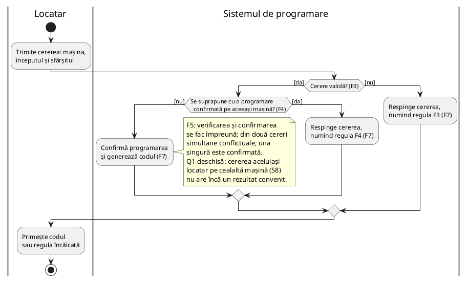
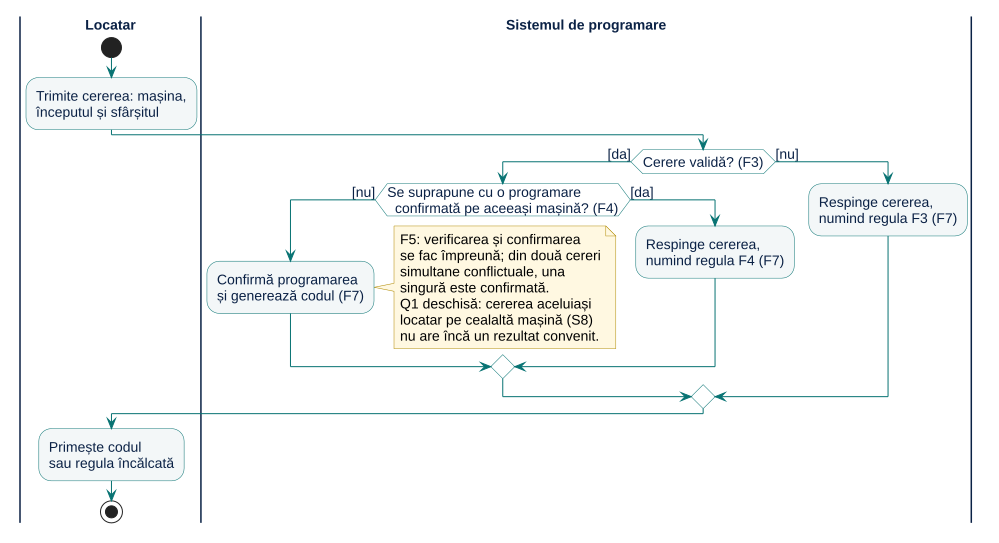
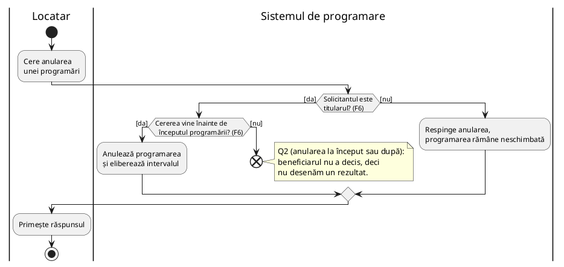
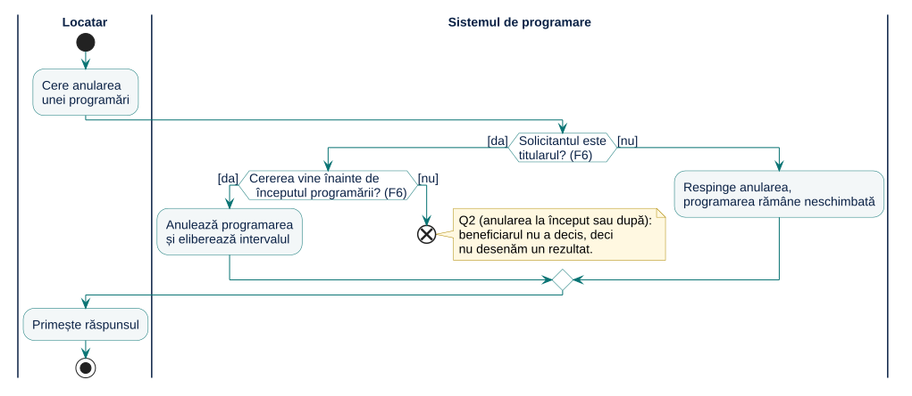

# Raționament de referință — diagrama de activitate a programărilor

Material de pregătire pentru [enunț](scenario.md) și pentru atelierul din [Laboratorul 1](../../01-specificare.md), construit didactic; nu captură AI. Notația și lista de verificare sunt cele din [specificația diagramei de activitate](../../diagrame/activitate.md).

## De ce o diagramă de activitate

Enunțul descrie un flux scurt cu decizii: o cerere este validă sau nu (F3), se suprapune sau nu cu o programare confirmată pe aceeași mașină (F4), iar răspunsul diferă (F7). Anularea (F6) are la rândul ei două condiții. Exact asta arată o diagramă de activitate: pașii, cine îi face și condițiile care despart rezultatele. Lista de verificare se poate aplica rând cu rând pe F3–F7, iar scenariile S1–S8 se pot urmări pe diagramă.

O diagramă a cazurilor de utilizare ar fi fost aproape goală: un singur actor (locatarul), două cazuri (programează, anulează) și nicio regulă vizibilă; toate deciziile interesante (alăturarea, cererile simultane, cine poate anula) ar rămâne în afara ei. O diagramă de stări a programării ar avea două stări (confirmată, anulată) și ar ascunde decizia de acceptare, care este miezul problemei; în plus, studenții au văzut până la Laboratorul 1 numai exemplul de stări din cursul 2.

## Cererea de programare

Codul de pe slide, fără liniile `skinparam` de stil:

Justificarea elementelor:

- **Culoarele.** Locatarul trimite cererea și primește răspunsul; sistemul de programare verifică și răspunde. Serviciul de cazare (F2) nu are culoar: identitatea verificată este o premisă a cererii, nu un pas al fluxului desenat. Administrarea mașinilor și a programului (F2, F8) lipsește din același motiv.
- **Prima decizie, F3 (cererea).** O cerere validă indică o mașină din listă și un interval în D, între 08:00 și 22:00, cu începutul înaintea sfârșitului (F1, F3). Validitatea poate fi și despărțită în mai multe decizii, câte una pentru fiecare condiție; ambele forme respectă lista, dacă fiecare condiție vine din F1 sau F3.
- **A doua decizie, F4 (suprapunerea).** Două intervale se suprapun dacă fiecare începe înaintea sfârșitului celuilalt; un interval care începe exact la sfârșitul altuia nu se suprapune. Se compară numai cu programările **confirmate** pentru **aceeași** mașină. Ordinea celor două decizii poate fi inversată fără a schimba rezultatele, cu condiția ca o cerere invalidă să nu fie confirmată.
- **F5 (cereri simultane) ca notă, nu ca decizie.** F5 nu adaugă o condiție nouă: cere ca verificarea suprapunerii și confirmarea să se petreacă împreună, astfel încât două cereri simultane să nu treacă amândouă de verificare înainte ca vreuna să fie confirmată. Diagrama arată un singur parcurs al fluxului; nota spune ce trebuie să rămână adevărat când două parcursuri se desfășoară în același timp. Nu cerem mecanismul (blocare, tranzacție): F5 cere doar garanția observabilă. O decizie „Cererea a sosit prima?” ar fi greșită: beneficiarul nu a ales prioritatea.
- **F7 (răspunsul).** Confirmarea generează codul; fiecare respingere numește regula care a împiedicat-o, de aceea cele două respingeri sunt acțiuni separate.
- **Q1 (mașini diferite) ca notă.** O cerere a aceluiași locatar pe cealaltă mașină, într-un interval suprapus (S8), trece de ambele decizii, dar enunțul nu spune dacă trebuie confirmată. Nota marchează că rezultatul lui S8 nu este convenit; dacă beneficiarul interzice asemenea suprapuneri, apare o decizie nouă după F4. O decizie „Locatarul are deja o programare suprapusă?” desenată acum ar fi o regulă inventată.
- **Ce nu apare.** Nicio limită de durată sau de număr de programări (Q3 și schimbarea „maximum 90 de minute” discutată în prima parte, încă neconvenită), nicio plată, notificare sau listă de așteptare (F8).

## Anularea

- **F6 (anularea).** Titularul poate anula înainte de începutul programării, iar intervalul devine disponibil; anularea făcută de alt locatar este respinsă și lasă programarea neschimbată.
- **Q2 cu nod final de flux.** Ramura „la început sau după” se încheie într-un nod final de flux (cercul cu X), însoțit de o notă: diagrama arată unde lipsește decizia, fără să o ia în locul beneficiarului. O diagramă care respinge sau acceptă anularea la ora de început a transformat Q2 în regulă. Acceptăm și o ramură care se oprește într-o notă „Q2 deschisă”, dacă nu atribuie un rezultat.
- Ordinea celor două decizii poate fi inversată: rezultatul este același pentru F6.

## Scenariile urmărite pe diagramă

Stările de pornire sunt cele din enunț: S1 și S5 încep fără programări; celelalte pornesc separat numai cu programarea confirmată a Ioanei pentru Albastra 10:00–11:00.

| Scenariu | Drumul pe diagramă | Rezultat |
|---|---|---|
| S1 | cerere validă, fără suprapunere | Confirmare cu cod. |
| S2 | cerere validă; 10:30–11:30 se suprapune cu 10:00–11:00 pe Albastra | Respingere, regula F4. |
| S3 | cerere validă; 11:00–12:00 începe exact la sfârșitul programării Ioanei, deci nu se suprapune | Confirmare cu cod. |
| S4 | cerere validă; Verdea nu are programări | Confirmare cu cod. |
| S5 | două parcursuri simultane; nota F5 | Una confirmată, cealaltă respinsă pentru conflict; nu știm care. |
| S6 | anularea: titulara, la 09:00, înainte de 10:00; apoi cererea lui Radu | Anulare; cererea lui Radu este confirmată. |
| S7 | anularea: Radu nu este titularul | Anulare respinsă; programarea Ioanei rămâne. |
| S8 | cerere validă, fără suprapunere pe Verdea; nota Q1 | Rezultat neconvenit până la decizia Q1. |

## Erori de urmărit la atelier

- Condiția de suprapunere scrisă astfel încât respinge S3 (alăturarea tratată ca suprapunere).
- O decizie pentru Q1 (programările locatarului pe cealaltă mașină) sau pentru durata maximă propusă în prima parte.
- F5 desenat ca bifurcare: două ramuri paralele care „verifică fiecare cererea”, fără ca una să fie respinsă.
- O decizie „Cine a cerut primul?”: prioritate inventată.
- Lipsa ramurii pentru cererea invalidă (F3) sau o singură respingere fără regula numită (F7).
- Toate acțiunile într-un singur culoar sau „Verifică suprapunerea” în culoarul locatarului.
- Casete-stări („Confirmată”, „Anulată”) în loc de acțiuni; confuzie cu diagrama de stări din cursul 2.
- În anulare: verificarea titularului omisă, sau ramura Q2 cu un rezultat ales.
- Un rezultat AI care se desenează curat, dar conține una dintre erorile de mai sus: randarea nu verifică nicio regulă.
