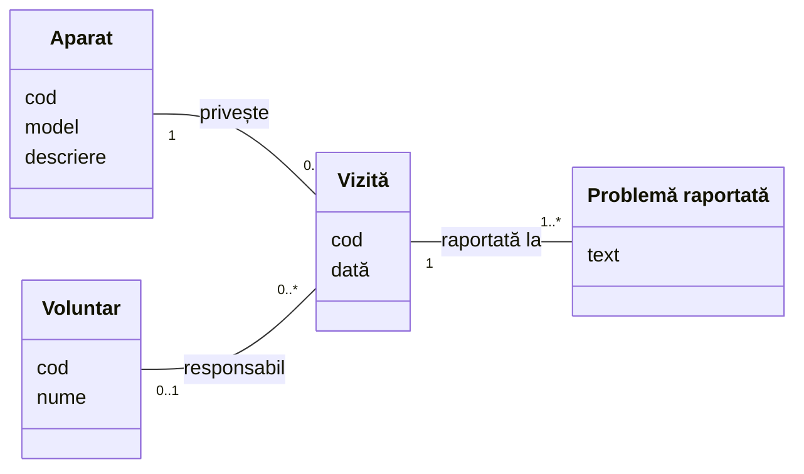

# Raționament de referință — atelierul de reparații

Material de pregătire pentru [enunț](scenario.md) și pentru etapa diagramei din Laboratorul 2; construit didactic, nu captură AI. Specificația diagramei: [diagrama de clase conceptuală](../../diagrame/clase-conceptuale.md).

## Modelul

Aparatul este un lucru fizic cu identitate stabilă; vizita este o ocazie distinctă în istoricul lui. Problema raportată aparține vizitei; nu este un diagnostic confirmat și nici o proprietate a aparatului, suprascrisă la fiecare vizită. Responsabilul se asociază vizitei, nu aparatului (R5). În tipologia cerințelor din cursul 3, R1–R5 sunt reguli ale domeniului, iar R6 este limita exercițiului.

| Relație | Număr permis | Regula |
|---|---|---|
| Aparat → vizite | Zero sau mai multe. | R2: același aparat poate reveni; poate fi înregistrat înaintea primei vizite. |
| Vizită → aparat | Exact unul. | R2 |
| Vizită → probleme raportate | Una sau mai multe. | R3: cel puțin o problemă. |
| Problemă raportată → vizită | Exact una. | R3 |
| Vizită → voluntar responsabil | Zero sau unul (zero, unul sau doi după schimbarea R4). | R4 |
| Voluntar → vizite | Zero sau mai multe. | R4 |

## Diagrama de referință

Pe slide, sursa are câteva caractere invizibile (U+2800) după primul `0..*`: în Mermaid 12, eticheta acelui capăt ar fi altfel acoperită de cutia Vizită. Aici sursa este curată; pe GitHub eticheta poate apărea parțial acoperită.

## Justificarea pe lista de verificare

1. **Concepte:** Aparat (R1), Vizită (R2), Problemă raportată (R3), Voluntar (R4). Piesele, plățile, proprietarii, programările și competențele lipsesc (R6). Organizatorii sunt beneficiarul, nu un concept ale cărui date le modelăm.
2. **Identitate:** A17 și A18 au același model T2, dar sunt instanțe distincte ale clasei Aparat; P1 și P3 au același text, dar sunt instanțe distincte ale clasei Problemă raportată. De aceea problema raportată este o clasă, nu un atribut text al vizitei.
3. **Atribute:** codul aparatului (R1), codul și data vizitei (R2), textul problemei (R3), codul și numele voluntarului (R4); modelul și descrierea aparatului apar în date („Prăjitor de pâine, model T2”). Codurile sunt atribuite de atelier, deci sunt fapte ale domeniului, nu identificatori tehnici. Problema raportată nu are cod: R3 cere să distingem problemele, dar nu impune un identificator; P1–P3 sunt etichetele datelor. Un cod al problemei ar fi o alegere de reprezentare acceptabilă, nu o greșeală, dacă este marcat ca alegere (discuția din capturile AI din 10 octombrie 2026).
4. **Relații, nu atribute:** vizita nu are atributele `aparat`, `probleme` sau `responsabil`; toate sunt relații.
5. **Nume:** „Vizita privește Aparatul”, „Voluntarul este responsabil de Vizită”, „Problema este raportată la Vizită”. Rolul „responsabil” este al voluntarului; în Mermaid apare la mijlocul liniei.
6. **Locul relației:** responsabilul și problemele țin de vizită (R4–R5): la J2, J1 își păstrează P1 și asocierea cu Mara.
7. **Cardinalități:** vezi tabelul de mai sus; fiecare valoare are o frază în enunț.
8. **Generalizare:** niciuna; enunțul nu spune că un concept este un caz special al altuia.
9. **Stări-exemplu:** A19 fără vizite (`0..*` lângă Vizită, citit de la Aparat); P1 și P3 cu același text (două instanțe); J4 cu două probleme (`1..*`); J3 fără responsabil (`0..1`). O vizită fără problemă sau cu două aparate nu se poate desena.
10. **Fără implementare:** nicio operație, niciun tip, nicio cheie străină, niciun tabel intermediar.

**Variante acceptabile:** alte nume de relații cu același sens; orientarea sau ordinea cutiilor; o notă „nu un diagnostic” la Problemă raportată; un atribut `descriere` lipsă la Aparat (datele îl arată, regulile nu îl cer). **Nu sunt acceptabile:** `1..*` între aparat și vizite (exclude A19), responsabilul legat de aparat, problema ca atribut al vizitei, `id`/`aparatId`/`createdAt`, o clasă `VizitaVoluntar`.

**După schimbarea R4:** `0..1` lângă Voluntar devine `0..2`; restul diagramei rămâne neschimbat. Exemplele de acceptare (adăugarea Marei la J2 acceptată, apoi a Ioanei respinsă) verifică noua cardinalitate.

## Greșeli frecvente ale răspunsurilor AI de urmărit

Nu au fost produse capturi noi pentru diagramă. Din experiența cu cerințe de tip „clase” (cursul 4, decizia din 19 noiembrie 2026) și din specificație: chei străine și `id` pe fiecare clasă, tipuri de date, momente tehnice de creare, clase pentru proprietar sau piese (R6), un cod impus problemei raportate prezentat ca cerință, compoziție UML în locul cardinalității, cardinalități citite invers. Lista de verificare le acoperă; citatele date de un asistent AI se verifică pe enunț.
