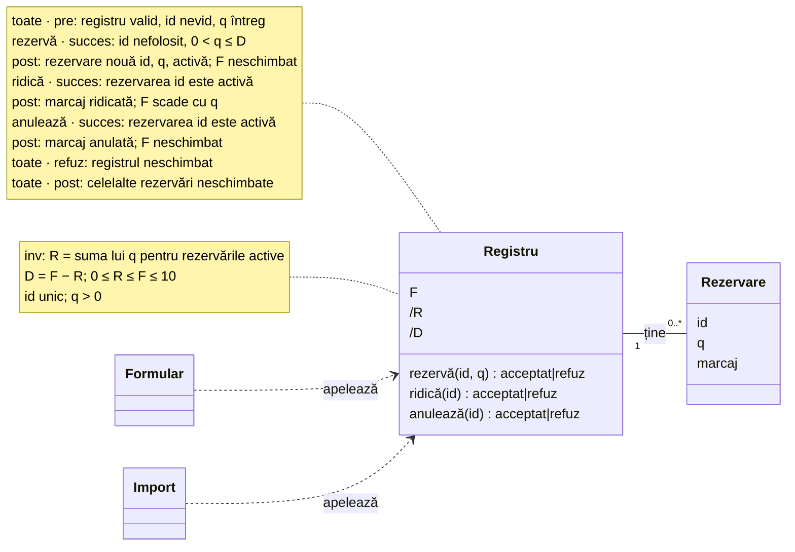

# Raționament de referință — depozit

Material de pregătire pentru [enunț](scenario.md) și pentru etapa diagramei, construit didactic; nu captură AI.

## Responsabilități

Registrul deține rezervările și stocul fizic și decide operațiile care le modifică. Formularul și importul interpretează intrările și apelează aceleași operații. Disponibilul poate fi calculat din F și suma rezervărilor active; dacă este stocat separat, apare costul sincronizării lui. Nicio alegere de reprezentare nu elimină regulile.

O altă repartizare defensabilă a responsabilităților: o funcție de decizie primește o stare coerentă și propune modificarea, iar un coordonator o aplică integral înaintea următorului apel. Costul: coordonatorul trebuie să păstreze coerența dintre decizie și aplicare. Nu cerem microservicii, tranzacții distribuite sau teoria cursurilor 7–8 (stări, interacțiuni și granițe). „Activă”, „ridicată”, „anulată” sunt valori date în enunț, suficiente pentru condițiile operațiilor.

## Invarianți și contracte

Opțional, pentru verificarea stocului total, notăm cu P suma cantităților din rezervările ridicate; cele anulate nu contribuie la P.

Cantitățile rezervărilor sunt strict pozitive; identificatorii sunt unici. `0 ≤ R ≤ F ≤ 10`, `D = F − R ≥ 0`, `F + P = 10`. Ultima egalitate folosește absența reaprovizionării și retururilor. Istoricul cu cantitățile ridicate permite calcularea lui P. Păstrarea identificatorilor și cantităților de la o stare la alta este o responsabilitate a operațiilor, distinctă de unicitatea verificabilă într-o singură stare.

Precondiții comune: R1 (context: registru valid, apeluri secvențiale, cantitate întreagă unde există, identificator nevid). Cantitatea q strict pozitivă, disponibilitatea și identificatorul nefolosit sunt **părți ale condiției de succes**, nu precondiții care ar lăsa refuzul nespecificat.

| Operație acceptată | Efect asupra cantităților | Efect asupra registrului |
|---|---|---|
| `rezervă(id,q)` | F' = F; R' = R+q; D' = D−q; P' = P | Adaugă numai rezervarea activă nouă. |
| `ridică(id)` de q | F' = F−q; R' = R−q; D' = D; P' = P+q | Numai rezervarea vizată devine ridicată. |
| `anulează(id)` de q | F' = F; R' = R−q; D' = D+q; P' = P | Numai rezervarea vizată devine anulată. |

Spre deosebire de enunțul muzeului, R3–R4 specifică aici și refuzul pentru un identificator necunoscut. Nu importăm precondiția „identificator cunoscut” din curs. Prin istoric înțelegem păstrarea rezervărilor încheiate, cu identificatorul și cantitatea lor; nu cerem un jurnal separat al fiecărui apel.

La orice refuz, F și **întregul registru** se păstrează; în consecință se păstrează și R, D, P. La succes, toate celelalte rezervări sunt identice. Separăm păstrarea identităților/cantităților de actualizarea stării rezervării vizate.

## Rezultatele scenariilor

Toate pornesc din I: F=10, A activă(4), R=4, D=6, P=0.

| Scenariu | Verdict și stare finală |
|---|---|
| S1 | Acceptat; A activă(4), B activă(6); F=10, R=10, D=0, P=0. |
| S2 | Refuz; exact I. |
| S3 | Acceptat; A ridicată(4); F=6, R=0, D=6, P=4. |
| S4 | Acceptat; A anulată(4); F=10, R=0, D=10, P=0. |
| S5 | Ridicare acceptată ca S3; anulare refuzată; rămâne exact starea de după ridicare. |
| S6 | Anulare acceptată ca S4; reutilizarea lui A este refuzată; rămâne exact starea de după anulare. |
| S7 | Refuz; exact I. |

La ridicare, scăderea doar a lui F ar lăsa R=4 și D=2, deși rezervarea nu mai este activă. Scăderea doar a lui R ar crea D=10 fără ca cele patru bucăți ridicate să mai existe fizic. Corecția trebuie să păstreze simultan sensurile și egalitățile.

## Încheiere: verificare nouă

După S1 (A activă 4, B activă 6; F=10, R=10, D=0), anulăm A. Rezultat: A anulată 4, B activă 6; F=10, R=6, D=4. Apoi ridicăm B: F=4, R=0, D=4, P=6; A rămâne anulată. Sunt pași succesivi, diferiți de scenariile care repornesc din I.

## Diagrama de referință

Pentru etapa diagramei din Laboratorul 3 (introdusă la 19 noiembrie 2026). Specificația: [diagrama de clase cu operații și restricții](../../diagrame/clase-operatii.md).

`marcaj` ia valorile activă, ridicată, anulată (R3–R4). Numele urmează verbul enunțului („marchează rezervarea ca ridicată”); evită „stare”, care în acest laborator numește valorile întregului registru („starea inițială I”).

### Justificarea pe lista de verificare

1. **Responsabilitate:** registrul deține rezervările și stocul și este singura componentă care le modifică; cele trei operații apar o singură dată, la el. Rezervarea nu are operații: o `ridică()` a rezervării nu ar putea modifica F, iar operații pe ambele clase ar dubla regula.
2. **Apelanți:** formularul și importul depind de registru (R5: aceleași reguli, prin operațiile registrului); nu au verificări proprii care decid acceptarea.
3. **Parametri și rezultate:** `rezervă(id, q)`, `ridică(id)`, `anulează(id)`, cum le dă enunțul; fiecare poate întoarce `refuz` (R2–R4). „acceptat” numește rezultatul de succes, pe care enunțul nu îl denumește.
4. **Precondiții:** numai R1 (registru valid, apeluri secvențiale, identificator nevid, cantitate întreagă). Identificatorul nefolosit, 0<q≤D și „rezervarea id este activă” sunt părți ale condiției de succes: enunțul promite refuz pentru ele.
5. **Condiția de succes:** completă pentru fiecare operație; „id nefolosit” include rezervările încheiate (R5: identificatorul nu se reutilizează), ceea ce acoperă scenariul S6.
6. **Postcondiții la succes:** rezervare nouă cu id, q, activă (R2); marcaj ridicată și F scade cu q (R3); marcaj anulată și F neschimbat (R4). Identificatorul și cantitatea rezervării vizate nu se modifică (R5), fiindcă nicio postcondiție nu le schimbă.
7. **Refuz:** registrul neschimbat, pentru toate operațiile.
8. **Efect limitat:** „celelalte rezervări neschimbate” este postcondiție comună, nu invariant: compară două stări.
9. **Invarianți:** R ca sumă a rezervărilor active, D=F−R, 0≤R≤F≤10, identificatori unici, cantități pozitive. Starea inițială I și toate stările scenariilor îi respectă. „D>0” nu ar fi invariant (după S1, D=0).
10. **Atribute derivate:** R și D sunt derivate; de aceea postcondițiile vorbesc numai despre F și despre marcaj. La ridicare, R scade cu q și D rămâne (formulele); la anulare, R scade și D crește cu q.
11. **Scenarii:** S1 acceptat (B activă(6), F=10, R=10, D=0); S2 și S7 refuz, exact I; S3 F=6, R=0, D=6; S4 F=10, R=0, D=10; S5 al doilea pas refuză (A nu mai este activă); S6 reutilizarea lui A refuză (id folosit).

**Variante acceptabile:** R și D păstrate ca atribute obișnuite, cu postcondiții pentru ele și cu invarianții care le leagă (costul: sincronizarea copiilor); câte o notă pentru fiecare operație; F și rezervările ca atribute ale unei singure clase, dacă istoricul rezervărilor rămâne vizibil; un atribut P (total ridicat) cu invariantul F+P=10. **Nu sunt acceptabile:** disponibilitatea sau identificatorul nefolosit la precondiții; refuz fără „registrul neschimbat”; efectul limitat printre invarianți; `setF()` sau verificări copiate în formular și import.

**Erori de urmărit la răspunsurile AI:** analiza AI păstrată din 27 octombrie 2026 (`captures/2026-10-27/`) trece identificatorul nefolosit, q>0 și D≥q la precondiții; aceeași confuzie este probabilă într-o diagramă generată. Alte erori probabile: tipuri `boolean`/`void`, excepții în loc de `refuz`, clase `Service`/`Repository`, invarianți care includ efectul limitat. Pentru diagramă nu au fost produse capturi noi.
