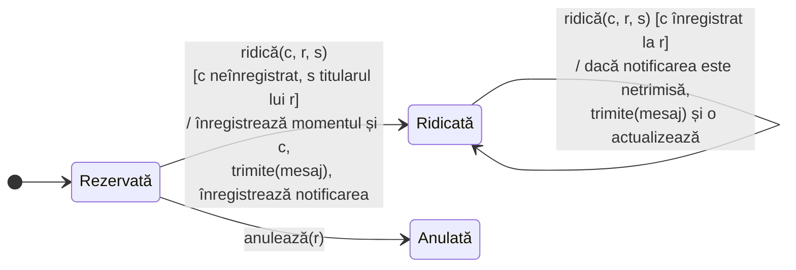
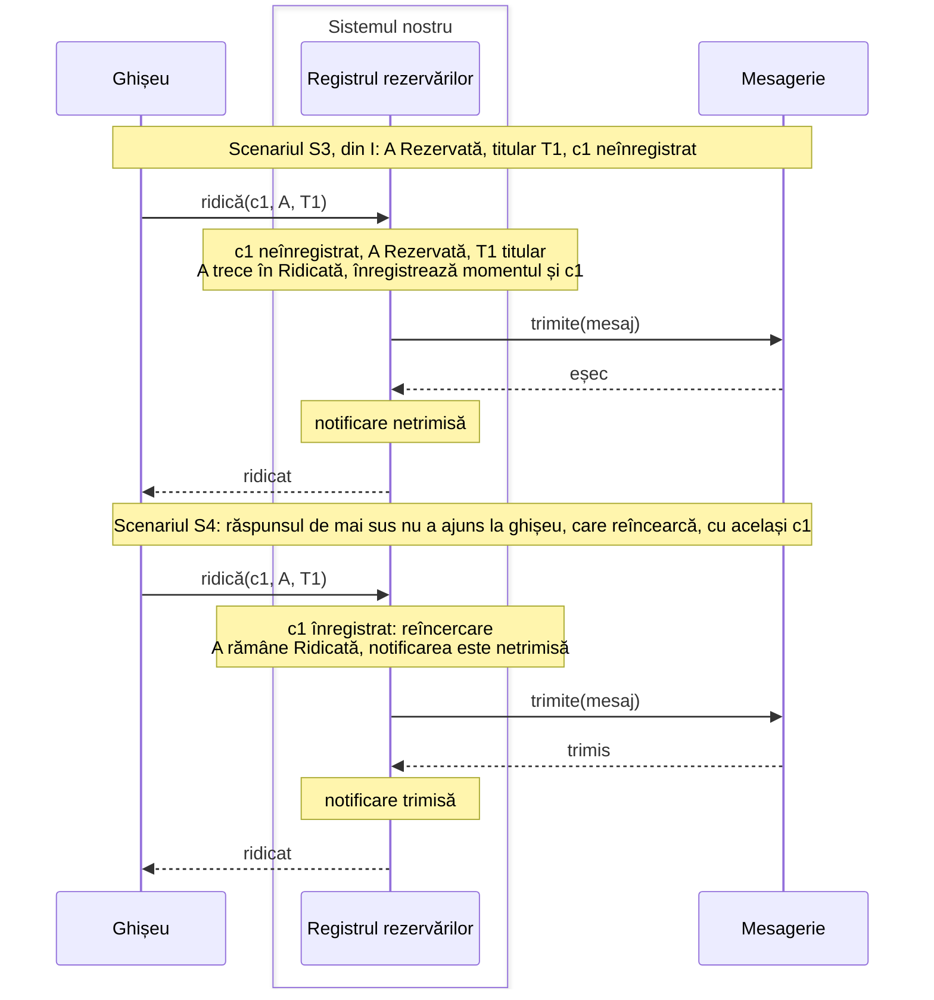

# Raționament de referință — ghișeul de echipamente

Material de pregătire pentru [enunț](scenario.md), construit didactic; nu captură AI.

## Tabelul de tranziții al rezervării

| Stare curentă | Eveniment | Condiție | Stare următoare | Efect |
|---|---|---|---|---|
| Rezervată | `ridică(c, r, s)` | c neînregistrat, s este titularul | Ridicată | momentul ridicării, c înregistrat, notificare `trimisă`/`netrimisă` |
| Ridicată | `ridică(c, r, s)` | c înregistrat la r (reîncercare) | Ridicată | notificarea poate trece din `netrimisă` în `trimisă` |
| Rezervată | `anulează(r)` | — | Anulată | — |

Orice altă combinație, sau o condiție neîndeplinită, este refuzată: `refuz`, fără modificări, fără apelul mesageriei. Anulată este finală intenționată. Ridicată permite reîncercarea, deci nu este finală în sensul cursului 7. Al doilea rând nu schimbă starea; îl scriem ca să fie vizibil că reîncercarea este permisă în Ridicată, spre deosebire de o cerere nouă (c neînregistrat), care este refuzată acolo.

Condiția „s este titularul” depinde de date, nu de stare: o cerere greșită lasă rezervarea Rezervată, cu toate datele. Starea și datele decid ce evenimente sunt permise. Titularul, echipamentul, momentul ridicării și identificatorul înregistrat se păstrează; rezultatul notificării poate fi actualizat (R5).

## Fluxul de lucru pentru `ridică(c, r, s)`

1. Ghișeu → Registru: `ridică(c, r, s)`.
2. Registru: dacă c este înregistrat la r, verifică notificarea: la `netrimisă` continuă cu pasul 4; la `trimisă`, cu pasul 7. Altfel verifică: r Rezervată și s titular. Dacă nu: `refuz`, fără modificări și fără apelul mesageriei (sfârșit).
3. Registru: r devine Ridicată; înregistrează momentul ridicării și c; notificarea `în așteptare`.
4. Registru → Mesagerie: `trimite(mesaj)`, cu anunțul pentru coordonatorul clubului.
5. Mesagerie → Registru: `trimis` sau `eșec`.
6. Registru: notificarea `trimisă`, respectiv `netrimisă`.
7. Registru → Ghișeu: `ridicat` (sfârșit). La reîncercare nu se repetă pasul 3. Valoarea `în așteptare` din pasul 3 este intermediară; apelurile secvențiale și răspunsul garantat al mesageriei exclud o nouă cerere în acel moment.

Tranziția (pasul 3) precedă apelul mesageriei. Dacă registrul ar schimba starea numai după `trimis`, la `eșec` ar avea două posibilități, amândouă greșite: întoarce `refuz` (titularul pleacă fără echipament, deși R3 îi acceptă cererea, iar eșecul notificării a anulat ridicarea, contrar lui R4; coordonatorul poate primi totuși anunțul unei ridicări care nu a avut loc, R7) sau întoarce `ridicat` fără să schimbe starea (studentul pleacă cu echipamentul, rezervarea rămâne Rezervată și fără c, deci registrul ar accepta încă o ridicare; este încălcată R3). Un flux care apelează întâi mesageria și face apoi tranziția, oricare ar fi răspunsul, dă în limitele lui R1 aceleași rezultate și aceleași date ca al nostru; diferă numai dacă operația se întrerupe între pași. Registrul coordonează; ghișeul nu apelează mesageria.

## Diagrama de stări de referință

Pentru atelierul de diagrame; specificația este [`lab/diagrame/stari.md`](../../diagrame/stari.md). Este tabelul de tranziții de mai sus, desenat; aceeași diagramă apare pe slide-ul „Diagrama de referință”.

Justificarea, după lista de verificare a specificației:

1. **Stări:** exact cele trei din R2. Rezultatul notificării (`trimisă`, `netrimisă`) este o dată a rezervării (vocabularul enunțului), nu o stare; titularul verificat este o condiție, nu o stare.
2. **Starea inițială:** `[*] --> Rezervată`, fără eveniment: starea inițială I pornește din Rezervată, iar crearea rezervărilor nu este modelată (R2).
3. **Tranziții permise:** ridicarea cu c neînregistrat (R3), reîncercarea (R5) și anularea (R6); niciuna alta. Reîncercarea este o buclă pe Ridicată, pentru că c se înregistrează numai la o ridicare acceptată (R3): în Rezervată, niciun c al rezervării nu este încă înregistrat.
4. **Condiții:** „c neînregistrat, s titularul lui r” (R3) și „c înregistrat la r” (R5); cele două tranziții ale lui `ridică` pleacă din stări diferite, deci cel mult una este posibilă. `anulează` nu are condiție în afara stării (R6). Refolosirea lui c cu alt conținut este în afara apelurilor admise (R3), deci condiția reîncercării nu trebuie să compare și s.
5. **Efecte:** momentul ridicării și c (R3), apelul `trimite(mesaj)` și rezultatul notificării (R4); la reîncercare, retrimiterea numai pentru `netrimisă` (R5). Anularea nu are efect (R6: fără notificare; R8: datele nu se șterg). Rezultatul `ridicat` întors ghișeului nu este un efect asupra rezervării și nu apare pe diagramă.
6. **Refuzuri:** nicio săgeată pentru `anulează` în Ridicată (scenariul S6), pentru `ridică` în Anulată (S7), pentru o cerere nouă în Ridicată (S5) sau pentru alt student (S2). Din Anulată nu pleacă nicio săgeată (R2: stare finală intenționată). Nu desenăm `Anulată --> [*]`: în UML, aceasta ar scoate obiectul din Anulată, deși datele rămân (R8).
7. **Scenarii:** S1 și S3 folosesc săgeata Rezervată → Ridicată; S4 folosește bucla (c1 înregistrat, notificare `netrimisă`, retrimitere); S2 nu găsește săgeată (condiția titularului); S5 nu găsește săgeată (c7 nu este înregistrat, iar A nu este Rezervată); S6 și S7 nu găsesc săgeată din Ridicată, respectiv din Anulată.

**Variante acceptabile:** bucla reîncercării împărțită în două tranziții, `[c înregistrat la r, notificare netrimisă] / trimite(mesaj), actualizează notificarea` și `[c înregistrat la r, notificare trimisă]`, fără efect (condițiile se exclud); efecte formulate mai scurt, dacă numesc aceleași date și același apel; tranzițiile numerotate și explicate într-un tabel alăturat, ca în cursul 7; tranziția din Rezervată fără condiția „c neînregistrat”, justificată prin R3 (în Rezervată, niciun c al rezervării nu este încă înregistrat). **Neacceptabile:** stări pentru notificare sau pentru refuz, bucle pentru evenimente refuzate, bucla reîncercării pe Rezervată, săgeata spre starea finală UML, efecte noi (ștergerea datelor, notificare la anulare).

## Diagrama de secvență de referință (extensie)

Specificația este [`lab/diagrame/secventa.md`](../../diagrame/secventa.md). Scenariul S3 (notificare eșuată), urmat de scenariul S4 (reîncercare după eșec); un singur scenariu, deci fără fragmente: valorile sunt cunoscute.

Justificarea, după lista de verificare a specificației: (1) trei participanți; numai registrul este în interiorul graniței (R7; ghișeul îl apelează, dar nu îl proiectăm). (2) Ghișeul apelează numai registrul, iar numai registrul apelează mesageria (R4); ghișeul nu apelează niciodată mesageria. (3) Ambele apeluri sunt sincrone (R1: apeluri secvențiale; registrul folosește răspunsul mesageriei) și au răspunsuri din enunț. (4) Tranziția și înregistrarea lui c1 precedă apelul mesageriei (R3, R4); la reîncercare nu există o a doua tranziție (R5). (5) Fără fragmente: valorile scenariilor decid ramurile. (6) Nimic despre livrare: `eșec` este consemnat ca `netrimisă` (R7). (7) Rezultatele sunt cele din tabelul de mai jos: `ridicat` de două ori, A Ridicată, o singură ridicare, notificarea `trimisă` la sfârșit.

O variantă pentru toate cazurile lui `ridică` folosește `alt [c înregistrat la r]` / `[c neînregistrat, r Rezervată, s titular]` / `[altfel]` (cu `refuz` și fără apelul mesageriei), iar în prima ramură `opt [notificarea este netrimisă]` în jurul retrimiterii. Greșeli de urmărit: nota schimbării stării pusă după `trimis`; un `refuz` la reîncercare; o a doua notă „A trece în Ridicată” la S4; mesageria pusă în interiorul graniței.

## Rezultatele scenariilor

S1, S2, S3 și S7 pornesc din I: A (T1, proiector) și B (T2, cameră video) în Rezervată. S4 continuă S3; S5 și S6 continuă independent S1. Rezervarea neindicată de apel rămâne identică.

| Scenariu | Rezultat |
|---|---|
| S1 | `ridicat`; A Ridicată, c1 înregistrat, notificare `trimisă`; B neschimbată. |
| S2 | `refuz` (T2 nu este titularul lui A); exact I; mesageria nu este apelată; c1 nu se înregistrează. |
| S3 | `ridicat`; A Ridicată, c1 înregistrat, notificare `netrimisă`. |
| S4 | `ridicat` (reîncercare); A rămâne Ridicată, o singură ridicare; mesageria apelată din nou → `trimisă`. |
| S5 | `refuz` (c7 este cerere nouă, iar A nu mai este Rezervată); exact starea și datele de după S1. |
| S6 | `refuz` (anularea cere Rezervată); A rămâne Ridicată. |
| S7 | `anulează(B)` acceptată: B Anulată; `ridică(c2, B, T2)` refuzată: B rămâne Anulată; fără notificare. |

Cererea din S2 trimisă din nou (a doua predicție de pe slide-ul „Trei predicții”): `ridică(c1, A, T2)` primește din nou `refuz`. Refuzul nu a înregistrat nimic, deci c1 este tot neînregistrat, iar cererea este judecată din nou după R3; R5 nu se aplică, fiindcă un identificator se înregistrează numai la o ridicare acceptată.

Ce garantează registrul, în limitele R1: o rezervare este ridicată cel mult o dată; o reîncercare primește același rezultat și nu produce o a doua ridicare; rezultatul notificării este înregistrat; un refuz nu modifică nimic și nu produce mesaje. Ce nu garantează: livrarea sau citirea mesajului; retrimiterea unei notificări `netrimisă` când ghișeul nu reîncearcă (R5 o retrimite numai la o reîncercare); comportamentul la o cădere între pașii 3 și 6; cereri concurente.

## Dificultăți de urmărit

- Confundarea cererii noi (c7, refuzată) cu reîncercarea (c1, acceptată din nou): identificatorul cererii este ceea ce le deosebește, nu conținutul.
- Propunerea de a anula ridicarea la `eșec`: încalcă R4 și presupune că `eșec` înseamnă „mesajul nu a ajuns”, contrar lui R7.
- Scrierea condiției „s este titularul” ca stare separată: este o verificare de date în starea Rezervată.
- Tratarea lui S2 ca eveniment care schimbă ceva: cererea refuzată nu se înregistrează.
- Cererea nouă pentru o rezervare Ridicată (S5): citită față de rândul din Rezervată, o refuză starea; citită față de rândul reîncercării din Ridicată, o refuză condiția (c nu este înregistrat). Ambele lecturi sunt corecte.

## Exercițiu suplimentar: ghișeul nu a primit răspunsul (trasări manuale)

A fost scos de pe slide-uri la 19 noiembrie 2026 (atelierul de diagrame a luat timpul lui). Din 20 noiembrie 2026, întrebările lui se pun în plen la scenariul S5, pe slide-ul „Reîncercare sau cerere nouă?”, unde identificatorul nou este c7; exercițiul rămâne în [sprijinul facultativ](worksheet.md), pentru studiu individual.

Din I, ghișeul trimite `ridică(c1, A, T1)`, iar mesageria răspunde `trimis`. Răspunsul registrului nu ajunge la ghișeu, deci operatorul nu predă încă proiectorul; ghișeul trimite `ridică(c8, A, T1)`, cu un identificator nou. Rezultate: `ridicat` (A Ridicată, c1 înregistrat, notificare `trimisă`: mesageria a preluat anunțul pentru coordonatorul clubului, deși proiectorul este încă la ghișeu), apoi `refuz` (c8 este cerere nouă, iar A nu mai este Rezervată); nimic nu se modifică, mesageria nu este apelată.

Ce știe operatorul: numai `refuz`, același rezultat pe care l-ar fi primit pentru alt student, pentru o rezervare anulată sau pentru una ridicată de altă cerere. Nu poate deosebi „ridicată prin cererea mea” de celelalte. Registrul consemnează A ca Ridicată, deși echipamentul este încă la ghișeu. Pentru A mai este acceptată numai reîncercarea cu c1 (care ar primi `ridicat`, fără alt apel al mesageriei); `anulează(A)` este refuzat (R6). Dacă ghișeul nu mai are c1, niciun eveniment permis nu îl ajută.

Refuzul ar fi fost evitat dacă ghișeul și-ar fi îndeplinit responsabilitatea pe care R3 o presupune: păstrează identificatorul până primește răspunsul și reîncearcă cu același c. Ghișeul este, ca mesageria, în afara graniței: despre el avem numai o presupunere, iar garanțiile registrului („o reîncercare primește același rezultat”) țin cât timp presupunerea este respectată. Întrebări pentru beneficiar, pe care nu le decidem noi: refuzul ar trebui să își spună motivul (cum făcea `refuz(motiv)` în cursul 5)? Ar trebui ca ghișeul să poată afla starea și datele unei rezervări? Ce face operatorul care a pierdut identificatorul? Nu adăugăm reguli; notăm întrebările.
