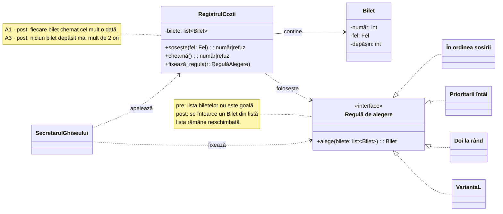

# Diagrama de clase cu interfață pentru Varianta L

---

## Verificare pe lista de control

**1. Variația** — R5: „alegerea urmează regula stabilită de secretariat". Interfața RegulăAlegere corespunde acestei variații.

**2. Realizările** — R5 și enunț: „În ordinea sosirii", „Prioritarii întâi", „Doi la rând", și Varianta L (descriere din prompt).

**3. Folosirea** — R5: „secretara o fixează de la ghișeu, prin `fixează regula(r)`". RegistrulCozii depinde de RegulăAlegere (folosește), nu de o realizare concretă. SecretarulGhiseului fixează realizarea prin operație.

**4. Ce trece prin interfață** — R6 și Varianta L: metoda `alege(bilete)` primește lista de Bilete cu atributul `depășiri`, pe care Varianta L îl inspectează pentru a decide: dacă cel mai vechi bilet a fost depășit de 2 ori, returneaza-l; altfel pune o cerere (care va fi tratată în implementare printr-o logică de fall-back la o altă regulă).

**5. Regula stabilă** — A3: „niciun bilet nu este depășit de mai mult de două ori" stă în RegistrulCozii și în contractul interfeței, nu se repetă în fiecare realizare.

**6. Contract** — Notat: RegulăAlegere garantează întoarcerea unui Bilet din coadă, fără modificări. RegistrulCozii garantează A1 și A3.

**7. Datele** — Depășirile sunt ținute în Bilet și gestionate de RegistrulCozii. Biletul e o valoare care trece prin interfață.

**8. Schimbări**:
- **C1 — programați** (R5+): se adaugă realizare nouă „Programații întâi"; se adaugă `fel: Fel` în Bilet cu valoarea „programat"; contractul RegulăAlegere rămâne neschimbat.
- **C2 — după oră** (R5+): se adaugă `oră: Time` pe Bilet; metodele `alege` iau în considerare și ora, dar contractul interfeței și regula stabilă nu se schimbă.

---

## Presupuneri

- **SecretarulGhiseului** e componenta responsabilă cu apelurile și fixarea regulii; nu e o clasă a modelului, ci reprezentă **ghișeul** din enunț.
- **Depășiri** e ținut la fiecare Bilet și incrementat de RegistrulCozii când cheamă alt bilet (cel mai vechi) și biletul curent rămâne în coadă.
- **Varianta L** e o realizare care inspectează depășirile celui mai vechi bilet și decide pe baza logicii date; detaliile implementării (cum delegă sub-regulii în caz de neaplicabilitate) sunt interne, nu apar pe diagramă.
- **Fel** e enumerație cu valorile din enunț; schimbările C1 vor adăuga „programat".
- **RegistrulCozii** aplică regula stabilă A3 la fiecare ciclu de chemare, independent de realizarea aleasă.