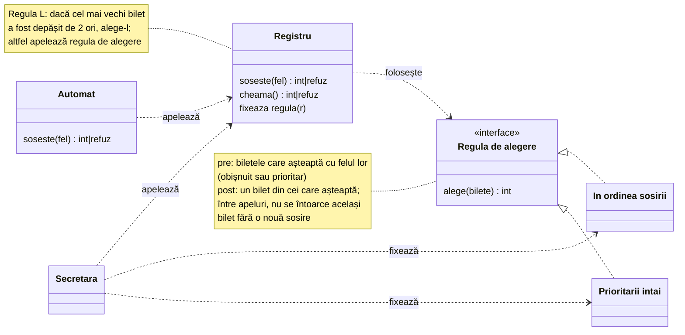

# Diagrama de clase — varianta L

---

# Verificare pe lista de control

**1. Variația** — R5 (regula de alegere se schimbă de la o perioadă la alta); realizările din enunț sunt „În ordinea sosirii" și „Prioritarii întâi". Nicio altă componentă a sistemului nu variază.

**2. Realizările** — Exact din enunț. Ambele sunt desenate cu săgeți punctate de realizare (realiză interfața).

**3. Folosirea și fixarea** — R4 și R5 (Registrul alege; Secretara fixează regula). Registru cunoaște numai interfața; Secretara cunoaște realizările și le fixează prin `fixează regula(r)`.

**4. Ce trece prin interfață** — R2 și R4 (biletul are fel; registrul alege un bilet). Regula de alegere primește biletele cu felul lor și întoarce identificatorul biletului ales. Registru furnizează datele; Secretara nu vede care realizare funcționează.

**5. Regula stabilă** — Varianta L (dacă cel mai vechi a fost depășit de 2, îl alege; altfel apelează regula). Stă la Registru. Nicio realizare nu o repetă și nicio realizare nu o poate încălca, pentru că Registru o aplică înainte de a apela regula.

**6. Contractul interfeței** — Scris la Regula de alegere: ce presupune (biletele cu felul lor), ce garantează (un bilet din coadă, nu se repetă fără nouă sosire). Regula nu cunoaște depășirile.

**7. Date** — Registru stochează biletele, felul, numărul fiecărui bilet și numărul de depășiri (intern). Regula de alegere nu cunoaște depășirile. Aceasta asigură că nicio realizare nu poate accesa depășirile pentru a le modifica.

**8. Schimbări** — C1: se adaugă o nouă realizare „Programații întâi"; Secretara fixează și pe aceasta. C2: se schimbă ce trece prin interfață (se adaugă ora de sosire); contractul se actualizează cu „ora rămâne neschimbată".

---

# Presupuneri

- Varianta L nu înlocuiește regulile de alegere; regula L se aplică *în plus*, la nivelul Registrului
- Regula de alegere nu are acces la contoarele de depășiri; doar Registru le păstrează și le folosește
- Fiecare bilet din coadă are cel puțin: identificator (număr), fel (obișnuit/prioritar), și un contor de depășiri
- Regula L asigură que cel mai vechi bilet nu va fi depășit mai mult de 2 ori (A3)
- Secretara este actorul extern care fixează implementarea; Automat și Registru sunt componente interne
- Între dou apeluri succesive la `alege`, dacă nu a sosit niciun bilet nou, regula nu întoarce același bilet
- Varianta L nu schimbă interfața regulii; doar logica din Registru se extinde