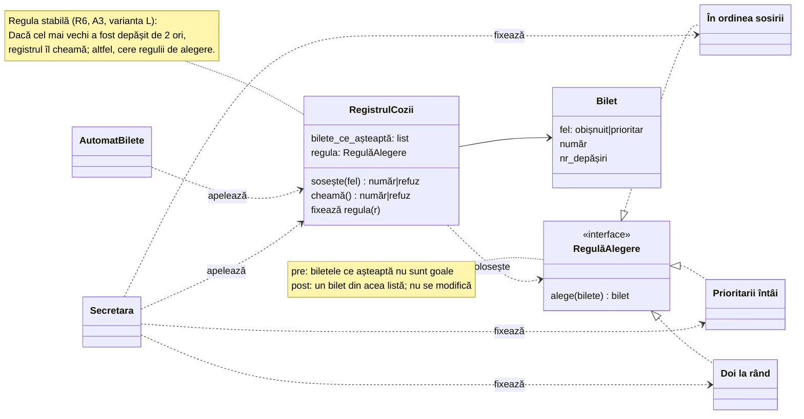

# Diagramă de clase cu interfață — Varianta L

Analizez varianta L: registrul numără depășirile și aplică o logică de supraviețuire (dacă cel mai vechi bilet a fost depășit de 2 ori, îl cheamă oricum; altfel, cere regulii de alegere).

## Diagrama Mermaid

---

## Verificarea pe lista de verificare

**1. Variația: interfața corespunde unei variații din enunț**

Suportare: **R5** — "alegerea urmează regula stabilită de secretariat; regula se schimbă de la o perioadă la alta, fără să se schimbe sosirea și chemarea."

Ce se schimbă la fiecare variantă:
- **C1**: Se adaugă regula „Programații întâi" ca realizare nouă a interfeței; `RegulăAlegere` rămâne neschimbată (primește bilete oricum).
- **C2**: Se adaugă o realizare nouă bazată pe oră; interfața transmite bilete cu atribut oră adăugat (dar structura rămâne).

---

**2. Realizările sunt exact cele din enunț, fiecare cu săgeata ei de realizare**

Suportare: **R5** — „Regulile folosite azi sunt «În ordinea sosirii» și «Prioritarii întâi»"; plus „Doi la rând (propunere de discutat)" din secțiunea Reguli de alegere.

Ce se schimbă:
- **C1**: Se adaugă `Programații întâi` (realizare nouă).
- **C2**: Se adaugă regula bazată pe oră (realizare nouă).

---

**3. Folosirea: componenta comună depinde de interfață, nu de realizări**

Suportare: **R5** — „secretara o fixează de la ghișeu, prin `fixează regula(r)`" și structura apelurilor din R3, R4.

Desenat:
- `RegistrulCozii` depinde de `RegulăAlegere` (sageată punctată „folosește").
- `Secretara` fixează realizări prin operația `fixează regula(r)` pe `RegistrulCozii`.
- Nicio realizare nu este cunoscută direct de `RegistrulCozii` în raport cu celelalte.

Ce se schimbă: Nimic; structura rămâne.

---

**4. Ce trece prin interfață**

Suportare: **R6** — un bilet este depășit când „este chemat un bilet sosit după el", deci regula trebuie să cunoască ordinea și depășirile pentru decizie.

Interfață `alege(bilete)`:
- **Intrare**: lista biletelor care așteaptă, fiecare cu `fel`, `număr`, `nr_depășiri`.
- **Ieșire**: un `bilet` din acea listă.

`RegistrulCozii` verifică apoi dacă cel mai vechi nu a fost depășit de >2 ori (regula stabilă).

Ce se schimbă:
- **C1**: Fel-ul se extinde (obișnuit → obișnuit|prioritar|programat), dar interfață transmite bilete oricum.
- **C2**: Se adaugă oră la `Bilet`, dar `alege(bilete)` primește aceleași obiecte.

---

**5. Regula stabilă stă într-un singur loc**

Suportare: **R6** — "depășire: un bilet care așteaptă este **depășit** când este chemat un bilet sosit după el" și **A3** — "niciun bilet nu este depășit de mai mult de două ori."

Regula din varianta L stă în `RegistrulCozii`:  
*„Dacă cel mai vechi a fost depășit de 2 ori, registrul îl cheamă; altfel, cere regulii de alegere."*

Nicio realizare a `RegulăAlegere` nu repetă și nu poate încălca această logică.

Ce se schimbă: Nimic; regula rămâne.

---

**6. Contractul interfeței**

Suportare: **R6**, **A3** și logica de supraviețuire a variantei L.

Scris:
- **pre**: biletele ce așteaptă nu sunt goale.
- **post**: un bilet din acea listă; biletele nu se modifică.

Ce se schimbă: Nimic.

---

**7. Datele necesare regulii stabile**

Suportare: **R6**, varianta L.

Datele:
- `nr_depășiri` ținut în fiecare `Bilet`, manipulat de `RegistrulCozii`.
- `RegistrulCozii` are acces la `bilete_ce_așteaptă` și aplică regula.

Nicio realizare a regulii nu are nevoie de aceste date; regula e aplicată anterior apelului la `alege(...)`.

Ce se schimbă: Nimic.

---

**8. Schimbările din enunț**

**C1 — Programații:**
- Se adaugă `Programații întâi` (realizare nouă).
- Atributul `fel` al lui `Bilet` se extinde: `obișnuit|prioritar` → `obișnuit|prioritar|programat`.
- Interfața rămâne neschimbată (primește bilete oricum).

**C2 — După oră:**
- Se adaugă o realizare nouă (regula bazată pe oră).
- Atributul `oră` se adaugă la `Bilet`.
- Interfață transmite bilete cu oră; regulile noi le folosesc.

---

## Presupuneri

- Secretara selectează din setul de reguli disponibile (hardcodate sau configurate); diagrama nu arată cum sunt disponibile.
- „Cel mai vechi" = biletul cu cel mai mic număr (sosit cel mai devreme).
- Biletele sunt ținute în ordine crescătoare a numerelor; regula nu sortează.
- Fiecare realizare a `RegulăAlegere` este stateless și poate fi re-folosită pentru orice apel.
- Apelurile sunt secvențiale (**R1**); nu modelez paralelism.
- O realizare care **de fapt** nu respectă contractul (ex. întoarce un bilet deja chemat) strica **A1**, dar nu e responsabilitatea diagramei să verifica runtime; contractul o assume.
- Registrul stochează o referință la realizarea curentă (`regula: RegulăAlegere`), nu o crează local.