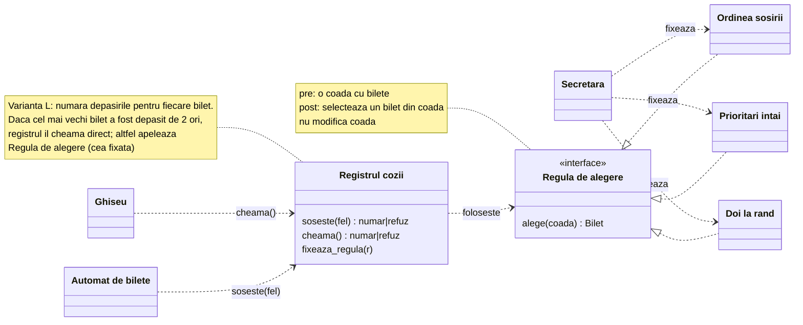

# Diagrama de clase cu interfață — Varianta L

---

## Verificare — Lista de verificare

**1. Variația:** interfața corespunde unei variații din enunț; nu există interfețe pentru lucruri care nu variază.

- **Regula din enunț:** R5 — „Regula se schimbă de la o perioadă la alta, fără să se schimbe sosirea și chemarea."
- **Satisfacție:** Interfața `Regula de alegere` corespunde exclusiv variației din R5. Componentele Registru, Automat, Ghișeu nu variază și nu au interfață.

**2. Realizările sunt exact cele din enunț, fiecare cu săgeata ei de realizare spre interfață.**

- **Regula din enunț:** R5 — „Regulile folosite azi sunt 'În ordinea sosirii' și 'Prioritarii întâi'" și secțiunea Reguli de alegere care adaugă „Doi la rând".
- **Satisfacție:** Trei realizări: `Ordinea sosirii`, `Prioritari intai`, `Doi la rand`. Săgeți punctate de la fiecare la interfață (realizare). Varianta L nu introduce o nouă realizare a regulei, ci o logică din Registru (v. punctul 5).

**3. Folosirea:** componenta comună depinde de interfață, nu de realizări. Este desenat cine fixează realizarea și prin ce operație ajunge la componenta comună.**

- **Regula din enunț:** R5 — „secretara ... fixează ... prin `fixează regula(r)`"; R4 — `cheamă()` acceptat din ghișeu; R3 — `sosește(fel)` din automat.
- **Satisfacție:** `Registru` depinde de `Regula de alegere` (foloseste). `Secretara` fixează realizări și transmite prin operația `fixeaza_regula(r)` a Registrului. `Ghiseu` și `Automat` apelează operații din Registru.

**4. Ce trece prin interfață:** operațiile interfeței primesc numai ce le trebuie realizărilor pentru decizia lor și întorc un rezultat pe care apelantul îl poate verifica.**

- **Regula din enunț:** R5 — alegerea urmează regula; R6 — un bilet e depășit când e chemat altul mai nou.
- **Satisfacție:** Interfață oferă `alege(coada) → Bilet`. Coada conține biletele cu numere, feli și numărul de depășiri. Rezultatul (un Bilet) permite Registrului să verific că biletul a fost scos. Nu trece prin interfață nicio informație despre limite (N din R3), despre starea globală sau despre implementarea Registrului.

**5. Regula stabilă stă într-un singur loc, în componenta comună; nicio realizare nu o repetă și nicio realizare nu o poate încălca.**

- **Regula din enunț:** A3 — „niciun bilet nu este depășit de mai mult de două ori"; Varianta L — „dacă cel mai vechi bilet a fost depășit de două ori, registrul îl cheamă."
- **Satisfacție:** Regula stabilă (A3 + logica L) stă exclusiv în `Registru`. Atunci când `cheama()` e apelat:
  - Registru numără depășirile pentru fiecare bilet (atribut implicit din coada)
  - **Dacă** cel mai vechi bilet a fost depășit de 2 ori, Registru o selectează direct și o scoate
  - **Altfel,** apelează `alege(coada)` pe realizarea Regulei fixate
  
  Nicio realizare a Regulei (Ordinea, Prioritari, Doi) nu poate rescrie această logică sau o depăși — Registru garantează A3 prin selectarea forțată.

**6. Contractul interfeței este scris: ce presupune (`pre:`), ce garantează orice realizare (`post:`), inclusiv ce nu modifică.**

- **Regula din enunț:** R6 — depășire; R4 — scoatere din coadă; R5 — alegere conform regulei.
- **Satisfacție:** Notă pentru `Regula de alegere`: 
  - `pre: o coada cu bilete` (fiecare cu număr, fel, depășiri)
  - `post: selecteaza un bilet din coada; nu modifica coada`
  
  Orice realizare garantează că biletul returnat aparține cozii și că coada nu e modificată.

**7. Datele necesare regulii stabile sunt la componenta care o aplică sau la obiectele pe care le ține ea.**

- **Regula din enunț:** A3; Varianta L — „registrul numără depășirile."
- **Satisfacție:** Regula stabilă (A3 + logica L) se aplică din `Registru`. `Registru` ține coada de bilete; fiecare bilet are atribute: număr, fel, **depășiri** (implicit din definiția A3 și R6). Datele sunt aici, nu se cer de la Regula de alegere. Realizările Regulei nu au acces la depășiri și nu pot contrazice A3.

**8. Schimbările din enunț: pentru fiecare, puteți arăta pe diagramă ce se adaugă și ce se modifică.**

- **C1 — Programați:**
  - **Regula din enunț:** „apare felul **programat** și regula 'Programații întâi': cel mai vechi bilet programat; dacă nu așteaptă niciunul, ca 'Prioritarii întâi'."
  - **Modificări pe diagramă:** 
    - Se adaugă o nouă realizare `Programatii_intai` legată de `Regula de alegere`
    - `Secretara` fixează și aceasta (`Secretara ..> Programatii_intai : fixeaza`)
    - Registru nu se modifică — continuă să apeleze `alege(coada)` prin Regula curenta fixată
    - Varianta L rămâne aceeași: A3 e garantată indiferent de ce realizare e fixată

- **C2 — După oră:**
  - **Regula din enunț:** „o regulă nouă alege și după ora la care a fost luat biletul."
  - **Modificări pe diagramă:**
    - Se adaugă o nouă realizare (ex. `Dupa_ora`) legată de `Regula de alegere`
    - `Secretara` fixează și aceasta
    - Atributele unui Bilet se extind cu ora sosirii (but implicit în model, nu schimbă diagrama)
    - Registru și Varianta L rămân neschimbate; logica L continuă să garanteze A3

---

## Presupuneri

1. **Varianta L nu introduce o nouă interfață** de alegere, ci o nouă **logică din Registru**. Regula de alegere (interfață) rămâne aceeași; schimbare este în cum Registru o apelează (cu prioritate pentru A3).

2. **Secretara este o componentă software** (actor) care execută operația `fixeaza_regula(r)` pe Registru pentru a instanța o realizare a Regulei de alegere.

3. **Interfața Regulei de alegere** are o singură operație: `alege(coada) → Bilet`. Coada este o structură implicită care conține biletele cu atribute: număr, fel, depășiri.

4. **Depășirile sunt numere pentru fiecare bilet**, implicite din R6 și A3. Registru le ține și le accesează din coada; Regula de alegere nu le vede (nu trec prin interfață pentru decizii de selecție în Ordinea, Prioritari, Doi).

5. **Regula stabilă (A3) este gestionată exclusiv de Registru**, nu de Regula de alegere. Varianta L garantează că niciun bilet nu e depășit de mai mult de 2 ori, indiferent de realizare.

6. **Varianta L implementează A3 prin:**
   - Numărare automată a depășirilor (Registru ține cont când alt bilet e chemat)
   - Selecție forțată: dacă cel mai vechi bilet a fost depășit de 2 ori, `cheama()` îl selectează direct
   - Altfel: apelează Regula de alegere (cea fixată) pentru a obține alegerea

7. **Registru stochează o referință la realizarea Regulei de alegere** fixată de Secretara și o apelează la fiecare `cheama()` (cu exceția cazului A3 din L).

8. **Ghișeu și Automat sunt componente care inițiază apeluri**, dar Secretara (implicit) controlează Registru. Diagrama nu arată ordonarea temporală, doar dependență structurală.

9. **Biletele nu sunt explicit desenate ca clasă** în diagrama de clase cu interfață (ar fi detaliu de implementare). Sunt presupuse ca fiind obiecte cu atribute: număr, fel, depășiri.