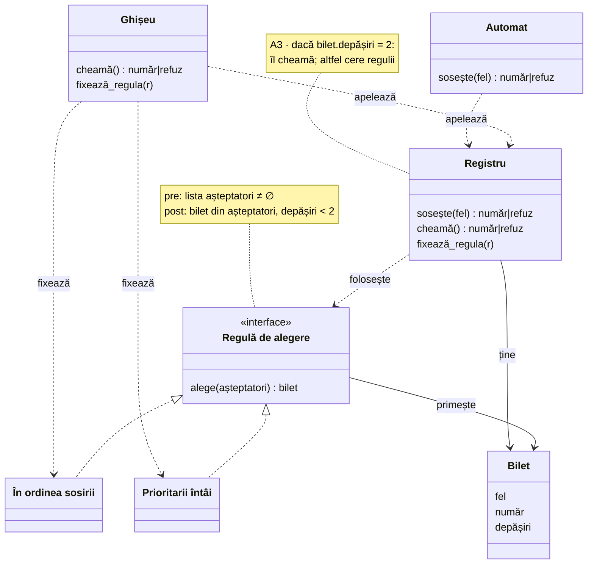

Citesc enunțul și specificația. Varianta L adaugă logica de numărare a depășirilor în Registru, care devine regula stabilă. Voi desena diagrama și o voi verifica pe lista de puncte.

---

## Verificare pe lista de puncte

**1. Variația: interfața corespunde unei variații din enunț; nu există interfețe pentru lucruri care nu variază.**

✓ **Da.** Din **R5**: „alegerea urmează regula stabilită de secretariat" care se schimbă de la o perioadă la alta. Interfața `RegulăAlegere` corespunde acestei variații. Automat și Ghișeu nu variază — nu au interfață.

**2. Realizările sunt exact cele din enunț, fiecare cu săgeata ei de realizare spre interfață.**

✓ **Da.** Două realizări din enunț: 
- „În ordinea sosirii" (R5, Reguli de alegere)
- „Prioritarii întâi" (R5, Reguli de alegere)

**3. Folosirea: componenta comună depinde de interfață, nu de realizări. Este desenat cine fixează realizarea și prin ce operație.**

✓ **Da.** Din **R5**: „secretara o fixează de la ghișeu, prin `fixează regula(r)`". 
- Registru depinde numai de `RegulăAlegere`
- Ghișeu fixează realizarea prin operația `fixează_regula(r)` și transmite-o Registrului (săgeată de la Ghișeu la realizări, cu eticheta „fixează")

**4. Ce trece prin interfață: operațiile interfeței primesc numai ce le trebuie realizărilor pentru decizia lor și întorc un rezultat pe care apelantul îl poate verifica.**

✓ **Da.** Din **R5** și **R6** (depășire):
- `alege(așteptatori)` primește lista biletelor care așteaptă (cu atributele fel, număr, depășiri)
- Întoarce un bilet pe care Registrul îl va chema
- Registrul verifică dacă `bilet.depășiri < 2` pentru a aplica regula A3

**5. Regula stabilă stă într-un singur loc, în componenta comună; nicio realizare nu o repetă și nicio realizare nu o poate încălca.**

✓ **Da.** Din **A3 — așteptare limitată**: „niciun bilet nu este depășit de mai mult de două ori".  
Regula stă în **Registru** (în notă): `dacă bilet.depășiri = 2: îl cheamă; altfel cere regulii`. 
- Nicio realizare de `RegulăAlegere` nu o cunoaște sau repetă
- Nicio realizare nu poate face biletul să depășească 2 depășiri, pentru că decizia nu merge prin ea

**6. Contractul interfeței este scris: ce presupune (pre:), ce garantează orice realizare (post:), inclusiv ce nu modifică.**

✓ **Da.** Contractul pe `RegulăAlegere`:
- `pre: lista așteptatori ≠ ∅` (din **R4**: acceptat numai dacă așteaptă cel puțin un bilet)
- `post: bilet din așteptatori, depășiri < 2` (orice realizare alege un bilet care nu va duce la depășire peste limită; lista rămâne neschimbată)

**7. Datele necesare regulii stabile sunt la componenta care o aplică.**

✓ **Da.** Registru ține:
- Coada de bilete (pentru a verifica depășirile)
- Pentru fiecare bilet: `fel`, `număr`, `depășiri`
- Regula curând fixată (referință la `RegulăAlegere`)

**8. Schimbările din enunț: pentru fiecare, puteți arăta pe diagramă ce se adaugă și ce se modifică.**

Fiecare schimbare:

- **C1 — programați**: Apare un tip nou de bilet (`fel = programat`). Se adaugă o realizare nouă `ProgramațiFîntâi` cu regula „Programații întâi: cel mai vechi bilet programat; dacă nu așteaptă niciunul, ca `PrioritariÎntâi`". Contractul interfeței se schimbă: `alege` primește și bilete de tip programat; Registru nu se modifică. 

- **C2 — după oră**: Regula de alegere primește mai mult decât lista — și ora fiecărui bilet. Interfața se schimbă: `alege(așteptatori, ore)` → bilet. Realizările noi folosesc ora; cele vechi ignoră. Registru ține și orele.

---

## Presupuneri

1. Biletele care așteaptă sunt ordonate după timp de sosire (pentru a detecta depășiri).
2. O depășire se contorizează când Registru cheamă un alt bilet; cea mai veche se depășește.
3. Registru implementează și logica `sosește` și `cheamă`, nu o delegă regulii de alegere.
4. Interfața `RegulăAlegere` alege numai dintre biletele care nu au fost deja depășite de 2 ori.
5. Ghișeu nu cunoaște detaliile Registrului; doar îi apelează operațiile.
6. Nu modelez durata între sosire și chemare, nici plecarea unui student — în linie cu **R1**.
7. Atributul `depășiri` al Biletului este actualizat de Registru la fiecare chemare.
8. Realizările nu comunică între ele și nu au stare în comun.