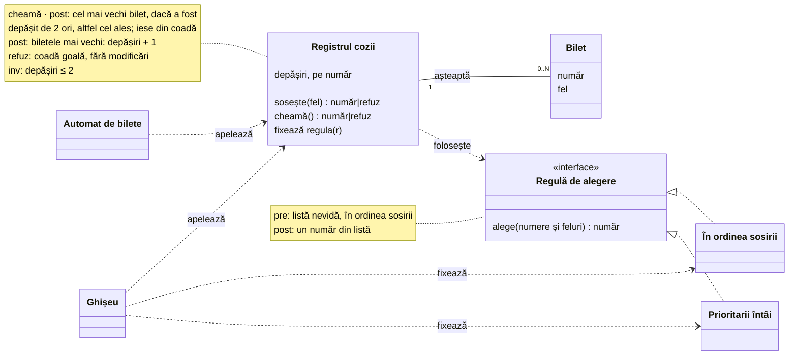

# Raționament de referință — biletele de ordine

Material de pregătire pentru [enunț](scenario.md), construit didactic; nu captură AI.

## Proprietățile

| Proprietatea | Ce o infirmă | Ce o stabilește |
|---|---|---|
| A1 (chemat o dată) | o execuție în care același bilet este chemat de două ori | argument: la chemare, biletul iese din coadă (R4), iar numerele nu se refolosesc (R2, R3) |
| A2 (fără blocaj) | o stare accesibilă cu bilete care așteaptă, în care `cheamă()` este refuzat | argument: R4 acceptă chemarea ori de câte ori există un bilet; regula de alegere întoarce unul |
| A3 (așteptare limitată) | o execuție în care un bilet este depășit de trei ori | pentru N dat: explorarea; pentru orice N: un argument |

## Scenariile

| Scenariu | În ordinea sosirii | Prioritarii întâi | Doi la rând | Varianta L, cu Prioritarii întâi |
|---|---|---|---|---|
| S1 (câte unul) | o1, p2 | p2, o1; o1 depășit o dată | p2, o1; o1 depășit o dată | p2, o1; o1 depășit o dată |
| S2 (un obișnuit) | o1, p2, p3; nicio depășire | p2, p3, p4; o1 depășit de trei ori: **A3 infirmată** | p2, p3, o1; o1 depășit de două ori | p2, p3, o1; o1 depășit de două ori |
| S3 (doi obișnuiți) | o1, o2, p3, p4 | p3, p4, p5, o1; o1 și o2 depășiți de trei ori: **A3 infirmată** | p3, p4, o1, p5; o2 depășit de trei ori: **A3 infirmată** | p3, p4, o1, o2; o1 și o2 depășiți de două ori |

Trasarea lui S3 sub „Doi la rând”: după sosirea lui o1, o2, p3, prima chemare ia p3 (o1 = 1, o2 = 1); sosește p4, chemat (2, 2); sosește p5; doi prioritari la rând, deci este chemat o1 (o2 nu este depășit de o1, sosit înaintea lui); numărătoarea repornește; ultima chemare ia p5 (o2 = 3). Cu N = 2 contraexemplul nu există: cei doi obișnuiți ar ocupa ambele locuri, iar R3 ar refuza sosirea prioritarilor; cu un singur obișnuit, acesta este chemat după cel mult doi prioritari.

## Rezultatele explorării

`python explorare.py`, 24 noiembrie 2026, Python 3.10.11; ieșirile complete sunt în [`model/rezultate.txt`](model/rezultate.txt). În program, varianta L cu „Prioritarii întâi” se numește `limita`.

| Regula | N = 2 | N = 3 | N = 4 | N = 5 |
|---|---|---|---|---|
| În ordinea sosirii | 7 stări, A3 da | 15, da | 31, da | 63, da |
| Prioritarii întâi | 16, **nu** | 54, **nu** | 148, **nu** | 361, **nu** |
| Doi la rând | 33, da | 142, **nu** | 479, **nu** | 1302, **nu** |
| Varianta L | 13, da | 38, da | 94, da | 213, da |

Modelul reține felul și depășirile biletelor (oprite la trei), nu numerele lor: altfel ar avea infinit de multe stări. Este o presupunere a modelului: numerele nu contează pentru alegere, numai ordinea.

Propunerea „un singur prioritar, apoi un obișnuit” respectă A3 cu N = 2 (27 de stări) și N = 3 (99) și o încalcă cu N = 4 (386 de stări): este nevoie de trei obișnuiți.

## Argumentul pentru varianta L, orice N și orice regulă

Fie două bilete care așteaptă, v (mai vechi) și n (mai nou). Orice bilet chemat care îl depășește pe n a sosit după n, deci și după v: îl depășește și pe v. Prin urmare, cel mai vechi bilet are cel puțin atâtea depășiri ca oricare altul. Când cel mai vechi a ajuns la două, registrul îl cheamă, iar chemarea lui nu depășește pe nimeni. Dacă cel mai vechi are cel mult una, toate au cel mult una, iar o chemare adaugă cel mult una fiecăruia. Deci niciun bilet nu trece de două depășiri. Este un invariant: adevărat pentru coada goală și păstrat de fiecare eveniment (cursul 6). Argumentul nu folosește regula de alegere; folosește numai faptul că ea întoarce un bilet care așteaptă.

## Varianta E față de varianta L

| | Varianta E (fiecare regulă) | Varianta L (limita în registru) |
|---|---|---|
| Cine răspunde de A3 | fiecare regulă de alegere | registrul |
| Ce trece prin interfață | biletele, cu depășirile lor | biletele, cu număr și fel |
| La C1 (programați) | A3 se reverifică pentru regula nouă | A3 nu se reverifică |
| Cost | verificare la fiecare regulă | regula aleasă nu este respectată întotdeauna; de întrebat beneficiarul |

## Diagrama de referință

Specificația este [`lab/diagrame/clase-interfata.md`](../../diagrame/clase-interfata.md); aceeași diagramă apare pe slide-ul „Diagrama de referință”.

Justificarea, după lista de verificare:

1. **Variația:** regula de alegere (R5). Biletul, automatul și ghișeul nu variază.
2. **Realizările:** cele două reguli folosite azi (R5). „Doi la rând” este o propunere pe care explorarea a infirmat-o, deci nu apare; poate apărea ca a treia realizare: sub varianta L, A3 ar fi respectată și de ea.
3. **Folosirea:** registrul depinde numai de interfață. Regula este fixată de secretară, de la ghișeu, prin `fixează regula(r)` (R5); o componentă separată, „Secretariat”, este acceptabilă.
4. **Ce trece prin interfață:** numerele și felurile biletelor care așteaptă, în ordinea sosirii. Nu trec depășirile (nu contează pentru alegere; date odată cu biletele, ar putea fi modificate) și nici registrul. Rezultatul, un număr, poate fi verificat de registru: aparține unui bilet care așteaptă? Dacă nu, `cheamă()` nu are ce garanta; registrul poate alege cel mai vechi bilet. Enunțul nu spune: decizie de notat.
5. **Regula stabilă:** A3, la registru; argumentul de mai sus arată că nicio realizare care întoarce un bilet care așteaptă nu o poate încălca.
6. **Contractul:** `alege` presupune o listă nevidă (registrul o apelează numai când așteaptă un bilet) și întoarce numărul unui bilet din listă, fără să o modifice.
7. **Datele:** depășirile sunt la registru, pe număr; le actualizează la chemare (R6). Pot fi și atribut al biletului, dacă prin interfață trec numai copii cu număr și fel.
8. **Schimbările:** C1 adaugă realizarea „Programații întâi” și o valoare a felului; modifică ghișeul, care fixează regula, și automatul, care dă biletele programate. C2 adaugă o realizare și modifică biletul (ora sosirii), registrul, care o înregistrează la `sosește`, și contractul interfeței; realizările existente ignoră ora.

**Neacceptabile:** registrul legat de realizări; limita scrisă în realizări (varianta E) pe diagrama cerută pentru L; `alege(registru)`; săgeata realizării inversată; interfețe fără variație.
